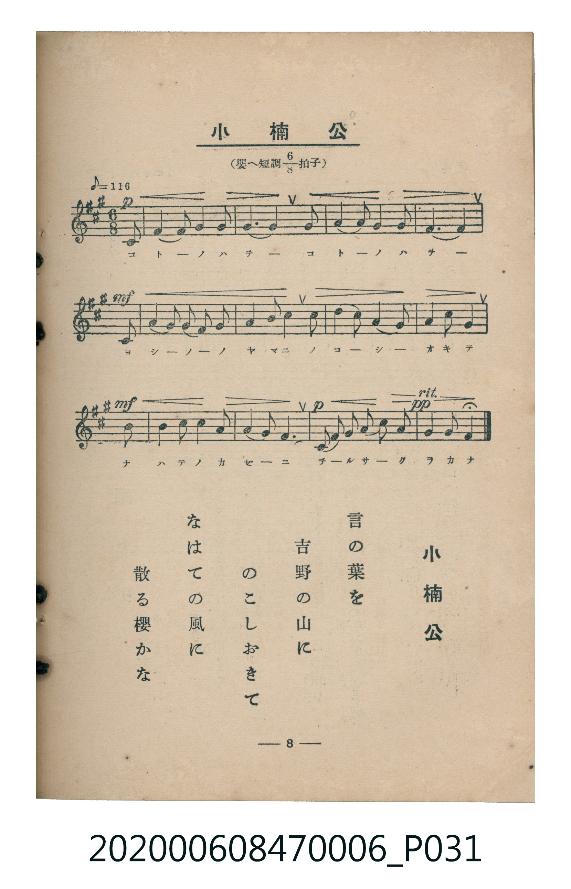

# 小楠公

> Re:Shoka 使用 AI 辨識樂譜，可能會有錯誤。歡迎回報。

<audio controls src="sho_nanko.mp3"></audio>

- 臺灣教育會公認《新定兒童唱歌》尋常科第六學年用（2020.006.0847.0006）

## 說明

原書資訊與歌詞全文（對應 P031.jpg，書頁 p. 8，第一學期第 7 首）：
調性與拍號：嬰へ短調八分之六拍子（F# 小調 6/8 拍，弱起 1 拍），♪=116

## 跨冊／重複收錄參照

> 同曲（〈小楠公〉；收錄於《新定兒童唱歌》六年級與《唱歌帖》P089）

- **[同曲]** 楊金土手抄《唱歌帖》第 2 冊・II（2020.006.0843）：[**〈小楠公〉**](../../../shokacho/vol_02/p089_sho_nanko/index.md)（`A` / `6/8` — [原始 TMD](../../../shokacho/vol_02/p089_sho_nanko/sho_nanko.tmd)）
- 總表：[跨冊重複與同名歌曲總索引](../../../duplicate_songs.md)

## 歌詞

```text
言の葉を
吉野の山に
のこしおきて
なはての風に
散る櫻かな
```

## ABC

```abc
X:1
T:小楠公
M:6/8
L:1/16
Q:3/8=39
K:F#m
V:V1 name="Piano" snm="Pia"
[V:V1]
!p! z2 z2 z2 z2 z2 C2 | F4 F2 G4 G2 | A6 F4 F2 | G4 G2 A4 B2 |
!mf! G10 C2 | F4 G2 A4 B2 | c4 d2 c4 B2 | c4 d2 c4 F2 |
!mf! A4 G2 F4 c2 | d4 d2 c4 A2 | !p! B4 G2 F4 C2 | F4 A2 G4 B2 |
!pp! A4 G2 F4 z2 |
```

## TMD 檔案連結

- [主旋律 TMD 檔案](sho_nanko.tmd) [[在 TMD Studio 編輯](https://tmdlang.github.io/Tmd-TS/#tmd=s7IKdvYPcrWy4qpTUCpJTLdSSM7PyUlNLsnMz7MqzsjMK0nNjM_KTMmPL87Iz05Ugisry88pzU21Si9KTEmNN4s3MjAyiDcwMIs3sDAxBzIMzBBKi_NLi5JTrYqTM_Lzc-JLUitKkvLzsxHyBUX5Zal5iXlANQVFIBtTwIoQClLLMlNSQdKpKZkl-UWZiTlI7kgtKga7FWxJfElRYl5xclFmAcgDCFUlGalAx2ZkFgO1V6IL52bmZJYkgsS1tBSebuh_tnTB09Y1ClpaXIq2CqYWXPa2Co5c2amVtgpuyrlcNmb6FnYgE16073reuPjZ1JkvmjY9m9MM1PJiVe_jhq5n0zY8XTfraeuk56uXPp2y8dnanscN3U83dD_dseP58onP16x52rr26dodT3dueT5lxfs9HaCg0wMGmB4o6IAMA7P3ezqVuLj0tRRsqQW4FBQUnvbNfzZ7x4vN7S9WdL3oaAe668XKeU9bVzyb1g50xdMNvc_aOxUCDIwN9bIK0t_v6QEqfrmgUaFAT8ECyAO6-8mOBqC7n82ZD2QrmCu8XDYN6ND3e2aBDH-xav-zhuUgY7t7X8ycDxR9umbD48Ydz-evBUo9bV39tKPtyc5uoNeBCp6unQC00U0ZFNhAWQVgiCoAhYG2PN2z8cXW7QqGEC7Q8J5HM1fZGhqacYEtWdHwuHHdi4mdj5smgX00ofNlex9Q6OnGjY8bV4OEgJzHjZMfN05_3Nj1uLH3ceMyiOiqx43rgRyg9MtFK6Bqn01d_Lip-9nq3Y8bu4EqQEKUhzQUKGjpc3EFZ-T7JeZl51sFZCbm5TvUGNQoVINsUbCx0LIDM7DFsQIkqF8s7FHQgIaHtoIJKKyer2_QgceQJhadQEtBptYoGMBhdUGtgnE8UMgsXkEXRJiDaCBRAwxlXYgQmKiBy4DEjWB8CKzOTYMYA44H3M7e1QN2NomuBTsByWJjIG0CJlF5YFeCFAHVgvVAnEXQVTs6yXGVCdxeQyDPCNlalDA1hAQUyKnVBUAZZAcaAN1Wy8Wla6cASwsKQLYyFxcA)]
- [鋼琴伴奏 TMD 檔案](sho_nanko_piano.tmd) [[在 TMD Studio 編輯](https://tmdlang.github.io/Tmd-TS/#tmd=s7IKdvYPcrWy4tLSUni6of_Z0gVPW9e839PxsnvP8wlbnuzZ8nRp__POjvd7OhW0tLgUbRVMLbjsbRUcubJTK20V3JRzuWzM9C3suOoUlF6073reuPjZ1JkvmjY9m9MMNOfFqt7HDV3Ppm14um7W09ZJz1cvfTpl47O1PY8bup9u6H66Y8fz5ROfr1nztHXt07U7nu7c8nzKCqDVRgZGBnoGBmZ6BhYm5kCGgRnQdiUuruCMfL_EvOx8q4DMxLz8IA-HGoMahWouBSCwsdCyAzP0tRRs0YEC0IonOxpeLOxR0AgwMDbUyypI18SiTEsfbESNggEcVhfUKhjHA4XM4hV0QYQ5iAYSNQqGQAZYCEzUwGVA4kYwPgRW56ZBjOHC78ZdPcS7EWwxknXGQNoETKLywG4DKQKqBeuBOIagW3Z0Eu8WE7hthkCeEbJlKOFnCAkUkAOrC4AyyM4yALqoFj2OfbDGMXoEAbUCzYAEtzGURojAaGCg4BSBRxLIFbDwRVdsCGFAKTgfl_lo5hmh6QbzQTqgqnH6AxxSqEZDw0rXTgEWXApobGUuLgA)]

## 分析

```text
================================================================================
📊 TMD Song Profile: [ 小楠公 ]
================================================================================
⏱  Duration:       0:40 (40.3s), 13 measures total
🎼 Key & Tempo:    首調基準 A, != 58.0 BPM, <6/8>
   - 分析範圍：      由實際發聲的音符與和弦推測調性；播放脈絡另行呈現
🎤 人聲音域:    C#4 (MIDI 61) – D5 (MIDI 74) [跨度: 13 個半音 / 1.1 個八度, 難度: moderate]
   - 最低音:  C#4 in [ShoNanko #1 @ m.1, 0:02]
   - 最高音: D5 in [ShoNanko #1 @ m.7, 0:19]
   - 適合: soprano, mezzo-soprano, contralto, tenor, baritone, bass
🏛  結構:      ShoNanko (40.3s)
⚡ 編曲密度:        Peak 1 軌道同時演奏
🗝  調性診斷：       F# 小調（純淨自然小調，未偵測到可信轉調）
   - 風格氣質:    純淨自然小調（陰鬱抒情、旋律集中，無明顯調外色彩）
   - 轉調歷程:    全曲維持單一推測調性（未偵測到可信轉調）
   - 核心骨幹音:  F#, G#, C#, A, B
   - 調性數值:    F# 小調 [相關度: 0.81, 穩定度: High, 自然音純度: 100.0%]
   - 候選調性 (K-S): F# 小調 (0.81), F# 大調 (0.53), C# 小調 (0.50)
   - 五度圈歷程:   +6
   - 各段落調性細節:
     • [ShoNanko #1]: F# 小調 (r: 0.81, 自然音純度: 100.0%)

  [ 五度圈游移軌跡 ]
               C  
         F            G  
      Bb               D  
      Eb               A  
         Ab           E  
            Db       B  
              [F#]*
     (* = active key center)

  [ 十二半音累積音高分佈 ]
     C  :                            0.0%
     C# : ████████████████████      19.4%
     D  : ███████                    6.9%
     D# :                            0.0%
     E  :                            0.0%
     F  :                            0.0%
     F# : ████████████████████████  23.6%
     G  :                            0.0%
     G# : ████████████████████████  23.6%
     A  : ██████████████████        18.1%
     A# :                            0.0%
     B  : ████████                   8.3%
--------------------------------------------------------------------------------
Assignment 軌道音域：
  - Piano         : C#4 – D5 (13 個半音 / 1.1 個八度, 45 個音符)
================================================================================
```


## 原書掃描頁




