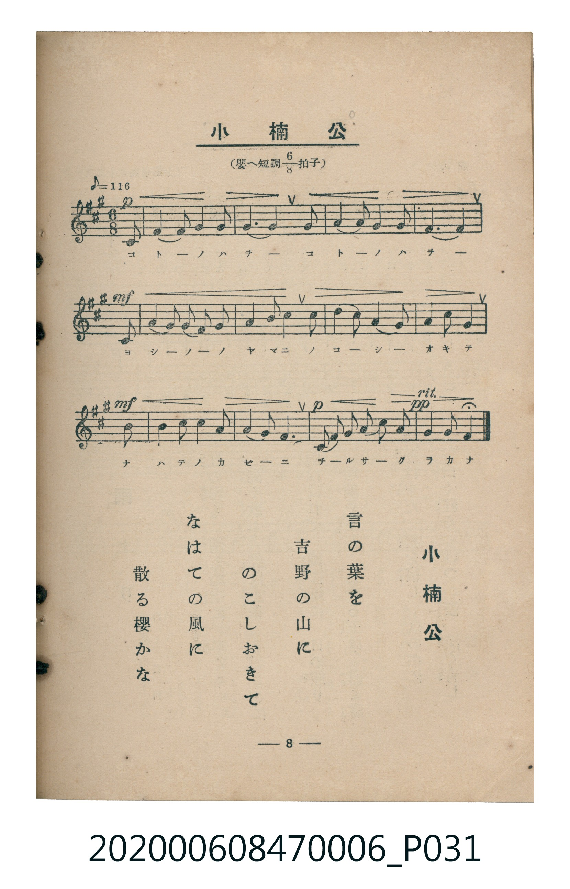

# 小楠公

> Re:Shōka 使用 AI 協助辨識與重建樂譜，可能會有錯誤。歡迎回報。

- **鋼琴伴奏版**：<br><audio controls src="sho_nanko.mp3"></audio>
- **NEUTRINO 歌聲合成版**：<br><audio controls src="sho_nanko_neutrino.mp3"></audio>

- 臺灣教育會公認《新定兒童唱歌》尋常科第六學年用（2020.006.0847.0006）

## 說明

原書資訊與歌詞全文（對應 P031.jpg，書頁 p. 8，第一學期第 7 首）：
調性與拍號：嬰へ短調八分之六拍子（F# 小調 6/8 拍，弱起 1 拍），♪=116


## 歌詞

```text
言の葉を
吉野の山に
のこしおきて
なはての風に
散る櫻かな
```

## ABC

<div class="abc-score" data-abc-src="sho_nanko.abc" aria-label="五線譜載入中"></div>

[下載 ABC 原始檔](sho_nanko.abc)

## TMD 檔案連結

- [主旋律 TMD 檔案](sho_nanko.tmd) [[在 TMD Studio 編輯](https://tmdlang.github.io/Tmd-TS/#tmd=s7IKdvYPcrWy4qpTUCpJTLdSSM7PyUlNLsnMz7MqzsjMK0nNjM_KTMmPL87Iz05Ugisry88pzU21Si9KTEmNN4s3MjAyiDcwMIs3sDAxBzIMzBBKi_NLi5JTrYqTM_Lzc-JLUitKkvLzs9Hl4wsS01OtAgyMDREyBUX5Zal5iXlA3QVFILekgLUjFKSWZaakgqSLkxPz4stSizLTMlNTkFyZWlQM9gnEipKixLzi5KLMApD3EKryi0oy8oE-KciotMrILC7JL8pMTsyJz07MQ_JwSUYq0L8Q6Up04dzMnMySRGRxoBnpmXlWufl5SaXAoFPi0tJSeLqh_9nSBU9b1yhoaXEp2iqYWnDZ2yo4cmWnVtoquCnnctmY6VvYgYx40b7reePiZ1Nnvmja9GxOM1DLi1W9jxu6nk3b8HTdrKetk56vXvp0ysZna3seN3Q_3dD9dMeO58snPl-z5mnr2qdrdzzdueX5lBXv93SAokUPGBl6oGgBMgzM3u_pVOLi0tdSsKUW4FJQUHjaN__Z7B0vNre_WNH1oqMd6K4XK-c9bV3xbFo70BVPN_Q-a-9UAMWtXlZB-vs9PUDFLxc0KhToKVgAeUB3P9nRAHT3sznzgWwFc4WXy6YBHfp-zyyQ4S9W7X_WsBxkbHfvi5nzgaJP12x43Ljj-fy1QKmnraufdrQ92dkN9DpQwdO1E4A2uimDAhsoqwAMUQWgMNCWp3s2vti6XcEQwgUa3vNo5ipbQ0MzLrAlKxoeN657MbHzcdMksI8mdL5s7wMKPd248XHjapAQkPO4cfLjxumPG7seN_Y-blwGEV31uHE9kAOUfrloBVTts6mLHzd1P1u9-3FjN1AFSIjykIYCBS19Lq7gjHy_xLzsfKuAzMS8fIcag5pqkCUKNhZadmAGtihWgIT0i4U9ChrQ4NBWMAEF1fP1DTrwCNLEohNoJ8jUGgUDOKwuqFUwjgcKmcUr6IIIcxANJGogLAgE8w2BDEMkebAOCKzOTYMYAzbfp0YhHg6BoQ1U-7hxBVghMHzB5HqQWNMkuAFEqmrqAFqBP2R29YBDhsQAAfkN6CkgggQBRMRIwRhIGgN5JmAaqgoiaQwJCrDXjRA-ByYtFD-sA_uhBczeB8SrEaJAP0NUQnSARLrA_F4gXgZmrSLo3x2d5PjXCOwBkO8MEb6HRmgNLFFAgsIQ7HGQIFAUFvtgpQbIvl4Pdu8yuL-7wf6ZA_UhyNcQHy4Ex2M3kDUVLNMPDp9OqB6Qj3WBqaaGq5aLS9dOAZZDFIBsZS4A)]
- [鋼琴伴奏 TMD 檔案](sho_nanko_piano.tmd) [[在 TMD Studio 編輯](https://tmdlang.github.io/Tmd-TS/#tmd=s7IKdvYPcrWy4tLSUni6of_Z0gVPW9e839PxsnvP8wlbnuzZ8nRp__POjvd7OhW0tLgUbRVMLbjsbRUcubJTK20V3JRzuWzM9C3suOoUlF6073reuPjZ1JkvmjY9m9MMNOfFqt7HDV3Ppm14um7W09ZJz1cvfTpl47O1PY8bup9u6H66Y8fz5ROfr1nztHXt07U7nu7c8nzKCqDVRgZGBnoGBmZ6BhYm5kCGgRnQdiUuruCMfL_EvOx8q4DMxLz8IA-HGoOaai4FILCx0LIDM_S1FGzRgQLQhic7Gl4s7FHQCDAwNtTLKkjXxKJMSx9sRI2CARxWF9QqGMcDhcziFXRBhDmIBhI1EBYEgvmGQIYhkjxYBwRW56ZBjAGb71OjEA-HjxsnA9U-blwBVvi4cR2YXA8Sa5oEN4BIVU0dQCvwB8OuHuKDAeQjoFeACOJxiIiRgjGQNAbyTMA0VBVE0hgSAGAPGyH8-7hxOorL14Fd3gJm7wPi1QhRoE8hKiE6QCJdYH4vEC8Ds1YR9OWOTuJ9aQR2NshPhgg_QyOvBpYAIAFgCPYuSBAoCotpsFIDZL-uB7tyGdy33WBfzIH6C-RXiL8WguOsG8iaCpbpB4dKJ1QPyJ-6wBRSw1WLnvJ9sKV89GQLdBLQbRB_GEPpGjgLBLGrgInAEy7Mb_gUG8IEjEAMIA8iAVKIrg3NTLAGJANgZsM0QaIAwx5wFKCqBZkJDCpdOwVYaCkA2cpcAA)]

## 分析

```text
================================================================================
📊 TMD Song Profile: [ 小楠公 ]
================================================================================
⏱  Duration:       0:40 (40.3s), 13 measures total
🎼 Key & Tempo:    首調基準 A, != 58.0 BPM, <6/8>
   - 分析範圍：      由實際發聲的音符與和弦推測調性；播放脈絡另行呈現
🎤 人聲音域:    C#4 (MIDI 61) – D5 (MIDI 74) [跨度: 13 個半音 / 1.1 個八度, 難度: moderate]
   - 最低音:  C#4 in [ShoNanko #1 @ m.1, 0:02]
   - 最高音: D5 in [ShoNanko #1 @ m.8, 0:21]
   - 適合: soprano, mezzo-soprano, contralto, tenor, baritone, bass
🏛  結構:      ShoNanko (40.3s)
⚡ 編曲密度:        Peak 1 軌道同時演奏
🗝  調性診斷：       F# 小調（純淨自然小調，未偵測到可信轉調）
   - 風格氣質:    純淨自然小調（陰鬱抒情、旋律集中，無明顯調外色彩）
   - 轉調歷程:    全曲維持單一推測調性（未偵測到可信轉調）
   - 核心骨幹音:  G#, A, F#, C#, B
   - 調性數值:    F# 小調 [相關度: 0.68, 穩定度: High, 自然音純度: 100.0%]
   - 候選調性 (K-S): F# 小調 (0.68), C# 小調 (0.49), C# 大調 (0.49)
   - 五度圈歷程:   +6
   - 各段落調性細節:
     • [ShoNanko #1]: F# 小調 (r: 0.68, 自然音純度: 100.0%)

  [ 五度圈游移軌跡 ]
               C  
         F            G  
      Bb               D  
      Eb               A  
         Ab           E  
            Db       B  
              [F#]*
     (* = active key center)

  [ 十二半音累積音高分佈 ]
     C  :                            0.0%
     C# : █████████████             16.7%
     D  : ██                         2.8%
     D# :                            0.0%
     E  :                            0.0%
     F  :                            0.0%
     F# : ████████████████          20.8%
     G  :                            0.0%
     G# : ████████████████████████  31.9%
     A  : █████████████████         22.2%
     A# :                            0.0%
     B  : ████                       5.6%
--------------------------------------------------------------------------------
Assignment 軌道音域：
  - Piano         : C#4 – D5 (13 個半音 / 1.1 個八度, 46 個音符)
================================================================================
```


## 原書掃描頁




