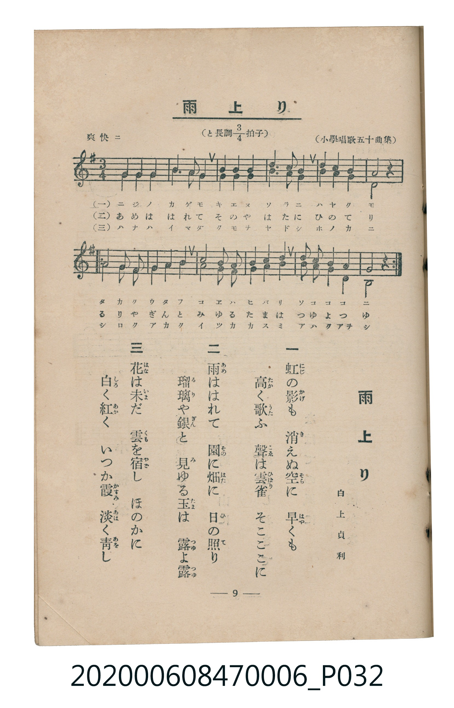

# 雨上り

<audio controls src="ameagari.mp3"></audio>

- 詞：白上貞利
- 小學唱歌五十曲集
- 臺灣教育會公認《新定兒童唱歌》尋常科第六學年用（2020.006.0847.0006）

## 說明

原書資訊與歌詞全文（對應 P032.jpg，書頁 p. 9，第一學期第 8 首，二部合唱）：
調性與拍號：と長調四分之三拍子（G 大調 3/4 拍），「爽快ニ」

## 歌詞

```text
一　虹（にじ）の影（かげ）も　消（き）えぬ空（そら）に　早（はや）くも
高（たか）く歌（うた）ふ　聲（こゑ）は雲雀（ひばり）　そこここに

二　雨（あめ）ははれて　園（その）に畑（はた）に　日（ひ）の照（て）り
瑠璃（るり）や銀（ぎん）と　見（み）ゆる玉（たま）は　露（つゆ）よ露（つゆ）

三　花（はな）は未（いま）だ　雲（くも）を宿（やど）し　ほのかに
白（しろ）く紅（あか）く　いつか霞（かすみ）　淡（あは）く青（あを）し
```

## ABC

```abc
X:1
T:雨上り
C:TMD (Chen, Chih-Han / aguai)
M:3/4
L:1/16
Q:1/4=108
K:G
V:V1 name="Piano1" snm="Pia"
V:V2 name="Piano2" snm="Pia"
[V:V1]
D4 G4 A4 | B6 A2 G4 | A4 A4 B4 | c6 B2 A4 |
B4 B4 ^c4 | d8 z4 | D4 G4 A4 | B4 c4 d4 |
e8 d4 | c4 B4 A4 | d4 B2 G2 A4 | G8 z4 |
[V:V2]
D4 B,4 D4 | G6 D2 B,4 | D4 D4 G4 | F6 G2 D4 |
G4 G4 E4 | D8 z4 | D4 B,4 D4 | G4 A4 B4 |
c8 B4 | A4 G4 D4 | G4 D2 B,2 D4 | B,8 z4 |
```

## TMD 檔案連結

- [主旋律 TMD 檔案](ameagari.tmd) [[在 TMD Studio 編輯](https://tmdlang.github.io/Tmd-TS/#tmd=s7IKdvYPcrWy4tLSUng5e8WTHV2Pm7oUtLS4FG0VDA0suOxtFdy5bIz1Tey46hSUXqyc937PrOcz9wLVvdg072nHSiWQ8NMN_U_X7ng6ZeOztT1Pdk152tv4bPaml7PbwJIv2nc9b1z8bOrMF02bns1pftq65sWq3scNXc-mbXi6btbT1knPVy-FaH3c0P10Q_fTHTueL5_4fM2ap61rQabu3PJ8yor3ezqMDIwM9AwMzPQMLEzMgQwDs_d7OpW4uPS1FGypBbgUFBSe9s1_NnvHi83tL1Z0vehoB7oL6OunrSueTWsHuuLpht5n7Z0KAQbGRnpZBenv9_QAFb9c0KhQoKdgCeQB3f1kRwPQ3c_mzAeyFSwUXi6bBhR_sqvnZfOKpxM6gF4FuhsYiiC7Xqza_6xhOciW7t4XM-cDRR83rng5dTtQ_Ons2U872p7s7H6yoxMo-3TtBKDt7gpPlywHSioAI0QBKAo2CRhuPc879j7dv_pxc_fjhl4ukMlARzxuaHgxcydQ1-PG1Y8bZwDVPm5c93Qv0HqgSPfjxkkgkaYmoLJn2zrAgiDzHjcCGWuer9wFFpn7uAloA1BwNUjZ9JVgwfWPm1rAgv1A7SDLXq4Gmg6UmA80FyIBDDWwSBtQECyyFeSaxk1gwcmPmyaCBde_BCWTBrDgpseNG4BJDyTe0ACyGKgMilZDfLQL6NEGYBoFK2963NQIMQPsnp7HjcuAsk_nAD0FdnbjOoizn08FWgV2M9QhEI8shdgJCZPnrcvB3GXgAOkCWfZ84oLnk5pBok3dUFc1tbzsgji173HTZLDOFSBPLQN6GSi4H6ymDaj-eR8wyCChsQ_qRKC750D8vgSoBqyyA00EGmsg37_ogsQR0M2rIAY8mwNkAEVaYEYuAAcFxABQLICNnPR0HdAVQCcDlQFjCqhsOjgsdwP9CI7x1WCvzdwL1jb9cRMkvvufb2mFhiks-sDagKYsAYq8nAPM85AUMxPqTWAIbl8I07IeouXlXEjQAyMGnLAap4MsozxLQoGClj4Xl2NuamJ6YlGmVUBmYl6-oUONQY1CNcgaBRsLLTswA1tpoADJlC8W9ihomCkAC6vn6xt04FlYE4sGoGUgw2oUTOMVdBUMgdgIiGsUjIEkiA0SqQGLgTBItEbBBCxnjKQShE3UwVxTsKSuggGIB45q3C7d1UMll4JcBLK4RsEMaj2EBxIHyUNUgsSMgTohPJAJCIfWooe5ETlhDin7nuzoBhYAQAYpHjIGEWAWzGlADlgQqgDu7RoFcxATxEFSD8JmSMpJjAMquhw9ocB4IHGQPJJSiBehAmBzUGJE104BFikKQLYyFxcA)]
- [鋼琴伴奏 TMD 檔案](ameagari_piano.tmd) [[在 TMD Studio 編輯](https://tmdlang.github.io/Tmd-TS/#tmd=s7IKdvYPcrWy4tLSUng5e8WTHV2Pm7re7-l42b3n-YQtT_Zsebq0_3lnx_s9nQpaWlyKtgqGBhZc9rYK7lw2xvomdlx1CkovVs57v2fW85l7gZpfbJr3tGOlEkj46Yb-p2t3PJ2y8dnanie7pjztbXw2e9PL2W1gyRftu543Ln42deaLpk3P5jQ_bV3zYlXv44auZ9M2PF0362nrpOerl0K0Pm7ofrqh--mOHc-XT3y-Zs3T1rUgU3dueT5lBdCZRgZGBnoGBmZ6BhYm5kCGgRnQpUpcXI65qYnpiUWZVgGZiXn5QR4ONQY1CtVcCkBgY6FlB2boaynYogMFoBVPdjS8WNijoGGmAPTC8_UNOgoBBsZGelkF6ZpYNGjpgw2rUTCNV9BVMARiIyCuUTAGkiA2SKQGLAbCINEaBROwnDGSShA2UQdzTcGSugoGIB4Xfpfu6qGSS0EuAllco2AGtR7CA4mD5CEqQWLGQJ0QHsgEhENr0QPdByXQTaCBDtQWrxBtGAvGaBzTeCDPNB6TCyIQao1QJA2AdhMy2ATIMUExFiSFaioKD2Qo0EO6dgowPymgsZW5uAA)]

## 分析

```text
================================================================================
📊 TMD Song Profile: [ 雨上り ]
================================================================================
⏱  Duration:       0:20 (20.0s), 12 measures total
🎼 Key & Tempo:    首調基準 G, != 108.0 BPM, <3/4>
   - 分析範圍：      由實際發聲的音符與和弦推測調性；播放脈絡另行呈現
🎤 人聲音域:    D4 (MIDI 62) – E5 (MIDI 76) [跨度: 14 個半音 / 1.2 個八度, 難度: moderate]
   - 最低音:  D4 in [Ameagari #1 @ m.1, 0:00]
   - 最高音: E5 in [Ameagari #1 @ m.9, 0:13]
   - 適合: soprano, mezzo-soprano, contralto, tenor, baritone, bass
🏛  結構:      Ameagari (20.0s)
⚡ 編曲密度:        Peak 2 軌道同時演奏
🗝  調性診斷：       G 大調（純淨自然大調，未偵測到可信轉調）
   - 風格氣質:    純淨自然大調（陽光明朗、易唱易記，無明顯調外色彩）
   - 轉調歷程:    全曲維持單一推測調性（未偵測到可信轉調）
   - 核心骨幹音:  D, B, G, A, C
   - 調性數值:    G 大調 [相關度: 0.87, 穩定度: Moderate, 自然音純度: 98.5%]
   - 候選調性 (K-S): G 大調 (0.87), D 大調 (0.76), B 小調 (0.73)
   - 五度圈歷程:   +1
   - 各段落調性細節:
     • [Ameagari #1]: G 大調 (r: 0.87, 自然音純度: 98.5%, 調外音: C#)

  [ 五度圈游移軌跡 ]
               C  
         F           [G ]*
      Bb               D  
      Eb               A  
         Ab           E  
            Db       B  
               F# 
     (* = active key center)

  [ 十二半音累積音高分佈 ]
     C  : ███████                    8.1%
     C# : █                          1.5%
     D  : ████████████████████████  27.9%
     D# :                            0.0%
     E  : ████                       4.4%
     F  :                            0.0%
     F# : ██                         2.2%
     G  : █████████████████         19.9%
     G# :                            0.0%
     A  : ████████████              14.0%
     A# :                            0.0%
     B  : ███████████████████       22.1%
--------------------------------------------------------------------------------
Assignment 軌道音域：
  - Piano1        : D4 – E5 (14 個半音 / 1.2 個八度, 32 個音符)
  - Piano2        : B3 – C5 (13 個半音 / 1.1 個八度, 32 個音符)
================================================================================
```


## 原書掃描頁




