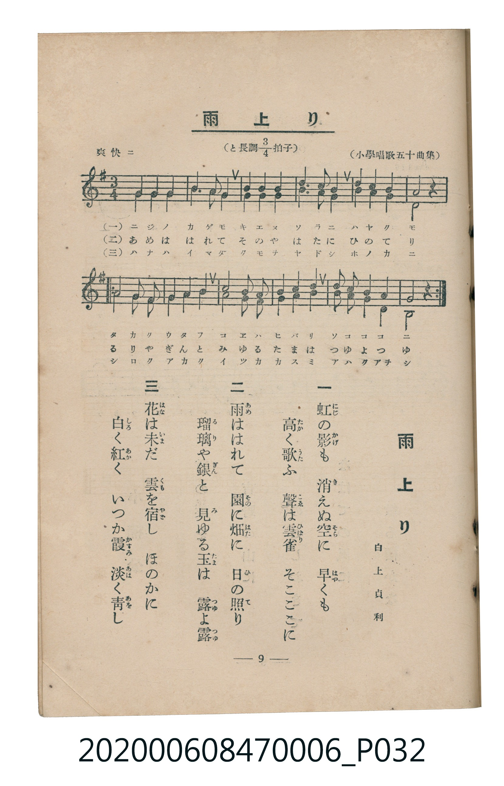

# 雨上り

> Re:Shōka 使用 AI 協助辨識與重建樂譜，可能會有錯誤。歡迎回報。

- **鋼琴伴奏版**：<br><audio controls src="ameagari.mp3"></audio>
- **NEUTRINO 歌聲合成版**：<br><audio controls src="ameagari_neutrino.mp3"></audio>

- 詞：白上貞利
- 小學唱歌五十曲集
- 臺灣教育會公認《新定兒童唱歌》尋常科第六學年用（2020.006.0847.0006）

## 說明

原書資訊與歌詞全文（對應 P032.jpg，書頁 p. 9，第一學期第 8 首，二部合唱）：
調性與拍號：と長調四分之三拍子（G 大調 3/4 拍），「爽快ニ」
曲式結構：全曲 12 小節（前 6 小節＋後 6 小節附反覆記號 `|: ... :|`），
第 1–2 小節與第 7–8 小節為齊唱，第 3–6 小節與第 9–12 小節為二部合唱。


## 歌詞

```text
一　虹（にじ）の影（かげ）も　消（き）えぬ空（そら）に　早（はや）くも
高（たか）く歌（うた）ふ　聲（こゑ）は雲雀（ひばり）　そこここに

二　雨（あめ）ははれて　園（その）に畑（はた）に　日（ひ）の照（て）り
瑠璃（るり）や銀（ぎん）と　見（み）ゆる玉（たま）は　露（つゆ）よ露（つゆ）

三　花（はな）は未（いま）だ　雲（くも）を宿（やど）し　ほのかに
白（しろ）く紅（あか）く　いつか霞（かすみ）　淡（あは）く青（あを）し
```

## ABC

```abc
X:1
T:雨上り
M:3/4
L:1/16
Q:1/4=108
K:G
V:V1 name="Alto" snm="Alt"
V:V2 name="Soprano" snm="Sop"
[V:V1]
!mf! G4 G4 G4 | B6 A2 G4 | G4 G4 G4 | B6 A2 G4 |
B4 A4 G4 | D8 z4 | A8 G2 F2 | G4 A4 B4 |
A8 G2 F2 | G4 A4 B4 | B2 A2 G4 D2 D2 | B,8 z4 |
[V:V2]
!mf! G4 G4 G4 | B6 A2 G4 | B4 B4 B4 | d6 c2 B4 |
w: 1.~ニ ジ ノ | カ ゲ モ | キ エ ヌ | ソ ラ ニ
w: 2.~あ め は | は れ て | そ の に | は た に
w: 3.~ハ ナ ハ | イ マ ダ | ク モ ヲ | ヤ ド シ
d4 c4 B4 | A8 z4 | A8 G2 F2 | G4 A4 B4 |
w: 1.~ハ ヤ ク | モ | タ カ ク | ウ タ フ
w: 2.~ひ の て | り | る り や | ぎ ん と
w: 3.~ホ ノ カ | ニ | シ ロ ク | ア カ ク
c8 B2 A2 | B4 c4 d4 | d2 c2 B4 A2 A2 | G8 z4 |
w: 1.~コ エ ハ | ヒ バ リ | ソ コ コ コ コ | ニ
w: 2.~み ゆ る | た ま は | つ ゆ よ つ ゆ | ゆ
w: 3.~イ ツ カ | カ ス ミ | ア ハ ク ア ヲ | シ
```

## TMD 檔案連結

- [主旋律 TMD 檔案](ameagari.tmd) [[在 TMD Studio 編輯](https://tmdlang.github.io/Tmd-TS/#tmd=s7IKdvYPcrWy4qpTUCpJTLdSSM7PyUlNLsnMz7MqzsjMK0nNjM_KTMmPL87Iz05Ugisry88pzU21Si9KTEmNN4s3MjAyiDcwMIs3sDAxBzIMzBBKi_NLi5JTrYqTM_Lzc-JLUitKkvLzs9Hl4wsS01OtAgyMjRAyBUX5Zal5iXlA3QVFILekgLUjFKSWZaakgqSLkxPz4stSizLTMlNTkFyZWlQM9gnEipKixLzi5KLMApD3EKryi0oy8oE-KciotMrILC7JL8pMTsyJz07MQ_JwSUYq0L_lqYlARhGy3sz0zDyrksRMYACBAqk8MT43MTMvJzEP6A4tLYWXs1c82dH1uKlLQUuLS9FWwdDAgsveVsGdy8ZY38QOZM6LlfPe75n1fOZeoLoXm-Y97VgJNv7phv6na3c8nbLx2dqeJ7umPO1tfDZ708vZbWDJF-27njcufjZ15oumTc_mND9tXfNiVe_jhq5n0zY8XTfraeuk56uXQrQ-buh-uqH76Y4dz5dPfL5mzdPWtSBTd255PmXF-z0doHjTA8aWHijegAwDs_d7OpW4uPS1FGypBbgUFBSe9s1_NnvHi83tL1Z0vehoB7oL6OunrSueTWsHuuLpht5n7Z0KoMjXyypIf7-nB6j45YJGhQI9BUsgD-juJzsagO5-Nmc-kK1gofBy2TSg-JNdPS-bVzyd0AH0KtDdwFAE2fVi1f5nDctBtnT3vpg5Hyj6uHHFy6nbgeJPZ89-2tH2ZGf3kx2dQNmnaycAbXdXeLpkOVBSARghCkBRsEnAcOt53rH36f7Vj5u7Hzf0ggwGhv_TPf3Pt054trwbaCrI-bM3KRgaKQCj6vn6BpBHOnsVzODc7qf7euDclzNbnvb3vljW9mLFDKCrFBJqrBT09PQUrGoSIBaCbAB5zvBRw2SYkUBPgITMgUIWUKHnTbte7u0CexgULgrGQDmYHVDllkAhuKuA6pGD6XFDExfIJmB4Pm5oeDFzJ9DVjxtXP26cAXTF48Z1T_cCDQaKdD9unAQSaWoCKnu2rQMsCAqax41AxprnK3eBReY-bgK6HSi4GqRs-kqw4PrHTS1gwX6gdpBlL1cDTQdKzAeaC5EAJgCwSBtQECyyFeSaxk1gwcmPmyaCBde_BKV4UMA-btz0uHEDMBeBxBsaQBYDlUHRaoiPdgHjrAGY3cDKmx43NULMALun53HjMqDs0zlAT4Gd3bgO4uznU4FWgd0MdQjEI0shdkLC5HnrcjB3GThAusARNXHB80nNINGmbqirmlpedkGc2ve4aTJY5wqQp5YBvQwU3A9W0wZU_7wPGGSQ0NgHdSLQ3XMgfl8CVANW2YEmAo01kO9fdEHiCOjmVRADns0BMoAiLTAjF4CDAmIAKBbARk56ug7oCqCTgcqAMQVUNh0clruBfgTH-Gqw12buBWub_rgJEt_9z7e0QsMUFn1gbUBTlgBFXs4BFl-QFDMT6k1gCG5fCNOyHqLl5VxI0AMjBpywGqeDLKO8dIECBS19Li7H3NTE9MSiTKvg_AJgUZ_vUGNQUw2yRsHGQssOzMBWsIGyHTA_vFjYo6ABy0o68NJIE4sGoGUgw2oUqnPTahUMFXThuEbBGEjqKhgh8WC4RsEULGeCxDOByxmB5XQVDEA8sPE-hjUKwNIHyH_ctANENveBVT5uWg1W-bhpE1BsEVRsLVhkBVhdD1RsL0Rd80qoOSDz-sEiS8Cq10PFQGaAYDzCbiOgeGMTWFUjiGyEqgXTINEeIHsZVGwuWMU6MAlyG5K6xvlIYpuQ1EH1AitGDLuNEe4EyULYILUgV4P484C4ASoGsgfig8fNIPNBemHqOoHy26Fis-EhCAk_WNgi7MafQHb14EggOqDa7cXaOWglPN50A4tsQwXzeCAXlFZAQpCUAEoTIGgMFIOkIJAIKLWA0gwk9RiB5UD6sKSZpv1QcZBPQSEEEgOFN0TmcfNUaNhthqtbAQ5lUJhMAquYACZXQdXtBauFqIexMMMPnm6aYOKg2AUWN-C4h4T8ZHDcg1IpSAzhzjawLpDYfLCKfWASluaWQFV0gEUhPJA9bZj2g9IOOM4hKWAt3P_gFAKOeXi6h6YnkLoWsBwsbz1u2gkWBbkFohcUOtC0BuZtAovD7IHYX4tUAjnmlJBT_ECq6ic7uoF1IZBBrVKIUAkFSnsQninIK4gkRVSWIM_ReLMAXklQvgCJAN0KREA-qpuB0aBrpwCLCQUgW5kLAA)]
- [鋼琴伴奏 TMD 檔案](ameagari_piano.tmd) [[在 TMD Studio 編輯](https://tmdlang.github.io/Tmd-TS/#tmd=s7IKdvYPcrWy4tLSUng5e8WTHV2Pm7re7-l42b3n-YQtT_Zsebq0_3lnx_s9nQpaWlyKtgqGBhZc9rYK7lw2xvomdlx1CkovVs57v2fW85l7gZpfbJr3tGOlEkj46Yb-p2t3PJ2y8dnanie7pjztbXw2e9PL2W1gyRftu543Ln42deaLpk3P5jQ_bV3zYlXv44auZ9M2PF0362nrpOerl0K0Pm7ofrqh--mOHc-XT3y-Zs3T1rUgU3dueT5lBdCZRgZGBnoGBmZ6BhYm5kCGgRnQpUpcXJ55JUX5VgGZiXn5QR4ONQY11VwKQGBjoWUHZtQoVOcW1CoYaZso6IKhobaxgnm8thFQBsTUhUoZa5sCyRowDRKByJmCFIIJoEy8tiHUDAOQUq5aFNt9kG03QbXdND5eIdo0PhZCAC0Gcg2BPCCGc0Bq4BwDiPGOuamJ6YlFmXj8p6-lYIsOFIDB92RHw4uFPQoaZgrA6Hm-vkFHIcDA2EgvqyBdE4sGLX24c9NqFUDehGGgv8FeNkLiwXCNAijMdBVMkHjgsATzjFACC2S8j2GNwuPmbiD_cdMOENncB1b5uGk1WOXjpk1AsUVQsbVgkRVgdT1Qsb0Qdc0roeaAzOsHiywBq14PFQOZAYLxCLuNgOKNTWBVjSCyEaoWTINEe4DsZVCxuWAV68AkyG1I6hrnI4ltQlIH1dvUhWm3McKdIFkIG6QW5GoQfx4QN0DFQPZAfPC4GWQ-SC9MXSdQfjtUbDY8BCHhBwtbhN34E8iuHnISCCxWDYGZCJRegUyQECTKYXnMGCgGSSogEUjGMoUmEyOwHGpOgieOpv1QcZCXQEEBEgMFLETmcfNUaCBthqtbAQ5OkOcngVVMAJOroOr2gtVC1MNYmAEFTyBNMHFQND5uagFHMiSIJ4MjGZQcQWIId7aBdYHE5oNV7AOTsMS1BKqiAywK4YHsacO0H5RIwJELieq1cP-DkwI4iuEJHJpwQOpawHKwTPS4aSdYFOQWiF5Q6EATFZi3CSwOswdiP0ZRY0RGSQNMUC-bgfVK94vGTUAGtQocQoURKPVBeKYgz4yWOIO-xCEvoeAtePBKgkojkAgwfQARqCKHqh4tfAZl4YOjJYWt0UQEB9SuAlKg4gHaCAM1riBGYmmXYSrHIoenyaZrpwBuFCoAGTBvRfsA5VH4Rmh8YzBfmQsA)]

## 分析

```text
================================================================================
📊 TMD Song Profile: [ 雨上り ]
================================================================================
⏱  Duration:       0:20 (20.0s), 12 measures total
🎼 Key & Tempo:    首調基準 G, != 108.0 BPM, <3/4>
   - 分析範圍：      由實際發聲的音符與和弦推測調性；播放脈絡另行呈現
🎤 人聲音域:    F#4 (MIDI 66) – D5 (MIDI 74) [跨度: 8 個半音 / 0.7 個八度, 難度: easy]
   - 最低音:  F#4 in [Ameagari #1 @ m.7, 0:11]
   - 最高音: D5 in [Ameagari #1 @ m.4, 0:05]
   - 適合: soprano, mezzo-soprano, contralto, tenor, baritone, bass
🏛  結構:      Ameagari (20.0s)
⚡ 編曲密度:        Peak 2 軌道同時演奏
🗝  調性診斷：       G 大調（純淨自然大調，未偵測到可信轉調）
   - 風格氣質:    純淨自然大調（陽光明朗、易唱易記，無明顯調外色彩）
   - 轉調歷程:    全曲維持單一推測調性（未偵測到可信轉調）
   - 核心骨幹音:  G, B, A, D, C
   - 調性數值:    G 大調 [相關度: 0.78, 穩定度: High, 自然音純度: 100.0%]
   - 候選調性 (K-S): G 大調 (0.78), B 小調 (0.54), D 大調 (0.50)
   - 五度圈歷程:   +1
   - 各段落調性細節:
     • [Ameagari #1]: G 大調 (r: 0.78, 自然音純度: 100.0%)

  [ 五度圈游移軌跡 ]
               C  
         F           [G ]*
      Bb               D  
      Eb               A  
         Ab           E  
            Db       B  
               F# 
     (* = active key center)

  [ 十二半音累積音高分佈 ]
     C  : ██████                     7.4%
     C# :                            0.0%
     D  : ████████                  10.3%
     D# :                            0.0%
     E  :                            0.0%
     F  :                            0.0%
     F# : ██                         2.2%
     G  : ████████████████████████  30.1%
     G# :                            0.0%
     A  : ██████████████████        22.8%
     A# :                            0.0%
     B  : ██████████████████████    27.2%
--------------------------------------------------------------------------------
Assignment 軌道音域：
  - Alto          : B3 – B4 (12 個半音 / 1.0 個八度, 34 個音符)
  - Soprano       : F#4 – D5 (8 個半音 / 0.7 個八度, 34 個音符)
================================================================================
```


## 原書掃描頁




