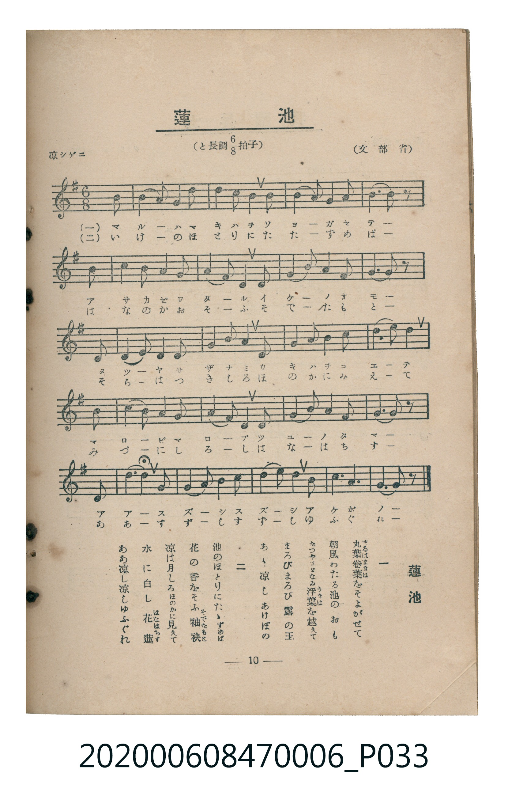

# 蓮池

<audio controls src="hasuike.mp3"></audio>

- 文部省
- 臺灣教育會公認《新定兒童唱歌》尋常科第六學年用（2020.006.0847.0006）

## 說明

原書資訊與歌詞全文（對應 P033.jpg，書頁 p. 10，第一學期第 9 首）：
調性與拍號：と長調八分之六拍子（G 大調 6/8 拍，弱起 1 拍），「涼シゲニ」

## 歌詞

```text
一　丸葉卷葉（まるはまきば）をそよがせて
朝風わたる池のおも
たつやさゞなみ浮葉（うきは）を越えて
まろびまろび露の玉
あゝ涼しあけぼの

二　池のほとりにたゝずめば
花の香をそふ袖袂（そでたもと）
涼し月しろほのかに見えて
水に白し花蓮（はなはちす）
ああ涼し涼しゆふぐれ
```

## ABC

```abc
X:1
T:蓮池
C:TMD (Chen, Chih-Han / aguai)
M:6/8
L:1/16
Q:3/8=40
K:G
V:V1 name="Piano" snm="Pia"
[V:V1]
z2 z2 z2 z2 z2 D2 | B,4 D2 G4 D2 | A4 A2 A4 D2 | B4 B2 A4 G2 |
A8 z2 D2 | B,4 D2 G4 D2 | A4 B2 A4 D2 | B4 A2 G4 E2 |
D8 z2 D2 | E4 E2 E4 F2 | G4 A2 B4 B2 | A4 A2 A4 B2 |
d8 z2 D2 | E4 E2 E4 F2 | G4 A2 B4 d2 | c4 A2 F4 E2 |
D8 z2 D2 | B6 D2 A4 | G6 A4 B2 | d6 A4 B2 |
G8 z2 z2 |
```

## TMD 檔案連結

- [主旋律 TMD 檔案](hasuike.tmd)
- [鋼琴伴奏 TMD 檔案](hasuike_piano.tmd)

## 分析

```text
================================================================================
📊 TMD Song Profile: [ 蓮池 ]
================================================================================
⏱  Duration:       1:03 (63.0s), 21 measures total
🎼 Key & Tempo:    首調基準 G, != 60.0 BPM, <6/8>
   - 分析範圍：      由實際發聲的音符與和弦推測調性；播放脈絡另行呈現
🎤 人聲音域:    B3 (MIDI 59) – D5 (MIDI 74) [跨度: 15 個半音 / 1.2 個八度, 難度: moderate]
   - 最低音:  B3 in [Hasuike #1 @ m.2, 0:03]
   - 最高音: D5 in [Hasuike #1 @ m.13, 0:36]
   - 適合: soprano, mezzo-soprano, contralto, tenor, baritone, bass
🏛  結構:      Hasuike (63.0s)
⚡ 編曲密度:        Peak 1 軌道同時演奏
🗝  調性診斷：       D 大調（純淨自然大調，未偵測到可信轉調）
   - 風格氣質:    純淨自然大調（陽光明朗、易唱易記，無明顯調外色彩）
   - 轉調歷程:    全曲維持單一推測調性（未偵測到可信轉調）
   - 核心骨幹音:  A, D, B, G, E
   - 調性數值:    D 大調 [相關度: 0.87, 穩定度: High, 自然音純度: 98.3%]
   - 候選調性 (K-S): D 大調 (0.87), G 大調 (0.70), B 小調 (0.61)
   - 五度圈歷程:   +2
   - 各段落調性細節:
     • [Hasuike #1]: D 大調 (r: 0.87, 自然音純度: 98.3%, 調外音: C)

  [ 五度圈游移軌跡 ]
               C  
         F            G  
      Bb              [D ]*
      Eb               A  
         Ab           E  
            Db       B  
               F# 
     (* = active key center)

  [ 十二半音累積音高分佈 ]
     C  : ██                         1.7%
     C# :                            0.0%
     D  : ██████████████████████    24.3%
     D# :                            0.0%
     E  : ██████████                10.4%
     F  :                            0.0%
     F# : ███                        3.5%
     G  : ██████████████            15.7%
     G# :                            0.0%
     A  : ████████████████████████  26.1%
     A# :                            0.0%
     B  : █████████████████         18.3%
--------------------------------------------------------------------------------
Assignment 軌道音域：
  - Piano         : B3 – D5 (15 個半音 / 1.2 個八度, 67 個音符)
================================================================================
```


## 原書掃描頁




