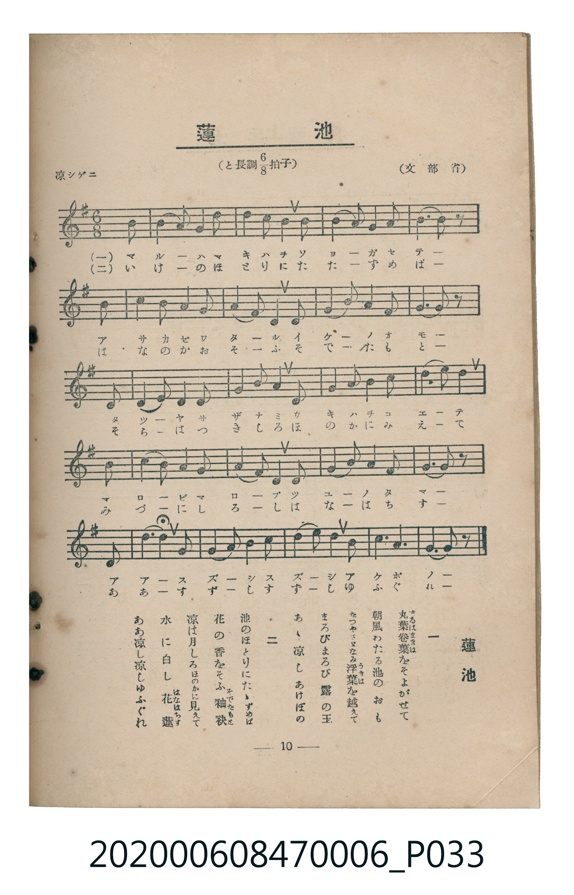

# 蓮池

> Re:Shōka 使用 AI 協助辨識與重建樂譜，可能會有錯誤。歡迎回報。

- **鋼琴伴奏版**：<br><audio controls src="hasuike.mp3"></audio>
- **NEUTRINO 歌聲合成版**：<br><audio controls src="hasuike_neutrino.mp3"></audio>

- 文部省
- 臺灣教育會公認《新定兒童唱歌》尋常科第六學年用（2020.006.0847.0006）

## 說明

原書資訊與歌詞全文（對應 P033.jpg，書頁 p. 10，第一學期第 9 首）：
調性與拍號：と長調八分之六拍子（G 大調 6/8 拍，弱起 1 拍），「涼シゲニ」


## 歌詞

```text
一　丸葉卷葉（まるはまきば）をそよがせて
朝風わたる池のおも
たつやさゞなみ浮葉（うきは）を越えて
まろびまろぶ露の玉
あゝ涼し涼しあけぼの

二　池のほとりにたゝずめば
花の香をそふ袖袂（そでたもと）
空に月しろほのかに見えて
水に白し花蓮（はなはちす）
あゝ涼し涼しゆふぐれ
```

## ABC

```abc
X:1
T:蓮池
M:6/8
L:1/16
Q:3/8=40
K:G
V:V1 name="Piano" snm="Pia"
[V:V1]
z2 z2 z2 z2 z2 B2 | B4 A2 G4 d2 | d4 c2 B4 B2 | B4 A2 G4 A2 |
w: ま | る _ は ま | き ば を そ | よ _ が せ
B6 B2 z2 B2 | c4 B2 A4 G2 | A4 F2 D4 D2 | G4 B2 A4 F2 |
w: て _ あ | さ か ぜ わ | た _ る い | け _ の お
G6 G2 z2 D2 | D4 E2 D4 D2 | G4 B2 A4 D2 | G4 A2 B4 c2 |
w: も _ た | つ _ や さ | ざ な み う | き は を こ
d4 e2 d4 B2 | c4 B2 A4 G2 | A4 F2 D4 D2 | G4 B2 A4 F2 |
w: え _ て ま | ろ _ び ま | ろ _ ぶ つ | ゆ _ の た
G6 G2 z2 D2 | d6 d4 G2 | G4 A2 B4 c2 | d4 e2 d4 B2 |
w: ま _ あ | あ _ す | ず _ し す | ず _ し あ
c6 A6 | G6 G2 z2 z2 | z2 z2 z2 z2 z2 B2 | B4 A2 G4 d2 |
w: け ぼ | の _ | い | け _ の ほ
d4 c2 B4 B2 | B4 A2 G4 A2 | B6 B2 z2 B2 | c4 B2 A4 G2 |
w: と り に た | た _ ず め | ば _ は | な の か を
A4 F2 D4 D2 | G4 B2 A4 F2 | G6 G2 z2 D2 | D4 E2 D4 D2 |
w: そ _ ふ そ | で _ た も | と _ そ | ら _ に つ
G4 B2 A4 D2 | G4 A2 B4 c2 | d4 e2 d4 B2 | c4 B2 A4 G2 |
w: き し ろ ほ | の か に み | え _ て み | づ _ に し
A4 F2 D4 D2 | G4 B2 A4 F2 | G6 G2 z2 D2 | d6 d4 G2 |
w: ろ _ し は | な _ は ち | す _ あ | あ _ す
G4 A2 B4 c2 | d4 e2 d4 B2 | c6 A6 | G6 G2 z2 z2 |
w: ず _ し す | ず _ し ゆ | ふ ぐ | れ _
```

## TMD 檔案連結

- [主旋律 TMD 檔案](hasuike.tmd) [[在 TMD Studio 編輯](https://tmdlang.github.io/Tmd-TS/#tmd=s7IKdvYPcrWy4qpTUCpJTLdSSM7PyUlNLsnMz7MqzsjMK0nNjM_KTMmPL87Iz05Ugisry88pzU21Si9KTEmNN4s3MjAyiDcwMIs3sDAxBzIMzBBKi_NLi5JTrYqTM_Lzc-JLUitKkvLzs9Hl4wsS01OtAgyMjREyBUX5Zal5iXlA3QVFILekgLUjFKSWZaakgqSLkxPz4stSizLTMlNTkFyZWlQM9gnEipKixLzi5KLMApD3EKryi0oy8oE-KciotMrILC7JL8pMTsyJz07MQ_JwSUYq0L8FOYl5SPYDVaZn5lnl5ucllQIDSIlLS0vhxeR1zzYuUNDS4lK0VTAz4LK3VXDnsjHTt7ADaXs2rf1l84rncxrBhrxo3_W8cfGzqTNfNG16Nqf5aeuaF6t6Hzd0PZu24em6WU9bJz1fvfTplI3P1vY8buh-uqH76Y4dz5dPfL5mzdPWtU_X7ni6c8vzKSve7-kABb8eMND1QMEPZBiYvd_TqcTFpa-lYEstwKWgoPC0b_6z2TtebG5_saLrRUc70F0vVs572roC6CugK55u6H3W3qkAikO9rIL093t6gIpfLmhUKNBTMDQAcoEOf7KjAejwZ3PmA9kKlgovl00DuvT9nlkg01-s2v-sYTnI3O7eFzPnA0UfN654OXU7UPxp6-qnHW1PdnYDPQ6Ufbp2AtA-d4WnS5YDJRWAgasAFAXa8HTPxhdbtysYQrhAg4EB1_Ns257HTdsfN2163Nz9uKGXC2QX0B2PGxqe7NjxYmLn097tQBJo4OPGfY-buh83rgcxGnsfN24AmvG4adLjxrmPm4CyPY8bZz9uXAbS_2zO3JeLVjxu6n_cOB-oBxjjjxvXPW7setzUBJIGiTYuedzU8rhx6uOmeY8bVz1u3P9s6zqYPW1g49dDjH-xretxI1AQbDDYDUC5zTDGtpdzNgHNft7XCZFuetw0F-SjxukQEiTSOPFxI5C9DuK1XUBPN8BctBsYho-bgBasBrt07uPGWY-bGoFeA4d410agopfLZkI92bj1xaJpLxY1gd0I5C4H6wGaD0xkYOufr9wFNOnZHKD0dLDrgMYDLQGG2eoXy4AkzBfPNmwBCj2fuReoDmgJME-AjQQGLDAggOTCx40zoUZi8VETMHi2Pm6c8LipB6SC8rQLBQpa-lxcHonFpZnZwKImMzEv36HGoKYaZIeCjYWWHZiBLc8oQFLui4U9ChrQJKatYKLwdEP_8_UNOvAUr4lFJ9BKkKk1CgZwaAzkGSvoKhgB06mugimQZwqkTcBiqHJGUB5IHKwPbJaPYY1CPBwC0wlQFTANgtUBQxdMgsUae8HsDUDZSWDWXLDKDqjKHjA5G6xyGVhMF2xeE8weI1R7WsAqJ0J1rwOTu8FiK0Dspi4gazVYdD5YdD5U5SywbCNYbAOSPeuB9uAP8l094CAnMaRNwOFlBCQNgTwQbR6vYBoPCut4oAAoYCHSQGEIF6TSACwLD2BgxgU7vhuI54A90I_sKXBwYw-SLnAgNyF5FBgc8AAF5gCoWpDZIJMmgc2YCzVjKyKiGpdDxUB2gkyEBTXMXKAqAgG4o5OcAASHlRn2MINzjcAp0wSaes3AJHIKBZZ_0KBqAXtiKtj508DsVUC8H8xqQ0qn6-HpdDJYFJZOQWkTnKIRgdjUCZWDpLclSKZMB8pCWJC0CYkUUDRC1O7HYjZQDH9APp09e-BSItg7IGduhgUEktg2RAA0taGkQ0gm3IeUXpAz9uPGpShBOB3F1OnQCIGlV0TBshAsNhPNVALZeApZqRBsA4gEBR6eJAcOZpAsiEQORgOU5AjLkSBfzAT7AlQwIXyLTQyS52D5ew_UBkgIQ_wPjylwmJJhBzDWQGKgfA8SmwCzowlUPCPsqOXi0rVTgFZe0T6GsQrIXCMwV5kLAA)]
- [鋼琴伴奏 TMD 檔案](hasuike_piano.tmd) [[在 TMD Studio 編輯](https://tmdlang.github.io/Tmd-TS/#tmd=s7IKdvYPcrWy4tLSUngxed2zjQve7-l42b3n-YQtT_Zsebq0_3lnx_s9nQpaWlyKtgpmBlz2tgruXDZm-hZ2XHUKSs-mtb9sXvF8TqMSiPeifdfzxsXPps580bTp2Zzmp61rXqzqfdzQ9WzahqfrZj1tnfR89dKnUzY-W9vzuKH76Ybupzt2PF8-8fmaNU9b1z5du-Ppzi3Pp6wA2m9kYGSgZ2BgpmdgYWIOZBiYAZ2gxMXlkVhcmpmdahWQmZiXH-ThUGNQU82lAAQ2Flp2YIa-loItOlAAWvBkR8OLhT0KGgEGxsZ6WQXpmliUaemDjahRMIBDYyDPWEFXwUjBEEiaAnmmQNoELIYqZwTlgcTB-sBm-RjWKMTD4ePGfUBVj5u6weoeN64Hk2Cxxl4wewNQdhKYNRessgOqsgdMzgarXAYW0wWb1wSzxwjVnhawyolQ3evA5G6w2AoQu6kLyFoNFp0PFp0PVTkLLNsIFtuAZM96oD34w3dXD_HhawIOJSMgaQjkgWjzeAXTeFAIxwMFQMEJkQYKQ7gglQZgWXiwPm6cCnZyNxDPATu7H9kr4EDGHhBd4KBtQvIeMBDgwfi4cRVULchskEmTwGbMhZqxFRE9jcuhYiA7QSbCAhhmLlAVgWDb0Ul8sIFDyAx7SMG5RuBUaAJNqWZgEjk1Pm5cAg2gFrDTp4IdPQ3MXgXE-8GsNqQ0uR6eJieDRWFpEpQOwakXEXRNnVA5SNpagmTKdKAshAVJh5CoAEUeRO1-LGYDxfAH39PZs-md6sCeADluM8z7SGLbEN5uakNJc5Bstg8pbSBn3ceNS1ECbjqKqdOh0QBLm4iiYyFYbCaaqQQy6hQSUhzYXBAJCjI8yQscuCBZEIkceAYoSQ-W50Bunwl2O6jAQfgRmxgkV8Fy8B6oDZBwhfgaHj_gkCTDDmBcgcRAORskNgFmRxOo2EXYUYtWAflgq4CQaw-g5xUMQQkMGBYQCpSJ0QSgDJg4XABqACzxomuDqcfQR8Ag4vVhWEVvF6EHEZwPsxqnwcCY0rVTgEZWtI9hrAIy1wjMVeYCAA)]

## 分析

```text
================================================================================
📊 TMD Song Profile: [ 蓮池 ]
================================================================================
⏱  Duration:       2:12 (132.0s), 44 measures total
🎼 Key & Tempo:    首調基準 G, != 60.0 BPM, <6/8>
   - 分析範圍：      由實際發聲的音符與和弦推測調性；播放脈絡另行呈現
🎤 人聲音域:    D4 (MIDI 62) – E5 (MIDI 76) [跨度: 14 個半音 / 1.2 個八度, 難度: moderate]
   - 最低音:  D4 in [Hasuike[L1] #1 @ m.7, 0:19]
   - 最高音: E5 in [Hasuike[L1] #1 @ m.13, 0:37]
   - 適合: soprano, mezzo-soprano, contralto, tenor, baritone, bass
🏛  結構:      Hasuike[L1] (66.0s) -> Hasuike[L2] (66.0s)
⚡ 編曲密度:        Peak 1 軌道同時演奏
🗝  調性診斷：       G 大調（純淨自然大調，未偵測到可信轉調）
   - 風格氣質:    純淨自然大調（陽光明朗、易唱易記，無明顯調外色彩）
   - 轉調歷程:    全曲維持單一推測調性（未偵測到可信轉調）
   - 核心骨幹音:  D, G, B, A, C
   - 調性數值:    G 大調 [相關度: 0.89, 穩定度: High, 自然音純度: 100.0%]
   - 候選調性 (K-S): G 大調 (0.89), D 大調 (0.76), B 小調 (0.65)
   - 五度圈歷程:   +1 -> +1
   - 各段落調性細節:
     • [Hasuike[L1] #1]: G 大調 (r: 0.89, 自然音純度: 100.0%)
     • [Hasuike[L2] #1]: G 大調 (r: 0.89, 自然音純度: 100.0%)

  [ 五度圈游移軌跡 ]
               C  
         F           [G ]*
      Bb               D  
      Eb               A  
         Ab           E  
            Db       B  
               F# 
     (* = active key center)

  [ 十二半音累積音高分佈 ]
     C  : ████████                   8.2%
     C# :                            0.0%
     D  : ████████████████████████  24.6%
     D# :                            0.0%
     E  : ██                         2.5%
     F  :                            0.0%
     F# : ███                        3.3%
     G  : ███████████████████████   23.8%
     G# :                            0.0%
     A  : ██████████████████        18.0%
     A# :                            0.0%
     B  : ███████████████████       19.7%
--------------------------------------------------------------------------------
Assignment 軌道音域：
  - Piano         : D4 – E5 (14 個半音 / 1.2 個八度, 154 個音符)
================================================================================
```


## 原書掃描頁




