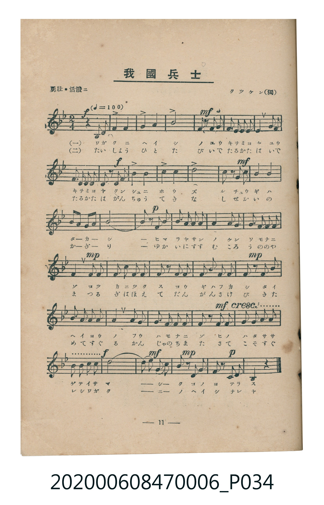
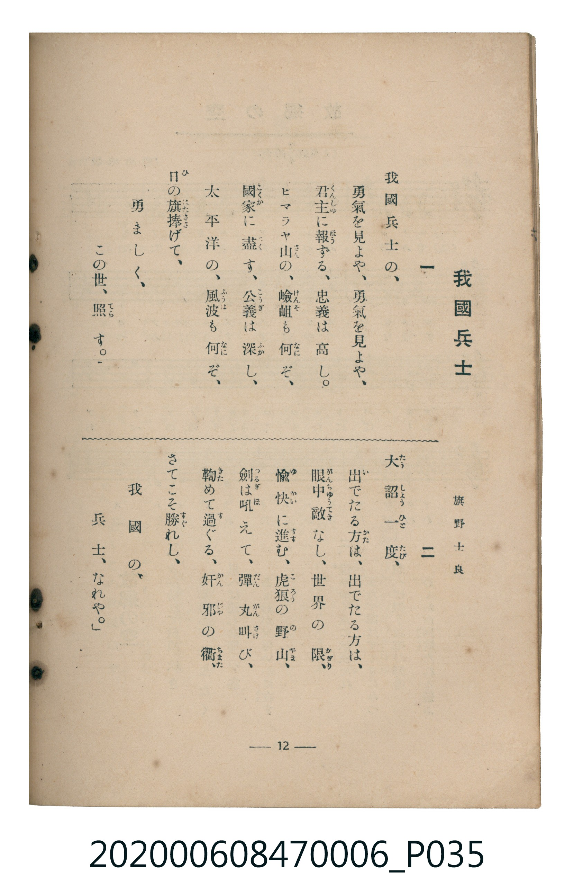

# 我國兵士

> Re:Shōka 使用 AI 協助辨識與重建樂譜，可能會有錯誤。歡迎[回報](https://github.com/TMDLang/reshoka/issues)。

- **鋼琴伴奏版**：<br><audio controls src="wagakuni_heishi.mp3"></audio>
- **NEUTRINO 歌聲合成版**：<br><audio controls src="wagakuni_heishi_neutrino.mp3"></audio>

- 詞：旗野士良
- 曲：ランゲ（獨）
- 臺灣教育會公認《新定兒童唱歌》尋常科第六學年用（2020.006.0847.0006）

## 說明

原書資訊與歌詞全文（對應 P034.jpg – P035.jpg，書頁 pp. 11–12，第一學期第 10 首）：
調性與拍號：變ろ長調四分之二拍子（Bb 大調 2/4 拍，弱起 1 拍），「勇壯・活潑ニ」（♩=100）


## 歌詞

```text
一　我國兵士の、
勇氣を見よや、勇氣を見よや、
君主（くんしゆ）に報（ほう）ずる、忠義は高し。
ヒマラヤ山（さん）の、嶮岨（けんそ）も何（なに）ぞ、
國家（こくか）に盡（つく）す、公義（こうぎ）は深（ふか）し、
太平洋の、風波（ふうは）も何（なに）ぞ、
日（ひ）の旗捧（はたさゝ）げて、
勇ましく、
この世、照（てら）す。

二　「大詔（たいせう）一度（ひとたび）、
出（い）でたる方（かた）は、出でたる方は、
眼中敵（がんちゆうてき）なし、世界の限（かぎり）、
愉快（ゆかい）に進（すゝ）む、虎狼（ころう）の野山（のやま）、
劍（つるぎ）は吼（ほ）えて、彈丸（だんがん）叫（さけ）び、
鞠（きた）めて過（す）ぐる、奸邪（かんじや）の衢（ちまた）、
さてこそ勝（すぐ）れし、
我國の、
兵士、なれや。」
```

## ABC

<div class="abc-score" data-abc-src="wagakuni_heishi.abc" aria-label="五線譜載入中"></div>

[下載 ABC 原始檔](wagakuni_heishi.abc)

## TMD 檔案連結

- [主旋律 TMD 檔案](wagakuni_heishi.tmd) [[在 TMD Studio 編輯](https://tmdlang.github.io/Tmd-TS/#tmd=s7IKdvYPcrWy4qpTUCpJTLdSSM7PyUlNLsnMz7MqzsjMK0nNjM_KTMmPL87Iz05Ugisry88pzU21Si9KTEmNN4s3MjAyiDcwMIs3sDAxBzIMzBBKi_NLi5JTrYqTM_Lzc-JLUitKkvLzs9Hl4wsS01OtAgyMTRAyBUX5Zal5iXlA3QVFILekgLUjFKSWZaakgqSLkxPz4stSizLTMlNTkFyZWlQM9gnEipKixLzi5KLMApD3EKryi0oy8oE-KciotMrILC7JL8pMTsyJz07MQ_JwSUYq0L-5mTmZJYlFlciaM9Mz86xyUzOzMpE8p6Wl8Kxj4tM53U9btz5dvFpBS4tL0VbB0MCAy95WwUmHy8ZI38QOZMiLlfPe75n1bPr0l-19QIUvOteDzX42exNQ-HHzysfNmx83Adkdz3tXvN_TCZZ80b7reePiZ1Nnvmja9GxO89PWNS9W9T5u6Ho2bcPTdbOetk56vnrp0ykbn63tedzQ_XRD99MdO54vn_h8zZqnrWufrt3xdOeW51OAhnWAYk0PGFd6oFgDMgzMwDZw6Wsp2FILcCkoKDztm_9s9o4Xm9tfrOh60dEOdBfQ109bVzyb1g50xdMNvc_aOxVAUa-XVZCu8KhhMohjCuK839MD1PlyQaNCQYGegqEhUM7QCCgI9MuTHQ1AvzybMx_IBgaswstl04CuBwYayMYXq_Y_a1gOsqu798XM-UDRF-u6Hjf1vpy6HSj1dPbspx1tT3Z2P9nVA1TwdO0EoDOckhSeLlkOlFUARo0CUBhozdM9G19s3a5gCOECDQcGaM_T7vani9c_bt79bMvuZ3snPm7uftwAlO14NHOlLTCCgeq4QE4Auu9xQwNyInjcuO5xQyM4QLrbn21Y_Lhp0otl3Y-bOh43tQAlsAqCVU-Y_WTHbqANjxv7HzdNftw4_XFTG9Cax42rny7YCBbf_bgRIjLrcRPQOY1P9y94vm_l48b1L1fPAKlvaAIZ9Lh50uPmeeBEteTpRojOqUATwTpBbnu6bd3TTaCU8bhxItimuSCppqYne6eCBVcBrQQrngdzGtBv67aB5YCq-x83dkPc9Xz2QrDgEqAgWGQmyPTWNUBHwRS3PW7sA0utf7Yd4pStMO1A90JMX7Lq6c7Nz7Z0Q1z3ctGKZ5sXwZQC9a8n4Lpn05eCJYDZB-RBYCZ71rscLLL-ceN8sN_BHmyc9LhxGSJqHjfuA7kB6B2IENi5657smAbkP2-FGLDscRMwOUA81gSJ713AxAGM8h5QKlo5BawKaEfL48bZkMgBJdhdyyAOety4Aiy7GWQG1OL2XWC5FrCxy0HSTd3Ppu0ECwJDAJiIQYEFCsf2XcgKIIIgI57P2fNkx9pnU7eC9fSAY3AhMK2AA2vZ40ZQGgYHEyiAgf55PrUH6LGXM0HJH2xH3-OmLoSLnrV0Pt0PDFFgUgTqB0pDnLb6ZQOoPAJ5HRJ8TUBfN76Y2fe8ew80cpt6YelxHahYgya1daAk3bgPyctdoHwDSiXARAtLDU8nQEwBJnggFxzUQC_v7XiyYwdYfAHYWyDPARU87Qe7DxiTjRPB6jdDjX45bwFYAugQcMA1NQINegmyA-RwsNIJ0KyydMfLplXQEAAZPQPoTIjbXyyEpLaF4BQBNgeWIoAWAgMUlEOedgMDARwajcBwBNoEDFNYAobkfqR8DykHGoCOWQVSCMriTcDSAyRHeVELBQpa-lxc4YnpidmleZkeqZnAatwqIDMxL9-hxqCmGmSVgo2hmZYdmIWtqFeAlK4vFvYoaEBLQG0FE4WnG_qfr2_QgRfUmlh0Aq0GmVqjYKCgC4bVabUKhvFAhjGIqFEwBVEgCGfUKJjBmOYIMUMoCwahOkHGVucCzQTzwBprwDb6GNYowHQ_buoHkY09YH3AfAwTb1wNN-1x4w64aAuS6HQMe4GxB6RBZgOzAUwUYqcRkp2N8-FmgfTMhovD9QDZm-CiK5BEQTrR7dwMsxNsIjC7g23FH2W7esBRRmJMQSPCJB6EwDTIBWAKBMFhDFYDVwqMSnBsQqMUTIEjBhgvYA5EOTxegLkQ4uumSUD2fjCrA-LPJljYI4UtQfWQcAHHcdNklNiAhSUwZwPZ3fB4Acmsh4c9UogS1AGxC5SSYHYRyDad5MQBLLXD6BoFIygLRgODGcpCpBKQHDxDgOMJJIIc7qCGAtzbyIl_N1wUOdhnYVgBChZYIIBqErgW5DCHSmCatwwuColQiOgqTFvA2Q5iCyjjQCKCQFADG3HUCWoQC1zygIMQzMJW_oBEwKFdAC19QALIgd0H9y0sqSFnboifkP2LajyIhIQAqJAAVjgI08GBDM8o4OIIZg7MTITtoDjrwm06NAqJCN8nu6aQH77AUAQHJDQ04QU7IpzhxT4wLMHBiVrGgFI1LKDRi5OmToifgYUBsCIGs8BZEylsgM0BFPG5UB1N0PQHyQ0gmXlwHSC1kGIFM9xB6oFVPJgFIkGuaEDV2QRK4yAdkBwAcgvEPZBCCyQDilOI3BKwODGpvHUtZiyAu0aEC3VQaYARtKAkjCEIijTcKtETOqSUBAUg1COQQIMGDSQRQwITXFJAEyckWwCb7mAS7HWUjI9UfyIFP7JOUKEFbBFCdYIKF4jOBeDAhEU1oqyGJg5wUkCtU0FRBS3nCZXnzeQEPxUzAaytg1Gnwtsv4OSFCGtEFoCENEwcUijhzwKQogdkAlIcNDVCZZfBs8AEiE5wAkYUbog4ADWhoRKgXLAQzAKXaNBgh8hBogcUkQRzwWpgz__JzrngyDAnLTLAQYwo25EKeBAGZRJwtQlpvkDdhig5QSImMAPQ61dIuoSkXIhnQCRIZhLca7D2BkwGVgigFs6QAIFVC8g5AJKSQQUYeuiDUzpYD64WLzY74M0ASJAjVWygAhfcfoOmTUQqBEoYgTjQFh-4QQ-CsFY-cpiA7EYuA8CpCdqCg6UjkItBhTiszABBmJnIfoe3vMGpHdG6hoUTNCWDQwK5NYkwq5aLS9dOAbU3pAAUUeYCAA)]
- [鋼琴伴奏 TMD 檔案](wagakuni_heishi_piano.tmd) [[在 TMD Studio 編輯](https://tmdlang.github.io/Tmd-TS/#tmd=s7IKdvYPcrWy4qpTUCpJTLdSyC8qychPL0osyKi0ysgsLskvykxOzInPTsxLVIIrKs4vLUpOjS9ITE-1CjAwNtEFEqZKXFpaCs86Jj6d0_20devTxavf7-l42b3n-YQtT_Zsebq0_3lnx_s9nQpaWlyKtgqGBgZc9rYKTjpcNkb6JnYgk1-snPd-z6xn06e_bO8D6n7RuR5s4bPZm4DCj5tXPm7e_LgJyO543rsCaBBY8kX7rueNi59NnfmiadOzOc1PW9e8WNX7uKHr2bQNT9fNeto66fnqpU-nbHy2tudxQ_fTDd1Pd-x4vnzi8zVrnraufbp2x9OdW55PARrWYWRgZKBnYGCmZ2BhYg5kGJiBbeAKT0xPzC7Ny_RIzSzOyLQKyEzMyw_ycKjRNayp5lIAAhtDMy07MKtGwUBBFwyr02oVDOOBDGMQUaNgCqJAEM6oUTCDMc0RYoZQFgxCdYKMrc4FmgnmgTXWgG30MaxRgOl-3NQPIht7wPoeN4J4YPHG1XDTHjfugIu2IIlOx7D3ceM6IA0y-3FTG0wUYqcRkp2N8-Fmgc153NQOl4JrA7I3wUVXIImCNKNbuxlmLdjQx43LwRZDwxcafCbxIASmQZrAFAiCQwasBq4UGAHgOIBGBJgCBycwNMEciHJ4aD5u7IU4tGkSkL0fzOqAOK0JFmJIIUJQPcQr4JhpmowShjDvP27qBrK74aEJklkPDy6kQCCoA2IXKP5hdkGDDZasYHSNghGUBaOBIQNlIeICJAdPeeCgBYkgBxUwulvhLkVOZbvhosghNQvDCpBPYO5eCDEMogU5mKASmOYtg4tC4gAiugrTFnD6htgyG0yCbMUTOiAWOFeCfQ1mYcubIBFwABVAcyZIADl8-uAOhEUocqqHOAPZiajGg0iIo0G553HjPoTp4HCBJ0dwVoWZAzMTYTsomLtwmw5OzFiDBOhxsN-hAQAvpxBBAy_FgN4HhwBq5gOlHVjYoOezpk6IM4G55HHjVDALnGaRvPO4cSKK-FyojiZoLEPSHEhmHlwHSC0kv2EGFUj948aZYBaIBLmiAVVnEyglgXRA0hnILRD3QHIzSAYUDRC5JWBxlIAD-xKUTTBCA5RQMARB4YxbJXpyguR4kJ-hdkP8CfUNJKlA_A_OQtAkAEl8jxu3gkmwa1FyBFIJjhRiyDpBuflxI7RUA-c6iM4FYP_DYgdR7kDjExx7qEU6KHShZRYNkhqsgsQo0uGVHjgSEcGDSGiQwIGJQ3Ir_oQGyZMgE5CCrakRKrsMntAmQHSCkwki1yOCbcbjpmaoBCitLQSzwFkdGlIQOUiIgsIeHnLg8ECUUEjFFAiDEiG4vIZUdVCDEPkfJGICMwC9YIfEOyRlQGwGkSCZSXB3wOommAwsX6AWMRDXwwo35BQGSSmgPI0eVOCUBNaDq02DzQ54_YOcsiD1F7AMAtf10ISESDJACSMQB9o6ADfZQBDWjkMOE5DdyHkMHPXQ2h4W6SAXg8o1WJ4EQZiZyH6Ht63ASROp_QQ3C5zswCGB3PJAmFWLvWXqg9IyNUFqmIJSgQHEj9GGsUCGSTyQZRoPYsLFgAxwNgIqhBdocFVITBQNKOrhMthUg8TQzMerHmQ6MIpIcg0osnFqQAkAIIM0k1EcjhZ8EBa03Y8ewAi_wpwHCQogG2EEyGhgrOraKaBGbLQP0DQsokZgUWUuAA)]

## 分析

```text
================================================================================
📊 TMD Song Profile: [ 我國兵士 ]
================================================================================
⏱  Duration:       0:43 (43.2s), 36 measures total
🎼 Key & Tempo:    首調基準 B,, != 100.0 BPM, <2/4>
   - 分析範圍：      由實際發聲的音符與和弦推測調性；播放脈絡另行呈現
🎤 人聲音域:    A#3 (MIDI 58) – D#5 (MIDI 75) [跨度: 17 個半音 / 1.4 個八度, 難度: challenging]
   - 最低音:  A#3 in [WagakuniHeishi #1 @ m.1, 0:00]
   - 最高音: D#5 in [WagakuniHeishi #1 @ m.33, 0:38]
   - 適合: soprano, mezzo-soprano, contralto, tenor, baritone, bass
🏛  結構:      WagakuniHeishi (43.2s)
⚡ 編曲密度:        Peak 1 軌道同時演奏
🗝  調性診斷：       A# 調性不明確（純淨自然大調，未偵測到可信轉調）
   - 風格氣質:    純淨自然大調（陽光明朗、易唱易記，無明顯調外色彩）
   - 轉調歷程:    全曲維持單一推測調性（未偵測到可信轉調）
   - 核心骨幹音:  F, A#, A, D, G
   - 調性數值:    A# 調性不明確 [相關度: 0.87, 穩定度: Ambiguous, 自然音純度: 100.0%]
   - 候選調性 (K-S): A# 大調 (0.87), F 大調 (0.85), D 小調 (0.71)
   - 五度圈歷程:   -2
   - 各段落調性細節:
     • [WagakuniHeishi #1]: A# 調性不明確 (r: 0.87, 自然音純度: 100.0%)

  [ 五度圈游移軌跡 ]
               C  
         F            G  
     [Bb]*              D  
      Eb               A  
         Ab           E  
            Db       B  
               F# 
     (* = active key center)

  [ 十二半音累積音高分佈 ]
     C  : ███████                    8.3%
     C# :                            0.0%
     D  : ██████████                12.4%
     D# : ███                        4.1%
     E  :                            0.0%
     F  : ████████████████████████  28.6%
     F# :                            0.0%
     G  : █████████                 11.3%
     G# :                            0.0%
     A  : ███████████               12.8%
     A# : ███████████████████       22.6%
     B  :                            0.0%
--------------------------------------------------------------------------------
Assignment 軌道音域：
  - Piano         : A#3 – D#5 (17 個半音 / 1.4 個八度, 104 個音符)
================================================================================
```


## 原書掃描頁






