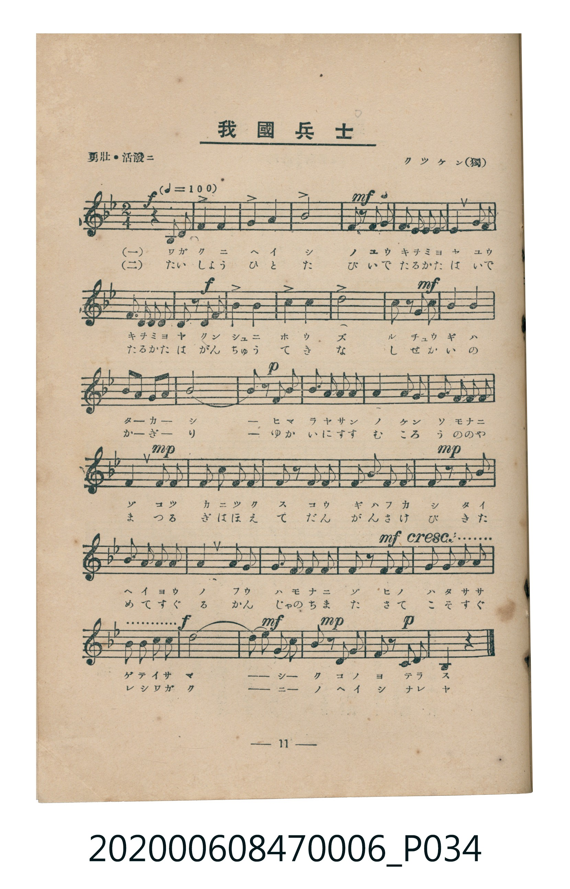
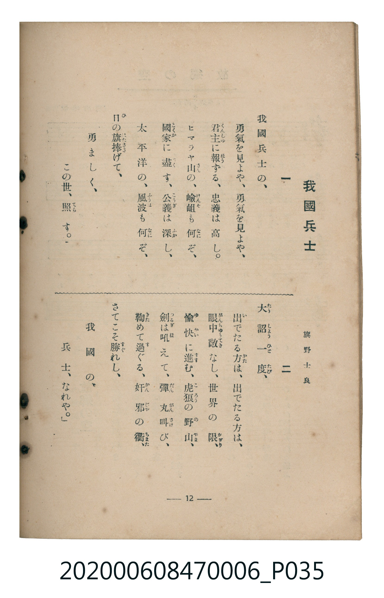

# 我國兵士

<audio controls src="wagakuni_heishi.mp3"></audio>

- 詞：旗野士良
- 曲：クツケン（獨）
- 臺灣教育會公認《新定兒童唱歌》尋常科第六學年用（2020.006.0847.0006）

## 說明

原書資訊與歌詞全文（對應 P034.jpg – P035.jpg，書頁 pp. 11–12，第一學期第 10 首）：
調性與拍號：變ろ長調四分之二拍子（Bb 大調 2/4 拍，弱起半拍），「勇壯・活潑ニ」（♩=100）

## 歌詞

```text
一　我國兵士の、
勇氣を見よや、勇氣を見よや、
君主（くんしゆ）に報（ほう）ずる、忠義は高し。
ヒマラヤ山（さん）の、嶮岨（けんそ）も何（なに）ぞ、
國家（こくか）に盡（つく）す、公義（こうぎ）は深（ふか）し、
太平洋の、風波（ふうは）も何（なに）ぞ、
日（ひ）の旗捧（はたさゝ）げて、
勇ましく、
この世、照（てら）す。

二　「大詔（たいせう）一度（ひとたび）、
出（い）でたる方（かた）は、出でたる方は、
眼中敵（がんちゆうてき）なし、世界の限（かぎり）、
愉快（ゆかい）に進（すゝ）む、虎狼（ころう）の野山（のやま）、
劍（つるぎ）は吼（ほ）えて、彈丸（だんがん）叫（さけ）び、
鞠（きた）めて過（す）ぐる、奸邪（かんじや）の衢（ちまた）、
さてこそ勝（すぐ）れし、
我國の、
兵士、なれや。」
```

## ABC

```abc
X:1
T:我國兵士
C:曲：クツケン（獨）
M:2/4
L:1/16
Q:1/4=100
K:Bb
V:V1 name="Piano" snm="Pia"
[V:V1]
!f! z4 z2 f f | b2 b2 d2 d2 | !mf! f4 z2 f d | b b c c d2 f d |
!f! b b c c d2 d e | f2 d2 b2 f2 | !mf! g4 f2 f e | d2 g2 f2 =e2 |
f2 c2 f4 | !p! f4 z2 f f | e2 c c a2 f f | f2 d d b2 b b |
!mp! a2 c c e2 c c | b2 d2 f2 d b | a2 c c e2 c a | !mp! b2 z2 z2 b b |
c c d c b2 g2 | f2 b c d2 b2 | !mf! c2 c c d d e e | !f! f f g a b4 |
!mf! !mp! b2 g e f2 d b | !p! c2 e c b2 z2 |
```

## TMD 檔案連結

- [主旋律 TMD 檔案](wagakuni_heishi.tmd)
- [鋼琴伴奏 TMD 檔案](wagakuni_heishi_piano.tmd)

## 分析

```text
================================================================================
📊 TMD Song Profile: [ 我國兵士 ]
================================================================================
⏱  Duration:       0:26 (26.4s), 22 measures total
🎼 Key & Tempo:    首調基準 B,, != 100.0 BPM, <2/4>
   - 分析範圍：      由實際發聲的音符與和弦推測調性；播放脈絡另行呈現
🎤 人聲音域:    F4 (MIDI 65) – A#5 (MIDI 82) [跨度: 17 個半音 / 1.4 個八度, 難度: challenging]
   - 最低音:  F4 in [WagakuniHeishi #1 @ m.1, 0:00]
   - 最高音: A#5 in [WagakuniHeishi #1 @ m.6, 0:06]
   - 適合: soprano, tenor
🏛  結構:      WagakuniHeishi (26.4s)
⚡ 編曲密度:        Peak 1 軌道同時演奏
🗝  調性診斷：       A# 大調（純淨自然大調，未偵測到可信轉調）
   - 風格氣質:    純淨自然大調（陽光明朗、易唱易記，無明顯調外色彩）
   - 轉調歷程:    全曲維持單一推測調性（未偵測到可信轉調）
   - 核心骨幹音:  F, A#, C, D, D#
   - 調性數值:    A# 大調 [相關度: 0.91, 穩定度: Moderate, 自然音純度: 98.8%]
   - 候選調性 (K-S): A# 大調 (0.91), F 大調 (0.83), D 小調 (0.66)
   - 五度圈歷程:   -2
   - 各段落調性細節:
     • [WagakuniHeishi #1]: A# 大調 (r: 0.91, 自然音純度: 98.8%, 調外音: E)

  [ 五度圈游移軌跡 ]
               C  
         F            G  
     [Bb]*              D  
      Eb               A  
         Ab           E  
            Db       B  
               F# 
     (* = active key center)

  [ 十二半音累積音高分佈 ]
     C  : ███████████████           16.2%
     C# :                            0.0%
     D  : ███████████████           16.2%
     D# : ███████                    7.5%
     E  : █                          1.2%
     F  : ████████████████████████  25.6%
     F# :                            0.0%
     G  : ██████                     6.2%
     G# :                            0.0%
     A  : █████                      5.0%
     A# : ████████████████████      21.9%
     B  :                            0.0%
--------------------------------------------------------------------------------
Assignment 軌道音域：
  - Piano         : F4 – A#5 (17 個半音 / 1.4 個八度, 106 個音符)
================================================================================
```


## 原書掃描頁






