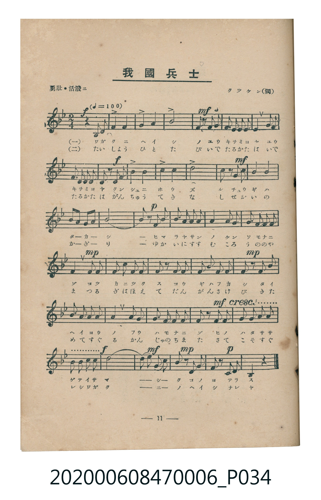
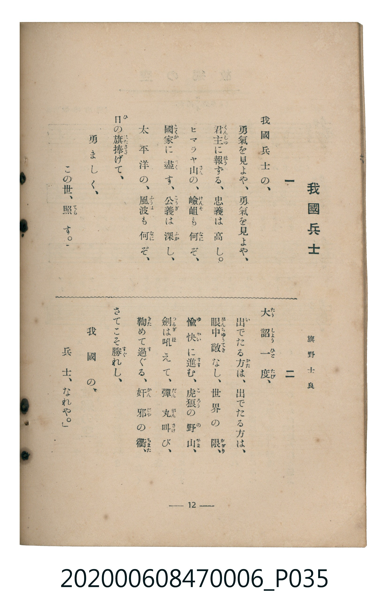

# 我國兵士

> Re:Shōka 使用 AI 協助辨識與重建樂譜，可能會有錯誤。歡迎回報。

- **鋼琴伴奏版**：<br><audio controls src="wagakuni_heishi.mp3"></audio>
- **NEUTRINO 歌聲合成版**：<br><audio controls src="wagakuni_heishi_neutrino.mp3"></audio>

- 詞：旗野士良
- 曲：ランゲ（獨）
- 臺灣教育會公認《新定兒童唱歌》尋常科第六學年用（2020.006.0847.0006）

## 說明

原書資訊與歌詞全文（對應 P034.jpg – P035.jpg，書頁 pp. 11–12，第一學期第 10 首）：
調性與拍號：變ろ長調四分之二拍子（Bb 大調 2/4 拍，弱起 1 拍），「勇壯・活潑ニ」（♩=100）


## 歌詞

```text
一　我國兵士の、
勇氣を見よや、勇氣を見よや、
君主（くんしゆ）に報（ほう）ずる、忠義は高し。
ヒマラヤ山（さん）の、嶮岨（けんそ）も何（なに）ぞ、
國家（こくか）に盡（つく）す、公義（こうぎ）は深（ふか）し、
太平洋の、風波（ふうは）も何（なに）ぞ、
日（ひ）の旗捧（はたさゝ）げて、
勇ましく、
この世、照（てら）す。

二　「大詔（たいせう）一度（ひとたび）、
出（い）でたる方（かた）は、出でたる方は、
眼中敵（がんちゆうてき）なし、世界の限（かぎり）、
愉快（ゆかい）に進（すゝ）む、虎狼（ころう）の野山（のやま）、
劍（つるぎ）は吼（ほ）えて、彈丸（だんがん）叫（さけ）び、
鞠（きた）めて過（す）ぐる、奸邪（かんじや）の衢（ちまた）、
さてこそ勝（すぐ）れし、
我國の、
兵士、なれや。」
```

## ABC

```abc
X:1
T:我國兵士
C:曲：ランゲ（獨）
M:2/4
L:1/16
Q:1/4=100
K:Bb
V:V1 name="Piano" snm="Pia"
[V:V1]
!f! z4 B,2 D2 | F4 F4 | G4 A4 | B8 |
w: 1.~わ が | く に | へ い | し
w: 2.~た い | せ う | ひ と | た
!mf! F2 z2 F2 G2 | F3 E E2 E2 | E4 G2 F2 | F3 D D2 D2 |
w: 1.~の ゆ _ | き を み よ | や ゆ _ | き を み よ
w: 2.~び い で | た る か た | は い で | た る か た
!f! D2 z2 D2 F2 | B4 B4 | c4 c4 | d8 |
w: 1.~や く ん | しゆ に | ほ う | ず
w: 2.~は が ん | ちゆ う | て き | な
!mf! c2 z2 G2 c2 | B4 B4 | B2 A2 G2 A2 | B8 |
w: 1.~る ちゆ う | ぎ は | た _ か _ | し
w: 2.~し せ か | い の | か _ ぎ _ | り
!p! B2 z2 F2 B2 | B3 A A2 A2 | A4 A2 G2 | G3 F F2 F2 |
w: 1.~_ ひ ま | ら や さ ん | の け ん | そ も な に
w: 2.~_ ゆ か | い に す す | む こ ろ | う の の や
!mp! F4 F2 F2 | F2 c2 F2 F2 | F2 z2 F2 F2 | F2 B2 F2 F2 |
w: 1.~ぞ こ く | か に つ く | す こ う | ぎ は ふ か
w: 2.~ま つ る | ぎ は ほ え | て だ ん | が ん さ け
F2 z2 F2 B2 | B3 A A2 A2 | A4 A2 G2 | G3 F F2 F2 |
w: 1.~し た い | へ _ や う | の ふ う | は も な に
w: 2.~び き た | め て す ぐ | る か ん | じや の ち ま
!mf! F4 F2 F2 | G2 G2 A2 A2 | B2 B2 c2 c2 | !f! d8 |
w: 1.~ぞ ひ の | は た さ さ | げ て い さ | ま
w: 2.~た さ て | こ そ す ぐ | れ し わ が | く
d2 e2 G2 c2 | !mp! B2 z2 D2 G2 | !p! F4 C2 D2 | B,4 z4 |
w: 1.~_ _ し _ | く こ の | よ て ら | す
w: 2.~_ _ に _ | の へ い | し な れ | や
```

## TMD 檔案連結

- [主旋律 TMD 檔案](wagakuni_heishi.tmd) [[在 TMD Studio 編輯](https://tmdlang.github.io/Tmd-TS/#tmd=s7IKdvYPcrWy4qpTUCpJTLdSSM7PyUlNLsnMz7MqzsjMK0nNjM_KTMmPL87Iz05Ugisry88pzU21Si9KTEmNN4s3MjAyiDcwMIs3sDAxBzIMzBBKi_NLi5JTrYqTM_Lzc-JLUitKkvLzs9Hl4wsS01OtAgyMTRAyBUX5Zal5iXlA3QVFILekgLUjFKSWZaakgqSLkxPz4stSizLTMlNTkFyZWlQM9gnEipKixLzi5KLMApD3EKryi0oy8oE-KciotMrILC7JL8pMTsyJz07MQ_JwSUYq0L-5mTmZJYlFlciaM9Mz86xyUzOzMrF4DipdnlpcklqUF5-bmpOfAtStpaXwrGPi0zndT1u3Pl28WkFLi0vRVsHQwIDL3lbBSYfLxkjfxA5kyIuV897vmfVs-vSX7X1AhS8614PNfjZ7E1D4cfPKx82bHzcB2R3Pe1e839MJlnzRvut54-JnU2e-aNr0bE7z09Y1L1b1Pm7oejZtw9N1s562Tnq-eunTKRufre153ND9dEP30x07ni-f-HzNmqeta5-u3fF055bnU4CGdYAiVQ8YlXqgSAUyDMzANnDpaynYUgtwKSgoPO2b_2z2jheb21-s6HrR0Q50F9DXT1tXPJvWDnTF0w29z9o7FUApQy-rIF3hUcNkEMcUxHm_pweo8-WCRoWCAj0FQ0OgnKERUBDolyc7GoB-eTZnPpANDFiFl8umAV0PDDSQjS9W7X_WsBxkV3fvi5nzgaIv1nU9bup9OXU7UOrp7NlPO9qe7Ox-sqsHqODp2glAZzglKTxdshwoqwCMGgWgMNCap3s2vti6XcEQwgUaDgzQnqfd7U8Xr3_cvPvZlt3P9k583Nz9uAEo2_Fo5kpbYAQD1XGBnAB03-OGBuRE8Lhx3eOGRnCAdLc_27D4cdOkF8u6Hzd1PG5qAUpgFQSrnjD7yY7dQBseN_Y_bpr8uHH646Y2oDWPG1c_XbARLL77cSNEZNbjJqBzGp_uX_B838rHjetfrp4BUt_QBDLocfOkx83zwIlqydONEJ1TgSaCdYLc9nTbuqebQCnjceNEsE1zQVJNTU_2TgULrgJaCVY8D-Y0oN_WbQPLAVX3P27shrjr-eyFYMElQEGwyEyQ6a1rgI6CKW573NgHllr_bDvEKVth2oHuhZi-ZNXTnZufbemGuO7lohXPNi-CKQXqX0_Adc-mLwVLALMPyIPATPasdzlYZP3jxvlgv4M92DjpceMyRNQ8btwHcgPQOxAhsHPXPdkxDch_3goxYNnjJmBygHisCRLfu4CJAxjlPaBUtHIKWBXQjpbHjbMhkQNKsLuWQRz0uHEFWHYzyAyoxe27wHItYGOXg6Sbup9N2wkWBIYAMBGDAgsUju27kBVABEFGPJ-z58mOtc-mbgXr6QHH4EJgWgEH1rLHjaA0DA4mUAAD_fN8ag_QYy9ngpI_2I6-x01dCBc9a-l8uh8YosCkCNQPlIY4bfXLBlB5BPI6JPiagL5ufDGz73n3HmjkNvXC0uM6ULEGTWrrQEm6cR-Sl7tA-QaUSoCJFpYank6AmAJM8EAuOKiBXt7b8WTHDrD4ArC3QJ4DKnjaD3YfMCYbJ4LVb4Ya_XLeArAE0CHggGtqBBr0EmQHyOFgpROgWWXpjpdNq6AhADJ6BtCZELe_WAhJbQvBKQJsDixFAC0EBigohzztBgYCODQageEItAkYprAEDMn9SPkeUg40AB2zCqQQlMWbgKUHSI7yohYKFLT0ubjCE9MTs0vzMj1SM4G1vFVAZmJevkONQU01yCoFG0MzLTswC1tRrwApXV8s7FHQgJaA2gomCk839D9f36ADL6g1segEWg0ytUbBQEEXDKvTahUM44EMYxBRo2AKokAQzqhRMIMxzRFihlAWDEJ1goytzgWaCeaBNdaAbfQxrFGA6X7c1A8iG3vA-oD5GCbeuBpu2uPGHXDRFiTR6Rj2AmMPSIPMBmYDmCjETiMkOxvnw80C6ZkNF4frAbI3wUVXIImCdKLbuRlmJ9hEYHYH24o_ynb1gKOMxJiCRoRJPAiBaZALwBQIgsMYrAauFBiV4NiERimYAkcMMF7AHIhyeLwAcyHE102TgOz9YFYHxJ9NsLBHCluC6iHhAo7jpskosQELS2DOBrK74fECklkPD3ukECWoA2IXKCXB7CKQbTrJiQNYaofRNQpGUBaMBgYzlIVIJSA5eIYAxxNIBDncQQ0FuLeRE_9uuChysM_CsAIULLBAANUkcC3IYQ6VwDRvGVwUEqEQ0VWYtoCzHcQWUMaBRASBoAY24qgT1CAWuOQBByGYha38AYmAQ7sAWvqABJADuw_uW1hSQ87cED8h-xfVeBAJCQFQIQGscBCmgwMZnlHAxRHMHJiZCNtBcdaF23RoFBIRvk92TSE_fIGhCA5IaGjCC3ZEOMOLfWBYgoMTtYwBpWpYQKMXJ02dED8DCwNgRQxmgbMmUtgAmwMo4nOhOpqg6Q-SG0Ay8-A6QGohxQpmuIPUA6t4MAtEglzRgKqzCZTGQTogOQDkFoh7IIUWSAYUpxC5JWBxYlJ561rMWAB3jQgX6qDSACNoQUkYQxAUabhVoid0SCkJCkCoRyCBBg0aSCKGBCa4pIAmTki2ADbdwSTY6ygZH6n-RAp-ZJ2gQgvYIoTqBBUuEJ0LwIEJi2pEWQ1NHOCkgFqngqIKWs4TKs-byQl-KmYCWFsHo06Ft1_AyQsR1ogsAAlpmDikUMKfBSBFD8gEpDhoaoTKLoNngQkQneAEjCjcEHEAakJDJUC5YCGYBS7RoMEOkYNEDygiCeaC1cCe_5Odc8GRYU5aZICDGFG2IxXwIAzKJOBqE9J8gboNUXKCRExgBqDXr5B0CUm5EM-ASJDMJLjXYO0NmAysEEAtnCEBAqsWkHMAJCWDCjD00AendLAeXC1ebHbAmwGQIEeq2EAFLrj9Bk2biFQIlDACcaAtPnCDHgRhrXzkMAHZjVwGgFMTtAUHS0cgF4MKcViZAYIwM5H9Dm95g1M7onUNCydoSgaHBHJrEmFWLReXrp0Cam9IASiizAUA)]
- [鋼琴伴奏 TMD 檔案](wagakuni_heishi_piano.tmd) [[在 TMD Studio 編輯](https://tmdlang.github.io/Tmd-TS/#tmd=s7IKdvYPcrWy4tLSUnjWMfHpnO6nrVufLl79fk_Hy-49zydsebJny9Ol_c87O97v6VTQ0uJStFUwNDDgsrdVcNLhsjHSN7HjqlNQerFy3vs9s55Nn_6yvQ-o-0XneiWQ8LPZm4DCj5tXPm7e_LgJyO543rsCaBBY8kX7rueNi59NnfmiadOzOc1PW9e8WNX7uKHr2bQNT9fNeto66fnqpU-nbHy2tudxQ_fTDd1Pd-x4vnzi8zVrnraufbp2x9OdW55PARrWYWRgZKBnYGCmZ2BhYg5kGJiBbeAKT0xPzC7Ny_RIzSzOyLQKyEzMyw_ycKjRNayp5lIAAhtDMy07MKtGwUBBFwyr02oVDOOBDGMQUaNgCqJAEM6oUTCDMc0RYoZQFgxCdYKMrc4FmgnmgTXWgG30MaxRgOl-3NQPIht7wPoeN4J4YPHG1XDTHjfugIu2IIlOx7D3ceM6IA0y-3FTG0wUYqcRkp2N8-FmgfTMhovD9QDZm-CiK5BEQTrR7dwMsxNs4uPG5WBboYELDTuTeBAC0yBNYAoEwcECVgNXCgx9cARAYwFMgcMSGJRgDkQ5PCgfN_ZCHNo0CcjeD2Z1QJzWBAsupOAgqB7iFXC0NE1GCUCY9x83dQPZ3fCgBMmshwcXUiAQ1AGxCxT5MLugwQZLUzC6RsEIyoLRwJCBshBxAZKDJztw0IJEkINqOiIkUJPYbrgockjNwrAC5BOYuxdCDINoQQ4mqASmecvgopA4gIiuwrQFnLghtoCSJyTs8IQOiAXOkmBfg1nYMiZIBBxABdBsCRJADp8-uANhEYqc6iHOQHYiqvEgEuJoUO553LgPYTo4XODJEZxPYebAzETYDgrmLtymQ0MdS5AAPQ72OzQA4IUUImjgRRjQ--AQQM18oLQDCxv0fNbUCXEmMJc8bpwKZoHTLJJ3HjdORBGfC9XRBI1lSJoDycyD6wCpheQ3zKACqX_cOBPMApEgVzSg6mwCpSSQDkg6A7kF4h5IbgbJgKIBIrcELI4ScGBfgrIJRmiAEgqGICiccatET06QHA_yM9RuiD-hvoEkFYj_wVkImgQgie9x41YwCXYtSo5AKr6RQgxZJyg3P26ElmrgXAfRuQDsf1jsIModaHyCYw-1SAeFLrTMokFSg9WOGEU6vMYDRyIieBAJDRI4MHFIbsWf0CB5EmQCUrA1NUJll8ET2gSITnAyQeR6RLDNgNUrkLS2EMwCZ3VoSEHkICEKCnt4yIHDA1FCIRVTIAxKhODyGlLVQQ1C5H-QiAnMAPSCHRLvkJQBsRlEgmQmwd0Bq5tgMrB8gVrEQFwPK9yQUxgkpYDyNHpQgVMSWA-uBg02O-D1D3LKgtRfwDIIXNdDExIiyQAljEAcaOsA3F4DQVgjDjlMQHYj5zFw1ENre1ikg1wMKtdgeRIEYWYi-x3esAInTUTjCRZO0GQHDgnklgfCrFrszVIflGapCVKrFJQKDCB-jDaMBTJM4oEs03gQEy4GZICzEVAhvECDq0JiomhAUQ-XwaYaJIZmPl71INOBUUSSa0CRjVMDSgAAGaSZjOJwtOCDsKCNfvQARvgV5jxIUADZCCNARgNjVddOATVio32ApmERNQKLKnMBAA)]

## 分析

```text
================================================================================
📊 TMD Song Profile: [ 我國兵士 ]
================================================================================
⏱  Duration:       0:43 (43.2s), 36 measures total
🎼 Key & Tempo:    首調基準 B,, != 100.0 BPM, <2/4>
   - 分析範圍：      由實際發聲的音符與和弦推測調性；播放脈絡另行呈現
🎤 人聲音域:    A#3 (MIDI 58) – D#5 (MIDI 75) [跨度: 17 個半音 / 1.4 個八度, 難度: challenging]
   - 最低音:  A#3 in [WagakuniHeishi #1 @ m.1, 0:00]
   - 最高音: D#5 in [WagakuniHeishi #1 @ m.33, 0:38]
   - 適合: soprano, mezzo-soprano, contralto, tenor, baritone, bass
🏛  結構:      WagakuniHeishi (43.2s)
⚡ 編曲密度:        Peak 1 軌道同時演奏
🗝  調性診斷：       A# 調性不明確（純淨自然大調，未偵測到可信轉調）
   - 風格氣質:    純淨自然大調（陽光明朗、易唱易記，無明顯調外色彩）
   - 轉調歷程:    全曲維持單一推測調性（未偵測到可信轉調）
   - 核心骨幹音:  F, A#, A, D, G
   - 調性數值:    A# 調性不明確 [相關度: 0.87, 穩定度: Ambiguous, 自然音純度: 100.0%]
   - 候選調性 (K-S): A# 大調 (0.87), F 大調 (0.85), D 小調 (0.71)
   - 五度圈歷程:   -2
   - 各段落調性細節:
     • [WagakuniHeishi #1]: A# 調性不明確 (r: 0.87, 自然音純度: 100.0%)

  [ 五度圈游移軌跡 ]
               C  
         F            G  
     [Bb]*              D  
      Eb               A  
         Ab           E  
            Db       B  
               F# 
     (* = active key center)

  [ 十二半音累積音高分佈 ]
     C  : ███████                    8.3%
     C# :                            0.0%
     D  : ██████████                12.4%
     D# : ███                        4.1%
     E  :                            0.0%
     F  : ████████████████████████  28.6%
     F# :                            0.0%
     G  : █████████                 11.3%
     G# :                            0.0%
     A  : ███████████               12.8%
     A# : ███████████████████       22.6%
     B  :                            0.0%
--------------------------------------------------------------------------------
Assignment 軌道音域：
  - Piano         : A#3 – D#5 (17 個半音 / 1.4 個八度, 104 個音符)
================================================================================
```


## 原書掃描頁






