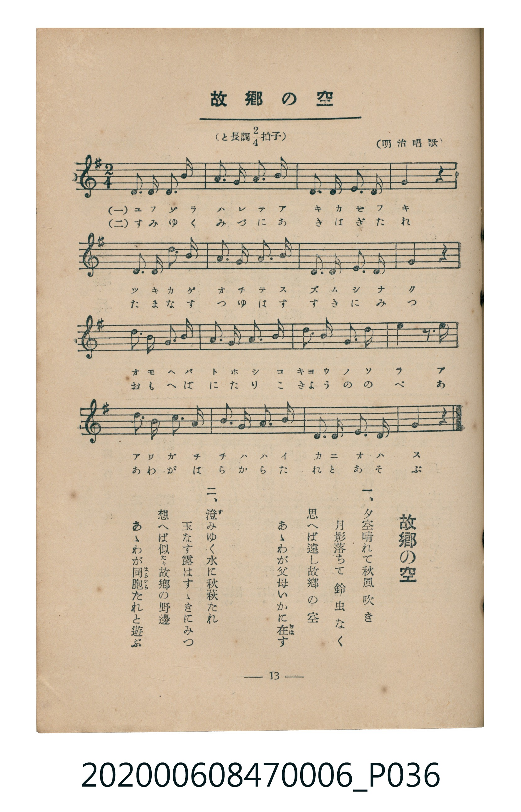

# 故郷の空

> Re:Shōka 使用 AI 協助辨識與重建樂譜，可能會有錯誤。歡迎回報。

- **鋼琴伴奏版**：<br><audio controls src="kokyo_no_sora.mp3"></audio>
- **NEUTRINO 歌聲合成版**：<br><audio controls src="kokyo_no_sora_neutrino.mp3"></audio>

- 明治唱歌
- 臺灣教育會公認《新定兒童唱歌》尋常科第六學年用（2020.006.0847.0006）

## 說明

原書資訊與歌詞全文（對應 P036.jpg，書頁 p. 13，第二學期第 1 首）：
調性與拍號：と長調四分之二拍子（G 大調 2/4 拍）


## 歌詞

```text
一、
夕空晴れて秋風吹き
月影落ちて鈴虫なく
思へば遠し故郷の空
あゝわが父母いかに在（おは）す

二、
澄（す）みゆく水に秋萩たれ
玉なす露はすゝきにみつ
想へば似たり故郷の野邊
あゝわが同胞（はらから）たれと遊ぶ
```

## ABC

<div class="abc-score" data-abc-src="kokyo_no_sora.abc" aria-label="五線譜載入中"></div>

[下載 ABC 原始檔](kokyo_no_sora.abc)

## TMD 檔案連結

- [主旋律 TMD 檔案](kokyo_no_sora.tmd) [[在 TMD Studio 編輯](https://tmdlang.github.io/Tmd-TS/#tmd=s7IKdvYPcrWy4qpTUCpJTLdSSM7PyUlNLsnMz7MqzsjMK0nNjM_KTMmPL87Iz05Ugisry88pzU21Si9KTEmNN4s3MjAyiDcwMIs3sDAxBzIMzBBKi_NLi5JTrYqTM_Lzc-JLUitKkvLzsxHyBUX5Zal5iXlANQVFIBtTwIoQClLLMlNSQdLFyYl58WWpRZlpmakpSG5JLSoGuxdsUXxJUWJecXJRZgHIEwhV-UUlGflA9xZkVFplZBaX5BdlJifmxGcn5iF5qyQjFeirvMSS0qJUdFGguWWpOcgGZqZn5lnlpmZmZWLxFlS6PLW4JLUoLz43NSc_pRI9VOILEtNTrQIMjIHhpaWl8Gxq68vm7Y8b1z1fuUtBS4tL0VbBwoLL3lbBncvGSN_EDqT72Yy-Z5t2P52y8dnaHrBxL9p3PW9c_GzqzBdNm57NaX7auubFqt7HDV3Ppm14um7W09ZJz1cvhSh_3ND9dEP30x07ni-f-HzNmqeta5-u3fF055bnU1a839MBikM9YMzpgeIQyDAwe7-nU4mLS19LwZZagEtBQeFp3_xns3e82Nz-YkXXi452oLterJz3tHXFs2ntQFc83dD7rL1TARQkelkF6e_39AAVv1zQqFCgp2BoDOQCHf5kVw_Q4c_mzAeyFQwVXi6bBnTp-z2zQKa_WLX_WcNykLndvS9mzgeKPm5c8XLqdqD409mzn3a0PdnZDdQPlH26dgLQPneFp0uWAyUVgOGrABQFmsQFMufJjobHDY1g9y6ZCoyOZzO3PG7qedy47Pny7peLVjydsPNxYy9I-tmcjqd7N76YsPdx40Kg9MuOLS9mrn7cuOpxYz9YumHu48Ydjxs3vGxc8LhxOnIMg6QfNzY9bpr7uKn_cWPP845tz9b3Pm5sedzY_bhx9dM5oFh53Nj1uHE90FWPG2dCHLYLGI9ghz3b1wJWMBMsu_9xUxvQzmcbtgD1Ah35YsLKx43zgW4GKX3eB1QBdNLMl3M2AY0DMkC2NgItAzp1_-PGJWDzmjdDnPpkzx6w1i64a1-2971s6kJ38NMJPS-a54HdsP5xE9CGbiAJdgzIXlC4gxy_DaSN8qQDBQpa-lxc3vnZlfl--cH5RYlWAZmJefkONQY11SB7FGwMzbTswCxs6VYBlHp2NLxY2KOgYaLwdEP_8_UNOvDEpolFA9A6kGE1CqbxCrpACKSgLGOgoBGYZQilQSIIZWZwVg1QBYipq2AApWvAhvoY1igAYw0s8rhxKxDPg7CbOoF6gIEK5fUA2cugqprAMr1QXjcQz4HrR8joKkAsh9tkBJKbCVW5H8nWfrCu_VDeUiBejdWm9UDcB2XPB8kAXYVuE_5g39VDYbBTM9Qbl0D90gsORQh7EtjHXVDeQqRQnwmWmQWNjwYgezpUZhVYph9PqM-HqtwHVo1sHtQNwLiAxzVUBhZTINfB4mM_kh7iQ31HJ1mhDg1ZRAhjCXMUNaZAETOU8DZDCW9oqDY1Adk7oD7aAPbRCihvN1KoToakvcdN7VABUBCtg7LngpNfJ0pAgJMrUqDjtg4WnPOBsrCoxmvdOrDkTizW4Q15YG1DScibgGkjoIgxZsiTnNqboMHRD2RD8i0ofYNkFkJ5oPwNS4MtYBlYrliNlCfWI6VO7Kkdm01gXdAIA5dZcDZySQJKCXD9kEhu3IZhUy0Xl66dAlIFoADkKnMBAA)]
- [鋼琴伴奏 TMD 檔案](kokyo_no_sora_piano.tmd) [[在 TMD Studio 編輯](https://tmdlang.github.io/Tmd-TS/#tmd=s7IKdvYPcrWy4qpTUCpJTLdSyC8qychPL0osyKi0ysgsLskvykxOzInPTsxLVIIrKs4vLUpOjS9ITE-1CjAwNlPi0tJSeDa19WXz9seN656v3PV-T8fL7j3PJ2x5smfL06X9zzs73u_pVNDS4lK0VbCw4LK3VXDnsjHSN7EDGflsRt-zTbufTtn4bG0P2I4X7bueNy5-NnXmi6ZNz-Y0P21d82JV7-OGrmfTNjxdN-tp66Tnq5dClD9u6H66ofvpjh3Pl098vmbN09a1T9fueLpzy_MpK4BOMDIwMtAzMDDTM7AwMQcyDMyArlDi4vLOz67M98sPzi9KtArITMzLD_JwqDGoqeZSAAIbQzMtOzBLX0vBFh0oAG15sqPhxcIeBQ2Qz_WyCtI1sSjT0gcbUaNgGq-gC4RACsoyBgoagVmGUBokglBmBmfVAFWAmLoKBlC6Bmyoj2GNwuOmNrDI48atQDwPwm7qBOp53LgeyusBspdBVTWBZXqhvG4gngPXj5DRVYBYDrfJCCQ3E6pyP5Kt_WBd-6G8pUC8GqtN64G4D8qeD5IBugrdJvyBvauHrMCmZlg3LoH6oBccdhD2JLA_u6C8hUhhPRMsMwsaCw1A9nSozCqwTD-esJ4PVbkPrBrZPKgbgDEAj2GoDCx-QK6DxcJ-JD3Eh_WOThLCGhqeiHDFEtIoakyBImYooWyGEsrQsGxqArJ3QP2xAeyPFVDebqSwnAxJZ4-b2qECoIBZB2XPBSe1ThTvg5MmUlDjtg4WiPOBsrAIxmvdOrDkTizW4Q3vp7Nnkx7eJmDaCChijBneJKfsJmgg9APZkJwJSssgmYVQHigHw9JbC1gGlgNWI6X_9UgpEXvKxmYTWBc0msClEpyNXFaA4h-uHxK1jdswbKrFUq77IJfrJtBiHRgg8QrRhrHg8AKyTONBTJCYCYxlAHU5yUohCtDUQlgm2NWislCMBfpI104ByVPRPkCnoAsZgYWUuQA)]

## 分析

```text
================================================================================
📊 TMD Song Profile: [ 故郷の空 ]
================================================================================
⏱  Duration:       0:21 (21.8s), 16 measures total
🎼 Key & Tempo:    首調基準 G, != 88.0 BPM, <2/4>
   - 分析範圍：      由實際發聲的音符與和弦推測調性；播放脈絡另行呈現
🎤 人聲音域:    D4 (MIDI 62) – E5 (MIDI 76) [跨度: 14 個半音 / 1.2 個八度, 難度: moderate]
   - 最低音:  D4 in [KokyoNoSora #1 @ m.1, 0:00]
   - 最高音: E5 in [KokyoNoSora #1 @ m.12, 0:15]
   - 適合: soprano, mezzo-soprano, contralto, tenor, baritone, bass
🏛  結構:      KokyoNoSora (21.8s)
⚡ 編曲密度:        Peak 1 軌道同時演奏
🗝  調性診斷：       D 大調（純淨自然大調，未偵測到可信轉調）
   - 風格氣質:    純淨自然大調（陽光明朗、易唱易記，無明顯調外色彩）
   - 轉調歷程:    全曲維持單一推測調性（未偵測到可信轉調）
   - 核心骨幹音:  D, A, G, E, B
   - 調性數值:    D 大調 [相關度: 0.89, 穩定度: High, 自然音純度: 97.3%]
   - 候選調性 (K-S): D 大調 (0.89), G 大調 (0.68), D 小調 (0.64)
   - 五度圈歷程:   +2
   - 各段落調性細節:
     • [KokyoNoSora #1]: D 大調 (r: 0.89, 自然音純度: 97.3%, 調外音: C)

  [ 五度圈游移軌跡 ]
               C  
         F            G  
      Bb              [D ]*
      Eb               A  
         Ab           E  
            Db       B  
               F# 
     (* = active key center)

  [ 十二半音累積音高分佈 ]
     C  : ██                         2.7%
     C# :                            0.0%
     D  : ████████████████████████  34.5%
     D# :                            0.0%
     E  : █████████                 12.4%
     F  :                            0.0%
     F# :                            0.0%
     G  : ██████████                14.2%
     G# :                            0.0%
     A  : █████████████████         24.8%
     A# :                            0.0%
     B  : ████████                  11.5%
--------------------------------------------------------------------------------
Assignment 軌道音域：
  - Piano         : D4 – E5 (14 個半音 / 1.2 個八度, 53 個音符)
================================================================================
```


## 原書掃描頁




