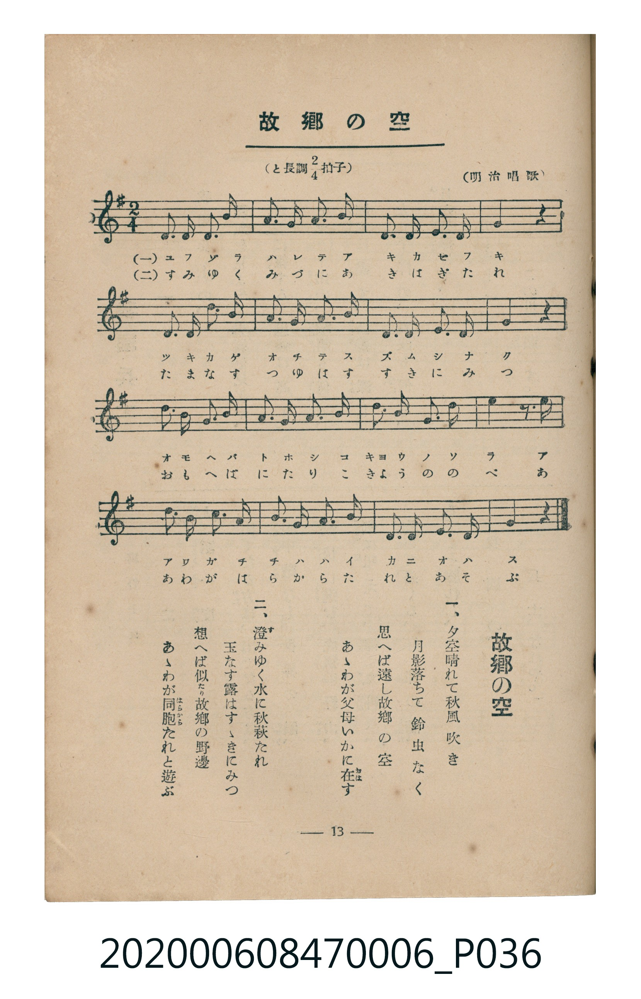

# 故郷の空

<audio controls src="kokyo_no_sora.mp3"></audio>

- 明治唱歌
- 臺灣教育會公認《新定兒童唱歌》尋常科第六學年用（2020.006.0847.0006）

## 說明

原書資訊與歌詞全文（對應 P036.jpg，書頁 p. 13，第二學期第 1 首）：
調性與拍號：と長調四分之二拍子（G 大調 2/4 拍）

## 歌詞

```text
一、
夕空晴れて秋風吹き
月影落ちて鈴虫なく
思へば遠し故郷の空
あゝわが父母いかに在（おは）す

二、
澄（す）みゆく水に秋萩たれ
玉なす露はすゝきにみつ
想へば似たり故郷の野邊
あゝわが同胞（はらから）たれと遊ぶ
```

## ABC

```abc
X:1
T:故郷の空
M:2/4
L:1/16
Q:1/4=88
K:G
V:V1 name="Piano" snm="Pia"
[V:V1]
D3 D D3 B | A3 B d3 B | A3 G E3 D | E4 z4 |
D3 D D3 B | A3 B d3 B | A3 G A3 B | G4 z4 |
e3 d B3 d | B3 A G3 A | B3 d e3 d | B4 z3 e |
d3 B B3 d | B3 A G3 A | D3 D E3 D | G4 z4 |
```

## TMD 檔案連結

- [主旋律 TMD 檔案](kokyo_no_sora.tmd) [[在 TMD Studio 編輯](https://tmdlang.github.io/Tmd-TS/#tmd=s7IKdvYPcrWy4tLSUng2tfVl8_bHjeuer9yloKXFpWirYGHBZW-r4M5lY6RvYsdVp6D0bEbfs027n07Z-GxtjxJI4EX7rueNi59NnfmiadOzOc1PW9e8WNX7uKHr2bQNT9fNeto66fnqpRDljxu6n27ofrpjx_PlE5-vWfO0de3TtTue7tzyfMqK93s6jAyMDPQMDMz0DCxMzIEMA7P3ezqVuLj0tRRsqQW4FBQUnvbNfzZ7x4vN7S9WdL3oaAe668XKeU9bVzyb1g50xdMNvc_aOxUCDIzN9LIK0t_v6QEqfrmgUaFAT8HQGMgFOvzJrh6gw5_NmQ9kKxgqvFw2DejS93tmgUx_sWr_s4blIHO7e1_MnA8Ufdy44uXU7UDxp7NnP-1oe7KzG6gfKPt07QSgfe4KT5csB0oqAMNXASgKNIkLZM6THQ2PGxrB7l0yFRgdz2ZuedzU87hx2fPl3S8XrXg6Yefjxl6Q9LM5HU_3bnwxYe_jxoVA6ZcdW17MXP24cdXjxn6wdMPcx407HjdueNm44HHjdOQYBkk_bmx63DT3cVP_48ae5x3bnq3vfdzY8rix-3Hj6qdzQLHyuLHrceN6oKseN86EOGwXMB7BDnu2rwWsYCZYdv_jpjagnc82bAHqBTryxYSVjxvnA90MUvq8D6gC6KSZL-dsAhoHZIBsbQRaBnTq_seNS8DmNW-GOPXJnj1grV1w175s73vZ1IXu4KcTel40zwO7Yf3jJqAN3UAS7BiQvaBwBzl-G0gb5UkHChS09Lm4vPOzK_P98oPzixKtAjIT8_IdagxqFKpBFinYGJpp2YFZ2BKuAij57Gh4sbBHQcNE4emG_ufrG3TgqU0TiwagfSDDahRM4xV0gRBIQVnGQEEjKMsUTcRQwQyuvAbG1lUwgNI14KjE7cJdPXRwIUymBsgmzXk7OslxnhnEdUAbIXQNlGUEtd8ILmIKVwsTgbnNjJDbgJmcrKCDhgU-tyGCFzluMcOulotL104BKY0qALnKXFwA)]
- [鋼琴伴奏 TMD 檔案](kokyo_no_sora_piano.tmd) [[在 TMD Studio 編輯](https://tmdlang.github.io/Tmd-TS/#tmd=s7IKdvYPcrWy4tLSUng2tfVl8_bHjeuer9z1fk_Hy-49zydsebJny9Ol_c87O97v6VTQ0uJStFWwsOCyt1Vw57Ix0jex46pTUHo2o-_Zpt1Pp2x8trZHCSTwon3X88bFz6bOfNG06dmc5qeta16s6n3c0PVs2oan62Y9bZ30fPVSiPLHDd1PN3Q_3bHj-fKJz9esedq69unaHU93bnk-ZQXQCUYGRgZ6BgZmegYWJuZAhoEZ0BVKXFze-dmV-X75wflFiVYBmYl5-UEeDjUGNQrVXApAYGNopmUHZulrKdiiAwWgNU92NLxY2KOgEWBgbKaXVZCuiUWZlj7YiBoF03gFXSAEUlCWMVDQCMoyRRMxVDCDK6-BsXUVDKB0DRd-d-3qoZm7YDI1QDZpjtrRSbyjzCBuAtoDoWugLCOorUZwEVO4WpgIzEVmhFz0dPZsEoIJ6m98LkIEJXLsYYZTLZak54OS9EygKQ-oO14h2jAWbDgmyyQeaGoNAZWm8SAmUBahFKgPXSlItwmGQlQzzcAmYRoK9I-unQKSlxQwucpcXAA)]

## 分析

```text
================================================================================
📊 TMD Song Profile: [ 故郷の空 ]
================================================================================
⏱  Duration:       0:21 (21.8s), 16 measures total
🎼 Key & Tempo:    首調基準 G, != 88.0 BPM, <2/4>
   - 分析範圍：      由實際發聲的音符與和弦推測調性；播放脈絡另行呈現
🎤 人聲音域:    D4 (MIDI 62) – E5 (MIDI 76) [跨度: 14 個半音 / 1.2 個八度, 難度: moderate]
   - 最低音:  D4 in [KokyoNoSora #1 @ m.1, 0:00]
   - 最高音: E5 in [KokyoNoSora #1 @ m.9, 0:10]
   - 適合: soprano, mezzo-soprano, contralto, tenor, baritone, bass
🏛  結構:      KokyoNoSora (21.8s)
⚡ 編曲密度:        Peak 1 軌道同時演奏
🗝  調性診斷：       D 大調（純淨自然大調，未偵測到可信轉調）
   - 風格氣質:    純淨自然大調（陽光明朗、易唱易記，無明顯調外色彩）
   - 轉調歷程:    全曲維持單一推測調性（未偵測到可信轉調）
   - 核心骨幹音:  D, B, A, E, G
   - 調性數值:    D 大調 [相關度: 0.79, 穩定度: Moderate, 自然音純度: 100.0%]
   - 候選調性 (K-S): D 大調 (0.79), B 小調 (0.73), G 大調 (0.72)
   - 五度圈歷程:   +2
   - 各段落調性細節:
     • [KokyoNoSora #1]: D 大調 (r: 0.79, 自然音純度: 100.0%)

  [ 五度圈游移軌跡 ]
               C  
         F            G  
      Bb              [D ]*
      Eb               A  
         Ab           E  
            Db       B  
               F# 
     (* = active key center)

  [ 十二半音累積音高分佈 ]
     C  :                            0.0%
     C# :                            0.0%
     D  : ████████████████████████  30.1%
     D# :                            0.0%
     E  : ████████████              15.0%
     F  :                            0.0%
     F# :                            0.0%
     G  : ███████████               14.2%
     G# :                            0.0%
     A  : █████████████             16.8%
     A# :                            0.0%
     B  : ███████████████████       23.9%
--------------------------------------------------------------------------------
Assignment 軌道音域：
  - Piano         : D4 – E5 (14 個半音 / 1.2 個八度, 53 個音符)
================================================================================
```


## 原書掃描頁




