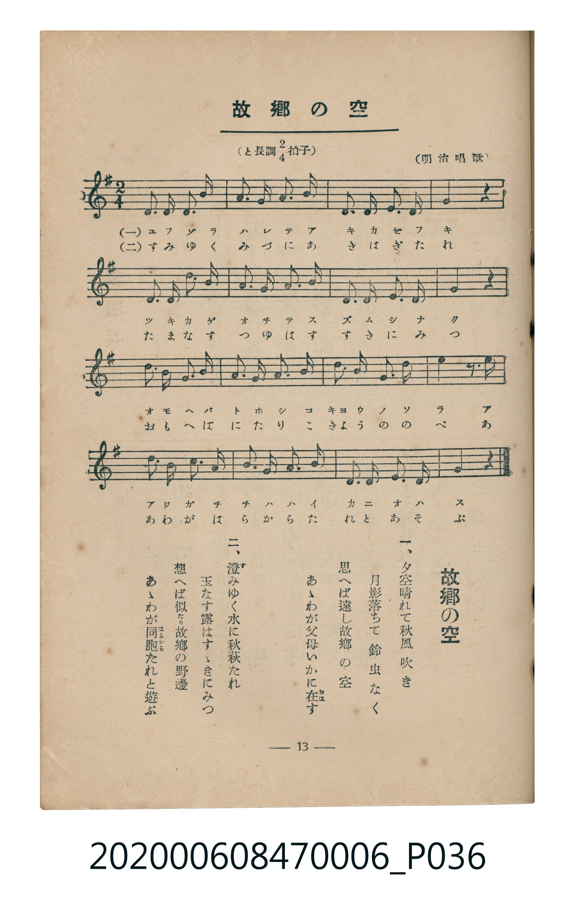

# 故郷の空

> Re:Shōka 使用 AI 協助辨識與重建樂譜，可能會有錯誤。歡迎回報。

- **鋼琴伴奏版**：<br><audio controls src="kokyo_no_sora.mp3"></audio>
- **NEUTRINO 歌聲合成版**：<br><audio controls src="kokyo_no_sora_neutrino.mp3"></audio>

- 明治唱歌
- 臺灣教育會公認《新定兒童唱歌》尋常科第六學年用（2020.006.0847.0006）

## 說明

原書資訊與歌詞全文（對應 P036.jpg，書頁 p. 13，第二學期第 1 首）：
調性與拍號：と長調四分之二拍子（G 大調 2/4 拍）


## 歌詞

```text
一、
夕空晴れて秋風吹き
月影落ちて鈴虫なく
思へば遠し故郷の空
あゝわが父母いかに在（おは）す

二、
澄（す）みゆく水に秋萩たれ
玉なす露はすゝきにみつ
想へば似たり故郷の野邊
あゝわが同胞（はらから）たれと遊ぶ
```

## ABC

```abc
X:1
T:故郷の空
M:2/4
L:1/16
Q:1/4=88
K:G
V:V1 name="Piano" snm="Pia"
[V:V1]
D3 D D3 B | A3 G A3 B | D3 D E3 D | G4 z4 |
w: 1.~ゆ ふ ぞ ら | は れ て あ | き か ぜ ふ | き
w: 2.~す み ゆ く | み づ に あ | き は ぎ た | れ
D3 D d3 B | A3 G A3 B | D3 D E3 D | G4 z4 |
w: 1.~つ き か げ | お ち て す | ず む し な | く
w: 2.~た ま な す | つ ゆ は す | す き に み | つ
d3 B A3 B | A3 G A3 B | d3 B A3 d | e4 z3 e |
w: 1.~お も へ ば | と ほ し こ | きょ う の そ | ら あ
w: 2.~お も へ ば | に た り こ | きょ う の の | べ あ
d3 B c3 A | B3 G A3 B | D3 D E3 D | G4 z4 |
w: 1.~あ わ が ち | ち は は い | か に お は | す
w: 2.~あ わ が は | ら か ら た | れ と あ そ | ぶ
```

## TMD 檔案連結

- [主旋律 TMD 檔案](kokyo_no_sora.tmd) [[在 TMD Studio 編輯](https://tmdlang.github.io/Tmd-TS/#tmd=s7IKdvYPcrWy4qpTUCpJTLdSSM7PyUlNLsnMz7MqzsjMK0nNjM_KTMmPL87Iz05Ugisry88pzU21Si9KTEmNN4s3MjAyiDcwMIs3sDAxBzIMzBBKi_NLi5JTrYqTM_Lzc-JLUitKkvLzsxHyBUX5Zal5iXlANQVFIBtTwIoQClLLMlNSQdLFyYl58WWpRZlpmakpSG5JLSoGuxdsUXxJUWJecXJRZgHIEwhV-UUlGflA9xZkVFplZBaX5BdlJifmxGcn5iF5qyQjFeirvMSS0qJUdFGguWWpOcgGZqZn5lnlpmZmZWLxFlS6PLW4JLUoLz43NSc_pVKJS0tL4dnU1pfN2x83rnu-cpeClhaXoq2ChQWXva2CO5eNkb6JHciIZzP6nm3a_XTKxmdre8Bmvmjf9bxx8bOpM180bXo2p_lp65oXq3ofN3Q9m7bh6bpZT1snPV-9FKL8cUP30w3dT3fseL584vM1a562rn26dsfTnVueT1nxfk8HKKb0gPGjB4opIMPA7P2eTiUuLn0tBVtqAS4FBYWnffOfzd7xYnP7ixVdLzrage56sXLe09YVz6a1A13xdEPvs_ZOhQADYzO9rIL093t6gIpfLmhUKNBTMDQGcoEOf7KrB-jwZ3PmA9kKhgovl00DuvT9nlkg01-s2v-sYTnI3O7eFzPnA0UfN654OXU7UPzp7NlPO9qe7OwG6gfKPl07AWifu8LTJcuBkgrA8FUAigJN4gKZ82RHw-OGRrB7l0wFRsezmVseN_U8blz2fHn3y0Urnk7Y-bixFyT9bE7H070bX0zY-7hxIVD6ZceWFzNXP25c9bixHyzdMPdx447HjRteNi543DgdOYZB0o8bmx43zX3c1P-4sed5x7Zn63sfN7Y8bux-3Lj66RxQrDxu7HrcuB7oqseNMyEO2wWMR7DDnu1rASuYCZbd_7ipDWjnsw1bgHqBjnwxYeXjxvlAN4OUPu8DqgA6aebLOZuAxgEZIFsbgZYBnbr_ceMSsHnNmyFOfbJnD1hrF9y1L9v7XjZ1oTv46YSeF83zwG5Y_7gJaEM3kAQ7BmQvKNxBjt8G0kZ50oECBS19Li7v_OzKfL_84PyiRKuAzMS8fIcag5pqkD0KNoZmWnZgFrZ0qwBKPTsaXizsUdAwUXi6of_5-gYdeGLTxKIBaB3IsBoF03gFXSAEUlCWMVDQCMwyhNIgEYQyMzirBqgCxNRVMIDSNWBDfQxrFICxBhZ53LgViOdB2E2dQD3AQIXyeoDsZVBVTWCZXiivG4jnwPUjZHQVIJbDbTICyc2EqtyPZGs_WNd-KG8pEK_GatN6IO6DsueDZICuQrcJf7Dv6qEw2KkZ6o1LoH7pBYcihD0J7OMuKG8hUqjPBMvMgsZHA5A9HSqzCizTjyfU50NV7gOrRjYP6gZgXMDjGioDiymQ62DxsR9JD_GhvqOTrFCHhiwihLGEOYoaU6CIGUp4m6GENzRUm5qA7B1QH20A-2gFlLcbKVQnQ9Le46Z2qAAoiNZB2XPBya8TJSDAyRUp0HFbBwvO-UBZWFTjtW4dWHInFuvwhjywtqEk5E3AtBFQxBgz5ElO7U3Q4OgHsiH5FpS-QTILoTxQ_oalwRawDCxXrEbKE-uRUif21I7NJrAuaISByyw4G7kkAaUEuH5IJDduw7CplotL104BqQJQAHKVuQA)]
- [鋼琴伴奏 TMD 檔案](kokyo_no_sora_piano.tmd) [[在 TMD Studio 編輯](https://tmdlang.github.io/Tmd-TS/#tmd=s7IKdvYPcrWy4tLSUng2tfVl8_bHjeuer9z1fk_Hy-49zydsebJny9Ol_c87O97v6VTQ0uJStFWwsOCyt1Vw57Ix0jex46pTUHo2o-_Zpt1Pp2x8trZHCSTwon3X88bFz6bOfNG06dmc5qeta16s6n3c0PVs2oan62Y9bZ30fPVSiPLHDd1PN3Q_3bHj-fKJz9esedq69unaHU93bnk-ZQXQCUYGRgZ6BgZmegYWJuZAhoEZ0BVKXFze-dmV-X75wflFiVYBmYl5-UEeDjUGNdVcCkBgY2imZQdm6Wsp2KIDBaAtT3Y0vFjYo6ARYGBsppdVkK6JRZmWPtiIGgXTeAVdIARSUJYxUNAIzDKE0iARhDIzOKsGqALE1FUwgNI1YEN9DGsUHje1gUUeN24F4nkQdlMnUM_jxvVQXg-QvQyqqgks0wvldQPxHLh-hIyuAsRyuE1GILmZUJX7kWztB-vaD-UtBeLVWG1aD8R9UPZ8kAzQVeg24Q_sXT1kBTY1w7pxCdQHveCwg7Angf3ZBeUtRArrmWCZWdBYaACyp0NlVoFl-vGE9Xyoyn1g1cjmQd0AjAF4DENlYPEDch0sFvYj6SE-rHd0khDW0PBEhCuWkEZRYwoUMUMJZTOUUIaGZVMTkL0D6o8NYH-sgPJ2I4XlZEg6e9zUDhUABcw6KHsuOKl1ongfnDSRghq3dbBAnA-UhUUwXuvWgSV3YrEOb3g_nT2b9PA2AdNGQBFjzPAmOWU3QQOhH8iG5ExQWgbJLITyQDkYlt5awDKwHLAaKf2vR0qJ2FM2NpvAuqDRBC6V4GzksgIU_3D9kKht3IZhUy2Wct0HuVw3gRbrwACJV4g2jAWHF5BlGg9igsRMYCwDqMtJVgpRgKYWwjLBrhaVhWIs0Ee6dgpInor2AToFXcgILKTMBQA)]

## 分析

```text
================================================================================
📊 TMD Song Profile: [ 故郷の空 ]
================================================================================
⏱  Duration:       0:21 (21.8s), 16 measures total
🎼 Key & Tempo:    首調基準 G, != 88.0 BPM, <2/4>
   - 分析範圍：      由實際發聲的音符與和弦推測調性；播放脈絡另行呈現
🎤 人聲音域:    D4 (MIDI 62) – E5 (MIDI 76) [跨度: 14 個半音 / 1.2 個八度, 難度: moderate]
   - 最低音:  D4 in [KokyoNoSora #1 @ m.1, 0:00]
   - 最高音: E5 in [KokyoNoSora #1 @ m.12, 0:15]
   - 適合: soprano, mezzo-soprano, contralto, tenor, baritone, bass
🏛  結構:      KokyoNoSora (21.8s)
⚡ 編曲密度:        Peak 1 軌道同時演奏
🗝  調性診斷：       D 大調（純淨自然大調，未偵測到可信轉調）
   - 風格氣質:    純淨自然大調（陽光明朗、易唱易記，無明顯調外色彩）
   - 轉調歷程:    全曲維持單一推測調性（未偵測到可信轉調）
   - 核心骨幹音:  D, A, G, E, B
   - 調性數值:    D 大調 [相關度: 0.89, 穩定度: High, 自然音純度: 97.3%]
   - 候選調性 (K-S): D 大調 (0.89), G 大調 (0.68), D 小調 (0.64)
   - 五度圈歷程:   +2
   - 各段落調性細節:
     • [KokyoNoSora #1]: D 大調 (r: 0.89, 自然音純度: 97.3%, 調外音: C)

  [ 五度圈游移軌跡 ]
               C  
         F            G  
      Bb              [D ]*
      Eb               A  
         Ab           E  
            Db       B  
               F# 
     (* = active key center)

  [ 十二半音累積音高分佈 ]
     C  : ██                         2.7%
     C# :                            0.0%
     D  : ████████████████████████  34.5%
     D# :                            0.0%
     E  : █████████                 12.4%
     F  :                            0.0%
     F# :                            0.0%
     G  : ██████████                14.2%
     G# :                            0.0%
     A  : █████████████████         24.8%
     A# :                            0.0%
     B  : ████████                  11.5%
--------------------------------------------------------------------------------
Assignment 軌道音域：
  - Piano         : D4 – E5 (14 個半音 / 1.2 個八度, 53 個音符)
================================================================================
```


## 原書掃描頁




