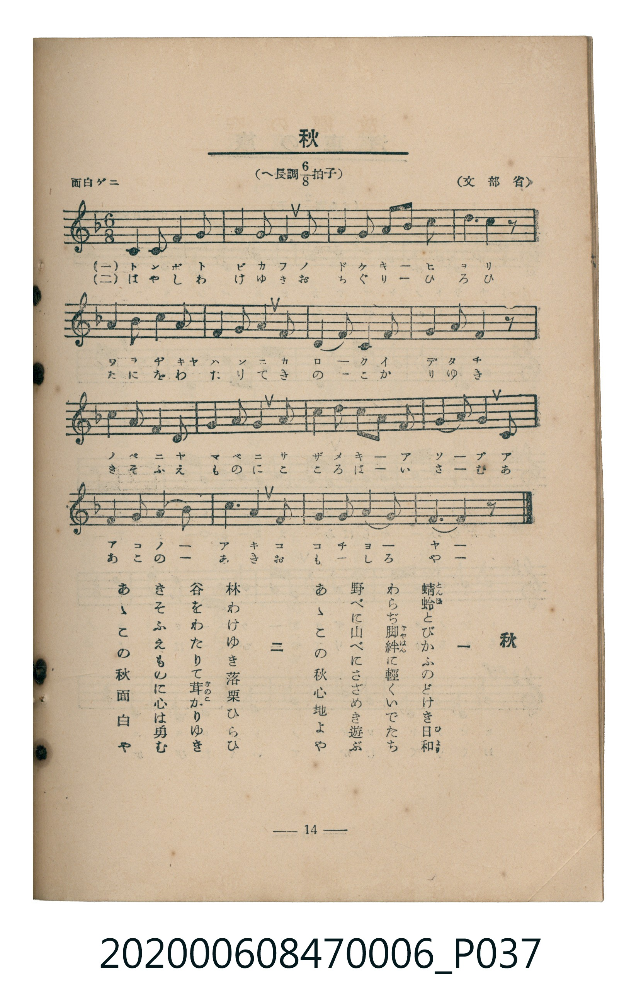

# 秋

> Re:Shōka 使用 AI 協助辨識與重建樂譜，可能會有錯誤。歡迎回報。

- **鋼琴伴奏版**：<br><audio controls src="aki.mp3"></audio>
- **NEUTRINO 歌聲合成版**：<br><audio controls src="aki_neutrino.mp3"></audio>

- 文部省
- 臺灣教育會公認《新定兒童唱歌》尋常科第六學年用（2020.006.0847.0006）

## 說明

原書資訊與歌詞全文（對應 P037.jpg，書頁 p. 14，第二學期第 2 首）：
調性與拍號：へ長調八分之六拍子（F 大調 6/8 拍），「面白ゲニ」（♩.=96）


## 歌詞

```text
一、
蜻蛉（とんぼ）とびかふのどけき日和（ひより）
わらぢ脚絆（きやはん）に軽くいでたち
野べに山べにさざめき遊ぶ
あゝこの秋心地よや

二、
林わけゆき落栗ひらひ
谷をわたりて茸（きのこ）かりゆき
きそふえものに心は勇む
あゝこの秋面白や
```

## ABC

<div class="abc-score" data-abc-src="aki.abc" aria-label="五線譜載入中"></div>

[下載 ABC 原始檔](aki.abc)

## TMD 檔案連結

- [主旋律 TMD 檔案](aki.tmd) [[在 TMD Studio 編輯](https://tmdlang.github.io/Tmd-TS/#tmd=s7IKdvYPcrWy4qpTUCpJTLdSSM7PyUlNLsnMz7MqzsjMK0nNjM_KTMmPL87Iz05Ugisry88pzU21Si9KTEmNN4s3MjAyiDcwMIs3sDAxBzIMzBBKi_NLi5JTrYqTM_Lzc-JLUitKkvLzsxHyBUX5Zal5iXlANQVFIBtTwIoQClLLMlNSQdLFyYl58WWpRZlpmakpSG5JLSoGuxdsUXxJUWJecXJRZgHIEwhV-UUlGflA9xZkVFplZBaX5BdlJifmxGcn5iF5qyQjFeir4tTE4vy8YmS9memZeVa5-XlJpcCAQPdbfEFieqpVgIGxuRKXlpbC8-XdClpaXIq2CpZmXPa2Cm5cNmb6FnYgTc-mtb9sXvF8TiPYiBftu543Ln42deaLpk3P5jQ_bV3zYlXv44auZ9M2PF0362nrpOerlz6dsvHZ2p7HDd1PN3Q_3bHj-fKJz9esedq69unaHU93bnk-ZcX7PR2g0NcDhrkeKPSBDAOz93s6lbi49LUUbKkFuBQUFJ72zX82e8eLze0vVnS96GgHuuvFynlPW1cAfQV0xdMNvc_aOxVAwaCXVZD-fk8PUPHLBY0KBXoKhiZALtDhT3b1AB3-bM58IFvBSOHlsmlAl77fMwtk-otV-581LAeZ2937YuZ8oOjjxh0vp24Hij9tXf20o-3Jzm6gx4GyT9dOANrnpvB0yXKgpAIwcBWAomCTgCHV83Luoucz9z5u2vS4uftxA1C849HMlXq2lqBQ4QLZ9GRHw-OGRrCdc3a_mA3U1vG4ccXjpsmPG_cA1YDYjZsfN3Y_btz6uHHd48aVjxsnPm7sfTZ96dNJPWDFmx43dTxu6gIZCDTlcVP_4yagtkUvWmY939oGVtH7uKnlceN6oKFgE1e_2L33cWP_40ag4PLHjfMfNy4E6XzZ3ve4cSdQ-unGjRDG48apjxunPW5qBBrxsrHrceM2sA2NTY-b5j5uBLpwHTB5Pd3f_HTOBrAbWiA-2gX0ONhHz-ZNBzkH6OCmNqARLybsfbZgOtjBQFdsAvt5w_bHTZPAiuYD_fC4cdmLnh1QN4N8C3FwN0gKbATEfqAc0H5geADtbAKrWw10BdCHT7vbHzc1YHEkLBpaQHKUJ0AoUNDS5-JyzM60CshMzMt3qDGoqQaZr2BjoWUHZmBL9AqgpLej4cXCHgUNE4WnG_qfr2_QgadUTSwagLaADKtRMI1X0AURhkDKCMg3BtOoPGMFEwVTIM8MyAMqBmIDhRqwfh_DGmCwgJIWUBCYukAcMGszUDkwkMHsrUC8DsxaCRadCGb3AvEmYNLqAOIuoDjIaAiMhxluBFINTGItYA3TQekQzJoIMqapDW5MF5i1EGz4BBAbaCDE8E4wjW44_nDc1UNOOIJCChRKukBWDTT8QGKGoHADhbEhJKhBfCOwKpAalHCE-A7s5kUQvz1uagZ7aj1YYjKQtRos0Q0OAEjo9gMxJICWg9XOB3sTFBzoIQmSAZkAzB1g8_rh6iEBtgwaoCBRSHyBbATbAo4hSJBD1BATkDs6yUqQ8MABBhssrCAkRNIMSIIUIMsBgxY5QUJcvxMWXsAEBBLdhyraOBUsOg2sohHqK2AeB4vOhfp0G0wMKRwh6uaCUzaI1QEOmyYwex3c9Mlgc8D5ogmUSMFxCIwpkOhUiOlNDXDT8Ybk09mzyQlJRCI0gQYdKLgQSRAiB8rmIJUgcfSMDfETKBWAQlQX7HaQGCwNoPgSmOJAuRmqDpxpseVnwmZC0hpEHSjTg0SxmVnLxaVrpwAsKxWAlDIXAA)]
- [鋼琴伴奏 TMD 檔案](aki_piano.tmd) [[在 TMD Studio 編輯](https://tmdlang.github.io/Tmd-TS/#tmd=s7IKdvYPcrWy4qpTUCpJTLdSyC8qychPL0osyKi0ysgsLskvykxOzInPTsxLVIIrKs4vLUpOjS9ITE-1CjAwNlfi0tJSeL68-_2ejpfde55P2PJkz5anS_ufd3a839OpoKXFpWirYGnGZW-r4MZlY6ZvYQcy6dm09pfNK57PaQSb-6J91_PGxc-mznzRtOnZnOanrWterOp93ND1bNqGp-tmPW2d9Hz10qdTNj5b2_O4ofvphu6nO3Y8Xz7x-Zo1T1vXPl274-nOLc-nrADab2RgZKBnYGCmZ2BhYg5kGJgBnaDExeWYnWkVkJmYlx_k4VBjUFPNpQAENhZadmCGvpaCLTpQABr-ZEfDi4U9ChogT-plFaRrYlGmpQ82okbBNF5BF0QYAikjIN8YTKPyjBVMFEyBPDMgD6gYiA0UasD6fQxrFB43rnjcNBko-LhxD4gDZm0GKn_c2A1mbwXidWDWSrDoRDC7F4g3KTxu6gDiLqA4yGgIjIcZbgRSvf5xUwtYw3Sgwn4wayLImKY2uDFdYNZCsOETQGyggRDDO8E0uuH4Q29XD_GhBwofUNjoAlk10FADiRmCQgsUsoaQAAbxjcCqQGpQQg_iJ7BLZ0B89LipGeyV9WCJyUDWarBEN9jbkDDtB2JIsCwHq50P9hwoENDDDyQDMuFx0ySwef1w9ZBgWgYNRpAoJJZANoJtAccLJKAhaogJvh2dJCQ-eJAAAwsWQhASImkGJEEKkOWAAYqc-CBu3gkLJWBiAYnuQxVtnAoWnQZW0Qj1y-PGJrDoXKj_tsHEkEIPom4uOBWDWB3gEGkCs9fBTZ8MNgecB5pACRIcc8D4AYlOhZje1AA3HW_4PZ09m_jwQyQ4E2iAgQIJkdwgcqCMDFIJEkfPuhCfgGIcFI66YBeDxGDxjeI3YOoC5VeoOnC2xJZjCZsJSVcQdaBsDRLFZmYtUhHog60IBHosXiHaMBaMkZiki5sAOSZADhADxRHBRI5JIKPiQWYBCRQpU5CUKUgKROC2xwykziw-F8gDk-g6UXm4nYKpixKPkeIGiD3A-NO1UwBGYbQPUBjGNAIzlbkA)]

## 分析

```text
================================================================================
📊 TMD Song Profile: [ 秋 ]
================================================================================
⏱  Duration:       0:30 (30.0s), 16 measures total
🎼 Key & Tempo:    首調基準 F, != 96.0 BPM, <6/8>
   - 分析範圍：      由實際發聲的音符與和弦推測調性；播放脈絡另行呈現
🎤 人聲音域:    C4 (MIDI 60) – D5 (MIDI 74) [跨度: 14 個半音 / 1.2 個八度, 難度: moderate]
   - 最低音:  C4 in [Aki #1 @ m.1, 0:00]
   - 最高音: D5 in [Aki #1 @ m.4, 0:05]
   - 適合: soprano, mezzo-soprano, contralto, tenor, baritone, bass
🏛  結構:      Aki (30.0s)
⚡ 編曲密度:        Peak 1 軌道同時演奏
🗝  調性診斷：       F 大調（純淨自然大調，未偵測到可信轉調）
   - 風格氣質:    純淨自然大調（陽光明朗、易唱易記，無明顯調外色彩）
   - 轉調歷程:    全曲維持單一推測調性（未偵測到可信轉調）
   - 核心骨幹音:  F, A, G, C, D
   - 調性數值:    F 大調 [相關度: 0.83, 穩定度: Moderate, 自然音純度: 100.0%]
   - 候選調性 (K-S): F 大調 (0.83), C 大調 (0.72), A 小調 (0.64)
   - 五度圈歷程:   -1
   - 各段落調性細節:
     • [Aki #1]: F 大調 (r: 0.83, 自然音純度: 100.0%)

  [ 五度圈游移軌跡 ]
               C  
        [F ]*          G  
      Bb               D  
      Eb               A  
         Ab           E  
            Db       B  
               F# 
     (* = active key center)

  [ 十二半音累積音高分佈 ]
     C  : █████████████████████     20.4%
     C# :                            0.0%
     D  : ████████                   7.5%
     D# :                            0.0%
     E  :                            0.0%
     F  : ████████████████████████  23.7%
     F# :                            0.0%
     G  : ██████████████████████    21.5%
     G# :                            0.0%
     A  : ████████████████████████  23.7%
     A# : ███                        3.2%
     B  :                            0.0%
--------------------------------------------------------------------------------
Assignment 軌道音域：
  - Piano         : C4 – D5 (14 個半音 / 1.2 個八度, 60 個音符)
================================================================================
```


## 原書掃描頁




