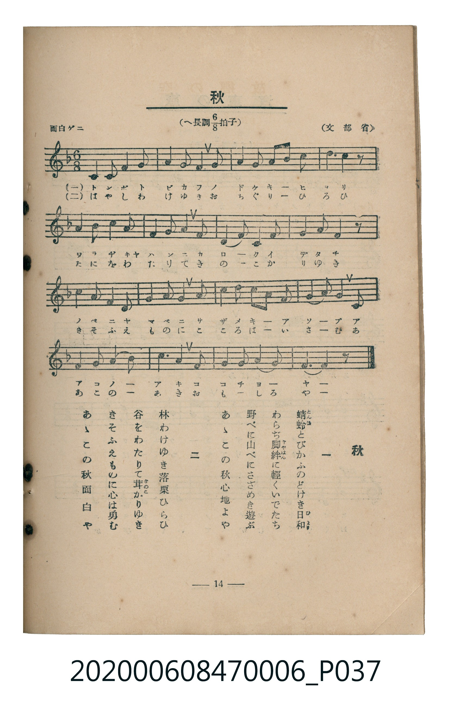

# 秋

> Re:Shōka 使用 AI 協助辨識與重建樂譜，可能會有錯誤。歡迎回報。

- **NEUTRINO 歌聲合成版**：<br><audio controls src="aki_neutrino.mp3"></audio>
- **鋼琴伴奏版**：<br><audio controls src="aki.mp3"></audio>


- 文部省
- 臺灣教育會公認《新定兒童唱歌》尋常科第六學年用（2020.006.0847.0006）

## 說明

原書資訊與歌詞全文（對應 P037.jpg，書頁 p. 14，第二學期第 2 首）：
調性與拍號：へ長調八分之六拍子（F 大調 6/8 拍，弱起 1 拍），「面白ゲニ」


## 歌詞

```text
一、
蜻蛉（とんぼ）とびかふのどけき日和（ひより）
わらぢ脚絆（きやはん）に軽くいでたち
野べに山べにさざめき遊ぶ
あゝこの秋心地よや

二、
林わけゆき落栗ひらひ
谷をわたりて茸（きのこ）かりゆき
きそふえものに心は勇む
あゝこの秋面白や
```

## ABC

```abc
X:1
T:秋
M:6/8
L:1/16
Q:3/8=64
K:F
V:V1 name="Piano" snm="Pia"
[V:V1]
z2 z2 z2 z2 z2 C2 | F4 F2 A4 G2 | F4 F2 A4 G2 | F4 G2 A2 c2 A2 |
w: 1.~と | ん ぼ と び | か ふ の ど | け き _ _ ひ
w: 2.~は | や し わ け | ゆ き お ち | ぐ り _ _ ひ
G4 G2 G4 C2 | F4 F2 A4 G2 | F4 F2 A4 A2 | G4 A2 G2 A2 F2 |
w: 1.~よ り _ わ | ら ぢ きゃ は | ん に か _ | る _ く い _
w: 2.~ろ ひ _ た | に を わ た | り て き _ | の _ こ か _
E4 D2 C4 z2 | C4 D2 C4 F2 | A4 B2 A4 c2 | c4 A2 G2 F2 G2 |
w: 1.~で た ち | の べ に や | ま べ に さ | ざ め き _ あ
w: 2.~り ゆ き | き そ ふ え | も の に こ | こ ろ は _ い
A6 G4 c2 | c4 F2 A4 G2 | F6 D2 C4 | G4 A2 G4 F2 |
w: 1.~そ ぶ あ | あ こ の _ | あ き こ | こ ち よ _
w: 2.~さ む あ | あ こ の _ | あ き お | も _ し ろ
F10 z2 |
w: 1.~や
w: 2.~や
```

## TMD 檔案連結

- [主旋律 TMD 檔案](aki.tmd) [[在 TMD Studio 編輯](https://tmdlang.github.io/Tmd-TS/#tmd=s7IKdvYPcrWy4qpTUCpJTLdSSM7PyUlNLsnMz7MqzsjMK0nNjM_KTMmPL87Iz05Ugisry88pzU21Si9KTEmNN4s3MjAyiDcwMIs3sDAxBzIMzBBKi_NLi5JTrYqTM_Lzc-JLUitKkvLzsxHyBUX5Zal5iXlANQVFIBtTwIoQClLLMlNSQdKpKZkl-UWZiTlI7kgtKga7FWxJfElRYl5xclFmAcgDCFUlGalAxxanJhbn5xUTFAZakZ6ZZ5Wbn5dUCvS2EpeWlsLz5d0KWlpcirYKlmZc9rYKblw2ZvoWdiA9z6a1v2xe8XxOI9iEF-27njcufjZ15oumTc_mND9tXfNiVe_jhq5n0zY8XTfraeuk56uXPp2y8dnanscN3U83dD_dseP58onP16x52rr26dodT3dueT5lxfs9HaAQ1QOGox4oRIEMA7P3ezqVuLj0tRRsqQW4FBQUnvbNfzZ7x4vN7S9WdL3oaAe668XKeU9bVwB9BXTF0w29z9o7FQIMjM31sgrS3-_pASp-uaBRoUBPwdAEyAU6_MmuHqDDn82ZD2QrGCm8XDYN6NL3e2aBTH-xav-zhuUgc7t7X8ycDxR93Ljj5dTtQPGnraufdrQ92dkN9DhQ9unaCUD73BSeLlkOlFQABq4CUBRow9M9G19s3a5gCOECDQYGXM_LuYuez9z7uGnT4-buxw29XCC7nuxoeNzQCLZ1zu4Xs4EqOx43rnjcNPlx4x6gRhC7cfPjxu7HjVsfN6573LjycePEx429z6YvfTqpB6x40-OmjsdNXUDFIFMeN_U_bgJqW_SiZdbzrW1gFb2Pm1oeN64HGgo2cfWL3XsfN_Y_bgQKLn_cOP9x40KQzpftfY8bdwKln27cCGE8bpz6uHHa46ZGoBEvG7seN24D29DY9Lhp7uNGoAvXARPY0_3NT-dsALuhBeKjXUC_gn30bN50kHOADm5qAxrxYsLeZwumgx0MdMUmsJ83bH_cNAmsaD7QD48bl73o2QF1M8i3EAd3g6TARkDsB8oB7QeGB9DOJrC61UBXAH34tLv9cVMDFkfCQr4FJEd5EoQCBS19Li7H7EyrgMzEvHyHGl3DmmqQBQo2Flp2YAa2dK8ASn07Gl4s7FHQgCYTbQUThacb-p-vb9CBp1pNLDqB9oFMrVEwgEPTeCDXUEEXiI2BpBFWnhGQZwrENUAWiAciQRrBpvkY1ijEwyEwwQGVAZMKUAkwCYL5INZmkGhjN5i9FYjXgVkrwaITwexeIAmiN4H1d4DYTV0QsaZ-mF1GqHatB6ttAeubDlYHYk0Ei7ZBTX3cCDIFmEjBdk1ANhdqF8hmEBsiNh9oF_7A39UDDnwSwxxXIMOC1RgczIZAnnk8kGsWDwpiXWAUIYIZmPDBTlwETsRNzWAOJAwg4b0aGsa6YDEIC5hVgRgURiD_L4f6ERQeusAwRIQrSDcobCbBwxEYEtCwAmYseAyBVIJiDyQ6GWofXB0w1CHqQCYTSMKd5IQiOExgYQMKLFAQmoBJU5A0NCANwYEMEgUFN1gOEYrQxLcT7uUWsKf2oYo2TgWLTgOraIR6C1gugEXnQgNgG0wMKRgh6uaCEzqI1QEOniYwex3c9Mlgc8DRBkyAoGgEiUJcMhWa7BvgpuMNyqezZ5MVlBgJEhGyiCQJCWWILAiipEeg22DJAJIkYGKwrAfyH9yfwCQHydiQBANKkhCImgwJmQlKaLAQhWR8SBhimlnLxaVrpwAsYRWAlDIXAA)]
- [鋼琴伴奏 TMD 檔案](aki_piano.tmd) [[在 TMD Studio 編輯](https://tmdlang.github.io/Tmd-TS/#tmd=s7IKdvYPcrWy4tLSUni-vPv9no6X3XueT9jyZM-Wp0v7n3d2vN_TqaClxaVoq2BpxmVvq-DGZWOmb2HHVaeg9Gxa-8vmFc_nNCqBeC_adz1vXPxs6swXTZuezWl-2rrmxarexw1dz6ZteLpu1tPWSc9XL306ZeOztT2PG7qfbuh-umPH8-UTn69Z87R17dO1O57u3PJ8ygqg_UYGRgZ6BgZmegYWJuZAhoEZ0AlKXFyO2ZlWAZmJeflBHg41uoY11VwKQGBjoWUHZuhrKdiiAwWg6U92NLxY2KOgEWBgbK6XVZCuiUWZlj7YiBoFAzg0jQdyDRV0gdgYSBph5RkBeaZAXANkgXggEqQRbJqPYY1CPBw-blwBVPa4aTJQyePGPWA-iLUZJNrYDWZvBeJ1YNZKsOhEMLsXSILoTWD9HSB2UxdErKkfZpcRql3rwWpbwPqmg9WBWBPBom1QUx83gkx53LgQbNcEZHOhdoFsBrEhYvOBduEP6V09xIc0rqCFBaYxOHANgTzzeCDXLB4UsLrAiEEE7uOmTrDDFoG887ipGcyB-BwSyquhIasLFoOwHjf2AzEoZEC-Xg71GSgUdIEhhwhNkG5QiEyChx7Q_9AQety4DB4vIJWgOAOJTobaB1cHDGuIOpDJBFJpJ_FhBw4JWIiAgggUcCZg0hQkDQ0-Q3DQgkRBgQyWQ4QdNKHthHu0BeyVfaiijVPBotPAKhqhnnnc2AQWnQv19jaYGFLgQdTNBSdqEKsDHChNYPY6uOmTweaAIwuY2ECRBxKFuGQqNIk3wE3HG4BPZ88mIQAxEh8iPBHJDxK2EFkQREl7QBfBohwS_TAxWOYC-QruO2DygmRdSOIAJT8IRE1yhMwEJSpYOEKyNiTkMM2sRSovfbCWl8iFHdBnCobxCtGGsWBsGg9km8YDOSCCWCkkJiiJIqsD8RDhR5aBRkCOEZADxPi14LAHxTAixAmEAZG-MQPxzUB8EAF2HSgGTYCiJkBBICbGM8DI1LVTAMZntA9QGMYEhgSQqcwFAA)]

## 分析

```text
================================================================================
📊 TMD Song Profile: [ 秋 ]
================================================================================
⏱  Duration:       0:30 (30.0s), 16 measures total
🎼 Key & Tempo:    首調基準 F, != 96.0 BPM, <6/8>
   - 分析範圍：      由實際發聲的音符與和弦推測調性；播放脈絡另行呈現
🎤 人聲音域:    C4 (MIDI 60) – C5 (MIDI 72) [跨度: 12 個半音 / 1.0 個八度, 難度: easy]
   - 最低音:  C4 in [Aki #1 @ m.1, 0:01]
   - 最高音: C5 in [Aki #1 @ m.4, 0:06]
   - 適合: soprano, mezzo-soprano, contralto, tenor, baritone, bass
🏛  結構:      Aki (30.0s)
⚡ 編曲密度:        Peak 1 軌道同時演奏
🗝  調性診斷：       F 大調（純淨自然大調，未偵測到可信轉調）
   - 風格氣質:    純淨自然大調（陽光明朗、易唱易記，無明顯調外色彩）
   - 轉調歷程:    全曲維持單一推測調性（未偵測到可信轉調）
   - 核心骨幹音:  F, A, G, C, D
   - 調性數值:    F 大調 [相關度: 0.81, 穩定度: High, 自然音純度: 100.0%]
   - 候選調性 (K-S): F 大調 (0.81), C 大調 (0.67), A 小調 (0.63)
   - 五度圈歷程:   -1
   - 各段落調性細節:
     • [Aki #1]: F 大調 (r: 0.77, 自然音純度: 100.0%)

  [ 五度圈游移軌跡 ]
               C  
        [F ]*          G  
      Bb               D  
      Eb               A  
         Ab           E  
            Db       B  
               F# 
     (* = active key center)

  [ 十二半音累積音高分佈 ]
     C  : ███████████████           17.9%
     C# :                            0.0%
     D  : ███                        3.2%
     D# :                            0.0%
     E  : ██                         2.1%
     F  : ████████████████████████  28.4%
     F# :                            0.0%
     G  : ███████████████████       22.1%
     G# :                            0.0%
     A  : █████████████████████     25.3%
     A# : █                          1.1%
     B  :                            0.0%
--------------------------------------------------------------------------------
Assignment 軌道音域：
  - Piano         : C4 – C5 (12 個半音 / 1.0 個八度, 62 個音符)
================================================================================
```


## 原書掃描頁




