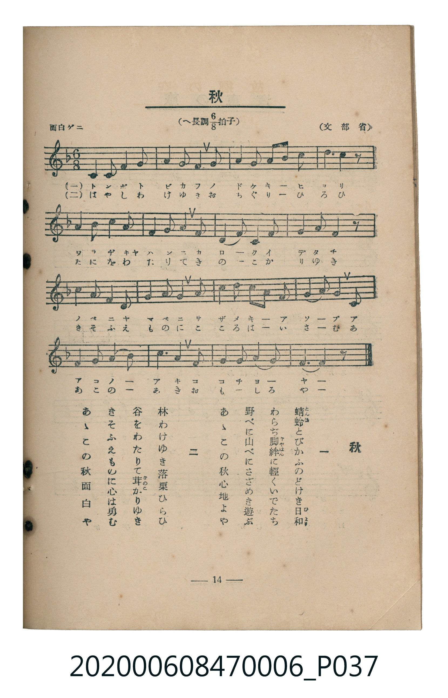

# 秋

<audio controls src="aki.mp3"></audio>

- 文部省
- 臺灣教育會公認《新定兒童唱歌》尋常科第六學年用（2020.006.0847.0006）

## 說明

原書資訊與歌詞全文（對應 P037.jpg，書頁 p. 14，第二學期第 2 首）：
調性與拍號：へ長調八分之六拍子（F 大調 6/8 拍，弱起 1 拍），「面白ゲニ」

## 歌詞

```text
一、
蜻蛉（とんぼ）とびかふのどけき日和（ひより）
わらぢ脚絆（きやはん）に軽くいでたち
野べに山べにさざめき遊ぶ
あゝこの秋心地よや

二、
林わけゆき落栗ひらひ
谷をわたりて茸（きのこ）かりゆき
きそふえものに心は勇む
あゝこの秋面白や
```

## ABC

```abc
X:1
T:秋
C:TMD (Chen, Chih-Han / aguai)
M:6/8
L:1/16
Q:3/8=64
K:F
V:V1 name="Piano" snm="Pia"
[V:V1]
z2 z2 z2 z2 z2 C2 | F4 F2 A4 G2 | F4 F2 A4 G2 | F4 G2 A2 c2 A2 |
G4 G2 G4 C2 | F4 F2 A4 G2 | F4 F2 A4 A2 | G4 A2 G2 A2 F2 |
E4 D2 C4 z2 | C4 D2 C4 F2 | A4 B2 A4 c2 | c4 A2 G2 F2 G2 |
A6 G4 c2 | c4 F2 A4 G2 | F6 D2 C4 | G4 A2 G4 F2 |
F10 z2 |
```

## TMD 檔案連結

- [主旋律 TMD 檔案](aki.tmd) [[在 TMD Studio 編輯](https://tmdlang.github.io/Tmd-TS/#tmd=s7IKdvYPcrWy4tLSUni-vFtBS4tL0VbB0ozL3lbBjcvGTN_CjqtOQenZtPaXzSuez2lUAvFetO963rj42dSZL5o2PZvT_LR1zYtVvY8bup5N2_B03aynrZOer176dMrGZ2t7Hjd0P93Q_XTHjufLJz5fs-Zp69qna3c83bnl-ZQV7_d0GBkYGegZGJjpGViYmAMZBmbv93QqcXHpaynYUgtwKSgoPO2b_2z2jheb21-s6HrR0Q5014uV8562rgD6CuiKpxt6n7V3KgQYGJvrZRWkv9_TA1T8ckGjQoGegqEJkAt0-JNdPUCHP5szH8hWMFJ4uWwa0KXv98wCmf5i1f5nDctB5nb3vpg5Hyj6uHHHy6nbgeJPW1c_7Wh7srMb6HGg7NO1E4D2uSk8XbIcKKkADFwFoCjQhqd7Nr7Yul3BEMIFGgwMuJ6Xcxc9n7n3cdOmx83djxt6uUB2PdnR8LihEWzrnN0vZgNVdjxuXPG4afLjxj1AjSB24-bHjd2PG7c-blz3uHHl48aJjxt7n01f-nRSD1jxpsdNHY-buoCKQaY8bup_3ATUtuhFy6znW9vAKnofN7U8blwPNBRs4uoXu_c-bux_3AgUXP64cf7jxoUgnS_b-x437gRKP924EcJ43Dj1ceO0x02NQCNeNnY9btwGtqGx6XHT3MeNQBeuAyawp_ubn87ZAHZDC8RHu4B-Bfvo2bzpIOcAHdzUBjTixYS9zxZMBzsY6IpNYD9v2P64aRJY0XygHx43LnvRswPqZpBvIQ7uBkmBjYDYD5QD2g8MD6CdTWB1q4GuAPrwaXf746YGLI6EhXwLSI7yJAgFClr6XFyO2ZlWAZmJefkONQY1CtUgCxRsLLTswAxs6V4BlPp2NLxY2KOgAU0m2gomCk839D9f36ADT7WaWHQC7QOZWqNgAIem8UCuoYIuEBsDSSOsPCMgzxSIa4AsEA9EgjSC4wu3I3f1gB1JottwOQZmvTHYOYZAnnk8kGsWD3KKLtArhJyzo5Mc54ANh1kCshXkFhMwaQqShrrIEOxakCjI3WA5_M55Ons2Wc7BCB2E6xDhA3EpRBYEQYFTy8Wla6cATG4KQEqZiwsA)]
- [鋼琴伴奏 TMD 檔案](aki_piano.tmd) [[在 TMD Studio 編輯](https://tmdlang.github.io/Tmd-TS/#tmd=s7IKdvYPcrWy4tLSUni-vPv9no6X3XueT9jyZM-Wp0v7n3d2vN_TqaClxaVoq2BpxmVvq-DGZWOmb2HHVaeg9Gxa-8vmFc_nNCqBeC_adz1vXPxs6swXTZuezWl-2rrmxarexw1dz6ZteLpu1tPWSc9XL306ZeOztT2PG7qfbuh-umPH8-UTn69Z87R17dO1O57u3PJ8ygqg_UYGRgZ6BgZmegYWJuZAhoEZ0AlKXFyO2ZlWAZmJeflBHg41BjUK1VwKQGBjoWUHZuhrKdiiAwWg6U92NLxY2KOgEWBgbK6XVZCuiUWZlj7YiBoFAzg0jQdyDRV0gdgYSBph5RkBeaZAXANkgXggEqSRC7-LdvUQ7yJcToBZagx2hCGQZx4P5JrFgxygC_QAIUfs6CTeEWAjYUaD7AK5wARMmoKkoe4wBLsRJApyLVgOvyOezp5NgiMwQgLhJkRYQNwHkQVBUEDUIiUeH6yJBznmgToUDOMVog1jwdg0Hsg2jQdyQASxUkhMUPAhqwPxIO6CxjDpBhoBOUZADhDj14LDHhTDiBAnEAZE-sYMxDcD8UEE2HWgmDMBipoABYGYGM8AI1PXTgEYnwoISpmLCwA)]

## 分析

```text
================================================================================
📊 TMD Song Profile: [ 秋 ]
================================================================================
⏱  Duration:       0:31 (31.9s), 17 measures total
🎼 Key & Tempo:    首調基準 F, != 96.0 BPM, <6/8>
   - 分析範圍：      由實際發聲的音符與和弦推測調性；播放脈絡另行呈現
🎤 人聲音域:    C4 (MIDI 60) – C5 (MIDI 72) [跨度: 12 個半音 / 1.0 個八度, 難度: easy]
   - 最低音:  C4 in [Aki #1 @ m.1, 0:01]
   - 最高音: C5 in [Aki #1 @ m.4, 0:06]
   - 適合: soprano, mezzo-soprano, contralto, tenor, baritone, bass
🏛  結構:      Aki (31.9s)
⚡ 編曲密度:        Peak 1 軌道同時演奏
🗝  調性診斷：       F 大調（純淨自然大調，未偵測到可信轉調）
   - 風格氣質:    純淨自然大調（陽光明朗、易唱易記，無明顯調外色彩）
   - 轉調歷程:    全曲維持單一推測調性（未偵測到可信轉調）
   - 核心骨幹音:  F, A, G, C, D
   - 調性數值:    F 大調 [相關度: 0.81, 穩定度: High, 自然音純度: 100.0%]
   - 候選調性 (K-S): F 大調 (0.81), C 大調 (0.67), A 小調 (0.63)
   - 五度圈歷程:   -1
   - 各段落調性細節:
     • [Aki #1]: F 大調 (r: 0.81, 自然音純度: 100.0%)

  [ 五度圈游移軌跡 ]
               C  
        [F ]*          G  
      Bb               D  
      Eb               A  
         Ab           E  
            Db       B  
               F# 
     (* = active key center)

  [ 十二半音累積音高分佈 ]
     C  : ███████████████           17.9%
     C# :                            0.0%
     D  : ███                        3.2%
     D# :                            0.0%
     E  : ██                         2.1%
     F  : ████████████████████████  28.4%
     F# :                            0.0%
     G  : ███████████████████       22.1%
     G# :                            0.0%
     A  : █████████████████████     25.3%
     A# : █                          1.1%
     B  :                            0.0%
--------------------------------------------------------------------------------
Assignment 軌道音域：
  - Piano         : C4 – C5 (12 個半音 / 1.0 個八度, 62 個音符)
================================================================================
```


## 原書掃描頁




