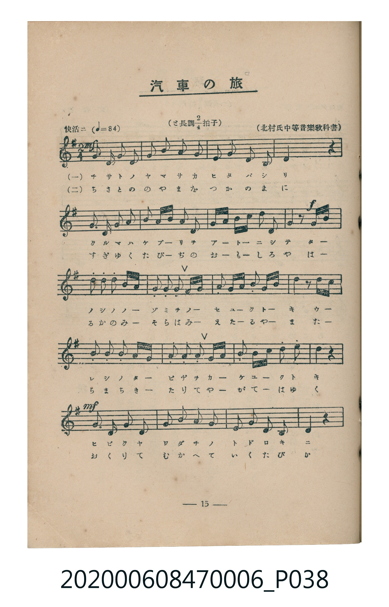
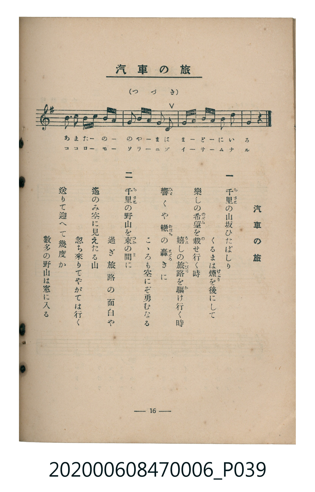

# 汽車の旅

> Re:Shōka 使用 AI 協助辨識與重建樂譜，可能會有錯誤。歡迎回報。

<audio controls src="kisha_no_tabi.mp3"></audio>

- 北村氏中等音樂教科書
- 臺灣教育會公認《新定兒童唱歌》尋常科第六學年用（2020.006.0847.0006）

## 說明

原書資訊與歌詞全文（對應 P038.jpg–P039.jpg，書頁 pp. 15–16，第二學期第 3 首）：
調性與拍號：と長調四分之二拍子（G 大調 2/4 拍，弱起半拍），「快活ニ」（♩=84）


## 跨冊／重複收錄參照

> 同曲（〈汽車の旅〉；收錄於《新定兒童唱歌》六年級及《唱歌帖》P009、P212《小公學校唱歌教材集》抄譜）

- **[同曲]** 楊金土手抄《唱歌帖》第 8 冊・VIII（2020.006.0843）：[**〈汽車の旅（火車之旅）〉**](../../../shokacho/vol_08/p009_kisha_no_tabi/index.md)（`F` / `2/4` — [原始 TMD](../../../shokacho/vol_08/p009_kisha_no_tabi/kisha_no_tabi.tmd)）
- **[同曲]** 楊金土手抄《唱歌帖》第 10 冊・X（2020.006.0843）：[**〈汽車の旅 (火車之旅)〉**](../../../shokacho/vol_10/p212_kisha_no_tabi/index.md)（`A` / `2/4` — [原始 TMD](../../../shokacho/vol_10/p212_kisha_no_tabi/kisha_no_tabi.tmd)）
- 總表：[跨冊重複與同名歌曲總索引](../../../duplicate_songs.md)

## 歌詞

```text
一、
千里（ちさと）の山坂ひたばしり
くるまは煙（けぶり）を後にして
樂しの希望（のぞみ）を載（の）せ行く時
嬉（うれ）しの旅路（たびぢ）を驅（か）け行く時
響（ひゞ）くや轍（わだち）の轟（とどろ）きに
こゝろも空にぞ勇むなる

二、
千里（ちさと）の野山を束（つか）の間（ま）に
過ぎゆく旅路の面白や
遙のみ空に見えたる山
忽ち來りてやがては行く
送りて迎へて幾度か
數多の野山は窓に入る
```

## ABC

```abc
X:1
T:汽車の旅
M:2/4
L:1/16
Q:1/4=84
K:G
V:V1 name="Piano" snm="Pia"
[V:V1]
!mf! z4 z2 D2 | G3 G G2 A2 | B3 B B2 A2 | G3 A F2 D2 |
w: 1.~ち | さ と の や | ま さ か ひ | た ば し _
w: 2.~ち | さ と の の | や ま を つ | か の ま _
A4 z2 D2 | G3 G G2 A2 | B3 c B2 A2 | G2 B A G2 F2 |
w: 1.~り く | る ま は け | ぶ _ り を | あ と _ に し
w: 2.~に す | ぎ ゆ く た | び _ ぢ の | お も _ し ろ
!f! G4 z2 B c | d2 d2 d2 c B | A2 A2 A2 B c | B2 B c d2 c B |
w: 1.~て た _ | の し の の _ | ぞ み を の _ | せ ゆ _ く と _
w: 2.~や は _ | る か の み _ | そ ら に み _ | え た _ る や _
A4 z2 d c | B2 B2 B2 A G | F2 G2 A2 B c | d2 G A B2 c2 |
w: 1.~き う _ | れ し の た _ | び ぢ を か _ | け ゆ _ く と
w: 2.~ま た _ | ち ま ち き _ | た り て や _ | が て _ は ゆ
!mf! d4 z2 D2 | G3 G G2 A2 | B3 B B2 A2 | G3 A F2 D2 |
w: 1.~き ひ | び く や わ | だ ち の と | ど ろ き _
w: 2.~く お | く り て む | か へ て い | く た び _
A4 z2 D2 | d3 c B2 d B | A2 B G F2 D2 | G A B c A2 B2 |
w: 1.~に こ | こ ろ _ も _ | そ ら _ に ぞ | い _ さ _ む な
w: 2.~か あ | ま た _ の _ | の や _ ま は | ま _ ど _ に い
G4 z4 |
w: 1.~る
w: 2.~る
```

## TMD 檔案連結

- [主旋律 TMD 檔案](kisha_no_tabi.tmd) [[在 TMD Studio 編輯](https://tmdlang.github.io/Tmd-TS/#tmd=s7IKdvYPcrWy4qpTUCpJTLdSSM7PyUlNLsnMz7MqzsjMK0nNjM_KTMmPL87Iz05Ugisry88pzU21Si9KTEmNN4s3MjAyiDcwMIs3sDAxBzIMzBBKi_NLi5JTrYqTM_Lzc-JLUitKkvLzsxHyBUX5Zal5iXlANQVFIBtTwIoQClLLMlNSQdKpKZkl-UWZiTlI7kgtKga7FWxJfElRYl5xclFmAcgDCFUlGalAx4IlC_KLgEZraSk827j3xe6ux43rnk1vVdDS4lK0VbAw4bK3VXDnsjHSN7EDaX7aM_3Z3InPNvQ_2bH2-drOl_M3P1vR9GzqzOfLJz6bvQNs_ov2Xc8bFwPFXjRtejan-Wnrmhereh83dD2btuHpullPWyc9X7306ZSNz9b2PG7ofrqh--mOHUDdz9esedq69unaHU93bnk-ZcX7PR2gENQDhpseKASBDAOz93s6lbi49LUUbKkFuBQUFJ72zQc6_cXm9hcrul50tAPd9WLlvKetK55Nawe64umG3mftnQoBBsYWelkF6Y8aJgOZliDm-z09QH0vFzQqFBToKRiaAqUMgU7sAfrkya4eoE-ezZkPZCsYK7xcNg3o9Pd7ZoGse7Fq_7OG5SCLuntfzJwPFH3cuOLl1O1A8aezZz_taHuysxuoHyj7dO0EoAPcFZ4uWQ6UVABGgQJQFGjD0z0bX2zd_rS3C8wFGgwMyZ6n-1c_27L7cXP34wagYMejmSttLUyAslwgS5_saHjc0Aj2bW_zy_YeoILHjQsfN04F2g1UA4zzpxs3Pp3b9Lhx0-PG-Y8bNzxunP64qQuk4XFj_-Om7seN-x43rn_eOhOsc-Ljxm1AaZDOpklP9_U8blwN0tC4DKQBmCDAnHVPd_Q8mzMbrGHd48Z5jxv3QzS8ADkZJAi2efaLhUD9_c9mNoGdtwYi1_a4CehIoDTIIGB6fLF9PVgc6LbNjxsXQQx6ubIVLNgNVjkRxaCX84G2AeU2PW6aB5YG-qLlxV5Q0Dxu6n_cuADof4jPX-wFRgJQ5YrHjSsfN4EC9HFjL9BHEM9Pftw0Fyj6uKnp-cpdYH_Oe9rd_rip4XHjKmC4QEJ3FzAC8Ibuy_Y-YAADnfxsLsSyJTBXr3s5bTJYZB-YC7b1ZWPfYyBqagN5B-x3kLq5i57P3Av0BETFTHCg7oc46sUyYASBQ6epG2gP2CX79wLd8GQfMCCBWXoZUN_jRmDwLAPGIiScwMY0NEKkX-wH2rgDyHi6c9_TXUBF3eCYnLrj6RJg8oQ5H5gAVk0GWve0dSnI60AVlOdAKFDQ0ufi8s4szkj0yw9JTMq0CshMzMt3qDGoqQbZo2BjaKZlB2Zhy_4KoDy3owHoMQUNSOZQ0FYwUXi6of_5-gYdeObVxKITaC_I1BoFAwVdMATR1blptQqm8UBWjYIhWNQQTBuBRYzBIsZgGiICUWOkYA7SAtUHkoGZBxECW-RjWKMA4oEgiAZGElg5MLWAxYBJBojXgVhNLVCZfVCZqUDcDWZtgsrMh8psAOLpUFOB4k1dKDb0I2w3Itp2MAkyC-QKEH8fkD0JzFoC1QNyC0QlzI0Q8dUoNswE244_7nb1gOOOxCjDFTUmaFFjDGSDaHD0wLRBYxoY0cZADYjIAaZshIcb14NZE6Ee2wbVCQlgSHCAxJugQQciQZ6HRAZIZhlKUICiCxERwDwONa0NGklQFUB6M8ymxkXIkdEIsRdiH8gOYNGEEk0wm0DuJhToOzrJCXRToMkwDApoSEqHYXBYgoMfxEJVA88NqOENTW5g36AmvcZ5YN5-eFgjZGZDww2WvCGhD5IBhQciHEAqkEIcHLewTASxC2Q6SN9csImdSHEIk-mAxwxUP1rGRI1dvGEOrOHJCXNIeEIwKCnXQJIyLN1DAh0U2IZAPkiRCdiBIBEsRRpSUu_BCHrkBAhNfNCgB3kdJAPKDMQEPbiMQkrsoJIGEmQwNjTpQoMWnLTBGQYRwBD3gcUgWRFsL0gGZDPCLpBegmXMFGqWMRQU_7DcDfIExKvAFgnUWwugMgvhEQIL3JUQGWB-RwQ0ZmE7GS3QIcEEClxY0DZA9cFKuR3wAIYFOlQPMFoQ5RBCB8wmUBlEKLW3rsUMcnDbmWAJAyvETeGlhzEwmJEDGJLUTaBy6OU62M1IIQ4KF1hpCStBsed6UJkDkgHHC7hahIQZsL0HkYHWD5BwQLIHHN6wqhpWMcPKK0SFDssC4BIazgPFLswF0HjAYk8tF5eunQJSM0kByFXmAgA)]
- [鋼琴伴奏 TMD 檔案](kisha_no_tabi_piano.tmd) [[在 TMD Studio 編輯](https://tmdlang.github.io/Tmd-TS/#tmd=s7IKdvYPcrWy4tLSUni2ce-L3V2PG9c9m976fk_Hy-49zydsebJny9Ol_c87O97v6VTQ0uJStFWwMOGyt1Vw57Ix0jex46pTUHraM_3Z3InPNvQ_2bH2-drOl_M3P1vR9GzqzOfLJz6bvUMJpORF-67njYuBYi-aNj2b0_y0dc2LVb2PG7qeTdvwdN2sp62Tnq9e-nTKxmdrex43dD_d0P10xw6g7udr1jxtXft07Y6nO7c8n7IC6CgjAyMDPQMDMz0DCxNzIMPADOguJS4u78zijES__JDEpEyrgMzEvPwgD4cag5pqLgUgsDE007IDs_S1FGzRgQLQlic7Gl4s7FHQCDAwttDLKkjXxKJMSx9sRI2CgYIuGILo6ty0WgXTeCCrRsEQLGoIpo3AIsZgEWMwDRGBqDFSMAdpgeoDycDMgwiBLfIxrFEA8UAQRD9uXAhW_rhxKljsceMKIF4HYjW1QGX2QWWmAnE3mLUJKjMfKrMBiKdDTQWKN3Wh2NCPsN2IaNvBJMgskCtA_H1A9iQwawlUD8gtEJUwN0LEV6PYMBNsO_6I2tVDfEThihATtAgxBrJBNDhSYNqg8QuMXmOgBkSUPG6CeQbozcb1YNZEqHe2QXVCghUSCCDxJmiAgUiQlyFRAJJZhhIAoEhCBP_jxj6oaW3QqIGqANKbYTY1LkKOgkaIvRD7QHY8bupFiRyYTSB3EwrqHZ3EB7Up0DwYBgUvJFXDMDgEwYEOYqGqgad81FCGJi2wH1CTWeM8MG8_PIQRMrOhoQVLypAwB8mAQgHhe5AKpHAGxygsw0DsApkO0jcXbGInUszBZDrg8QHVj5YJUeMUb0g_nT2b-JCGhCIEg5JtDSTZwtI4JKhBQWwI5IMUmYCdBRLBUmghJesejABHTmzQhAYNcJCHQTKghE9MgINLIaSEDSpLIAEFY0OTKTRAwckYnDkQwQpxH1gMku3A9oJkQDYj7ALpJViKTKG8FKGgWIflX5DTIR583AQueoEiC6AyC-HRAAvSlRAZYI5GBC9mIToZLaghgQMKUliANkD1wcqxHfBghQU1VA8wMhAlDUIHzCZQKUMoZbeuhQW0JVFlCKxwNoWXD8bAwEUOVkiyNoHKoZfXYJcihTMoNGClIKxkxJ6vQaUKSAYcG-BKDhJSjxtXQWSg5T7E90j2gEMZVvHCqllYiYSonmHJHVzywnmgOIW5ABr6WOypxdLA8UFu4FhA2zeQxokBJIcbgMImXiHaMBZGwfmm8UDaNB67CJwJYgANgeUD7EaZACkTuDasZgMpUD2K2ygUGzH0YlFDRaNgQYXfl9QIMGhIIWk0AzHNcDkWZBIw5nXtFJAiP9oHKIkuZAQWUuYCAA)]

## 分析

```text
================================================================================
📊 TMD Song Profile: [ 汽車の旅 ]
================================================================================
⏱  Duration:       0:35 (35.7s), 25 measures total
🎼 Key & Tempo:    首調基準 G, != 84.0 BPM, <2/4>
   - 分析範圍：      由實際發聲的音符與和弦推測調性；播放脈絡另行呈現
🎤 人聲音域:    D4 (MIDI 62) – D5 (MIDI 74) [跨度: 12 個半音 / 1.0 個八度, 難度: easy]
   - 最低音:  D4 in [KishaNoTabi #1 @ m.1, 0:01]
   - 最高音: D5 in [KishaNoTabi #1 @ m.10, 0:12]
   - 適合: soprano, mezzo-soprano, contralto, tenor, baritone, bass
🏛  結構:      KishaNoTabi (35.7s)
⚡ 編曲密度:        Peak 1 軌道同時演奏
🗝  調性診斷：       G 大調（純淨自然大調，未偵測到可信轉調）
   - 風格氣質:    純淨自然大調（陽光明朗、易唱易記，無明顯調外色彩）
   - 轉調歷程:    全曲維持單一推測調性（未偵測到可信轉調）
   - 核心骨幹音:  G, A, B, D, C
   - 調性數值:    G 大調 [相關度: 0.79, 穩定度: Moderate, 自然音純度: 100.0%]
   - 候選調性 (K-S): G 大調 (0.79), D 大調 (0.71), B 小調 (0.63)
   - 五度圈歷程:   +1
   - 各段落調性細節:
     • [KishaNoTabi #1]: G 大調 (r: 0.79, 自然音純度: 100.0%)

  [ 五度圈游移軌跡 ]
               C  
         F           [G ]*
      Bb               D  
      Eb               A  
         Ab           E  
            Db       B  
               F# 
     (* = active key center)

  [ 十二半音累積音高分佈 ]
     C  : ███████                    6.7%
     C# :                            0.0%
     D  : ███████████████████       18.3%
     D# :                            0.0%
     E  :                            0.0%
     F  :                            0.0%
     F# : ██████                     5.6%
     G  : ████████████████████████  23.3%
     G# :                            0.0%
     A  : ████████████████████████  23.3%
     A# :                            0.0%
     B  : ███████████████████████   22.8%
--------------------------------------------------------------------------------
Assignment 軌道音域：
  - Piano         : D4 – D5 (12 個半音 / 1.0 個八度, 98 個音符)
================================================================================
```


## 原書掃描頁






