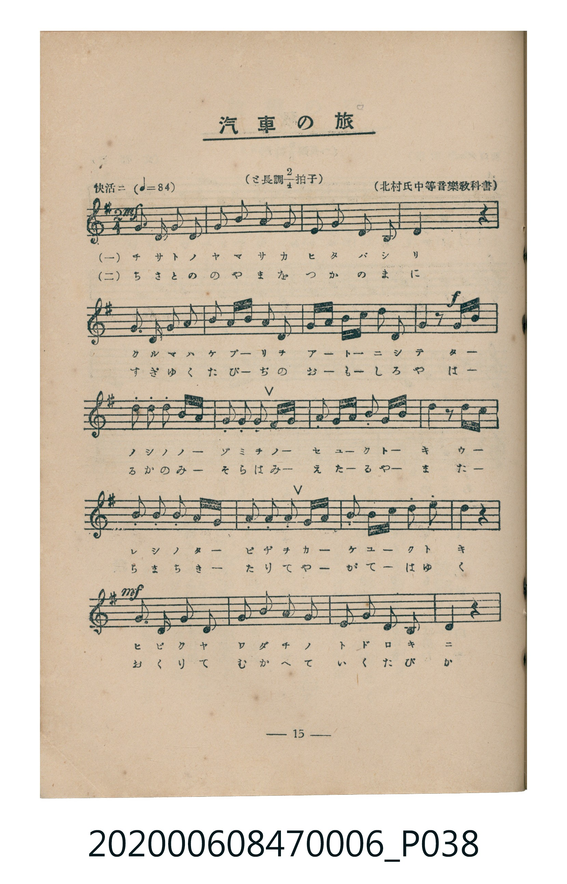
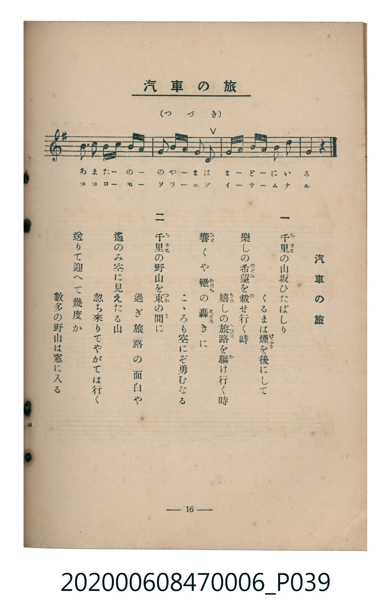

# 汽車の旅

<audio controls src="kisha_no_tabi.mp3"></audio>

- 北村氏中等音樂教科書
- 臺灣教育會公認《新定兒童唱歌》尋常科第六學年用（2020.006.0847.0006）

- note

原書資訊與歌詞全文（對應 P038.jpg–P039.jpg，書頁 pp. 15–16，第二學期第 3 首）：
調性與拍號：と長調四分之二拍子（G 大調 2/4 拍，弱起半拍），「快活ニ」（♩=84）

## 歌詞

```text
一、
千里（ちさと）の山坂ひたばしり
くるまは煙（けぶり）を後にして
樂しの希望（のぞみ）を載（の）せ行く時
嬉（うれ）しの旅路（たびぢ）を驅（か）け行く時
響（ひゞ）くや轍（わだち）の轟（とどろ）きに
こゝろも空にぞ勇むなる

二、
千里（ちさと）の野山を束（つか）の間（ま）に
過ぎゆく旅路の面白や
遙のみ空に見えたる山
忽ち來りてやがては行く
送りて迎へて幾度か
數多の野山は窓に入る
```

## 原書掃描頁





## 調性分析

```text
================================================================================
📊 TMD Song Profile: [ 汽車の旅 ]
================================================================================
⏱  Duration:       0:35 (35.7s), 25 measures total
🎼 Key & Tempo:    首調基準 G, != 84.0 BPM, <2/4>
   - 分析範圍：      由實際發聲的音符與和弦推測調性；播放脈絡另行呈現
🎤 人聲音域:    D4 (MIDI 62) – D5 (MIDI 74) [跨度: 12 個半音 / 1.0 個八度, 難度: easy]
   - 最低音:  D4 in [KishaNoTabi #1 @ m.1, 0:01]
   - 最高音: D5 in [KishaNoTabi #1 @ m.10, 0:12]
   - 適合: soprano, mezzo-soprano, contralto, tenor, baritone, bass
🏛  結構:      KishaNoTabi (35.7s)
⚡ 編曲密度:        Peak 1 軌道同時演奏
🗝  調性診斷：       G 大調（純淨自然大調，未偵測到可信轉調）
   - 風格氣質:    純淨自然大調（陽光明朗、易唱易記，無明顯調外色彩）
   - 轉調歷程:    全曲維持單一推測調性（未偵測到可信轉調）
   - 核心骨幹音:  G, A, B, D, C
   - 調性數值:    G 大調 [相關度: 0.79, 穩定度: Moderate, 自然音純度: 100.0%]
   - 候選調性 (K-S): G 大調 (0.79), D 大調 (0.71), B 小調 (0.63)
   - 五度圈歷程:   +1
   - 各段落調性細節:
     • [KishaNoTabi #1]: G 大調 (r: 0.79, 自然音純度: 100.0%)

  [ 五度圈游移軌跡 ]
               C  
         F           [G ]*
      Bb               D  
      Eb               A  
         Ab           E  
            Db       B  
               F# 
     (* = active key center)

  [ 十二半音累積音高分佈 ]
     C  : ███████                    6.7%
     C# :                            0.0%
     D  : ███████████████████       18.3%
     D# :                            0.0%
     E  :                            0.0%
     F  :                            0.0%
     F# : ██████                     5.6%
     G  : ████████████████████████  23.3%
     G# :                            0.0%
     A  : ████████████████████████  23.3%
     A# :                            0.0%
     B  : ███████████████████████   22.8%
--------------------------------------------------------------------------------
Assignment 軌道音域：
  - Piano         : D4 – D5 (12 個半音 / 1.0 個八度, 98 個音符)
================================================================================
```

## ABC

```abc
X:1
T:汽車の旅
C:TMD (Chen, Chih-Han / aguai)
M:2/4
L:1/16
Q:1/4=84
K:G

V:V1 name="Piano" snm="Pia"

[V:V1]
!mf! z4 z2 d2 | g3 g g2 a2 | b3 b b2 a2 | g3 a f2 d2 |
a4 z2 d2 | g3 g g2 a2 | b3 c b2 a2 | g2 b a g2 f2 |
!f! g4 z2 b c | d2 d2 d2 c b | a2 a2 a2 b c | b2 b c d2 c b |
a4 z2 d c | b2 b2 b2 a g | f2 g2 a2 b c | d2 g a b2 c2 |
!mf! d4 z2 d2 | g3 g g2 a2 | b3 b b2 a2 | g3 a f2 d2 |
a4 z2 d2 | d3 c b2 d b | a2 b g f2 d2 | g a b c a2 b2 |
g4 z4 |
```

- [主旋律 TMD 檔案](kisha_no_tabi.tmd)
- [鋼琴伴奏 TMD 檔案](kisha_no_tabi_piano.tmd)
