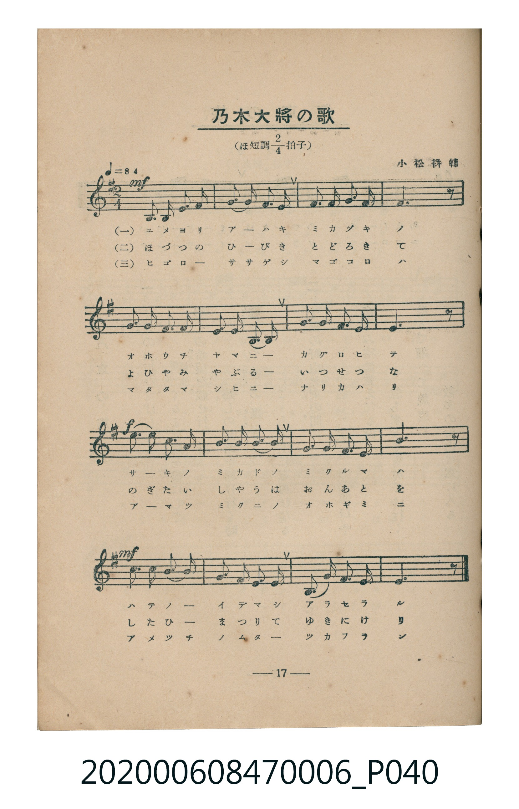
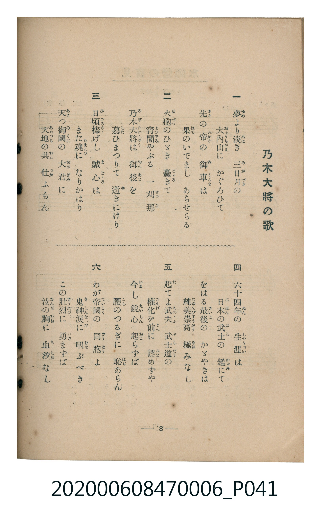

# 乃木大將の歌

<audio controls src="nogi_taisho_no_uta.mp3"></audio>

- 曲：小松耕輔
- 臺灣教育會公認《新定兒童唱歌》尋常科第六學年用（2020.006.0847.0006）

- note

原書資訊與歌詞全文（對應 P040.jpg–P041.jpg，書頁 pp. 17–18，第二學期第 4 首）：
調性與拍號：ほ短調四分之二拍子（E 小調 2/4 拍，關係調 G 大調），♩=84

## 歌詞

```text
一、
夢（ゆめ）より淡（あは）き三日月（みかづき）の
大内山（おほうちやま）にかぐろひて
先（さき）の帝（みかど）の御車（みくるま）は
果（はて）のいでましあらせらる

二、
火砲（ほづつ）のひゞき轟（とゞろ）きて
宵闇（よひやみ）やぶる一刹那（せつな）
乃木大將（のぎたいしやう）は御後（おんあと）を
慕（した）ひまつりて逝（ゆ）きにけり

三、
日頃捧（ひごろさゝ）げし誠心（まごゝろ）は
また魂（たましひ）になりかはり
天（あま）つ御國（みくに）の大君（おほぎみ）に
天地（あめつち）の共（むた）仕（つか）ふらん

四、
六十四年（ねん）の生涯（しやうがい）は
日本（にほん）の武士（ぶし）の鑑（かゞみ）にて
をはる最後（さいご）のかゞやきは
純美崇高（じゆんびすうかう）極（きは）みなし

五、
起（た）てよ武夫（ものゝふ）武士道（ぶしだう）の
權化（ごんげ）を前（まへ）に認（みと）めずや
今（いま）し鋭心（えいしん）起（おこ）らずば
腰（こし）のつるぎに恥（はぢ）あらん

六、
わが帝國（ていこく）の同胞（どうはう）よ
鬼神涙（きしんなみだ）に咽（むせ）ぶべき
この壯烈（さうれつ）に勇（いさ）まずば
汝（なんぢ）の胸（むね）に血汐（ちしほ）なし
```

## 原書掃描頁





## 調性分析

```text
================================================================================
📊 TMD Song Profile: [ 乃木大將の歌 ]
================================================================================
⏱  Duration:       0:22 (22.9s), 16 measures total
🎼 Key & Tempo:    首調基準 G, != 84.0 BPM, <2/4>
   - 分析範圍：      由實際發聲的音符與和弦推測調性；播放脈絡另行呈現
🎤 人聲音域:    B3 (MIDI 59) – E5 (MIDI 76) [跨度: 17 個半音 / 1.4 個八度, 難度: challenging]
   - 最低音:  B3 in [NogiTaishoNoUta #1 @ m.1, 0:00]
   - 最高音: E5 in [NogiTaishoNoUta #1 @ m.9, 0:11]
   - 適合: soprano, mezzo-soprano, contralto, tenor, baritone, bass
🏛  結構:      NogiTaishoNoUta (22.9s)
⚡ 編曲密度:        Peak 1 軌道同時演奏
🗝  調性診斷：       E 小調（純淨自然小調，未偵測到可信轉調）
   - 風格氣質:    純淨自然小調（陰鬱抒情、旋律集中，無明顯調外色彩）
   - 轉調歷程:    全曲維持單一推測調性（未偵測到可信轉調）
   - 核心骨幹音:  E, G, B, F#, A
   - 調性數值:    E 小調 [相關度: 0.90, 穩定度: High, 自然音純度: 100.0%]
   - 候選調性 (K-S): E 小調 (0.90), E 大調 (0.59), G 大調 (0.49)
   - 五度圈歷程:   +4
   - 各段落調性細節:
     • [NogiTaishoNoUta #1]: E 小調 (r: 0.90, 自然音純度: 100.0%)

  [ 五度圈游移軌跡 ]
               C  
         F            G  
      Bb               D  
      Eb               A  
         Ab          [E ]*
            Db       B  
               F# 
     (* = active key center)

  [ 十二半音累積音高分佈 ]
     C  : ██                         2.5%
     C# :                            0.0%
     D  :                            0.0%
     D# :                            0.0%
     E  : ████████████████████████  29.2%
     F  :                            0.0%
     F# : ███████████████           18.3%
     G  : ███████████████████       22.5%
     G# :                            0.0%
     A  : █████                      5.8%
     A# :                            0.0%
     B  : ██████████████████        21.7%
--------------------------------------------------------------------------------
Assignment 軌道音域：
  - Piano         : B3 – E5 (17 個半音 / 1.4 個八度, 52 個音符)
================================================================================
```

## ABC

```abc
X:1
T:乃木大將の歌
C:曲：小松耕輔
M:2/4
L:1/16
Q:1/4=84
K:G

V:V1 name="Piano" snm="Pia"

[V:V1]
!mf! e3 B e3 f | g3 f e3 f | g3 a b3 g | f6 z2 |
g3 g f3 f | e3 f e3 B | g3 g f3 f | e6 z2 |
!f! e3 b b3 b | c3 b a3 a | g3 a g3 f | b6 z2 |
!mf! b3 e b3 a | g3 f e3 f | B3 e g3 f | e6 z2 |
```

- [主旋律 TMD 檔案](nogi_taisho_no_uta.tmd)
- [鋼琴伴奏 TMD 檔案](nogi_taisho_no_uta_piano.tmd)
