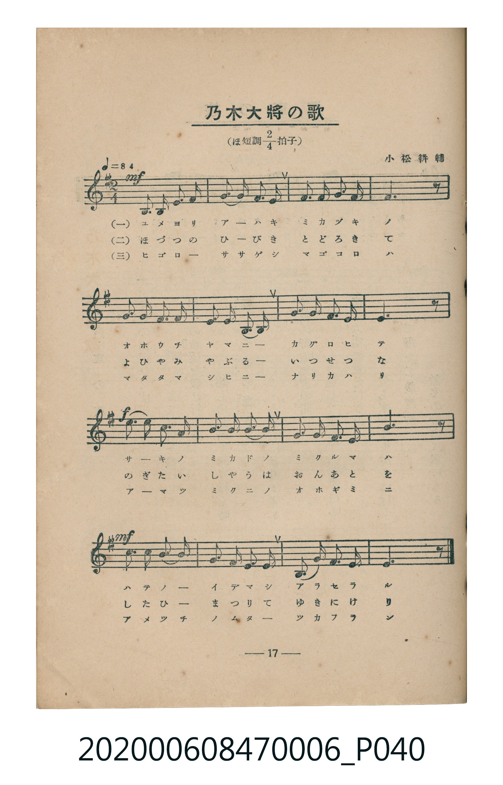
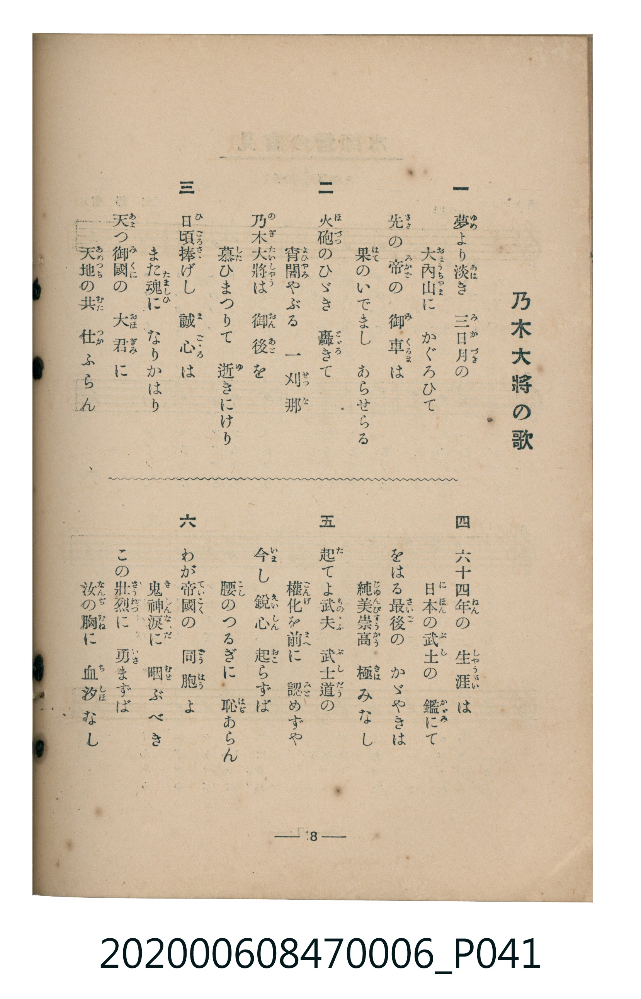

# 乃木大將の歌

> Re:Shōka 使用 AI 協助辨識與重建樂譜，可能會有錯誤。歡迎回報。

- **鋼琴伴奏版**：<br><audio controls src="nogi_taisho_no_uta.mp3"></audio>
- **NEUTRINO 歌聲合成版**：<br><audio controls src="nogi_taisho_no_uta_neutrino.mp3"></audio>

- 曲：小松耕輔
- 臺灣教育會公認《新定兒童唱歌》尋常科第六學年用（2020.006.0847.0006）

## 說明

原書資訊與歌詞全文（對應 P040.jpg–P041.jpg，書頁 pp. 17–18，第二學期第 4 首）：
調性與拍號：ほ短調四分之二拍子（E 小調 2/4 拍，關係調 G 大調），♩=84


## 歌詞

```text
一、
夢（ゆめ）より淡（あは）き三日月（みかづき）の
大内山（おほうちやま）にかぐろひて
先（さき）の帝（みかど）の御車（みくるま）は
果（はて）のいでましあらせらる

二、
火砲（ほづつ）のひゞき轟（とゞろ）きて
宵闇（よひやみ）やぶる一刹那（せつな）
乃木大將（のぎたいしやう）は御後（おんあと）を
慕（した）ひまつりて逝（ゆ）きにけり

三、
日頃捧（ひごろさゝ）げし誠心（まごゝろ）は
また魂（たましひ）になりかはり
天（あま）つ御國（みくに）の大君（おほぎみ）に
天地（あめつち）の共（むた）仕（つか）ふらん

四、
六十四年（ねん）の生涯（しやうがい）は
日本（にほん）の武士（ぶし）の鑑（かゞみ）にて
をはる最後（さいご）のかゞやきは
純美崇高（じゆんびすうかう）極（きは）みなし

五、
起（た）てよ武夫（ものゝふ）武士道（ぶしだう）の
權化（ごんげ）を前（まへ）に認（みと）めずや
今（いま）し鋭心（えいしん）起（おこ）らずば
腰（こし）のつるぎに恥（はぢ）あらん

六、
わが帝國（ていこく）の同胞（どうはう）よ
鬼神涙（きしんなみだ）に咽（むせ）ぶべき
この壯烈（さうれつ）に勇（いさ）まずば
汝（なんぢ）の胸（むね）に血汐（ちしほ）なし
```

## ABC

```abc
X:1
T:乃木大將の歌
C:曲：小松耕輔
M:2/4
L:1/16
Q:1/4=84
K:Em
V:V1 name="Piano" snm="Pia"
[V:V1]
!mf! B,3 B, E3 F | G3 G F3 E | F3 F G3 F | F6 z2 |
w: 1.~ゆ め よ り | あ _ は き | み か づ き | の
w: 2.~ほ づ つ の | ひ _ び き | と ど ろ き | て
w: 3.~ひ ご ろ _ | さ さ げ し | ま ご こ ろ | は
w: 4.~ろ く じゅ う | よ ね ん の | しゃ う が い | は
w: 5.~た て よ _ | も の の ふ | ぶ し だ う | の
w: 6.~わ が て い | こ _ く の | ど う は う | よ
G3 G F3 F | E3 E B,2 B,2 | G3 G F3 E | E6 z2 |
w: 1.~お ほ う ち | や ま に _ | か ぐ ろ ひ | て
w: 2.~よ ひ や み | や ぶ る _ | い つ せ つ | な
w: 3.~ま た た ま | し ひ に _ | な り か は | り
w: 4.~に ほ ん の | ぶ し の _ | か が み に | て
w: 5.~ご ん げ を | ま へ に _ | み と め ず | や
w: 6.~き し ん な | み だ に _ | む せ ぶ べ | き
!f! e3 e c3 A | B3 B B3 B | G3 G F3 E | B6 z2 |
w: 1.~さ _ き の | み か ど の | み く る ま | は
w: 2.~の ぎ た い | し や う は | お ん あ と | を
w: 3.~あ _ ま つ | み く に の | お ほ ぎ み | に
w: 4.~を _ は る | さ い ご の | か が や き | は
w: 5.~い _ ま し | え い し ん | お こ ら ず | ば
w: 6.~こ _ の さ | う れ つ に | い さ ま ず | ば
!mf! c3 c B2 B2 | G3 F E2 E2 | B,2 G2 F3 E | E6 z2 |
w: 1.~は て の _ | い で ま し | あ ら せ ら | る
w: 2.~し た ひ _ | ま つ り て | ゆ き に け | り
w: 3.~あ め つ ち | の む た _ | つ か ふ ら | ん
w: 4.~じゅ ん び _ | す う か う | き は み な | し
w: 5.~こ し の _ | つ る ぎ に | は ぢ あ ら | ん
w: 6.~な ん ぢ の | む ね に _ | ち し ほ な | し
```

## TMD 檔案連結

- [主旋律 TMD 檔案](nogi_taisho_no_uta.tmd) [[在 TMD Studio 編輯](https://tmdlang.github.io/Tmd-TS/#tmd=s7IKdvYPcrWy4qpTUCpJTLdSSM7PyUlNLsnMz7MqzsjMK0nNjM_KTMmPL87Iz05Ugisry88pzU21Si9KTEmNN4s3MjAyiDcwMIs3sDAxBzIMzBBKi_NLi5JTrYqTM_Lzc-JLUitKkvLzsxHyBUX5Zal5iXlANQVFIBtTwIoQClLLMlNSQdLFyYl58WWpRZlpmakpSG5JLSoGuxdsUXxJUWJecXJRZgHIEwhV-UUlGflA9xZkVFplZBaX5BdlJifmxGcn5iF5qyQjFeir3MyczJLEokpkzZnpmXlWJYmZwHAAhUV5YnxuYmZeTmIe0CFaWgpPdjY_m7Pi6ZLlTze0P25c92xtj4KWFpeirYKFCZe9rYI7V3Zqpa2Cay6XjZG-iR3I3GezN73fM-vphv5nc_e9aJj6Ys8UsHUv2nc9b1z8bOrMF02bns1pftq65sWq3scNXc-mbXi6btbT1knPVy99OmUj0ILHDd1PN3Q_3bHj-fKJz9esedq69unaHU93bnk-ZcX7PR2gGNEDxoMeKEaADAOz93s6lbi49LUUbKkFuBQUFJ72zX82e8eLze0vVnS96GgHuuvFynlPW1c8m9YOdMXTDb3P2jsVAgxMDPSyCtIfNUwGMg1BzPd7eoD6Xi5oVCgo0FMwNAdKGVoABYE-ebKrB-iTZ3PmA9kKJgovl00DOh0YViDrXqza_6xhOcii7t4XM-cDRR837n4-fy1Q_Ons2U872p7s7AbqB8o-XTsB6ABXBWAIAyUVgMGuABQF2vBy-pwn-5tAYu4KwAgDMsDG9zyaudIWGFsgW57saHjc0Aj23pJFQFMeN7U9bmoEKnvcBGR3Pdu-ECTY2PS4cT1IsLH3yY7OZ9OXPpvTARbf_7ix-3HjUqA4WHYdxKDlT9tan27cCFbRBXT148a2x40LHze1PG7cB1a3GqxtwuOm3seNmx43LgNra4UYORVu2NMdc5EsWQkV3Lfwxe4umHj_4yagFMTQ9SBTns2bA5ZbDzQVouFxI9Da5UBFjxungzzSBBScDSKbuiEhsAuYvsAh8Lxx9fMFwKQK1A50MtBTS2AmbHrcNA_orBd7gdEAlF0B4jZBXAn0AcT567a-nA5KCKCAA2kA2goKbjBjG9AyYEg_7dj5smkx2IjZQNMfN64CKgC7ASlPgaWBdvY9bpwPdvt0sBFtED8Cvf90Xw80ZJsmg2MGmAmA1kwCe791KlgO6FOgU4EagKEL9PgSYFQC3fmyARygTRCzgC4HxsNEoBQ0JXRCwwEYvy8XND_rXQ42CmjCFHBETX3cBNQO1DgJaP6LVQue7m8GKwCaD1QwFxYg4GgAi85_ubYJrALoD0joAwMXEvurwA4CRt16kPXgRAOMX0hCg8TmEpBP53QjIrpxNTQBAENpwmyktAUMKHBAN66GGvR0zgaoWU2N4GAGpmGwzlZwkmxqgATOk92QsAIqAFoDVLAVnComg0MDmMVg-QJY2vQ2grLczi1g9WuBaiAGPp8y_9k2YL4ABzg4kh439gDjDCk5grLKGrAKoK93w3U-W7vs6WKgh4Di24CaIYIvJ04Ei3SDUxvUT9DkBYxfcGB1P5vTAEsAwJwCtHMKLJGCtYFcAYwrsOXPt0x5vq_v6Zb2l6tngDXMAOduYKLZ_LhxJti1wBgAJYZnS7eCFYB0go0DhvgqoLugGWQKNChebN0OiU-wmmXAlA7yxxKwP5qAMbcOlAwagUZ1Qvz3shHoXagXHzcugCVicCnxbE3X0x5gcQeUBqYeoJsmQVLx005gMoKkqh2QEADWCrBUAEnpwEidBfQo2G3QogBeskx_2b0WljAh4sCYAQU6zO3ANAOOA1AxACxRN4D91QpJMEBXQKMCnGWAgQNMW6ufNS6FFSnAEhIoCy5DYOmkdS00cB43AdNoD7DMgqXaZWDrgWb2Q5PfhJ4XzfPAUivBgQ80EBwgTR0g_S_X7Hm-dN6zbTNhMQFyODgagB5fAAmKp5P2wlIwMAcARYAhuxOoGJLlgKrXPV28_nkzvCAFxjYwPUKKsdVPuyFlC9BRwIQPFAEGMSwEnm2EFLXAfAk0BeLNdS-agTEAsW0tNCoWNjzbCKpsQMU5KE53g8XBSQVoCuX1LBQoaOlzcfnlp2eGgJshfvmhJYlWAZmJefkONQY11SC7FGwMzbTswCxsFb0CqHbd0fBiYY-ChgmoZny-vkEHXjtrYtEAtBJkWI1CdW5arYJxvIIuEAIpMwjLPB4oZQhmGoI4IAZQqgbGBlIQWbBCqCAEGgBxDdhwH8MaYDppA4sC0zEQd0DZXUBNwJQF1QFMG1C6Fyy-H8rrBuKlKDLrkOwB2Qm1xwgktxuqcikQL4Gy14F1bYLbsxnFtBVQ3kqgi3pRZJZht8cYYRowH8N1AeWB_KlQ8alAPAnKng6W2YfQ0TgZGgIQeyD-xrDHBBRuMBf1AzGwKGuFcttAGmEB2bgWyIYaCfUsMB81w5UCsyiU3YLPPlOQ3HyoymVw48H-aoLEEsh4WPgDCz2wadvgvgRmWWTn4YonM5B5_VCVPfBwhrkO4hGIn5G9tBLJP7CUghwMyPbgzyK7esjJImj5AJzkofkESIHzDpjAnmOgKiEQLXM0dkG9sxvsJQh7IdhrLVDePiBejYgOYKaAiE9ASiKb8CVaUOaAp5dNSCbvR7FnG5ANMRtiD0x8CRDPhrNBMquw2wPOHLCkPh8pQe2DpEuEC1D8AzENVCQg_LYe7DJI2GDYA8ocUBPA4YaW_pETJSwZIocbKNnBCpjV-MINnCmmQF03GciGZuqmSSiZegeaf2BmrwAXeRD2LKSQxrAHlCmAxQ7c1XD_rEIxbwGqPU0NUPHZSH7eCdYBMQvZHgL1RidZ9Qaw2jAD22EG7MuBaCOgqDGYZQynsWcJiCwEoucISDEKKYqR4xW5UoAVCKgywIISmoJhaQ5HcQeuLmBFWR9SSoUUQ9CUCowvRJ4Ep0hYbgWnBlixuAIcG5C0gWETOE8gqjlYmoHkIyR3w9MzxEfIpUIflA3OrfAUgGYPuMKAuQFeSAJDA7liAvkHmp6h9iDlCXg5gLdiAucJWDpG-AdSzcHKGJA9sDCcjOIfYLg1dULZ4DzRuAG7PeA8gagOYHE1FawH1qAA5WRYRQ_JyTA_gKpgmNtw2YM3TwD7P2S3pSCZwQScyEEYlgWAGQBcFYAJYB4AUSAZousKWNUHrKBRSjaYr5dDfQ0JfVjKg4Q4vAwH8kBpBVbSo4U7OGfASmpQGQ5rOiGXeMAaAVw2Q0pOkGmgGIHkV0RKnoivDEfKF-CGITgeQTUfxCZofAPLOFjehIhDVIHcDmqCIPsHllbQ7AHXFYjGEzjjQtqAEANnQh0LallAjAV5BVaIQoIckVEhBTIkeDCsAmcNWNGNXvlAkykw2CEZGhJMsEgFdkHAJCxA8HoJnDVglSbIPxC9INuQq4W18KiA2AMKWojbES1lXP6p5eLStVNA65AoAIWUuQA)]
- [鋼琴伴奏 TMD 檔案](nogi_taisho_no_uta_piano.tmd) [[在 TMD Studio 編輯](https://tmdlang.github.io/Tmd-TS/#tmd=s7IKdvYPcrWy4tLSUniys_nZnBVPlyx_uqH9ceO6Z2t73u_peNm95_mELU_2bHm6tP95Z8f7PZ0KWlpcirYKFiZc9rYK7lzZqZW2Cq65XDZG-iZ2XHUKSs9mb3q_Z9bTDf3P5u570TD1xZ4pSiDhF-27njcufjZ15oumTc_mND9tXfNiVe_jhq5n0zY8XTfraeuk56uXPp2yEWjr44bupxu6n-7Y8Xz5xOdr1jxtXft07Y6nO7c8n7IC6CAjAyMDPQMDMz0DCxNzIMPADOgmJS4uv_z0zJDEzOKMfL_80JJEq4DMxLz8IA-HGoOaai4FILAxNNOyA7P0tRRs0YEC0KYnOxpeLOxR0AgwMDHQyypI18SiTEsfbESNQnVuWq2CcbyCLhACKTMIyzweKGUIZhqCOCAGUKoGxgZSEFmwQqggBBoAcQ3YcB_DGoXHTW1g0cdNjUDcAWV3ATU9bmyC6njcuB5K94LF90N53UC8FEVmHZI9IDuh9hiB5HZDVS4F4iVQ9jqwrk1wezajmLYCylsJdFEviswy7PYYI0x73DgFrgsoD-RPhYpPBeJJUPZ0sMw-hI7GydAQgNgD8TeGPSagcIO5qB-IZzxuaoVy20AaYQHZuBbIhhoJ9ez0x03NcKWPG3ug7BZ89pmC5OZDVS6DGw_2VxMklkDGw8L_ceNWsGnb4L583LgA2Xm44skMZF4_VGUPPJxhroN4BOJnZC-tRPIPLKUgBwOyPfgzxq4e4jMGWuoHJ3Ro7gBS4BwDJrDnE6hKCETLEo1dUE_sBnsEwl4I9lALlLcPiFcjIgGYFSDiE5ASxiZ8SRWUJeCpZBOSyftR7NkGZEPMhtgDE18CxLPhbJDMKuz2gLMELIHPR0pG-yCpEeECFP9ATAMVBAi_rQe7DBI2GPaAsgTUBHC4oaV65KQIS3zI4QZKbLBiZTW-cANnhSlQ100GsqFZuWkSSlbegeYfmNkrwAUdhD0LKaQx7AFlBWBhA3c13D-rUMxbgGpPUwNUfDaSn3eCdUDMQraHQB3RSUIdAawizMAmmymYgGkjoKgxmGUMp7FnBIgsBKLnA0iRCSl2kWMTuQKAZX5UGWChCE23sJSGo2gDVw2wYqsPKX1Cihxo-gTGEiIngtMhLI-C0wCsCFwBjgNIisCwCZwTEFUaLKVAcg-Su-GpGOIj5LKgD8oG51F4vKPZA64cYG6AF4jA0ECuhED-gaZiqD1IOQGe-_FWQuCcAEu9CP9AqjRYyQKyBxaGk1H8Awy3pk4oG5wTGjdgtwecExBFPyyupoL1wBoPoPwLq9Qh-RfmB1B1C3MbLnvw5oSns2eT2FqCZAETcNIGYVjCByZ7cLEPJoApH0SBZIiuF2CVG7AKRinFYH5dDvUrJMxh6Q0SzvDyGsgDpRBYqY4W2uD8ACuVQeU1rHGEXLoBS39wOQwpJUGmgeIBkksR6XcivvIaKTeAm37g2APVchCboLEMLM9gORIiDlEFcjuokYHsH1gKQbMHXC8gmkfg7App5UEMnAl1LKjtADEW5BVYgQkJckT2hBS-kODBsAqcIWDFNHpFA02cwGCHZGNIMMEi9XHjIjAJCxC8XgJnCFgFCfIPRC_INuQqYC08KiD2gIIW4nZEWxiXf2px9DN8kPsZJtBuBjTVm8XHK0SbxefGglMxgm0MYhsj2AZQf0BVQWVw6QCJI3SAKxqQrEk8NoXIBiBpAudJEuwC-l7XTgEtAKJ9DGMVsAkbYRc2xi5sgl3YFLuwGVhYmQsA)]

## 分析

```text
================================================================================
📊 TMD Song Profile: [ 乃木大將の歌 ]
================================================================================
⏱  Duration:       0:22 (22.9s), 16 measures total
🎼 Key & Tempo:    首調基準 G, != 84.0 BPM, <2/4>
   - 分析範圍：      由實際發聲的音符與和弦推測調性；播放脈絡另行呈現
🎤 人聲音域:    B3 (MIDI 59) – E5 (MIDI 76) [跨度: 17 個半音 / 1.4 個八度, 難度: challenging]
   - 最低音:  B3 in [NogiTaishoNoUta #1 @ m.1, 0:00]
   - 最高音: E5 in [NogiTaishoNoUta #1 @ m.9, 0:11]
   - 適合: soprano, mezzo-soprano, contralto, tenor, baritone, bass
🏛  結構:      NogiTaishoNoUta (22.9s)
⚡ 編曲密度:        Peak 1 軌道同時演奏
🗝  調性診斷：       E 小調（純淨自然小調，未偵測到可信轉調）
   - 風格氣質:    純淨自然小調（陰鬱抒情、旋律集中，無明顯調外色彩）
   - 轉調歷程:    全曲維持單一推測調性（未偵測到可信轉調）
   - 核心骨幹音:  E, F#, B, G, C
   - 調性數值:    E 小調 [相關度: 0.82, 穩定度: High, 自然音純度: 100.0%]
   - 候選調性 (K-S): E 小調 (0.82), B 大調 (0.57), B 小調 (0.54)
   - 五度圈歷程:   +4
   - 各段落調性細節:
     • [NogiTaishoNoUta #1]: E 小調 (r: 0.82, 自然音純度: 100.0%)

  [ 五度圈游移軌跡 ]
               C  
         F            G  
      Bb               D  
      Eb               A  
         Ab          [E ]*
            Db       B  
               F# 
     (* = active key center)

  [ 十二半音累積音高分佈 ]
     C  : █████                      5.8%
     C# :                            0.0%
     D  :                            0.0%
     D# :                            0.0%
     E  : ████████████████████████  25.8%
     F  :                            0.0%
     F# : ██████████████████████    24.2%
     G  : ███████████████████       20.0%
     G# :                            0.0%
     A  : █                          0.8%
     A# :                            0.0%
     B  : ██████████████████████    23.3%
--------------------------------------------------------------------------------
Assignment 軌道音域：
  - Piano         : B3 – E5 (17 個半音 / 1.4 個八度, 52 個音符)
================================================================================
```


## 原書掃描頁






