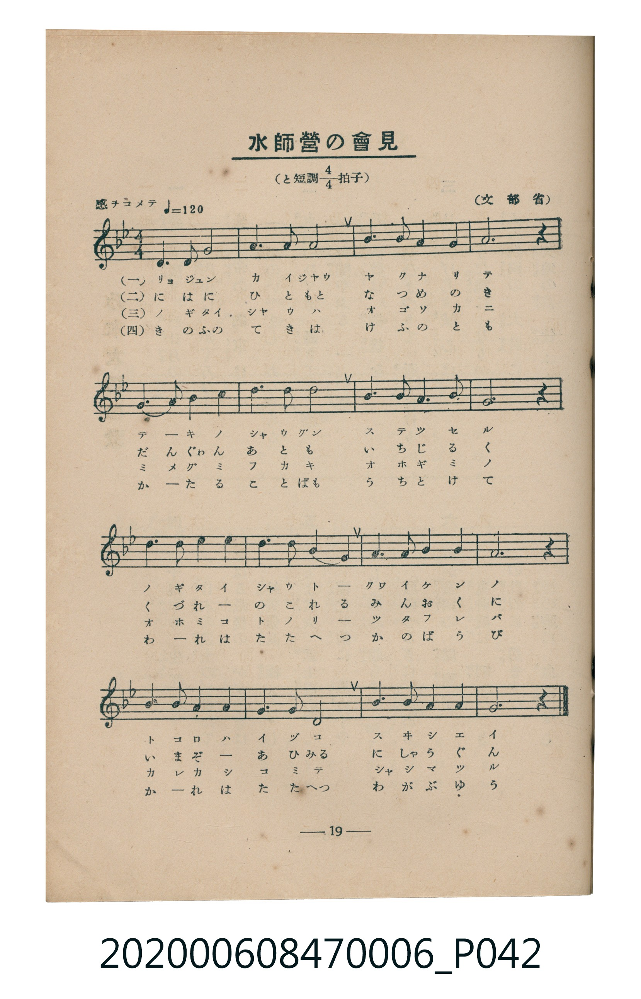
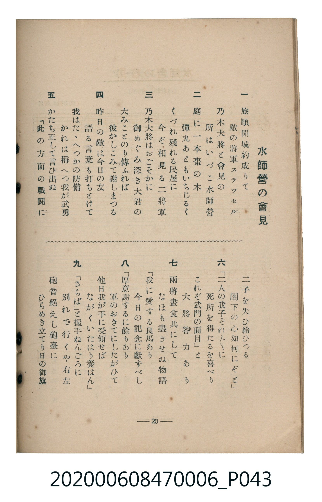

# 水師營の會見

> Re:Shōka 使用 AI 協助辨識與重建樂譜，可能會有錯誤。歡迎回報。

- **鋼琴伴奏版**：<br><audio controls src="suishiei_no_kaiken.mp3"></audio>
- **NEUTRINO 歌聲合成版**：<br><audio controls src="suishiei_no_kaiken_neutrino.mp3"></audio>

- 文部省
- 臺灣教育會公認《新定兒童唱歌》尋常科第六學年用（2020.006.0847.0006）

## 說明

原書資訊與歌詞全文（對應 P042.jpg–P043.jpg，書頁 pp. 19–20，第二學期第 5 首）：
調性與拍號：と短調四分之四拍子（G 小調 4/4 拍，關係調 Bb 大調），「感ヲコメテ」（♩=120）


## 歌詞

```text
一、
旅順開城約成りて
敵の將軍ステッセル
乃木大將と會見の
所はいづこ水師營

二、
庭に一本棗の木
彈丸あともいちじるく
くづれ殘れる民屋に
今ぞ相見る二將軍

三、
乃木大將はおごそかに
御めぐみ深き大君の
大みことのり傳ふれば
彼かしこみて謝しまつる

四、
昨日の敵は今日の友
語る言葉も打ちとけて
我はたゝへつかの防備
かれは稱へつ我が武勇

五、
かたち正して言ひ出ぬ
「此の方面の戰鬪に
二子を失ひ給ひつる
閣下の心如何にぞと」

六、
「二人の我子それ〲に
死所を得たるを喜べり
これぞ武門の面目」と
大將答力あり

七、
兩將晝食共にして
なほも盡きせぬ物語
「我に愛する良馬あり
今日の記念に獻ずべし」

八、
「厚意謝するに餘りあり
軍のおきてにしたがひて
他日我が手に受領せば
ながくいたはり養はん」

九、
「さらば」と握手ねんごろに
別れて行くや右左
砲音絶えし砲臺に
ひらめき立てり日の御旗
```

## ABC

<div class="abc-score" data-abc-src="suishiei_no_kaiken.abc" aria-label="五線譜載入中"></div>

[下載 ABC 原始檔](suishiei_no_kaiken.abc)

## TMD 檔案連結

- [主旋律 TMD 檔案](suishiei_no_kaiken.tmd) [[在 TMD Studio 編輯](https://tmdlang.github.io/Tmd-TS/#tmd=s7IKdvYPcrWy4qpTUCpJTLdSSM7PyUlNLsnMz7MqzsjMK0nNjM_KTMmPL87Iz05Ugisry88pzU21Si9KTEmNN4s3MjAyiDcwMIs3sDAxBzIMzBBKi_NLi5JTrYqTM_Lzc-JLUitKkvLzs9Hl4wsS01OtAgxMjBAyBUX5Zal5iXlA3QVFILekgLUjFKSWZaakgqSLkxPz4stSizLTMlNTkFyZWlQM9gnEipKixLzi5KLMApD3EKryi0oy8oE-KciotMrILC7JL8pMTsyJz07MQ_JwSUYq0L-5mTmZJYlFlejiEG1IwkAz0jPzrHLz85JKgUGHKZGamZWJFBhaWgrPNmx5umP18_b5jxvXPZvT_GJZt4KWFpeirYKhkQGXva2Ckw5XdmqlrYJ7LpeNib6JHcjIZ9PaXzaveD6nEWzBi_ZdzxsXP5s680XTJqAJT1vXvFjV-7ih69m0DU_XzXraOun56qVPp2x8trbncUP30w3dT3fseL584vM1a562rn26dsfTnVueT1nxfk8HKDb1gHGoB4pNIMPA7P2eTiUuLn0tBVtqAS4FBYWnffOfzd7xYnP7ixVdLzrage56sXLe09YVQF8BXfF0Q--z9k4FUJLQyypIf9QwGcg0BjHf7-kB6nu5oFGhoEBPwdASKGVkABQE-uTJrh6gT57NmQ9kK5gqvFw2Dej093tmgax7sWr_s4blIIu6e1_MnA8Ufdy44vn8tUDxp7NnP-1oe7KzG8gAyj5dOwHoAHeFpxv6gZIKwNBWAIoCbXg5fc6T_U0gMackhadLlgNZYPOBAdrzrGX-4-ZNj5s2P25e-Li57XEDUEPHo5krbYHxB1TEBXLCkx0NjxsaQaxn01tfLmh7Oa376fy-51tannVMeNzU9bhxGVhu6lZgGni6of3F7t7HTTtBhjU3P27a_bh5NdiQnc3P5qwA2g5UAfQBJK0ANYC1djY8blz_uLHlcePSx42T4WkKYvsuoDvBtj_dtfZx42qga57NWfNs8XRwilsBltjb8WTHjseNTUCDHzcBSaBBCx83znjcBLShH6QCSIHMbup5tg4o2gOUeLZh4tONQGmI43YDfTHvOTBagW5q6gbFB9gfUO93Qh2A6gegg4G6pjxunPu4EWbQ030LHzc1Pm6c8Lhx_7PtGx839oJUT5gN9SiQA5QAehHk0MZ1wMB7Cgz5xq0gJzVugHhlD9g0oO-AioBKl71YAzQfyN33uHEJ0G1gJwEjHBYjM1Y8mw4MtHXg4F8P9AiE-7S_G5J65gH1vFjR8GJiJzBknnUCDQWGDNDyibBo6wCygF6Z_7gJaA8wEJeA7V_3csamp00zIWEHDBOg-9Y_XwH0EEgFWE_Ps7XLnna3Q-NoCtQ9YM3AwmDhs7WLwc5eBrT8ceOmp-27HjeuAasAJrq1QEvWPZu28-XcRSBGx4aXa1bBogKUF4DJatLTJUDbNj3fugxIQr0OlH45bfGTHSD3Pd3f_HRZ05O9U4H6gHEH8lMDJL6A5QLMMQ09QOOe7AJaDbRkIshcYGQB_dIANBFs27O1u0GJD2jbPqBbgWEA9Oqkp9PmPG7cCYwciIcmg30_D-jdl9OAXlkHdPTz2euAtgHthEYqMD08XzvlaRcwnptA-iDJphmWbltXAhU8mzn35eL5T1uBvgI6GBQyEOOBHt8NjJrns4HxAjQSaMSa550rgREHCyxQYK9-1gKUmAmKy871L5etgdoDSbqQGH-xYsbT_cA0sPp57-7HjcBSYifIFniYrEaEydO-Wc9a-sHpCmQiUMvLJcBcAUzMMENBWRiYPEHpG8gAxgDExcB4BYYEMOzATn-yexrQZmha6AQZ87R_-ssFM8B-ACdmsOeAOoB5D5gjgbrXA81_uQRoKpAxGea2JzvnItz2uHHq46ZOoH5I-D7rXwg2ei1IPTCvNQEFIRmtA5SbQclrIdiCppan_Zufbgc77PmCTS_nb36-ddvjxg6gu4FcYB0D1QdyPtB8UB7tfb4aaPIyoJOgWWbfwmfTp4MUUV5RQIGClj4XV3BpJrBRkprpl--dmJmdmmcVkJmYl-9QY1BTDbJMwcZCyw7MwFZTKYCqhx0NQF8qaJiAivbn6xt04NWLJhYNQCtBhtUoVOem1SoYxyvoAiGQMgOxwESNgjlEFEiBWWCiRsEQLGgI4aKqhEADkBDYdB_DGoXHzaseNy8HSzxu2vG4eSlQZDOI07wHrPVx02qo5BKIgsVgzjKIZPMSqOR6ILsLrG0VVKYNyUqwKyBWGgHlGqFGNgJ1gdlwyxo3QWVWAM1sgrIgMiBzQXyQMxrBrHVQmV7sNhmDXNEHdd86IN4P9QbEW9shXoF45nFzP4qfoZY1bQHivWAWyJkgA7uxW2aCcAjIYcDaAMWJoOAC8XvBnkb28ESozFaoariHwd7HYpMpcpzsB5oEDgy4y0GeBPEbQF4Es0ARAZKBRlXzJCj7cXM71E892G0yA7kP5A-Qq-YDdYEjGOanJlCIgfg9oNIVxU9zoa4DycyDsiAyEHdj2GQOTYdIEQKLH0RSmwR1_2qgGCiZwO1r7oDKLILGD8TneBKhBcgtIDeD3N8GxC0o7p_-uKkZKjkTaBjYSLDTQZKQaAHW5PAAAYmAAgTEw2KZJUgOGozNK4F4ApgFcjRIZhHUz8C8APLzUhSfQVMUMEeC0iKItRYqg5kO8Zc-u3rIK30KaiGFCLh8AZUtRmAHGIOFjME0CKOVOyBGDUwjBKIXO5CoAXn1cRPIU5C8ipkzmzZAQwAiuROqDRhrzdBIatoNDhEcaQtc4CyAqpwMZAObJSCbQBzUGIWXOfCEAEoWIJmFQDwDakQ3WAaS-DEsA5c586FOBOqCOh4kApKZCjUDlIQhfkYrcJpng8sqCHs-WA-kBMOwCVzgQBIBOAyBGRTiOojLYYkb6KdGsBvAPgPJQMMd7CdQUQNiT0QqpDBsAhc4oOCHxBHIjcjZciFUBphEwW5F-Gk3kgw0iwJ14SlEwQXOdKibgJmwHagBlOsREQI1BlwaQXI6SB5kGcyCXiTP78SXLcFlDkQOHOzA0gM550GjHhhNEI9ASkmQDDTDgoKiaQ1U1X6wDCQSMWwClzagTA9L7uDSEl43QN0ArhtAgYooamBBAfQtsJSFsDfhiypQUdMMql-giawZ5D54DdAMrYXAlTWkBoD5FppkQdUkvJxtwOEnAq2cTrLKGVAjB2yHsYIJkARhRCEDKlqgLRlwcwjR8AHJgDCBJg7RrQBQKkIk4PWPm6F5Edz42QiWhBZEuPIluLiBVY3AxhS46kMkYKh5wCQKlYHnWGjFDS6iIPUKyBQ8lSaorEEuN8CRCMmpyJUiKMeCVGEmbVDjAVQiQZIJSAaSSDFsApU1sOoenIDBLgc3ZEDugyYecDLdAWZBQxdWPoEbROBSCFz6gGQg5QmGTaCyBlo6QGyCNGFA1T3IDbAEvB2adSGJFSQDa_bMg4pBfImnWgCXNdCCAtFQgcfTNqhME3p2Bbc9YfEEUo2IJ0hpimETuKCBZkpgSEObKPBEBqv_QSkMVLlBXAzOeqhpE9xsACsnVNbAImQGNCoQliG32VDLGmDXsRVqWReo-QOJKmAvECoPij4s9oFLHGiCAtKQBIlo3MASNahqhUQlLBFCXQL2WQM0ACAyJLZsgKMo5JQ4KM0VaNcJ2l4BUuAOF5jAqxIC0UsbWFUEqvfWgj0NTSHwJngrNJ8iIgbWrNkACyhgkCHrwQh4cDkDa58A26Jo6RfWptkELVkQ5Qys7wVu5MJiGZS2QJZBMgSGZeCiBqoRlITBbHgrG944ABYA4LoG4S2k4hWUZyFuJJAz0Vs2xJY2KIkblH8fN8FKGxzdAOSuFLAxCfUWvB0K9RZSPMK8Bev1gqpYSDNkH9RPkLjHsAlc2sBcDswmsC4GokCEtVng3oJHJbSBBQwS4JgHmEWgwwEqcMCVFTQAoYU8zFsgr4D4vUAMSYTQpAHXA-pt7AKzZkJlQDGNxSZwaQPrmIOCHaUXDU-eID-Be71gF4PMg8lMh-qHRy-uFAguZ2AtE1AnChQqEL8gF_9t0JIRUc7A9ICqQXAFCc-MED3INtVycenaKaCP9CgAxZS5AA)]
- [鋼琴伴奏 TMD 檔案](suishiei_no_kaiken_piano.tmd) [[在 TMD Studio 編輯](https://tmdlang.github.io/Tmd-TS/#tmd=s7IKdvYPcrWy4qpTUCpJTLdSyC8qychPL0osyKi0ysgsLskvykxOzInPTsxLVIIrKs4vLUpOjS9ITE-1CjAwMdIFEsZKXFpaCs82bHm6Y_Xz9vmPG9c9m9P8Yln3-z0dL7v3PJ-w5cmeLU-X9j_v7Hi_p1NBS4tL0VbB0MiAy95WwUmHKzu10lbBPZfLxkTfxA5kz7Np7S-bVzyf0wi29UX7rueNi59NnfmiaRPQ2Keta16s6n3c0PVs2oan62Y9bZ30fPXSp1M2Plvb87ih--mG7qc7djxfPvH5mjVPW9c-Xbvj6c4tz6esALrEyMDIQM_AwEzPwMLEHMgwMAM6RomLyzOvpCjfKiAzMS8_yMOhxqCmmksBCGwstOzAjBqF6ty0WgVDBV0gNFQwjwdSYKJGwQxE6YIoYxALTNTgUwmBBiAhrloUq32QrTZBtdosPl4h2iw-N1bBFMQyjY8FmwgTRLCQRXEqNYDYHVyaWZyRmZrpl--dmJmdmocnBPS1FGzRgQIwgJ_saHixsEdBA5QM9LIK0jWxKNPSR_YJOITAAQUOEDBRAwkjcFAhBxlKMKKqRA5GkOk-hjUKj5tXPW5eDpZ43LTjcfNSoMhmEKd5D1jr46bVUMklEAWLwZxlEMnmJVDJ9UB2F1jbKqhMG5KVYFdArDQCyjVCjWwE6gKz4ZY1boLKrACa2QRlQWRA5oL4IGc0glnroDK92G0yBrmiD-q-dUC8H-oNiLe2Q7wC8czj5n4UP0Mta9oCxHvBLJAzQQZ2Y7fMBOEQkMMeN25FcSIouED8XrCnkT08ESqzFaoa7mGw97HYZIocJ_uBJoEDA-5ykCdB_AaQF8EsUESAZKBR1TwJyn7c3A71Uw92m8xA7gP5A-Sq-UBd4AiG-akJFGIgfg8QT0bx01yo60Ay86AsiAzE3Rg2mUPTIVKEwOIHkdQmQd2_GigGSiZw-5o7oDKLoPED8TmeRGgBcgvIzSD3twFxC4r7pz9uaoZKzgQaBjYS7HSQJCRaHjfugwcISAQUICAeFsssQXLQYGxeCcQTwCyQo0Eyi6B-BuYFkJ-XovgMmqKAORKUFkGstVAZzHSIv8zZ1UNKmVMAKj3BZgOLDlCJYgS21hgsZAymQRittAExsJbZiMIGEiEgDz5uAnkFkkMx82PTBqi_IZI7odqAcdUMjZqm3eBwwJGiwMXMAqjKyUD2hMdNIJtAHNR4hJc08OgHJQaQzEIgngE1ohssA0nyGJaBS5r5UCcCdUEdDxIByUyFmgFKuBA_oxUzzbPBJRSEPR-sB1JuYdgELmYgUQ8OQ2C2hLgO4nJYkgb6qRHsBrDPQDLQcAf7CVTAgNgTkYomDJvAxQwo-CFxBHIjcmZcCJUBJkywWxF-2o0kA82YQF14ik5wMTMd6iZg1msHagDldUSEQI0Bl0GQ_A2SB1kGs6AXyfM78WVGcEkDkQMHO7DMQM5v0KgHRhPEI5CyESQDzaagoGhaA1W1HywDiUQMm8BlDCirw5I7uIyE1whQN4BrBFCgIgoYWFAAfQssWyHsTfiiClTANINqFWgiawa5D17uN0PrHnAVDSn3Yb6FJllQ5QgvXRtw-IlAi6aThNIF1KABm2ysYAIkQRhRtIAKFGirBdz0QTRyQDIgTKA5Q3SND0o7iGS7_nEzNAeCGzobwZLQ4gdXbgQXMrBqcBa0mkMkW6h5wIQJlYHnU2glDS6YIHUIyBQ8FSSohEEuLcBRB8mfyBUgKJ-CVGEmaFBDAVQOQRIHSAaSNDFsApUwsKodnGzBLgc3WkDugyYZcOLcAWZBQxdWKoEbP-CyB1zmgGQgpQiGTaASBlomQGyCNFdAVTvIDbBkux2aYSFJFCQDa-LMg4pBfImnMgCXMNDiAdEogcfTNqhME3omBbczYfEEUo2IJ0gZimETuHiBZkVgSEObI_BEBqvrQSkMVKVBXAzOcKhpE9xEACsnVMLAImQGNCoQliG3z1BLmBmPm1qhlnWBmjqQqHrcCCriQfKg6MNiH7icgSYoIA1JkIiGDCxRgypUSFTCEiHUJWCfNUADACJDYivm6ezZxJczVO95IsoYWLUDquPWgr0KTRewRnbTLmjuREQHtAkDjntw8AADClkPRnCDSxdYWwTY2kRLtbD2yyZoeYIoXWC9K3AzFha3oBQFsgySDTAsAxcwUI2ghAtmw9vR8IYAMNuD6xWEt5AKVVBOhbiRQH5Eb8UQW8agJGlQrn3cBCtjcDT0kTtLwIYj1FvwNifUW0jxCPMWLB5B1SmkybEP6idI3GPYBC5jYC4HZg5YJwJRDMLaJ3BvwaMS2pgCBsnjpk4wi0CXAlTMgKsoaABCi3aYt0BeAfF7gRiSCKFJA64H1J_YBWbNhMqAYhqLTeAyBtb1BgU7Sj8ZnjxBfgL3a8EuBpkHk5kO1Q-PXlwpEFy6wFohoG4SKFQgfkEu9Nug5SGidIHpAVV-4GoRnhkhepBtwjmAQ9w4EvKQEXygiODgEopK0DASzGxwLwtcFIGVQ8wwBLIMY2EU-tAUCGMbmUI0raAaTYCUCZJ5yA4C-wruKiKcSpORNF07BfBAngKQgR4p0T5AJ2MVN8IhboxDHBgGWMVNcYib4RA3xyFugUPcEiyuzAUA)]

## 分析

```text
================================================================================
📊 TMD Song Profile: [ 水師營の會見 ]
================================================================================
⏱  Duration:       0:32 (32.0s), 16 measures total
🎼 Key & Tempo:    首調基準 B,, != 120.0 BPM, <4/4>
   - 分析範圍：      由實際發聲的音符與和弦推測調性；播放脈絡另行呈現
🎤 人聲音域:    D4 (MIDI 62) – D#5 (MIDI 75) [跨度: 13 個半音 / 1.1 個八度, 難度: moderate]
   - 最低音:  D4 in [SuishieiNoKaiken #1 @ m.1, 0:00]
   - 最高音: D#5 in [SuishieiNoKaiken #1 @ m.9, 0:17]
   - 適合: soprano, mezzo-soprano, contralto, tenor, baritone, bass
🏛  結構:      SuishieiNoKaiken (32.0s)
⚡ 編曲密度:        Peak 1 軌道同時演奏
🗝  調性診斷：       G 小調（純淨自然小調，未偵測到可信轉調）
   - 風格氣質:    純淨自然小調（陰鬱抒情、旋律集中，無明顯調外色彩）
   - 轉調歷程:    全曲維持單一推測調性（未偵測到可信轉調）
   - 核心骨幹音:  A, G, A#, D, D#
   - 調性數值:    G 小調 [相關度: 0.70, 穩定度: Moderate, 自然音純度: 100.0%]
   - 候選調性 (K-S): G 小調 (0.70), D 大調 (0.56), D 小調 (0.53)
   - 五度圈歷程:   +1
   - 各段落調性細節:
     • [SuishieiNoKaiken #1]: G 小調 (r: 0.70, 自然音純度: 100.0%)

  [ 五度圈游移軌跡 ]
               C  
         F           [G ]*
      Bb               D  
      Eb               A  
         Ab           E  
            Db       B  
               F# 
     (* = active key center)

  [ 十二半音累積音高分佈 ]
     C  : █                          1.7%
     C# :                            0.0%
     D  : ███████████████           20.0%
     D# : ███                        3.3%
     E  :                            0.0%
     F  :                            0.0%
     F# :                            0.0%
     G  : █████████████████         22.5%
     G# :                            0.0%
     A  : ████████████████████████  31.7%
     A# : ████████████████          20.8%
     B  :                            0.0%
--------------------------------------------------------------------------------
Assignment 軌道音域：
  - Piano         : D4 – D#5 (13 個半音 / 1.1 個八度, 52 個音符)
================================================================================
```


## 原書掃描頁






