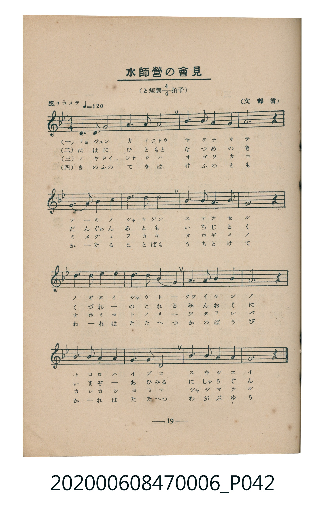
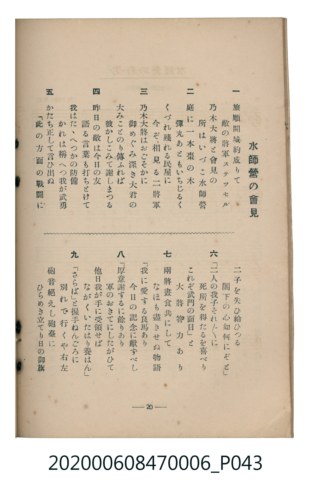

# 水師營の會見

> Re:Shoka 使用 AI 協助辨識與重建樂譜，可能會有錯誤。歡迎回報。

<audio controls src="suishiei_no_kaiken.mp3"></audio>

- 文部省
- 臺灣教育會公認《新定兒童唱歌》尋常科第六學年用（2020.006.0847.0006）

## 說明

原書資訊與歌詞全文（對應 P042.jpg–P043.jpg，書頁 pp. 19–20，第二學期第 5 首）：
調性與拍號：と短調四分之四拍子（G 小調 4/4 拍，關係調 Bb 大調），「感ヲコメテ」（♩=120）

## 歌詞

```text
一、
旅順開城約成りて
敵の將軍ステッセル
乃木大將と會見の
所はいづこ水師營

二、
庭に一本棗の木
彈丸あともいちじるく
くづれ殘れる民屋に
今ぞ相見る二將軍

三、
乃木大將はおごそかに
御めぐみ深き大君の
大みことのり傳ふれば
彼かしこみて謝しまつる

四、
昨日の敵は今日の友
語る言葉も打ちとけて
我はたゝへつかの防備
かれは稱へつ我が武勇

五、
かたち正して言ひ出ぬ
「此の方面の戰鬪に
二子を失ひ給ひつる
閣下の心如何にぞと」

六、
「二人の我子それ〲に
死所を得たるを喜べり
これぞ武門の面目」と
大將答力あり

七、
兩將晝食共にして
なほも盡きせぬ物語
「我に愛する良馬あり
今日の記念に獻ずべし」

八、
「厚意謝するに餘りあり
軍のおきてにしたがひて
他日我が手に受領せば
ながくいたはり養はん」

九、
「さらば」と握手ねんごろに
別れて行くや右左
砲音絶えし砲臺に
ひらめき立てり日の御旗
```

## ABC

```abc
X:1
T:水師營の會見
M:4/4
L:1/16
Q:1/4=120
K:Bb
V:V1 name="Piano" snm="Pia"
[V:V1]
D6 D2 G8 | A6 G2 D8 | B6 B2 A4 G4 | A12 z4 |
B6 B2 d4 B4 | A6 G2 d8 | B6 A2 G4 B4 | D12 z4 |
B6 B2 A4 G4 | c6 B2 A4 G4 | D6 G2 B4 A4 | d12 z4 |
G6 A2 B4 G4 | E6 D2 C8 | A6 B2 A4 A4 | G12 z4 |
```

## TMD 檔案連結

- [主旋律 TMD 檔案](suishiei_no_kaiken.tmd) [[在 TMD Studio 編輯](https://tmdlang.github.io/Tmd-TS/#tmd=s7IKdvYPcrWy4qpTUCpJTLdSSM7PyUlNLsnMz7MqzsjMK0nNjM_KTMmPL87Iz05Ugisry88pzU21Si9KTEmNN4s3MjAyiDcwMIs3sDAxBzIMzBBKi_NLi5JTrYqTM_Lzc-JLUitKkvLzsxHyBUX5Zal5iXlANQVFIBtTwIoQClLLMlNSQdKpKZkl-UWZiTlI7kgtKga7FWxJfElRYl5xclFmAcgDCFUlGalAx-Zm5mSWJBZVKnFpaSk827Dl6Y7Vz9vnP25c92xO84tl3QpaWlyKtgqGRgZc9rYKTklcNib6JnYgM55Na3_ZvOL5nEawiS_adz1vXPxs6swXTZuAOp-2rnmxqvdxQ9ezaRuerpv1tHXS89VLn07Z-Gxtz-OG7qcbup_u2PF8-cTna9Y8bV37dO2Opzu3PJ-y4v2eDlCY6QFDSg8UZkCGgdn7PZ1KXFz6Wgq21AJcCgoKT_vmP5u948Xm9hcrul50tAPd9WLlvKetK4C-Arri6YbeZ-2dCgEGJkZ6WQXpjxomA5nGIOb7PT1AfS8XNCoUFOgpGFoCpYwMgIJAnzzZ1QP0ybM584FsBVOFl8umAZ3-fs8skHUvVu1_1rAcZFF374uZ84GijxtXPJ-_Fij-dPbspx1tT3Z2AxlA2adrJwAd4K7wdEM_UFIBGNoKQFGgDS-nz3myvwkk5pSk8HTJciALbD4wQHuetcx_3LzpcdPmx80LHze3PW4Aauh4NHOlLTDegIq4QE54sqPhcUMjiPVseuvLBW0vp3U_nd_3fEvLs44Jj5u6HjcuA8tN3QqM-6cb2l_s7n3ctBNkWHPz46bdj5tXgw3Z2fxszgqg7UAVQB9A0ghQA1hrZ8PjxvWPG1seNy593DgZnpYgtu8CuhNs-9Ndax83rga65tmcNc8WTwentBVgib0dT3bseNzYBDT4cROQBBq08HHjjMdNQBv6QSqAFMjspp5n64CiPUCJZxsmPt0IlIY4bjfQF_OeA6MV6KamblB8gP0B9X4n1AGofgA6GKhryuPGuY8bYQY93bfwcVPj48YJjxv3P9u-8XFjL0j1hNlQjwI5QAmgF0EObVwHDLynwJBv3ApyUuMGiFf2gE0D-g6oCKh02Ys1QPOB3H2PG5cA3QZ2EjDCYTEyY8Wz6cBAWwcO_vVAj0C4T_u7IalnHlDPixUNLyZ2AkPmWSfQUGDIAC2fCIu2DiAL6JX5j5uA9gADcQnY_nUvZ2x62jQTEnbAMAG6b_3zFUAPgVSA9fQ8W7vsaXc7NI6mQN0D1gwsBBY-W7sY7OxlQMsfN2562r7rceMasApgolsLtGTds2k7X85dBGJ0bHi5ZhUsKkB5AZisJj1dArRt0_Oty4Ak1OtA6ZfTFj_ZAXLf0_3NT5c1Pdk7FagPGHcgPzVA4gtYLsAc09ADNO7JLqDVQEsmgswFRhbQLw1AE8G2PVu7G5T4gLbtA7oVGAZAr056Om3O48adwMiBeGgy2PfzgN59OQ3olXVARz-fvQ5oG9BOaKQC08PztVOedgHjuQmkD5JsmmHptnUlUMGzmXNfLp7_tBXoK6CDQSEDMR7o8d3AqHk-GxgvQCOBRqx53rkSGHGwwAIF9upnLUCJmaC47Fz_ctkaqD2QpAuJ8RcrZjzdD0wDq5_37n7cCCwldoJsgYfJakSYPO2b9aylH5yuQCYCtbxcAswVwMQMMxSUhYHJE5S-gQxgDEBcDIxXYEgAww7s9Ce7pwFthqaFTpAxT_unv1wwA-wHcGIGew6oA5j3gDkSqHs90PyXS4CmAhmTYW57snMuwm2PG6c-buoE6oeE77P-hWCj14LUA_NaE1AQktE6QLkZlLwWgi1oannav_npdrDDni_Y9HL-5udbtz1u7AC6G8gF1jFQfSDnA80H5dHe56uBJi8DOgmaZfYtfDZ9OkgR5RUFFCho6XNxBZdmAqv-1Ey_fO_EzOzUPKuAzMS8fIcagxqFapBtCjYWWnZgBraqSgFUP-xoAHpTQcMEVLY_X9-gA69fNLFoANoJMqxGwTheQRcIgZQZhKULFDSHMIEiUGmQoCGYNoRIghXDFUKgAUgIHFu4HbmrhxxHwqw2BpNoLkRzIFAG7DiIOrj7iXXgjk5KHIgcNkZYxKDOAfJAOsAyQEHSnAgs18lxIjR6gXaCrIa6xwQe-0YYsQ91OdSR8NSBcGUtF5eunQJ6ylUAiilzcQEA)]
- [鋼琴伴奏 TMD 檔案](suishiei_no_kaiken_piano.tmd) [[在 TMD Studio 編輯](https://tmdlang.github.io/Tmd-TS/#tmd=s7IKdvYPcrWy4tLSUni2YcvTHauft89_3Lju2ZzmF8u63-_peNm95_mELU_2bHm6tP95Z8f7PZ0KWlpcirYKhkYGXPa2Ck5JXDYm-iZ2XHUKSs-mtb9sXvF8TqMSiPeifdfzxsXPps580bQJaNzT1jUvVvU-buh6Nm3D03WznrZOer566dMpG5-t7Xnc0P10Q_fTHTueL5_4fM2ap61rn67d8XTnludTVgBdYGRgZKBnYGCmZ2BhYg5kGJgBHaHExRVcmlmckZma6ZfvnZiZnZpnFZCZmJcf5OFQY1CjUM2lAAQ2Flp2YIa-loItOlAAWvVkR8OLhT0KGgEGJkZ6WQXpmliUaemDjahRMI5X0AVCIGUGYekCBc0hTKAIVBokaAimDSGSYMVwhRBoABLiwu-0XT3EOw1moTGYRHMXmrOAMmAnQdTBXU2ss3Z0ku4s5HAwwiIGdQSQB9IBlgEKkuawp7NnE-8waAQCbQJZCHWFCTx-jTDiF-peqNPg8Y9wWy2uBOmDkiBNoAkSZEa8QrRZfCyCAQoHINMYVQzOBEuiqQMxDIC2k2mkCYhhQpSRSLYDQyfaCI8bQaagOQa_G6EGQik0t-AyDhjgunYK6GGugENMmYsLAA)]

## 分析

```text
================================================================================
📊 TMD Song Profile: [ 水師營の會見 ]
================================================================================
⏱  Duration:       0:32 (32.0s), 16 measures total
🎼 Key & Tempo:    首調基準 B,, != 120.0 BPM, <4/4>
   - 分析範圍：      由實際發聲的音符與和弦推測調性；播放脈絡另行呈現
🎤 人聲音域:    C4 (MIDI 60) – D5 (MIDI 74) [跨度: 14 個半音 / 1.2 個八度, 難度: moderate]
   - 最低音:  C4 in [SuishieiNoKaiken #1 @ m.14, 0:27]
   - 最高音: D5 in [SuishieiNoKaiken #1 @ m.5, 0:09]
   - 適合: soprano, mezzo-soprano, contralto, tenor, baritone, bass
🏛  結構:      SuishieiNoKaiken (32.0s)
⚡ 編曲密度:        Peak 1 軌道同時演奏
🗝  調性診斷：       G 小調（純淨自然小調，未偵測到可信轉調）
   - 風格氣質:    純淨自然小調（陰鬱抒情、旋律集中，無明顯調外色彩）
   - 轉調歷程:    全曲維持單一推測調性（未偵測到可信轉調）
   - 核心骨幹音:  D, A, G, A#, C
   - 調性數值:    G 小調 [相關度: 0.78, 穩定度: High, 自然音純度: 100.0%]
   - 候選調性 (K-S): G 小調 (0.78), D 小調 (0.60), D 大調 (0.59)
   - 五度圈歷程:   +1
   - 各段落調性細節:
     • [SuishieiNoKaiken #1]: G 小調 (r: 0.78, 自然音純度: 100.0%)

  [ 五度圈游移軌跡 ]
               C  
         F           [G ]*
      Bb               D  
      Eb               A  
         Ab           E  
            Db       B  
               F# 
     (* = active key center)

  [ 十二半音累積音高分佈 ]
     C  : ██████                     5.8%
     C# :                            0.0%
     D  : ████████████████████████  25.0%
     D# : ██                         2.5%
     E  :                            0.0%
     F  :                            0.0%
     F# :                            0.0%
     G  : █████████████████████     21.7%
     G# :                            0.0%
     A  : ███████████████████████   24.2%
     A# : ████████████████████      20.8%
     B  :                            0.0%
--------------------------------------------------------------------------------
Assignment 軌道音域：
  - Piano         : C4 – D5 (14 個半音 / 1.2 個八度, 48 個音符)
================================================================================
```


## 原書掃描頁






