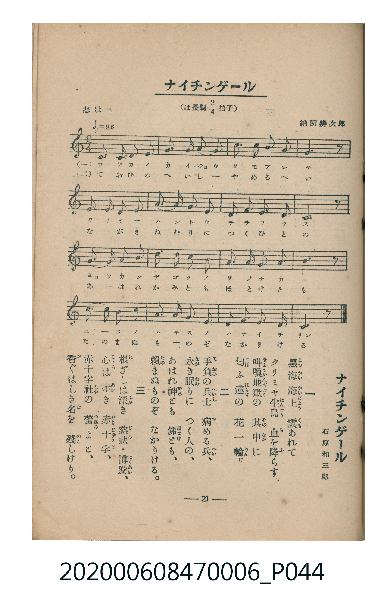

# ナイチンゲール

> Re:Shoka 使用 AI 辨識樂譜，可能會有錯誤。歡迎回報。

<audio controls src="naichingeru.mp3"></audio>

- 詞：石原和三郎
- 曲：納所辨次郎
- 臺灣教育會公認《新定兒童唱歌》尋常科第六學年用（2020.006.0847.0006）

## 說明

原書資訊與歌詞全文（對應 P044.jpg，書頁 p. 21，第二學期第 6 首）：
調性與拍號：は長調四分之二拍子（C 大調 2/4 拍），「悲壯ニ」（♩=96）

## 歌詞

```text
一、
黒海（こつかい）海上（かいじよう）雲（くも）あれて
クリミヤ半島（はんとう）血（ち）を降（ふ）らす、
叫喚地獄（きようかんぢごく）の其中（そのなか）に
匂（にほ）ふ蓮（はちす）の花一輪（りん）。

二、
手負（ておひ）の兵士（へいし）病（や）める兵（へい）、
永（なが）き眠（ねむ）りにつく人の、
あはれ神（かみ）とも佛（ほとけ）とも、
頼（たの）まぬものぞなかりける。

三、
根（ね）ざしは深（ふか）き慈悲（じひ）・博愛（はくあい）、
心（こゝろ）は赤（あか）き赤十字（せきじゆうじ）、
赤十字社（しや）の蕾（つぼみ）よと、
香（か）ぐはしき名（な）を殘（のこ）しけり。
```

## ABC

```abc
X:1
T:ナイチンゲール
C:曲：納所辨次郎
M:2/4
L:1/16
Q:1/4=96
K:C
V:V1 name="Piano" snm="Pia"
[V:V1]
G3 G E2 G2 | A3 A c2 A2 | d3 c A2 G2 | A6 z2 |
G3 G E2 G2 | A3 G A2 c2 | d3 d e2 d2 | c6 z2 |
e3 d e2 c2 | d3 c A2 G2 | A3 G A2 c2 | d6 z2 |
e3 c d2 e2 | c3 A G2 A2 | c3 A G2 d2 | c6 z2 |
```

## TMD 檔案連結

- [主旋律 TMD 檔案](naichingeru.tmd) [[在 TMD Studio 編輯](https://tmdlang.github.io/Tmd-TS/#tmd=s7IKdvYPcrWy4qpTUCpJTLdSSM7PyUlNLsnMz7MqzsjMK0nNjM_KTMmPL87Iz05Ugisry88pzU21Si9KTEmNN4s3MjAyiDcwMIs3sDAxBzIMzBBKi_NLi5JTrYqTM_Lzc-JLUitKkvLzsxHyBUX5Zal5iXlANQVFIBtTwIoQClLLMlNSQdKpKZkl-UWZiTlI7kgtKga7FWxJfElRYl5xclFmAcgDCFUlGalAx2ZkFgO1VypxaWkpPG7uety05HFz4-PmzY-bNj1u3vO4ebWClhaXoq2CpRmXva2CM5eNkb6JHciMFyvnvd8z6_n8zU_75j-d1PNkR-fL5j6w6c9mbwLJbOl91tnwYt-KZ2sWwmRetO963rj42dSZL5o2PZvT_LR1zYtVvY8bup5N2_B03aynrZOer176dMrGZ2t7Hjd0P93Q_XTHjufLJz5fs-Zp69qna3c83bnl-ZQV7_d0gEJWDxieeqCQBTIMzN7v6VTi4tLXUrClFuBSUFAAeu3Z7B0vNre_WNH1oqMd6C6gr5-2rng2rR3oiqcbep-1dyoEGJiY6GUVpL_f0wNU_HJBo0KBnoKRIZALdPiTXT1Ahz-bMx_IVjBTeLlsGtClwNABmf5i1f5nDctB5nb3vpg5Hyj6uHH9y6nbgeJPZ89-2tH2ZGc3UD9Q9unaCUD7nBWeLlkOlFQARoECUBRsEjCkep41bXq6eP3j5u7HDUDBjkczV9pagkKEC2TLkx0NjxsaQayXuyc927odqOBx4-THjUseN3Y_bmwBKgMKPtnRBRYHiTxunPG4CchuA0q9BEUlkN3_uKkJyH3c2PS4qedx4zKQcY-bgFauetw8_3Hzkqe9XU83bwMrXf-4CWj6Coj-FwsbwIILQZqbJr2cCXLf48atYC7QuJlQpz3tX_102qynczY87wW6CKiiF-IEkItAxi163DgF6AqwE9Y9bd32ZMdasLK5QO7jxlVAZWCp1WCzeoBOBcqtfty4Gyy69cXkdVCnNS4E2gkx5UXXRmDQvNizCiTVBEz4k0HiDU2QQNsFDFewy551dr_YtACsfdnjxq7HjcAAgThi69PFq8HiO8CBNh0o_nx6K9g0UKg-bmp83NQNVAZXAzYfYuiGHWBRoMN7wMb1Pp8DsWPt4yZgiAE1A20CegAYSf1Pdu0C-RKiExQDoCDueb4UmP0gMbYfbMQKYBQ92TsbLLgbHAET4eKwBLBgD1h6PtA8sNy-x41rQNKgQJwHCUewzROBLocHxQ64qxfshLgRrHca0MtApzzbvhESpbA46H3W2gFMkGDBGdDgat79tHfWsxaI44Cx0A_2BlKAPN3fDE2XTXMfN4FSNlDdi61LwIJApVCjgSJPexufrgWGNVB8NiiZgBIrMJkA0QyEcXB1z5fsAyudDo0TYLRPhYgAQ3YPNOhAKW0FLIiWAZMHKFjBqieAXQv0Zu_TCZCUC0wtoIT8bB3QNiAXGG7gZANSAwy0LlCgAU2hvPSBAgUtfS4uv8TMZGCtk55aVGoVkJmYl-9QY1CjUA2ySMHG0EzLDszCVvYpgEogYCJf2KOgYaLwdEP_8_UNOvACSxOLBqB9IMNqFEwVdIHQVMEYTOoCRczAImYKhnFgCiRkBGLqgkRAfGRlEGgAEgGnItzO29VDTeeZgmmwE-HOA1LGIBaYWwORJMWFO4DFGOkuBFuJsBzVSVhCDJvLiXYjsL6gwI1AS8EWgrnwADIDOw8S0ShCuMOxlotL104BKb0qALnKXFwA)]
- [鋼琴伴奏 TMD 檔案](naichingeru_piano.tmd) [[在 TMD Studio 編輯](https://tmdlang.github.io/Tmd-TS/#tmd=s7IKdvYPcrWy4tLSUnjc3PW4acnj5sbHzZsfN2163LzncfPq93s6XnbveT5hy5M9W54u7X_e2fF-T6eClhaXoq2CpRmXva2CM5eNkb6JHVedgtKLlfPe75n1fP7mp33zn07qebKj82VznxJI5tnsTSCZLb3POhte7FvxbM1CmMyL9l3PGxc_mzrzRdOmZ3Oan7auebGq93FD17NpG56um_W0ddLz1UufTtn4bG3P44bupxu6n-7Y8Xz5xOdr1jxtXft07Y6nO7c8n7IC6EojAyMDPQMDMz0DCxNzIMPADOhQJS4uv8TM5IzMvPTUolKrgMzEvPwgD4cagxqFai4FILAxNNOyA7P0tRRs0YEC0JonOxpeLOxR0AgwMDHRyypI18SiTEsfbESNgqmCLhCaKhiDSV2giBlYxEzBMA5MgYSMQExdkAiIj6wMAg1AIlz4HbWrh3JHmYJpsMPgjgJSxiAWmFsDkSTFXTs6iXcX2CKElagOwRI62NxLtMuezp5NssuAVoGtAXPhgWEGdhQkKlGEcIdZLZZk6IOSDE2gqRCoXSHaMBZIm8QrRJuAGKZABkzEAGgYHmWmIIYhFlXIZsCVE28Y0P26dgpIXlDA5CpzcQEA)]

## 分析

```text
================================================================================
📊 TMD Song Profile: [ ナイチンゲール ]
================================================================================
⏱  Duration:       0:20 (20.0s), 16 measures total
🎼 Key & Tempo:    首調基準 C, != 96.0 BPM, <2/4>
   - 分析範圍：      由實際發聲的音符與和弦推測調性；播放脈絡另行呈現
🎤 人聲音域:    E4 (MIDI 64) – E5 (MIDI 76) [跨度: 12 個半音 / 1.0 個八度, 難度: easy]
   - 最低音:  E4 in [Naichingeru #1 @ m.1, 0:00]
   - 最高音: E5 in [Naichingeru #1 @ m.7, 0:08]
   - 適合: soprano, mezzo-soprano, contralto, tenor, baritone, bass
🏛  結構:      Naichingeru (20.0s)
⚡ 編曲密度:        Peak 1 軌道同時演奏
🗝  調性診斷：       A 調性不明確（純淨自然大調，未偵測到可信轉調）
   - 風格氣質:    純淨自然大調（陽光明朗、易唱易記，無明顯調外色彩）
   - 轉調歷程:    全曲維持單一推測調性（未偵測到可信轉調）
   - 核心骨幹音:  A, C, D, G, E
   - 調性數值:    A 調性不明確 [相關度: 0.77, 穩定度: Ambiguous, 自然音純度: 100.0%]
   - 候選調性 (K-S): A 小調 (0.77), C 大調 (0.75), G 大調 (0.66)
   - 五度圈歷程:   +3
   - 各段落調性細節:
     • [Naichingeru #1]: A 調性不明確 (r: 0.77, 自然音純度: 100.0%)

  [ 五度圈游移軌跡 ]
               C  
         F            G  
      Bb               D  
      Eb              [A ]*
         Ab           E  
            Db       B  
               F# 
     (* = active key center)

  [ 十二半音累積音高分佈 ]
     C  : ███████████████████████   24.2%
     C# :                            0.0%
     D  : ██████████████████        19.2%
     D# :                            0.0%
     E  : █████████████             13.3%
     F  :                            0.0%
     F# :                            0.0%
     G  : ██████████████████        18.3%
     G# :                            0.0%
     A  : ████████████████████████  25.0%
     A# :                            0.0%
     B  :                            0.0%
--------------------------------------------------------------------------------
Assignment 軌道音域：
  - Piano         : E4 – E5 (12 個半音 / 1.0 個八度, 52 個音符)
================================================================================
```


## 原書掃描頁




