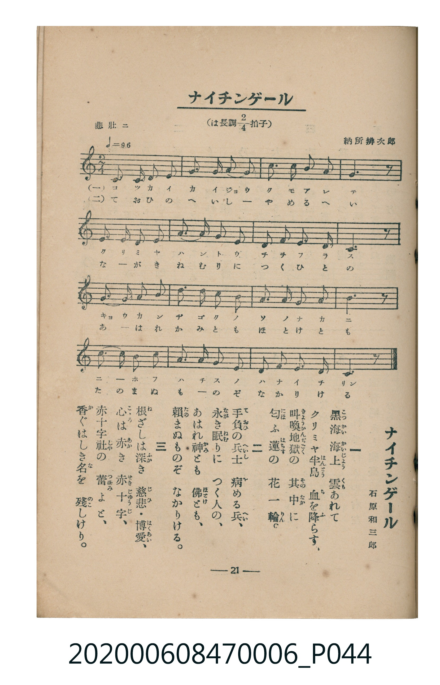

# ナイチンゲール

> Re:Shōka 使用 AI 協助辨識與重建樂譜，可能會有錯誤。歡迎回報。

- **鋼琴伴奏版**：<br><audio controls src="naichingeru.mp3"></audio>
- **NEUTRINO 歌聲合成版**：<br><audio controls src="naichingeru_neutrino.mp3"></audio>

- 詞：石原和三郎
- 曲：納所辨次郎
- 臺灣教育會公認《新定兒童唱歌》尋常科第六學年用（2020.006.0847.0006）

## 說明

原書資訊與歌詞全文（對應 P044.jpg，書頁 p. 21，第二學期第 6 首）：
調性與拍號：は長調四分之二拍子（C 大調 2/4 拍），「悲壯ニ」（♩=96）


## 歌詞

```text
一、
黒海（こつかい）海上（かいじよう）雲（くも）あれて
クリミヤ半島（はんとう）血（ち）を降（ふ）らす、
叫喚地獄（きようかんぢごく）の其中（そのなか）に
匂（にほ）ふ蓮（はちす）の花一輪（りん）。

二、
手負（ておひ）の兵士（へいし）病（や）める兵（へい）、
永（なが）き眠（ねむ）りにつく人の、
あはれ神（かみ）とも佛（ほとけ）とも、
頼（たの）まぬものぞなかりける。

三、
根（ね）ざしは深（ふか）き慈悲（じひ）・博愛（はくあい）、
心（こゝろ）は赤（あか）き赤十字（せきじゆうじ）、
赤十字社（しや）の蕾（つぼみ）よと、
香（か）ぐはしき名（な）を殘（のこ）しけり。
```

## ABC

```abc
X:1
T:ナイチンゲール
C:曲：納所辨次郎
M:2/4
L:1/16
Q:1/4=96
K:C
V:V1 name="Piano" snm="Pia"
[V:V1]
C3 C D2 E2 | G3 G A2 G2 | c3 c B2 A2 | G6 z2 |
w: 1.~こ つ か い | か い じょ う | く も あ れ | て
w: 2.~て お ひ の | へ い し _ | や め る へ | い
w: 3.~ね ざ し は | ふ か き _ | じ ひ はく あ | い
E3 E D2 E2 | A3 A G2 E2 | D2 F2 E3 D | C6 z2 |
w: 1.~く り み や | は ん と う | ち を ふ ら | す
w: 2.~な _ が き | ね む り に | つ く ひ と | の
w: 3.~こ こ ろ は | あ か き _ | せ き じゅ う | じ
G3 G A2 B2 | d3 d c2 B2 | A3 A G2 A2 | B6 z2 |
w: 1.~きょ う か ん | ぢ ご く の | そ の な か | に
w: 2.~あ _ は れ | か み と も | ほ と け と | も
w: 3.~せ き じゅ う | じ しゃ の _ | つ ぼ み よ | と
c3 c B2 c2 | A3 A G2 E2 | D2 F2 E3 D | C6 z2 |
w: 1.~に _ ほ ふ | は ち す の | は な い ち | りん
w: 2.~た の ま ぬ | も _ の ぞ | な か り け | る
w: 3.~か ぐ は し | き _ な を | の こ し け | り
```

## TMD 檔案連結

- [主旋律 TMD 檔案](naichingeru.tmd) [[在 TMD Studio 編輯](https://tmdlang.github.io/Tmd-TS/#tmd=s7IKdvYPcrWy4qpTUCpJTLdSSM7PyUlNLsnMz7MqzsjMK0nNjM_KTMmPL87Iz05Ugisry88pzU21Si9KTEmNN4s3MjAyiDcwMIs3sDAxBzIMzBBKi_NLi5JTrYqTM_Lzc-JLUitKkvLzsxHyBUX5Zal5iXlANQVFIBtTwIoQClLLMlNSQdLFyYl58WWpRZlpmakpSG5JLSoGuxdsUXxJUWJecXJRZgHIEwhV-UUlGflA9xZkVFplZBaX5BdlJifmxGcn5iF5qyQjFegriHQlst7M9Mw8q9zUzKxMJB9oaSk8bu563LTkcXPj4-bNj5s2PW7e87h5tYKWFpeirYKlGZe9rYIzl42RvokdyKwXK-e93zPr-fzNT_vmP53U82RH58vmPrAtz2ZvAsls6X3W2fBi34pnaxbCZF6073reuPjZ1JkvmjY9m9P8tHXNi1W9jxu6nk3b8HTdrKetk56vXvp0ysZna3seN3Q_3dD9dMeO58snPl-z5mnr2qdrdzzdueX5lBXv93SAYkgPGC96oBgCMgzM3u_pVOLi0tdSsKUW4FJQUAB67dnsHS82t79Y0fWiox3oLqCvn7aueDatHeiKpxt6n7V3KgQYmJjoZRWkv9_TA1T8ckGjQoGegpEhkAt0-JNdPUCHP5szH8hWMFN4uWwa0KXA0AGZ_mLV_mcNy0Hmdve-mDkfKPq4cf3LqduB4k9nz37a0fZkZzdQP1D26doJQPucFZ4uWQ6UVABGgQJQFGwSMKR6njVterp4_ePm7scNQMGORzNX2lqCQoQLZMuTHQ2PGxpBrJe7Jz3buh2o4HHj5MeNSx43dj9ubAEqAwo-2dEFFgeJPG6c8bgJyG4DSr0ERSWQ3f-4qQnIfdzY9Lip53HjMpBxj5uAVq563Dz_cfOSp71dTzdvAytd_7gJaPoKiP4XCxvAggtBmpsmvZwJct_jxq1gLtC4mVCnPe1f_XTarKdzNjzvBboIqKIX4gSQi0DGLXrcOAXoCrAT1j1t3fZkx1qwsrlA7uPGVUBlYKnVYLN6gE4Fyq1-3LgbLLr1xeR1UKc1LgTaCTHlRddGYNC82LMKJNUETPiTQeINTZBA2wUMV7DLnnV2v9i0AKx92ePGrseNwACBOGLr08WrweI7wIE2HSj-fHor2DRQqD5uanzc1A1UBlcDNh9i6IYdYFGgw3vAxvU-nwOxY-3jJmCIATUDbQJ6ABhJ_U927QL5EqITFAOgIO55vhSY_SAxth9sxApgFD3ZOxssuBscARPh4rAEsGAPWHo-0Dyw3L7HjWtA0qBAnAcJR7DNE4EuhwfFDrirF-yEuBGsdxrQy0CnPNu-ERKlsDjofdbaAUyQYMEZ0OBq3v20d9azFojjgLHQD_YGUoA83d8MTZdNcx83gVI2UN2LrUvAgkClUKOBIk97G5-uBYY1UHw2KJmAEiswmQDRDIRxcHXPl-wDK50OjRNgtE-FiABDdg806EApbQUsiJYBkwcoWMGqJ4BdC_Rm79MJkJQLTC2ghPxsHdA2IBcYbuBkA1IDDLQuUKABTaG89IECBS19Li6_xMxkYO2VnlpUahWQmZiX71BjUFMNskfBxtBMyw7Mwlb0KYAKIGAaX9ijoGGi8HRD__P1DTrw8koTiwagdSDDahQMFXSB0FDBCEgaA3GNgilYxBRYiIFIkIhhHERRnII5kAKJw1RBoAFIBGyej2ENMOVOBosCgx6Iu8GsFrAeCA_CB8dnO5jTBpXsh0g2NYESP5jVA5VZhmRZPMIyI4QcMMcC8SYwax1U1w4ky6ZDdQPFm0COAZneCMQQ54FUgnRAZDDsMQbJrYWaNg1qGjDFQHVthcp0A3Evwp7GGVDxTSC1EO9BPIbdKvyxu6uHnNgFxSgoXhGxC4o9UByC4g8iApIzgfJ0gTxYmsAet7BIAgX3fjALFreg4ADxJwPZK8B-hUXsQrD4JLAYNLCaOsEyM7EHODhiV0HFgUUnmAQFLVJENDWAXQGSWQ2VWQLmQcIZlBRA9AqwDChJ4IpYWGoFursJZAciYkFxhS1iZ8PdA07FrVBlbUixTnzE7gDWnaRHLHImBWVKYDRCMimQAmdXiCBybEPyLUgcV9wC62JQjoT4BZp1gdEJ8fQiqMwUeBDD8tlcqMw6aKRBdIJkQBGDK3ohgQsLbkRehxUR-2HJCFgeQGR2Q2VWAPFEKAuSo2FmYYteUGRBogseWYiUCcuiwGqjGSmZwBITSGoPPKF3QGVAtpIQw8AmHlkFM0qhC-ZRnnthEQIJTEhuRMq7wJwKyZOIyAVHDjRaoQUnUBUo0EEtKezhDo7f-VDFoFSxD8xaAzESHlsQS4ANEqhViLQDydgg3kSwDkiawB6_sPQyAe5YUOkMTs5we8AmgwsgWGEAyfawegFmD8RWZHtqubh07RSQKmYFIFeZCwA)]
- [鋼琴伴奏 TMD 檔案](naichingeru_piano.tmd) [[在 TMD Studio 編輯](https://tmdlang.github.io/Tmd-TS/#tmd=s7IKdvYPcrWy4tLSUnjc3PW4acnj5sbHzZsfN2163LzncfPq93s6XnbveT5hy5M9W54u7X_e2fF-T6eClhaXoq2CpRmXva2CM5eNkb6JHVedgtKLlfPe75n1fP7mp33zn07qebKj82VznxJI5tnsTSCZLb3POhte7FvxbM1CmMyL9l3PGxc_mzrzRdOmZ3Oan7auebGq93FD17NpG56um_W0ddLz1UufTtn4bG3P44bupxu6n-7Y8Xz5xOdr1jxtXft07Y6nO7c8n7IC6EojAyMDPQMDMz0DCxNzIMPADOhQJS4uv8TM5IzMvPTUolKrgMzEvPwgD4cag5pqLgUgsDE007IDs_S1FGzRgQLQlic7Gl4s7FHQCDAwMdHLKkjXxKJMSx9sRI2CoYIuEBoqGAFJYyCuUTAFi5gqmIFJkIhhHERRnII5kAKJw1RBoAFIBGyej2GNwuPGyWDRx41LgLgbzGoB64HwIPzHjTMeN7WDOW1QyX6IZFMTkN0EZvVAZZYhWRaPsMwIIfe4sQuIN4FZ66C6diBZNh2qGyjeBHIMyPRGIIY4D6QSpAMig2GPMUhuLdS0aVDTHjeuh-raCpXpBuJehD2NM6Dim0BqId6DeAy7VfjjdFcP8XEKikdQbCLiFBRnoJgDxRpEBCRnAuXpAnmwlIA9RmFRAwrk_WAWLEZBgQDiTwayV4B9CIvOhWDxSWAxaBA1dYJlZmIPZnB0roKKP24ERT4kQJGCv6kB7AqQzGqozBIwDxK6oAQAoleAZUAJAVd0wtIo0N1NIDsQ0QmKIWzRORvuHnDabYUqa0OKa-Kjc0cn8dGJnCFBGRAYeZAMCaTAWRMiiBzHkDwKEscVo72Q3AfxATSbAiMR4tVFUJkp8ICF5am5UJl10KiC6ATJgKIDV6RCghQWyIh8DSsO9sMSDzDvQ2R2Q2VWAPFEKAuSe2FmYYtUUBRBIgkeRYj0CMuO0x83NSMlDlgSAkntgSfvDqgMyFYS4vXp7NkkFL0oxSqYR3lOhUUDJAghOQ8pnwJzJST_IaIUHCXQyIQWjUBVoKAG1q2QbII9VudDFYPSwj4waw3ESHgcQSx53DgPahUixUAyMYg3EawDkhKwxyoslUyAOxZU_oITMdwesMngwgaW8SFZHFbyw-yB2IpsTy2W-tYHub41gVa3wHCPV4g2jEVmmAAZJiCGaXw8MCogrkaTBzNA8tGm8VDNCJVI4khMFG2kGQv0jq6dApKPon2AKtGFjDCFjMFCylwA)]

## 分析

```text
================================================================================
📊 TMD Song Profile: [ ナイチンゲール ]
================================================================================
⏱  Duration:       0:20 (20.0s), 16 measures total
🎼 Key & Tempo:    首調基準 C, != 96.0 BPM, <2/4>
   - 分析範圍：      由實際發聲的音符與和弦推測調性；播放脈絡另行呈現
🎤 人聲音域:    C4 (MIDI 60) – D5 (MIDI 74) [跨度: 14 個半音 / 1.2 個八度, 難度: moderate]
   - 最低音:  C4 in [Naichingeru #1 @ m.1, 0:00]
   - 最高音: D5 in [Naichingeru #1 @ m.10, 0:11]
   - 適合: soprano, mezzo-soprano, contralto, tenor, baritone, bass
🏛  結構:      Naichingeru (20.0s)
⚡ 編曲密度:        Peak 1 軌道同時演奏
🗝  調性診斷：       C 大調（純淨自然大調，未偵測到可信轉調）
   - 風格氣質:    純淨自然大調（陽光明朗、易唱易記，無明顯調外色彩）
   - 轉調歷程:    全曲維持單一推測調性（未偵測到可信轉調）
   - 核心骨幹音:  C, G, A, E, D
   - 調性數值:    C 大調 [相關度: 0.87, 穩定度: Moderate, 自然音純度: 100.0%]
   - 候選調性 (K-S): C 大調 (0.87), A 小調 (0.76), G 大調 (0.76)
   - 五度圈歷程:   +0
   - 各段落調性細節:
     • [Naichingeru #1]: C 大調 (r: 0.87, 自然音純度: 100.0%)

  [ 五度圈游移軌跡 ]
              [C ]*
         F            G  
      Bb               D  
      Eb               A  
         Ab           E  
            Db       B  
               F# 
     (* = active key center)

  [ 十二半音累積音高分佈 ]
     C  : ████████████████████████  23.3%
     C# :                            0.0%
     D  : ████████████              11.7%
     D# :                            0.0%
     E  : ███████████████           15.0%
     F  : ███                        3.3%
     F# :                            0.0%
     G  : ███████████████████       18.3%
     G# :                            0.0%
     A  : █████████████████         16.7%
     A# :                            0.0%
     B  : ████████████              11.7%
--------------------------------------------------------------------------------
Assignment 軌道音域：
  - Piano         : C4 – D5 (14 個半音 / 1.2 個八度, 52 個音符)
================================================================================
```


## 原書掃描頁




