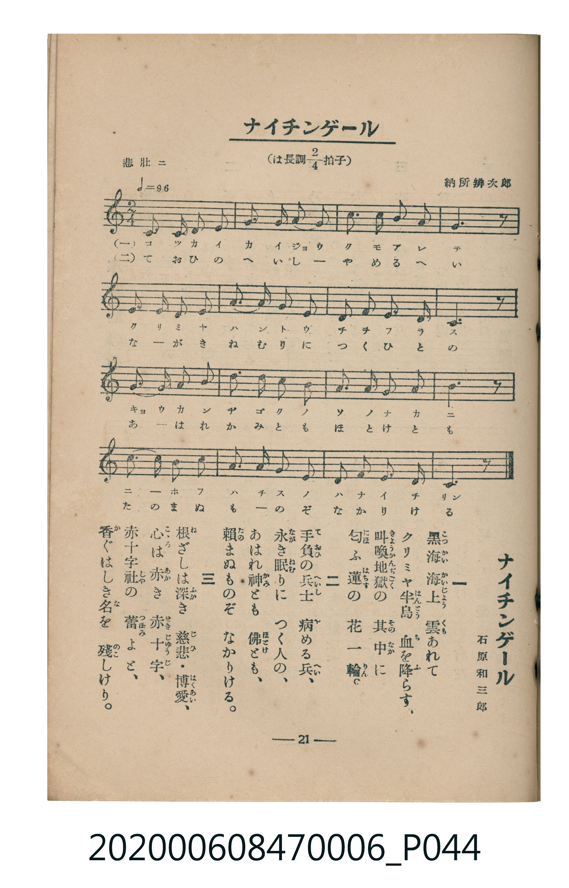

# ナイチンゲール

> Re:Shōka 使用 AI 協助辨識與重建樂譜，可能會有錯誤。歡迎[回報](https://github.com/TMDLang/reshoka/issues)。

- **鋼琴伴奏版**：<br><audio controls src="naichingeru.mp3"></audio>
- **NEUTRINO 歌聲合成版**：<br><audio controls src="naichingeru_neutrino.mp3"></audio>

- 詞：石原和三郎
- 曲：納所辨次郎
- 臺灣教育會公認《新定兒童唱歌》尋常科第六學年用（2020.006.0847.0006）

## 說明

原書資訊與歌詞全文（對應 P044.jpg，書頁 p. 21，第二學期第 6 首）：
調性與拍號：は長調四分之二拍子（C 大調 2/4 拍），「悲壯ニ」（♩=96）


## 歌詞

```text
一、
黒海（こつかい）海上（かいじよう）雲（くも）あれて
クリミヤ半島（はんとう）血（ち）を降（ふ）らす、
叫喚地獄（きようかんぢごく）の其中（そのなか）に
匂（にほ）ふ蓮（はちす）の花一輪（りん）。

二、
手負（ておひ）の兵士（へいし）病（や）める兵（へい）、
永（なが）き眠（ねむ）りにつく人の、
あはれ神（かみ）とも佛（ほとけ）とも、
頼（たの）まぬものぞなかりける。

三、
根（ね）ざしは深（ふか）き慈悲（じひ）・博愛（はくあい）、
心（こゝろ）は赤（あか）き赤十字（せきじゆうじ）、
赤十字社（しや）の蕾（つぼみ）よと、
香（か）ぐはしき名（な）を殘（のこ）しけり。
```

## ABC

<div class="abc-score" data-abc-src="naichingeru.abc" aria-label="五線譜載入中"></div>

[下載 ABC 原始檔](naichingeru.abc)

## TMD 檔案連結

- [主旋律 TMD 檔案](naichingeru.tmd) [[在 TMD Studio 編輯](https://tmdlang.github.io/Tmd-TS/#tmd=s7IKdvYPcrWy4qpTUCpJTLdSSM7PyUlNLsnMz7MqzsjMK0nNjM_KTMmPL87Iz05Ugisry88pzU21Si9KTEmNN4s3MjAyiDcwMIs3sDAxBzIMzBBKi_NLi5JTrYqTM_Lzc-JLUitKkvLzsxHyBUX5Zal5iXlANQVFIBtTwIoQClLLMlNSQdLFyYl58WWpRZlpmakpSG5JLSoGuxdsUXxJUWJecXJRZgHIEwhV-UUlGflA9xZkVFplZBaX5BdlJifmxGcn5iF5qyQjFegriHQlst7M9Mw8q9zUzKxMLD6AWlyQmJ5qFWBgYqLEpaWl8Li563HTksfNjY-bNz9u2vS4ec_j5tUKWlpcirYKlmZc9rYKzlw2RvomdiBjXqyc937PrOfzNz_tm_90Us-THZ0vm_vAFjybvQkks6X3WWfDi30rnq1ZCJN50b7reePiZ1Nnvmja9GxO89PWNS9W9T5u6Ho2bcPTdbOetk56vnrp0ykbn63tedzQ_XRD99MdO54vn_h8zZqnrWufrt3xdOeW51NWvN_TAYo7PWCM6YHiDsgwMHu_p1OJi0tfS8GWWoBLQUEB6LVns3e82Nz-YkXXi452oLuAvn7auuLZtHagK55u6H3W3qkACj69rIL093t6gIpfLmhUKNBTMDIEcoEOf7KrB-jwZ3PmA9kKZgovl00DuhQYOiDTX6za_6xhOcjc7t4XM-cDRR83rn85dTtQ_Ons2U872p7s7AbqB8o-XTsBaJ-zwtMly4GSCsAoUACKgk0ChlTPs6ZNTxevf9zc_bgBKNjxaOZKW0tQiHCBbHmyo-FxQyOI9XL3pGdbtwMVPG6c_LhxyePG7seNLUBlQMEnO7rA4iCRx40zHjcB2W1AqZegqASy-x83NQG5jxubHjf1PG5cBjLucRPQylWPm-c_bl7ytLfr6eZtYKXrHzcBTV8B0f9iYQNYcCFIc9OklzNB7nvcuBXMBRo3E-q0p_2rn06b9XTOhue9QBcBVfRCnAByEci4RY8bpwBdAXbCuqet257sWAtWNhfIfdy4CqgMLLUabFYP0KlAudWPG3eDRbe-mLwO6rTGhUA7Iaa86NoIDJoXe1aBpJqACX8ySLyhCRJou4DhCnbZs87uF5sWgLUve9zY9bgRGCAQR2x9ung1WHwHONCmA8WfT28FmwYK1cdNjY-buoHK4GrA5kMM3bADLAp0eA_YuN7ncyB2rH3cBAwxoGagTUAPACOp_8muXSBfQnSCYgAUxD3PlwKzHyTG9oONWAGMoid7Z4MFd4MjYCJcHJYAFuwBS88HmgeW2_e4cQ1IGhSI8yDhCLZ5ItDl8KDYAXf1gp0QN4L1TgN6GeiUZ9s3QqIUFge9z1o7gAkSLDgDGlzNu5_2znrWAnEcMBb6wd5ACpCn-5uh6bJp7uMmUMoGqnuxdQlYEKgUajRQ5Glv49O1wLAGis8GJRNQYgUmEyCagTAOru75kn1gpdOhcQKM9qkQEWDI7oEGHSilrYAF0TJg8gAFK1j1BLBrgd7sfToBknKBqQWUkJ-tA9oG5ALDDZxsQGqAgdYFCjSgKZSXPlCgoKXPxeWXmJkMrNfSU4tKrQIyE_PyHWoMaqpB9ijYGJpp2YFZ2Io-BVABBEzjC3sUNEwUnm7of76-QQdeXmli0QC0DmRYjYKhgi4QGioYAUljIK5RMAWLmAILMRAJEjGMgyiKUzAHUiBxmCoINACJgM3zMawBptzJYFFg0ANxN5jVAtYD4UH44PhsB3PaoJL9EMmmJlDiB7N6oDLLkCyLR1hmhJAD5lgg3gRmrYPq2oFk2XSobqB4E8gxINMbgRjiPJBKkA6IDIY9xiC5tVDTpkFNA6YYqK6tUJluIO5F2NM4Ayq-CaQW4j2Ix7BbhT92d_WQE7ugGAXFKyJ2QbEHikNQ_EFEQHImUJ4ukAdLE9jjFhZJoODeD2bB4hYUHCD-ZCB7BdivsIhdCBafBBaDBlZTJ1hmJvYAB0fsKqg4sOgEk6CgRYqIpgawK0Ayq6EyS8A8SDiDkgKIXgGWASUJXBELS61AdzeB7EBELCiusEXsbLh7wKm4FaqsDSnWiY_YHcC6k_SIRc6koEwJjEZIJgVS4OwKEUSObUi-BYnjiltgXQzKkRC_QLMuMDohnl4ElZkCD2JYPpsLlVkHjTSITpAMKGJwRS8kcGHBjcjrsCJiPywZAcsDiMxuqMwKIJ4IZUFyNMwsbNELiixIdMEjC5EyYVkUWG00IyUTWGICSe2BJ_QOqAzIVhJiGNjEI6tgRil0wTzKcy8sQiCBCcmNSHkXmFMheRIRueDIgUYrtOAEqgIFOqglhT3cwfE7H6oYlCr2gVlrIEbCYwtiCbBBArUKkXYgGRvEmwjWAUkT2OMXll4mwB0LKp3ByRluD9hkcAEEKwwg2R5WL8DsgdiKbE8tF5eunQJSxawA5CpzAQA)]
- [鋼琴伴奏 TMD 檔案](naichingeru_piano.tmd) [[在 TMD Studio 編輯](https://tmdlang.github.io/Tmd-TS/#tmd=s7IKdvYPcrWy4qpTUCpJTLdSyC8qychPL0osyKi0ysgsLskvykxOzInPTsxLVIIrKs4vLUpOjS9ITE-1CjAwMVHi0tJSeNzc9bhpyePmxsfNmx83bXrcvOdx8-r3ezpedu95PmHLkz1bni7tf97Z8X5Pp4KWFpeirYKlGZe9rYIzl42RvokdyOwXK-e93zPr-fzNT_vmP53U82RH58vmPrCtz2ZvAsls6X3W2fBi34pnaxbCZF6073reuPjZ1JkvmjY9m9P8tHXNi1W9jxu6nk3b8HTdrKetk56vXvp0ysZna3seN3Q_3dD9dMeO58snPl-z5mnr2qdrdzzdueX5lBVAVxoZGBnoGRiY6RlYmJgDGQZmQIcqcXH5JWYmZ2TmpacWlVoFZCbm5Qd5ONQY1FRzKQCBjaGZlh2Ypa-lYIsOFIC2PNnR8GJhj4IGKJT0sgrSNbEo09IHG1GjYKigC4SGCkZA0hiIaxRMwSKmCmZgEiRiGAdRFKdgDqRA4jBVEGgAEgGb52NYo_C4cTJY9HHjEiDuBrNawHogPAj_ceOMx03tYE4bVLIfItnUBGQ3gVk9UJllSJbFIywzQsg9buwC4k1g1jqorh1Ilk2H6gaKN4EcAzK9EYghzgOpBOmAyGDYYwySWws1bRrUtMeN66G6tkJluoG4F2FP4wyo-CaQWoj3IB7DbhX-ON3VQ3ycguIRFJuIOAXFGSjmQLEGEQHJmUB5ukAeLCVgj1FY1IACeT-YBYtRUCCA-JOB7BVgH8KicyFYfBJYDBpETZ1gmZnYgxkcnaug4o8bQZEPCVCk4G9qALsCJLMaKrMEzIOELigBgOgVYBlQQsAVnbA0CnR3E8gORHSCYghbdM6GuwecdluhytqQ4pr46NzRSXx0ImdIUAYERh4kQwIpcNaECCLHMSSPgsRxxWgvJPdBfADNpsBIRE25U-ABC8tTc6Ey66BRBdEJkgFFB65IhQQpLJAR-RpWHOyHJR5g3ofI7IbKrADiiVAWJPfCzMIWqaAogkQSPIoQ6RHmqemPm5qREgcsCYGk9sCTdwdUBmQrCfH6dPZsEopelGIVzKM8p8KiARKEkJyHlE-BuRKS_xBRCo4SaGRCi0agKlBQA-tWSDbBHqvzoYpBaWEfmLUGYiQ8jiCWPG6cB7UKkWIgmRjEmwjWAUkJ2GMVlkomwB0LKn_BiRhuD9hkcGEDy_iQLA4r-WH2QGxFtqcWS33rg1zfmkCrW2C4xytEG8YiM0yADBMQwzQ-HhgVEFejyYMZIPlo03ioZoRKJHEkJoo20owFekfXTgHJR9E-QJXoQkaYQsZgIWUuAA)]

## 分析

```text
================================================================================
📊 TMD Song Profile: [ ナイチンゲール ]
================================================================================
⏱  Duration:       0:20 (20.0s), 16 measures total
🎼 Key & Tempo:    首調基準 C, != 96.0 BPM, <2/4>
   - 分析範圍：      由實際發聲的音符與和弦推測調性；播放脈絡另行呈現
🎤 人聲音域:    C4 (MIDI 60) – D5 (MIDI 74) [跨度: 14 個半音 / 1.2 個八度, 難度: moderate]
   - 最低音:  C4 in [Naichingeru #1 @ m.1, 0:00]
   - 最高音: D5 in [Naichingeru #1 @ m.10, 0:11]
   - 適合: soprano, mezzo-soprano, contralto, tenor, baritone, bass
🏛  結構:      Naichingeru (20.0s)
⚡ 編曲密度:        Peak 1 軌道同時演奏
🗝  調性診斷：       C 大調（純淨自然大調，未偵測到可信轉調）
   - 風格氣質:    純淨自然大調（陽光明朗、易唱易記，無明顯調外色彩）
   - 轉調歷程:    全曲維持單一推測調性（未偵測到可信轉調）
   - 核心骨幹音:  C, G, A, E, D
   - 調性數值:    C 大調 [相關度: 0.87, 穩定度: Moderate, 自然音純度: 100.0%]
   - 候選調性 (K-S): C 大調 (0.87), A 小調 (0.76), G 大調 (0.76)
   - 五度圈歷程:   +0
   - 各段落調性細節:
     • [Naichingeru #1]: C 大調 (r: 0.87, 自然音純度: 100.0%)

  [ 五度圈游移軌跡 ]
              [C ]*
         F            G  
      Bb               D  
      Eb               A  
         Ab           E  
            Db       B  
               F# 
     (* = active key center)

  [ 十二半音累積音高分佈 ]
     C  : ████████████████████████  23.3%
     C# :                            0.0%
     D  : ████████████              11.7%
     D# :                            0.0%
     E  : ███████████████           15.0%
     F  : ███                        3.3%
     F# :                            0.0%
     G  : ███████████████████       18.3%
     G# :                            0.0%
     A  : █████████████████         16.7%
     A# :                            0.0%
     B  : ████████████              11.7%
--------------------------------------------------------------------------------
Assignment 軌道音域：
  - Piano         : C4 – D5 (14 個半音 / 1.2 個八度, 52 個音符)
================================================================================
```


## 原書掃描頁




