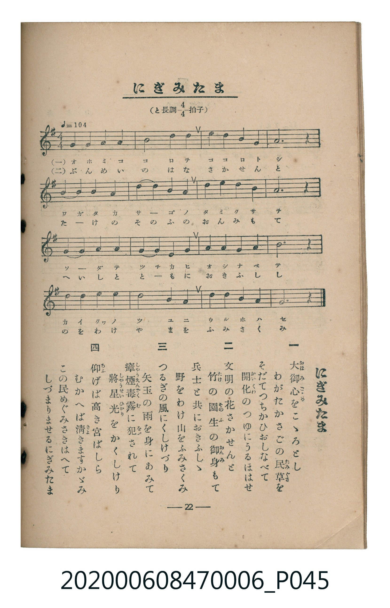

# にぎみたま

> Re:Shōka 使用 AI 協助辨識與重建樂譜，可能會有錯誤。歡迎回報。

<audio controls src="nigimitama.mp3"></audio>

- 臺灣教育會公認《新定兒童唱歌》尋常科第六學年用（2020.006.0847.0006）

## 說明

原書資訊與歌詞全文（對應 P045.jpg，書頁 p. 22，第二學期第 7 首）：
調性與拍號：と長調四分之四拍子（G 大調 4/4 拍），♩=104


## 跨冊／重複收錄參照

> 同曲（芝葛鎮作曲〈にぎみたま〉；收錄於《公學校唱歌》六年級、《公學校唱歌集》與《新定兒童唱歌》六年級）

- **[同曲]** 《公學校唱歌》第六學年用（昭和15年／1940，國臺圖 523.37 4322-4）：[**〈にぎみたま〉**](../../../kogakko_shoka/grade_6/11_nigimitama/index.md)（`G` / `4/4` — [原始 TMD](../../../kogakko_shoka/grade_6/11_nigimitama/nigimitama.tmd)）
- **[同曲]** 《公學校唱歌集》（大正4年／1915，國臺圖 0725 26）：[**〈にぎみたま〉**](../../../kogakko_shokashu_1915/5_06_nigimitama/index.md)（`G` / `4/4` — [原始 TMD](../../../kogakko_shokashu_1915/5_06_nigimitama/nigimitama.tmd)）
- 總表：[跨冊重複與同名歌曲總索引](../../../duplicate_songs.md)

## 歌詞

```text
一、
大御心（おほみこゝろ）をこゝろとし
わがたかさごの民草（たみぐさ）を
そだてつちかひおしなべて
開化（かいくわ）のつゆにうるほはせ

二、
文明の花さかせんと
竹（たけ）の園生（そのふ）の御身（おんみ）もて
兵士と共におきふしゝ
野をわけ山をふみさくみ

三、
つるぎの風にくしけづり
矢玉の雨を身にあみて
瘴煙毒霧（しやうえんどくむ）に犯（をか）されて
將星光（しやうせいひかり）をかくしけり

四、
仰（あふ）げば高き宮ばしら
むかへば清（きよ）きますかゞみ
この民めぐみさきはへて
しづまりませるにぎみたま
```

## ABC

```abc
X:1
T:にぎみたま
M:4/4
L:1/16
Q:1/4=104
K:G
V:V1 name="Piano" snm="Pia"
[V:V1]
G4 G4 A4 A4 | B8 d4 d4 | e4 d4 B4 G4 | A12 z4 |
w: 1.~オ ホ ミ コ | コ ロ ヲ | コ コ ロ ト | シ
w: 2.~ぶ ん め い | の は な | さ か せ ん | と
w: 3.~ツ ル ギ ノ | カ ゼ ニ | ク シ ケ ヅ | リ
w: 4.~あ ふ げ ば | た か き | み や ば し | ら
B4 B4 B4 A4 | d4 d4 B4 A4 | d4 e4 d4 B4 | A12 z4 |
w: 1.~ワ ガ タ カ | サ ー ゴ ノ | タ ミ グ サ | ヲ
w: 2.~た ー け の | そ の ふ の | お ん み も | て
w: 3.~ヤ ダ マ ノ | ア ー メ ヲ | ミ ニ ア ミ | テ
w: 4.~む か へ ば | き ー よ き | ま す か が | み
G4 G4 A4 A4 | G4 G4 E4 G4 | A4 A4 G4 A4 | B12 z4 |
w: 1.~ソ ー ダ テ | ツ チ カ ヒ | オ シ ナ ベ | テ
w: 2.~へ い し と | と ー も に | お き ふ し | し
w: 3.~シャ ウ エ ン | ド ク ム ニ | ヲ カ サ レ | テ
w: 4.~こ の た み | め ー ぐ み | さ き は へ | て
d4 d4 e4 e4 | d8 B4 A4 | d4 d4 B4 A4 | G12 z4 |
w: 1.~カ イ クヮ ノ | ツ ユ ニ | ウ ル ホ ハ | セ
w: 2.~の を わ け | や ま を | ふ み さ く | み
w: 3.~シャ ウ セ イ | ヒカ リ ヲ | カ ク シ ケ | リ
w: 4.~し づ ま り | ま せ る | に ぎ み た | ま
```

## TMD 檔案連結

- [主旋律 TMD 檔案](nigimitama.tmd) [[在 TMD Studio 編輯](https://tmdlang.github.io/Tmd-TS/#tmd=s7IKdvYPcrWy4qpTUCpJTLdSSM7PyUlNLsnMz7MqzsjMK0nNjM_KTMmPL87Iz05Ugisry88pzU21Si9KTEmNN4s3MjAyiDcwMIs3sDAxBzIMzBBKi_NLi5JTrYqTM_Lzc-JLUitKkvLzs9Hl4wsS01OtAgxMTBEyBUX5Zal5iXlA3QVFILekgLUjFKSWZaakgqSLkxPz4stSizLTMlNTkFyZWlQM9gnEipKixLzi5KLMApD3EKryi0oy8oE-KciotMrILC7JL8pMTsyJz07MQ_JwSUYq0L9FqTmZ6SiaIeLJ-bm5qbn5RYkQk7W0FB43rn7c2Pe4cf_jxvmPG_cpaGlxKdoqGBqYcNnbKrhz2Zjom9iBDHnRvut54-JnU2e-aNr0bE7z09Y1L1b1Pm7oejZtw9N1s562Tnq-eunTKRufre153ND9dEP30x07ni-f-HzNmqeta5-u3fF055bnU1a839MBigE9YLjrgWIAyDAwe7-nU4mLS19LwZZagEtBQeFp3_xns3e82Nz-YkXXi452oLterJz3tHXFs2ntQFc83dD7rL1TARSNelkF6e_39AAVv1zQqFCgp2BkBOQCHf5kVw_Q4c_mzAeyFcwVXi6bBnTp-z2zQKa_WLX_WcNykLndvS9mzgeKPm5c8XLqdqD409mzn3a0PdnZDWQAZZ-unQC0z13h6ZLlQEkFYHAqAEXBJvU8mrnSFhTSIBOf7Gh43NAIdvmS5U_3LXy6vxmo73Fj1-PG3eDYmfy4ae7jJpDOx02T4FygtY8bp4O0PW7qf9zYA47F7seNUx83TnncuO7ZhokveoFWAQ0CigNNmQCUghgB1tM493HjgseNyx43LnncuBCscxPYzumPG1c9btwJlAKpezmt-2kP0PtAY4AqWh439gNtAxnTuA6ks6kNnIraHjcBZYGuXf-4cTbEU7uAqQHsKWCwP5sBTGbrXnRtBLsOqHL246bJQPeDpJ-v3glz5ESIuU_nTHo-BRiwQEGgG4HWbIWK71v4YtdqaNCA9O8He6cJ6tKnrVufLga6ZcXTVqA9QAbQL8BA2gryUdNcsF_a-0ABCAqtiU83bgQHJlAaGDZAVwEF90OjoxPqcrAHga4FOf7lImBoAw0FKgMG0MTHjUsfN3WB3T9_0fM-kPNezl4BNBHoQrA6oKuA5oId9nzGluetM5-tn_RyznKw64HuAQYkMOQ6wN5YCQ7UBrAnVz_vWg9SA3JaN1hk6uMmYNRCfLgBGJLzn7ZCYhVuymxwvAAjrxvoJFgiATob5lSgO8G6Z8-G-uvJ7g1gE4BuhAQtUP2Gl6tnAMPr6TpgeG8AG94JSVoNYLN2AEWf7WgFa-t93NQB1gYM3X2PG2eCLZ4HCj5wmAF9BEp8j5sawWkOErpApcCkATQF7BGww5aCdDcBIwloBjA9AC1BKY5A6igvD6BAQUufi8sPWC7mZpYk5iZaBWQm5uU71BjUVIOsUbAx0bIDM7AVRQqgAmFHw4uFPQoaJsA46H--vkEHXn5oYtEAtAxkWI2CIRAaAWGNgrGCroIpENYomAFJY6B4DVBcFwgNFGrAqn0Ma4ChvUrhcfNsIJ4PZG8GqgGRukD-WiDeBOWDMVikAyyyHWxOPMwcI6BY4zag-GQgbgSyW0CqGteBzGlcD8SrwPypQNwNxEDbgCpBIitQzTEGijW3APFqoIp1QLoPbNtqkDlNe4D8bjAfaCLQBY-bNgJFWkEizatQzTEBmd0ExFuBeBIQbwDbNh_sHpALesH8_UAzgLYBZYGpA2xyJ9wc_HGzq4ecuDEGQ1DcgOIFxoLEDta4aQb5dA0Qg1y6GuxCoI-agSHRtAUeOkA5cNwBfQGUBenahCV2gCpA-honguMFJDIXzIKEEUSkCxKD4HBpAosswxI_S4C4AYjnwV2wCGJ280JYigG5BxhXEJn5YJE2zBhqApoCjo0d8BjqhfquAx5H-4B4JlRdDzTWiIujHZ2U5R8Qyywemm2MwMKQTIWegfZCvQ8KlDawZ0FJGJgNgFH2uHkSOIiAmQyUZJuBQdw8E1uAgCMJFBCgBDkdnDUgGQQSIKDEDE4AoEgCBRM42sCJFkhiRFLT9sfNi4HUMiAGGQHO182dkLzTvACWk4CxBXYkOFWtwRVPjaA0AUopwFgFhj7IeKDnwKlpAkwEnLdBzgLl9h1oaQdvPAHrCHLiCZSDzIAQxNLFyFWGWKIJ5E9g2m1a_7gZXrQAYwpU1AGDCVq0gFigWAMViP1gkd1Y4gmovwlYrDT1gzMUSBXYHFBiBYqDVIBiB5iNwMECNgcp2WKNpd1g14GcBGwtgAs8YKEGK4BBTkcUergKPFCqWQp1RRc084BcBSpuwb4DpiBgdQd1GThbglVAzKnl4tK1U0BUWApAnjIXAA)]
- [鋼琴伴奏 TMD 檔案](nigimitama_piano.tmd) [[在 TMD Studio 編輯](https://tmdlang.github.io/Tmd-TS/#tmd=s7IKdvYPcrWy4tLSUnjcuPpxY9_jxv2PG-c_btz3fk_Hy-49zydsebJny9Ol_c87O97v6VTQ0uJStFUwNDDhsrdVcOeyMdE3seOqU1B60b7reePiZ1Nnvmja9GxO89PWNS9W9T5u6Ho2bcPTdbOetk56vnrp0ykbn63tedzQ_XRD99MdO54vn_h8zZqnrWufrt3xdOeW51NWAK00MjAy0DMwMNMzsDAxBzIMzIC2KnFxeeaVFOVbBWQm5uUHeTjUGNRUcykAgY2Jlh2YUaNQnZtWq2AKhGZAWAOkdRWMFYzALFMoyxAopqtgoFDDVYtiog8eEw3jFaINYxVMgJRJLMgMCN8sHkibxeciCZmChEzjkUSAFNQyv8z0zNzMksTcRDx-0NdSsEUHCsAgerKj4cXCHgWNAAMTU72sgnRNLMq09FEcDYRGYC8bAz0MCoAaYKCAgsEQyDKCBwNIi49hjcLjplUKj5tnA_F8IHszUA2I1AXy1wLxJigfjMEiHWCR7WBz4mHmGAHFGrcBxScDcSOQ3QJS1bgOZE7jeiBeBeZPBeJuIAbaBlQJElmBao4xUKy5BYhXA1WsA9J9YNtWg8xp2gPkd4P5QBOBLnjctBEo0goSaV6Fao4JyOwmIN4KxJOAeAPYtvlg94Bc0Avm7weaAbQNKPu4cTrY5E64OfijZVcP8dFiDIaoyRGUVEFsrDHSDPLfGiAGuW812F1AfzQD_d-0BR4mQDlwjAHdDpQF6dqEJU6AKkD6GieCYwMkMhfMgoQMRKQLEm_g0GgCiyzDEitLgLgBiOfBXbAIYnbzQlg6AbkHGEMQmflgkTbMeGkCmgKOgx3weOmF-q4DHjP7gHgmVF0PNK6Ii5kdnaRkmALkDANimcVD84kRWBiSi9BzzF6oz0Hh0Qb2JyjNAtM9MLYeN08Chw4wV4HSaDMwdJtnYgsLcPyAwgCUAqeD8wIkR0DCApR6wXEPih9QCIFjDJxKgSRG_DRtf9y8GEgtA2KQEeCM3NwJySzNC2BZBxhRYEeCE9QaXFHUCEoOoEQCjFBgwIOMB3oOnJAmwETAmRnkLFD23oGWbPBG0dPZs0ks04gt2hExBPIiMMU2rX_cDC9GgJEEKtaAIQQtRkAsUISBCr9-sMhuLFEE1N8ELEKa-sHZCKQKbA4oiQLFQSpAEQPMPOAQAZuDlFixRtBusOtATpoELdyABRissAU5HVHA4SrcQAlmKdQVXdAsA3IVqGgF-w6YeIBVOtRl4MwIVgExB0u1RERFiFnLIYkgakWoHDCKYLIgBix-sFajcJVY6lZCxkEyMS4XkmALspFUq_117RTArQ0FIAMR5NE-QEVoIkYYIsYYIkCHAEWUuQA)]

## 分析

```text
================================================================================
📊 TMD Song Profile: [ にぎみたま ]
================================================================================
⏱  Duration:       0:36 (36.9s), 16 measures total
🎼 Key & Tempo:    首調基準 G, != 104.0 BPM, <4/4>
   - 分析範圍：      由實際發聲的音符與和弦推測調性；播放脈絡另行呈現
🎤 人聲音域:    E4 (MIDI 64) – E5 (MIDI 76) [跨度: 12 個半音 / 1.0 個八度, 難度: easy]
   - 最低音:  E4 in [Nigimitama #1 @ m.10, 0:21]
   - 最高音: E5 in [Nigimitama #1 @ m.3, 0:04]
   - 適合: soprano, mezzo-soprano, contralto, tenor, baritone, bass
🏛  結構:      Nigimitama (36.9s)
⚡ 編曲密度:        Peak 1 軌道同時演奏
🗝  調性診斷：       D 大調（純淨自然大調，未偵測到可信轉調）
   - 風格氣質:    純淨自然大調（陽光明朗、易唱易記，無明顯調外色彩）
   - 轉調歷程:    全曲維持單一推測調性（未偵測到可信轉調）
   - 核心骨幹音:  A, D, B, G, E
   - 調性數值:    D 大調 [相關度: 0.78, 穩定度: Moderate, 自然音純度: 100.0%]
   - 候選調性 (K-S): D 大調 (0.78), G 大調 (0.71), B 小調 (0.58)
   - 五度圈歷程:   +2
   - 各段落調性細節:
     • [Nigimitama #1]: D 大調 (r: 0.78, 自然音純度: 100.0%)

  [ 五度圈游移軌跡 ]
               C  
         F            G  
      Bb              [D ]*
      Eb               A  
         Ab           E  
            Db       B  
               F# 
     (* = active key center)

  [ 十二半音累積音高分佈 ]
     C  :                            0.0%
     C# :                            0.0%
     D  : ██████████████████        21.7%
     D# :                            0.0%
     E  : ███████                    8.3%
     F  :                            0.0%
     F# :                            0.0%
     G  : █████████████████         20.0%
     G# :                            0.0%
     A  : ████████████████████████  28.3%
     A# :                            0.0%
     B  : ██████████████████        21.7%
--------------------------------------------------------------------------------
Assignment 軌道音域：
  - Piano         : E4 – E5 (12 個半音 / 1.0 個八度, 50 個音符)
================================================================================
```


## 原書掃描頁




