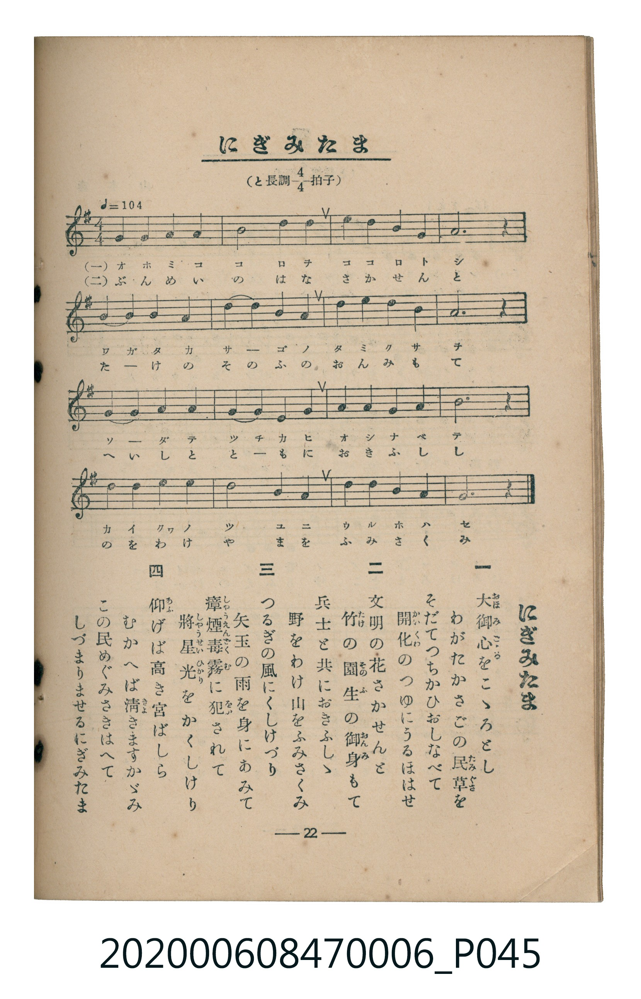

# にぎみたま

<audio controls src="nigimitama.mp3"></audio>

- 臺灣教育會公認《新定兒童唱歌》尋常科第六學年用（2020.006.0847.0006）

## 說明

原書資訊與歌詞全文（對應 P045.jpg，書頁 p. 22，第二學期第 7 首）：
調性與拍號：と長調四分之四拍子（G 大調 4/4 拍），♩=104

## 歌詞

```text
一、
大御心（おほみこゝろ）をこゝろとし
わがたかさごの民草（たみぐさ）を
そだてつちかひおしなべて
開化（かいくわ）のつゆにうるほはせ

二、
文明の花さかせんと
竹（たけ）の園生（そのふ）の御身（おんみ）もて
兵士と共におきふしゝ
野をわけ山をふみさくみ

三、
つるぎの風にくしけづり
矢玉の雨を身にあみて
瘴煙毒霧（しやうえんどくむ）に犯（をか）されて
將星光（しやうせいひかり）をかくしけり

四、
仰（あふ）げば高き宮ばしら
むかへば清（きよ）きますかゞみ
この民めぐみさきはへて
しづまりませるにぎみたま
```

## ABC

```abc
X:1
T:にぎみたま
C:TMD (Chen, Chih-Han / aguai)
M:4/4
L:1/16
Q:1/4=104
K:G
V:V1 name="Piano" snm="Pia"
[V:V1]
d4 g4 b4 d4 | c8 b4 a4 | g4 a4 b4 d4 | a12 z4 |
b4 b4 a4 g4 | a4 b4 d4 b4 | a4 d4 b4 a4 | g12 z4 |
f4 g4 a4 f4 | g4 a4 b4 c4 | d4 e4 d4 b4 | d12 z4 |
e4 d4 b4 g4 | c8 b4 a4 | g4 d4 e4 f4 | g12 z4 |
```

## TMD 檔案連結

- [主旋律 TMD 檔案](nigimitama.tmd)
- [鋼琴伴奏 TMD 檔案](nigimitama_piano.tmd)

## 分析

```text
================================================================================
📊 TMD Song Profile: [ にぎみたま ]
================================================================================
⏱  Duration:       0:36 (36.9s), 16 measures total
🎼 Key & Tempo:    首調基準 G, != 104.0 BPM, <4/4>
   - 分析範圍：      由實際發聲的音符與和弦推測調性；播放脈絡另行呈現
🎤 人聲音域:    D4 (MIDI 62) – E5 (MIDI 76) [跨度: 14 個半音 / 1.2 個八度, 難度: moderate]
   - 最低音:  D4 in [Nigimitama #1 @ m.1, 0:00]
   - 最高音: E5 in [Nigimitama #1 @ m.11, 0:23]
   - 適合: soprano, mezzo-soprano, contralto, tenor, baritone, bass
🏛  結構:      Nigimitama (36.9s)
⚡ 編曲密度:        Peak 1 軌道同時演奏
🗝  調性診斷：       G 大調（純淨自然大調，未偵測到可信轉調）
   - 風格氣質:    純淨自然大調（陽光明朗、易唱易記，無明顯調外色彩）
   - 轉調歷程:    全曲維持單一推測調性（未偵測到可信轉調）
   - 核心骨幹音:  G, D, A, B, C
   - 調性數值:    G 大調 [相關度: 0.87, 穩定度: Moderate, 自然音純度: 100.0%]
   - 候選調性 (K-S): G 大調 (0.87), D 大調 (0.76), B 小調 (0.65)
   - 五度圈歷程:   +1
   - 各段落調性細節:
     • [Nigimitama #1]: G 大調 (r: 0.87, 自然音純度: 100.0%)

  [ 五度圈游移軌跡 ]
               C  
         F           [G ]*
      Bb               D  
      Eb               A  
         Ab           E  
            Db       B  
               F# 
     (* = active key center)

  [ 十二半音累積音高分佈 ]
     C  : █████████                  8.3%
     C# :                            0.0%
     D  : ██████████████████████    20.0%
     D# :                            0.0%
     E  : ██████                     5.0%
     F  :                            0.0%
     F# : ██████                     5.0%
     G  : ████████████████████████  21.7%
     G# :                            0.0%
     A  : ██████████████████████    20.0%
     A# :                            0.0%
     B  : ██████████████████████    20.0%
--------------------------------------------------------------------------------
Assignment 軌道音域：
  - Piano         : D4 – E5 (14 個半音 / 1.2 個八度, 50 個音符)
================================================================================
```


## 原書掃描頁




