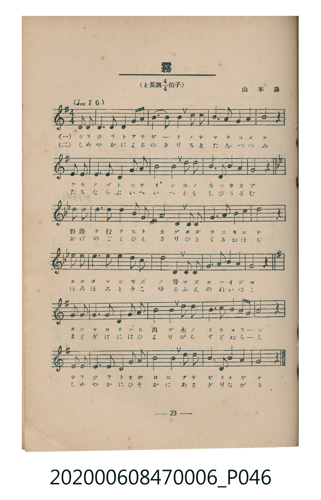
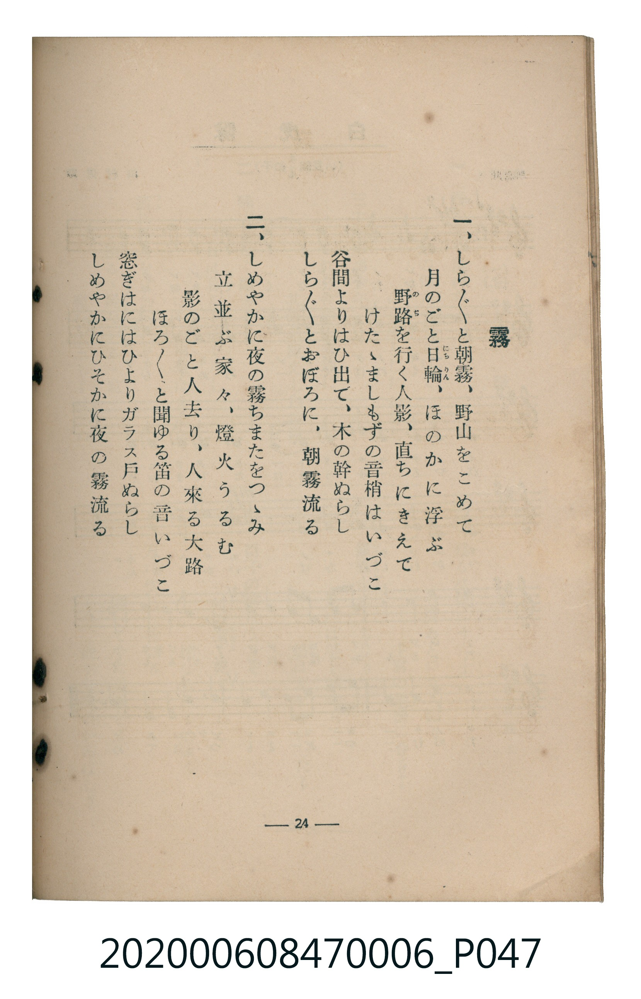

# 霧

<audio controls src="kiri.mp3"></audio>

- 曲：山本壽
- 臺灣教育會公認《新定兒童唱歌》尋常科第六學年用（2020.006.0847.0006）

- note

原書資訊與歌詞全文（對應 P046.jpg–P047.jpg，書頁 pp. 23–24，第二學期第 8 首）：
調性與拍號：と長調四分之四拍子（G 大調 4/4 拍，中段轉同主音 G 小調），♩=76

## 歌詞

```text
一、
しら〲と朝霧、野山をこめて
月のごと日輪（にちりん）、ほのかに浮ぶ
野路（のぢ）を行く人影、直ちにきえて
けたゝましもずの音、梢はいづこ
谷間よりはひ出て、木の幹ぬらし
しら〲とおぼろに、朝霧流る

二、
しめやかに夜の霧ちまたをつゝみ
立並ぶ家々、燈火うるむ
影のごと人去り、人來る大路
ほろ〲と聞ゆる笛の音いづこ
窓ぎはにはひよりガラス戸ぬらし
しめやかにひそかに夜の霧流る
```

## 原書掃描頁





## 調性分析

```text
================================================================================
📊 TMD Song Profile: [ 霧 ]
================================================================================
⏱  Duration:       0:56 (56.8s), 18 measures total
🎼 Key & Tempo:    首調基準 G, != 76.0 BPM, <4/4>
   - 分析範圍：      由實際發聲的音符與和弦推測調性；播放脈絡另行呈現
🎤 人聲音域:    D4 (MIDI 62) – D5 (MIDI 74) [跨度: 12 個半音 / 1.0 個八度, 難度: easy]
   - 最低音:  D4 in [Kiri #1 @ m.1, 0:00]
   - 最高音: D5 in [Kiri #1 @ m.2, 0:04]
   - 適合: soprano, mezzo-soprano, contralto, tenor, baritone, bass
🏛  結構:      Kiri (56.8s)
⚡ 編曲密度:        Peak 1 軌道同時演奏
🗝  調性診斷：       D 大調（流行色彩大調，未偵測到可信轉調）
   - 風格氣質:    流行大調（略帶和弦色彩音與裝飾副屬和弦）
   - 轉調歷程:    全曲維持單一推測調性（未偵測到可信轉調）
   - 核心骨幹音:  D, G, A, B, A#
   - 調性數值:    D 大調 [相關度: 0.86, 穩定度: High, 自然音純度: 94.7%]
   - 候選調性 (K-S): D 大調 (0.86), G 大調 (0.71), D 小調 (0.65)
   - 五度圈歷程:   +2
   - 各段落調性細節:
     • [Kiri #1]: D 大調 (r: 0.86, 自然音純度: 94.7%, 調外音: C, D#, A#)

  [ 五度圈游移軌跡 ]
               C  
         F            G  
      Bb              [D ]*
      Eb               A  
         Ab           E  
            Db       B  
               F# 
     (* = active key center)

  [ 十二半音累積音高分佈 ]
     C  :                            0.8%
     C# :                            0.0%
     D  : ████████████████████████  42.4%
     D# :                            0.8%
     E  : ██                         2.7%
     F  :                            0.0%
     F# : █                          1.5%
     G  : ██████████                18.2%
     G# :                            0.0%
     A  : █████████                 16.7%
     A# : ██                         3.8%
     B  : ████████                  13.3%
--------------------------------------------------------------------------------
Assignment 軌道音域：
  - Piano         : D4 – D5 (12 個半音 / 1.0 個八度, 91 個音符)
================================================================================
```

## ABC

```abc
X:1
T:霧
C:曲：山本壽
M:4/4
L:1/16
Q:1/4=76
K:G

V:V1 name="Piano" snm="Pia"

[V:V1]
d3 d d6 d2 g3 a | b6 d2 d4 d2 b2 | a3 a b2 a2 g4 z4 | d3 d d6 e2 g2 b2 |
b8 d4 b4 | a3 b a2 f2 d4 z4 | g3 g g3 g g2 _b2 a4 | g4 d8 g2 a2 |
_b3 b a2 g2 d4 z4 | d3 d d6 d2 c2 _b2 | a4 d8 d2 _e2 | g3 g a2 _b2 a4 z4 |
d3 d d6 e2 g2 b2 | a4 d8 b2 g2 | a3 a d2 f2 g4 z4 | d3 d d6 d2 g2 b2 |
a4 d8 b2 g2 | e3 g a2 b2 g4 z4 |
```

- [主旋律 TMD 檔案](kiri.tmd)
- [鋼琴伴奏 TMD 檔案](kiri_piano.tmd)
