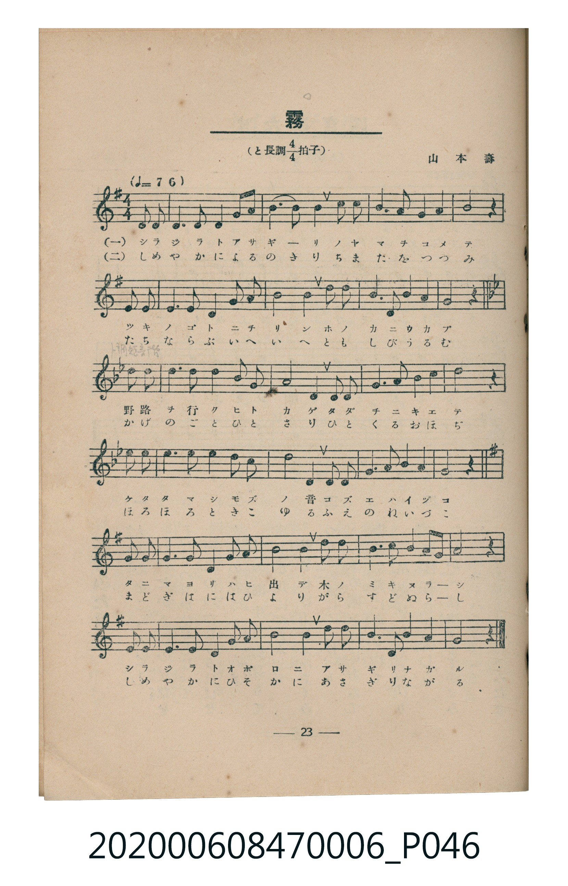
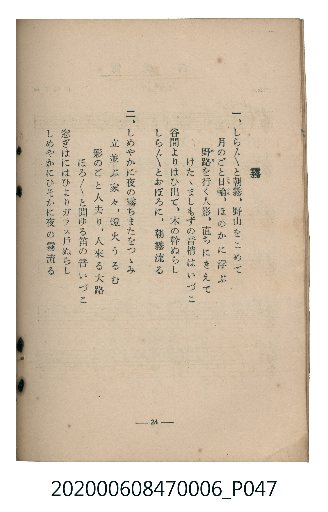

# 霧

> Re:Shōka 使用 AI 協助辨識與重建樂譜，可能會有錯誤。歡迎回報。

- **鋼琴伴奏版**：<br><audio controls src="kiri.mp3"></audio>
- **NEUTRINO 歌聲合成版**：<br><audio controls src="kiri_neutrino.mp3"></audio>

- 曲：山本壽
- 臺灣教育會公認《新定兒童唱歌》尋常科第六學年用（2020.006.0847.0006）

## 說明

原書資訊與歌詞全文（對應 P046.jpg–P047.jpg，書頁 pp. 23–24，第二學期第 8 首）：
調性與拍號：と長調四分之四拍子（G 大調 4/4 拍，中段轉同主音 G 小調），♩=76


## 歌詞

```text
一、
しら〲と朝霧、野山をこめて
月のごと日輪（にちりん）、ほのかに浮ぶ
野路（のぢ）を行く人影、直ちにきえて
けたゝましもずの音、梢はいづこ
谷間よりはひ出て、木の幹ぬらし
しら〲とおぼろに、朝霧流る

二、
しめやかに夜の霧ちまたをつゝみ
立並ぶ家々、燈火うるむ
影のごと人去り、人來る大路
ほろ〲と聞ゆる笛の音いづこ
窓ぎはにはひよりガラス戸ぬらし
しめやかにひそかに夜の霧流る
```

## ABC

<div class="abc-score" data-abc-src="kiri.abc" aria-label="五線譜載入中"></div>

[下載 ABC 原始檔](kiri.abc)

## TMD 檔案連結

- [主旋律 TMD 檔案](kiri.tmd) [[在 TMD Studio 編輯](https://tmdlang.github.io/Tmd-TS/#tmd=s7IKdvYPcrWy4qpTUCpJTLdSSM7PyUlNLsnMz7MqzsjMK0nNjM_KTMmPL87Iz05Ugisry88pzU21Si9KTEmNN4s3MjAyiDcwMIs3sDAxBzIMzBBKi_NLi5JTrYqTM_Lzc-JLUitKkvLzsxHyBUX5Zal5iXlANQVFIBtTwIoQClLLMlNSQdLFyYl58WWpRZlpmakpSG5JLSoGuxdsUXxJUWJecXJRZgHIEwhV-UUlGflA9xZkVFplZBaX5BdlJifmxGcn5iF5qyQjFeirvMSS0qJUdNHy1EQgowjZxMz0zDyrksRMYOCAAqg8MT43MTMvJzEP6DotLYWXc5YraGlxKdoqmJtx2dsquHPZmOib2IEMeDZ70_s9s55u3Phszpqni_eCDX3Rvut54-JnU2e-aNr0bE7z09Y1L1b1Pm7oejZtw9N1s562Tnq-eunTKRufre153ND9dEP30x07ni-f-HzNmqeta5-u3fF055bnU1a839MBigw9YBTogSIDyDAwe7-nU4mLS19LwZZagEtBQeFp3_xns3e82Nz-YkXXi452oLterJz3tHXFs2ntQFc83dD7rL1TIcDAxEwvqyD9UcNkINMcxHy_pweo7-WCRoWCAj0FI2OglJEJUBDokye7eoA-eTZnPpCtYKHwctk0oNOBAQWy7sWq_c8aloMs6u59MXM-UPRx44qXU7cDxZ_Onv20o-3Jzm4gAyj7dO0EoAPcFZ4uWQ6UVACGuQJQFGjDkx1rn63b-mJv59MJQPbul_M3KwBVbegHqgLb0_No5kpbYFyBrHuyo-FxQyOI9bhx-uOmzscNm4D2PZszFxirQImX7X3A2HvcNOlx4-THTY2PG5eBlD6b0_G4cd3jxikgpdOXvtizCuiQx42rHzcufNzU9bhpMtAaoObHjbvByrqBUs-2AhnbQJqBRr7Yvh6sASi0CKS0adKLhT2PG_uf7Nr1dO9GoM7ns7eAzAKZ2Pu4EagSbO3jxomPG-c_bpr7uHEf2LVNjxuBobMO6EGgnmeLFj1uXP-4seVx41Kga8FhuWH7y2lAd3eAXAWS2_S0fRfQMJDqOSuAOp_u3Pm4cQ3I243T0cPgcSNQz57HTUAHrAZrAAXJs62Nj5u6ISG3C5hAESEHFAfaDPLq0yVzQI4Chh_IC0CXAp0MDL8lYIfvB2l4vrr7yY5lwPB4um7b44ZWkIfbO56DfNsGNP1xUwM43QFDAhbIoIDp2w3yRUMjkP1kH0gdKN63r4c4ACgHzEMgZ79onPe4CST9fM1saNggB8nzVZMfN_aBAwNoHShIoMHTtOZx88rHTTufdezADBKE50AaGoH-QPEoNFSAqinPclCgoKXPxeWdWZRpFZCZmJfvUGNQUw2yQMHGQssOzMCWzxVAmWtHAzA1KWg83bPxxdbtCtoKJqC0_3x9gw48l2pi0Qm0D2RqjYKBgi4cm8aDUA2I0IVzdRUMFYyAgsZgMWMwbQqEMBEjoDyI1IWLQAwziwehGrA1PoY1CiCTYBgYygrAMAfqeNw4A6wDxANGJ1iuCYinguX6oHJdQPY6MKsFyNoHkmuaBJFrnAxkN0LtBelZBmVD7FkCxL0wVxhhc0Uj2LQWqGndQLwabFMHEHeDTQTZDJLrhThkIZizD4jnozgEZNUSJIfsR3HIfLDOGnBewh2Zu3rAkUliHALDGWQRkMKIL1CMocYXUAmIAYkwUNTBIgysCB5dCG9PgUfMaogfQBECLPWgWoG5EUyuA4ceSCMo_EAibWARRIBsQwkQkPpFSDHzuHEVUkoAqQXmZCDeAdYLzI874BaCXdMESibTwZKbERYCowxuYVMDioWgqJ1EMAZ2dKLFALBiAdr4fP5aYH1CZHyYQgIaTBvrAAO5Bhzc0NBH5DNI6BuB1OgC8y3I0RCt0BykA0JIUQJLak2gkO0He2oTODhAgQAsoiDSsFACpbgFYClQioXFXy-Y1QGNEtTMMhGSppGiBDMNICycCsoOyBYipEBuA7kTFOQgNZA0ApJZhGLhbqAaUO7EGyXA6h8tSkiND2AogvMHODxBEQMMcERQ444SzDyCXqiBwgvieVB5MB3saVC6nIVUcIBk14JJYFEFlQGFP0hkPTiRg1hLoQEEy1aIUmM1SoyAAhJkSy88RkCsyeD03gazD5wLHjduBduEHI9rCdgH8sVKwqXUFPQ8sh9UbUOabSSXWcYgFpA2R4Q_qAwD5QgTeM4xBtOG4NCHZybsMbIPGgagAhyS-EChvAlWjCyHRwoo8UOCbx1SgQ0RWQM2ohMaSKCIRQQStO5CihRoPQW2CFx7IKwEOgMWKRDH9MBrvplQXSuJsA9YSxHIJa1rB67qAGHkKMCs00EV5x5weIAKIFhxBCKx1_agugAUVpCCHFaow2pupLDHrLnB5dBcSJmIahcoSUDjGuIK4uyq5eLStVMAtc4UgLQyFwA)]
- [鋼琴伴奏 TMD 檔案](kiri_piano.tmd) [[在 TMD Studio 編輯](https://tmdlang.github.io/Tmd-TS/#tmd=s7IKdvYPcrWy4tLSUng5Z_n7PR0vu_c8n7DlyZ4tT5f2P-_seL-nU0FLi0vRVsHcjMveVsGdy8ZE38SOq05B6dnsTe_3zHq6ceOzOWueLt6rBBJ70b7reePiZ1Nnvmja9GxO89PWNS9W9T5u6Ho2bcPTdbOetk56vnrp0ykbn63tedzQ_XRD99MdO54vn_h8zZqnrWufrt3xdOeW51NWAF1hZGBkoGdgYKZnYGFiDmQYmAEdosTF5Z1ZlGkVkJmYlx_k4VCja1hTzaUABDYWWnZghr6Wgi06UAAa_2RHw4uFPQoaAQYmZnpZBemaWJRp6YONqFEwUNCFY9N4EKoBEbpwrq6CoYIRUNAYLGYMpk2BECZiBJQHkbpwEYhhZvEgVAO2xsewRgFkEgw_bpyu8LipE6jjceMMsA4Q73HjCrBcExBPBcv1QeW6gOx1YFYLkLUPJNc0CSLXOBnIboTaC9KzDMqG2LMEiHthrjDC5opGsGktUNO6gXg12KYOIO4GmwiyGSTXC3HIQjBnHxDPR3EIyKolSA7Zj-KQ-WCdNVz4Y25XD_ExBwxdkPFACiOWQPGEGktAJSAGJJpAEQaLJrAieCQhPDsFHh2rIS4HRcPjpslQrY8bd4PJdeAwA2kEhRpIpA0sggiGbSjBAFK_CCk-HjeuQop_kNrHjaA43gHW2wJiwCwEu6YJlDimgyU3IywERhTcwqYGFAtBETqJYLjv6CQ-3E0hAQqmjXWAgVkDDlZoKCNyESSUjUBqdBVMwI6DaIXmDx0QQgp6WEJqAoVgP9jxm8DeBnm2G-QLiGaIr0HpaQFYCpQeYfHUC2Z1QIMeNStMhKRYpKDHjGuEhVNBiR3ZQoQUyG0gd4KCFqQGkhZAMotQLNwNVAPKe3iD_uns2SQkeVBQwoIOFAfAsEWEKu7Qx0z26KUTKGgg_gRl7Olg_4GS2iykEgAkuxZMAsscqAwoqEEi68HpFsRaCg0LWE5BZP_VKIEPCjOQLb3wwAexJoOTcBvMPnDCfty4FWwTcpStJWAfyBcrCRc3U8gpboxBLCBtjghnUPEDSuQm8MxgDKYNwaEMzx_YQ34f1K-gEheSnkChuQlWAiyHBz4oPUOCaR1SCQsRWQM2ohMaGKAIRAQGtLJBCnxoxQK2CFzcI6wEOgMW-BDH9MCrqplQXSuJsA9YrRBI-K1r6V3WgzBywGNWvaD6bQ84FEAlCaxcAZHYK2VQ4Q0KIUjJCyuFYRUsUohjVrDgAmUupHBDtQuUEKAxDHEFcXbVIreYfFBaTCbQFhOouQOBoEZOvEK0aXwshGEYCworCANKwflmMJVwEbAJUBNNQLImxJgDonAaAxTSMASVVqaaKGx0h8INQFYdbQIShMujOk9BwwRUXBrGaYI5pBmMKYpsODhkzOJzY4FlAoyFLAq0D81pYAZUHQ73UhicwGSga6cASgnRPkBBONsIzFbmAgA)]

## 分析

```text
================================================================================
📊 TMD Song Profile: [ 霧 ]
================================================================================
⏱  Duration:       1:18 (78.9s), 25 measures total
🎼 Key & Tempo:    首調基準 G, != 76.0 BPM, <4/4>
   - 分析範圍：      由實際發聲的音符與和弦推測調性；播放脈絡另行呈現
🎤 人聲音域:    B3 (MIDI 59) – D#5 (MIDI 75) [跨度: 16 個半音 / 1.3 個八度, 難度: moderate]
   - 最低音:  B3 in [Kiri #1 @ m.18, 0:55]
   - 最高音: D#5 in [Kiri #1 @ m.13, 0:40]
   - 適合: soprano, mezzo-soprano, contralto, tenor, baritone, bass
🏛  結構:      Kiri (78.9s)
⚡ 編曲密度:        Peak 1 軌道同時演奏
🗝  調性診斷：       G 大調（流行色彩大調，未偵測到可信轉調）
   - 風格氣質:    流行大調（略帶和弦色彩音與裝飾副屬和弦）
   - 轉調歷程:    全曲維持單一推測調性（未偵測到可信轉調）
   - 核心骨幹音:  D, B, G, A, E
   - 調性數值:    G 大調 [相關度: 0.79, 穩定度: Moderate, 自然音純度: 92.2%]
   - 候選調性 (K-S): G 大調 (0.79), D 大調 (0.75), B 小調 (0.71)
   - 五度圈歷程:   +1
   - 各段落調性細節:
     • [Kiri #1]: G 大調 (r: 0.79, 自然音純度: 92.2%, 調外音: D#, A#)

  [ 五度圈游移軌跡 ]
               C  
         F           [G ]*
      Bb               D  
      Eb               A  
         Ab           E  
            Db       B  
               F# 
     (* = active key center)

  [ 十二半音累積音高分佈 ]
     C  : ██                         2.2%
     C# :                            0.0%
     D  : ████████████████████████  25.0%
     D# : ████                       4.4%
     E  : ███████████               11.1%
     F  :                            0.0%
     F# : █                          0.6%
     G  : █████████████████         17.2%
     G# :                            0.0%
     A  : ██████████████            15.0%
     A# : ███                        3.3%
     B  : ████████████████████      21.1%
--------------------------------------------------------------------------------
Assignment 軌道音域：
  - Piano         : B3 – D#5 (16 個半音 / 1.3 個八度, 98 個音符)
================================================================================
```


## 原書掃描頁






