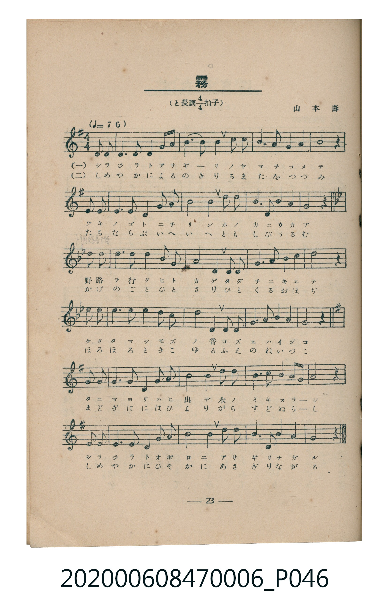
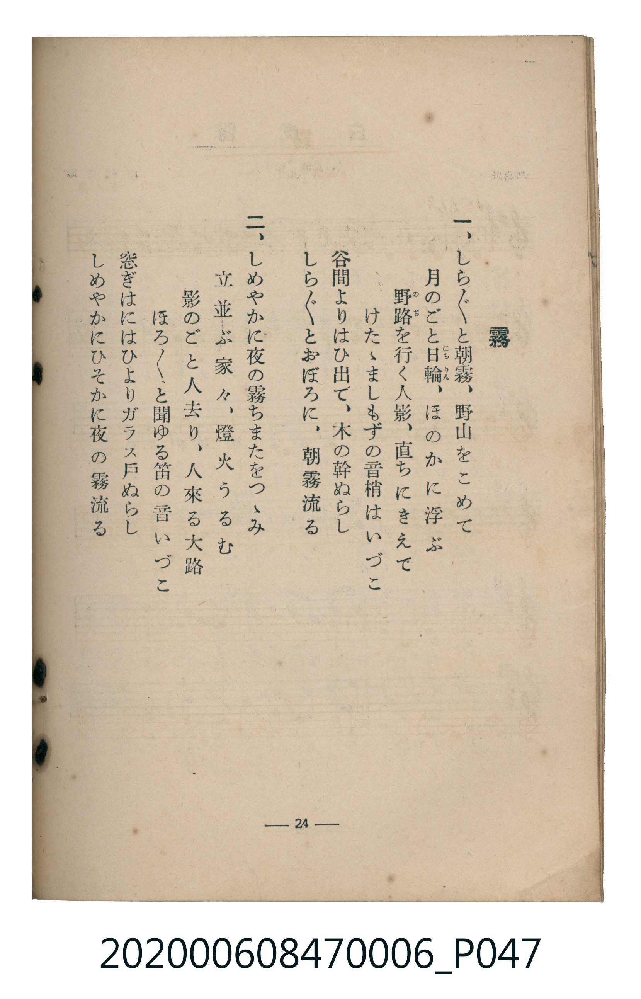

# 霧

> Re:Shōka 使用 AI 協助辨識與重建樂譜，可能會有錯誤。歡迎回報。

- **鋼琴伴奏版**：<br><audio controls src="kiri.mp3"></audio>
- **NEUTRINO 歌聲合成版**：<br><audio controls src="kiri_neutrino.mp3"></audio>

- 曲：山本壽
- 臺灣教育會公認《新定兒童唱歌》尋常科第六學年用（2020.006.0847.0006）

## 說明

原書資訊與歌詞全文（對應 P046.jpg–P047.jpg，書頁 pp. 23–24，第二學期第 8 首）：
調性與拍號：と長調四分之四拍子（G 大調 4/4 拍，中段轉同主音 G 小調），♩=76


## 歌詞

```text
一、
しら〲と朝霧、野山をこめて
月のごと日輪（にちりん）、ほのかに浮ぶ
野路（のぢ）を行く人影、直ちにきえて
けたゝましもずの音、梢はいづこ
谷間よりはひ出て、木の幹ぬらし
しら〲とおぼろに、朝霧流る

二、
しめやかに夜の霧ちまたをつゝみ
立並ぶ家々、燈火うるむ
影のごと人去り、人來る大路
ほろ〲と聞ゆる笛の音いづこ
窓ぎはにはひよりガラス戸ぬらし
しめやかにひそかに夜の霧流る
```

## ABC

<div class="abc-score" data-abc-src="kiri.abc" aria-label="五線譜載入中"></div>

[下載 ABC 原始檔](kiri.abc)

## TMD 檔案連結

- [主旋律 TMD 檔案](kiri.tmd) [[在 TMD Studio 編輯](https://tmdlang.github.io/Tmd-TS/#tmd=s7IKdvYPcrWy4qpTUCpJTLdSSM7PyUlNLsnMz7MqzsjMK0nNjM_KTMmPL87Iz05Ugisry88pzU21Si9KTEmNN4s3MjAyiDcwMIs3sDAxBzIMzBBKi_NLi5JTrYqTM_Lzc-JLUitKkvLzsxHyBUX5Zal5iXlANQVFIBtTwIoQClLLMlNSQdLFyYl58WWpRZlpmakpSG5JLSoGuxdsUXxJUWJecXJRZgHIEwhV-UUlGflA9xZkVFplZBaX5BdlJifmxGcn5iF5qyQjFeirvMSS0qJUdNHy1EQgowjZxMz0zDyrksRMYOCAAqg8MT43MTMvJzEPyXVQVxUkpqdaBRiYmOkCCXMlLi0thZdzlitoaXEp2iqYm3HZ2yq4c9mY6JvYgXQ-m73p_Z5ZTzdufDZnzdPFe8GmvWjf9bxx8bOpM180bXo2p_lp65oXq3ofN3Q9m7bh6bpZT1snPV-99OmUjc_W9jxu6H66ofvpjh3Pl098vmbN09a1T9fueLpzy_MpK97v6QDFlR4whvRAcQVkGJi939OpxMWlr6VgSy3ApaCg8LRv_rPZO15sbn-xoutFRzvQXS9WznvauuLZtHagK55u6H3W3qkAChG9rIL0Rw2TQeECYr7f0wPU93JBo0JBgZ6CkTFQysgEKAj0yZNdPUCfPJszH8hWsFB4uWwa0OnAgAJZ92LV_mcNy0EWdfe-mDkfKPq4ccXLqduB4k9nz37a0fZkZzeQAZR9unYC0AHuCk-XLAdKKgDDXAEoCrThyY61z9ZtfbG38-kEIHv3y_mbFYCqNvQDVYHt6Xk0c6UtMK5A1j3Z0fC4oRHEetw4_XFT5-OGTUD7ns2ZC4xVoMTL9j5g7D1umvS4cfLjpsbHjctASp_N6XjcuO5x4xSQ0ulLX-xZBXTI48bVjxsXPm7qetw0GWgNUPPjxt1gZd1AqWdbgYxtIM1AI19sXw_WABRaBFLaNOnFwp7Hjf1Pdu16uncjUOfz2VtAZoFM7H3cCFQJtvZx48THjfMfN8193LgP7Nqmx43A0FkH9CBQz7NFix43rn_c2PK4cSnQteCw3LD95TSguztArgLJbXravgtoGEj1nBVAnU937nzcuAbk7cbp6GHwuBGoZ8_jJqADVoM1gILk2dbGx03dkJDbBUygiJADigNtBnn16ZI5IEcBww_kBaBLgU4Ght8SsMP3gzQ8X939ZMcyYHg8XbftcUMryMPtHc9Bvm0Dmv64qQGc7oAhAQtkUMD07Qb5oqERyH6yD6QOFO_b10McAJQD5iGQs180znvcBJJ-vmY2NGyQg-T5qsmPG_vAgQG0DhQk0OBpWvO4eeXjpp3POnZgBgnCcyANjUB_oHgUGipA1ZRnOShQ0NLn4vLOLMq0CshMzMt3qDGoqQZZoGBjoWUHZmDL5wqgzLWjAZiaFDSe7tn4Yut2BW0FE1Daf76-QQeeSzWx6ATaBzK1RsFAQReOTeNBqAZE6MK5ugqGCkZAQWOwmDGYNgVCmIgRUB5E6sJFIIaZxYNQDdgaH8MaBZBJMAwMZQVgmAN1PG6cAdYB4gGjEyzXBMRTwXJ9ULkuIHsdmNUCZO0DyTVNgsg1TgayG6H2gvQsg7Ih9iwB4l6YK4ywuaIRbFoL1LRuIF4NtqkDiLvBJoJsBsn1QhyyEMzZB8TzURwCsmoJkkP2ozhkPlhnDTgv4Y7MXT3gyCQxDoHhDLIISGHEFyjGUOMLqATEgEQYKOpgEQZWBI8uhLenwCNmNcQPoAgBlnpQrcDcCCbXgUMPpBEUfiCRNrAIIkC2oQQISP0ipJh53LgKKSWA1AJzMhDvAOsF5scdcAvBrmkCJZPpYMnNCAuBUQa3sKkBxUJQ1E4iGAM7OtFiAFixAG18Pn8tsD4hMj5MIQENpo11gIFcAw5uaOgj8hkk9I1AanSB-RbkaIhWaA7SASGkKIEltSZQyPaDPbUJHBygQAAWURBpWCiBUtwCsBQoxcLirxfM6oBGCWpmmQhJ00hRgpkGEBZOBWUHZAsRUiC3gdwJCnKQGkgaAcksQrFwN1ANKHfijRJg9Y8WJaTGBzAUwfkDHJ6giAEGOCKocUcJZh5BL9RA4QXxPKg8mA72NChdzkIqOECya8EksKiCyoDCHySyHpzIQayl0ACCZStEqbEaJUZAAQmypRceIyDWZHB6b4PZB84Fjxu3gm1Cjse1BOwD-WIl4VJqCnoe2Q-qtiHNNpLLLGMQC0ibI8IfVIaBcoQJPOcYg2lDcOjDMxP2GNkHDQNQAQ5JfKBQ3gQrRpbDIwWU-CHBtw6pwIaIrAEb0QkNJFDEIgIJWnchRQq0ngJbBK49EFYCnQGLFIhjeuA130yorpVE2AespQjkkta1A1d1gDByFGDW6aCKcw84PEAFEKw4ApHYa3tQXQAKK0hBDivUYTU3Uthj1tzgcmgupExEtQuUJKBxDXEFcXbVcnHp2imAWmcKQFqZCwA)]
- [鋼琴伴奏 TMD 檔案](kiri_piano.tmd) [[在 TMD Studio 編輯](https://tmdlang.github.io/Tmd-TS/#tmd=s7IKdvYPcrWy4qpTUCpJTLdSyC8qychPL0osyKi0ysgsLskvykxOzInPTsxLVIIrKs4vLUpOjS9ITE-1CjAwMdMFEuZKXFpaCi_nLH-_p-Nl957nE7Y82bPl6dL-550d7_d0KmhpcSnaKpibcdnbKrhz2Zjom9iBjHs2e9P7PbOebtz4bM6ap4v3gq140b7reePiZ1Nnvmja9GxO89PWNS9W9T5u6Ho2bcPTdbOetk56vnrp0ykbn63tedzQ_XRD99MdO54vn_h8zZqnrWufrt3xdOeW51NWAF1hZGBkoGdgYKZnYGFiDmQYmAEdosTF5Z1ZlGkVkJmYlx_k4VCja1hTzaUABDYWWnZghr6Wgi06UAAa_2RHw4uFPQoaIB_rZRWka2JRpqUPNqJGwUBBF45N40GoBkTowrm6CoYKRkBBY7CYMZg2BUKYiBFQHkTqwkUghpnFg1AN2BofwxoFkEkw_LhxusLjpk6gjseNM8A6QLzHjSvAck1APBUs1weV6wKy14FZLUDWPpBc0ySIXONkILsRai9IzzIoG2LPEiDuhbnCCJsrGsGmtUBN6wbi1WCbOoC4G2wiyGaQXC_EIQvBnH1APB_FISCrliA5ZD-KQ-aDddZw4Y-5XT3ExxwwdEHGAymMWALFE2osAZWAGJBoAkUYLJrAiuCRhPDsFHh0rIa4HBQNj5smQ7U-btwNJteBwwykERRqIJE2sAgiGLahBANI_SKk-HjcuAop_kFqHzeC4ngHWG8LiAGzEOyaJlDimA6W3IywEBhRcAubGlAsBEXoJILhvqOT-HA3hQQomDbWAQZmDThYoaGMyEWQUDYCqdFVMAE7DqIVmj90QAgp6GEJqQkUgv1gx28Cexvk2W6QLyCaIb4GpacFYClQeoTFUy-Y1QENetSsMBGSYpGCHjOuERZOBSV2ZAsRUiC3gdwJClqQGkhaAMksQrFwN1ANKO_hDfqns2eTkORBQQkLOlAcAMMWEaq4Qx8z2aOXTqCggfgTlLGng_0HSmqzkEoAkOxaMAksc6AyoKAGiawHp1sQayk0LGA5BZH9V6MEPijMQLb0wgMfxJoMTsJtMPvACftx41awTchRtpaAfSBfrCRc3Ewhp7gxBrGAtDkinEHFDyiRm8AzgzGYNgSHMjx_YA_5fVC_gkpcSHoCheYmWAmwHB74oPQMCaZ1SCUsRGQN2IhOaGCAIhARGNDKBinwoRUL2CJwcY-wEugMWOBDHNMDr6pmQnWtJMI-YLVCIOG3rqV3WQ_CyAGPWfWC6rc94FAAlSSwcgVEYq-UQYU3KIQgJS-sFIZVsEghjlnBgguUuZDCDdUuUEKAxjDEFcTZVYvcYvJBaTGZQFtMoOYOBIIaOfEK0abxsRCGYSworCAMKAXnm8FUwkXAJkBNNAHJmhBjDojCaQxQSMMQVFqZaqKw0R0KNwBZdbQJSBAuj-o8BQ0TUHFpGKcJ5pBmMKYosuHgkDGLz40FlgkwFrIo0D40p4EZUHU43EthcAKTga6dAiglRPsABeFsIzBbmQsA)]

## 分析

```text
================================================================================
📊 TMD Song Profile: [ 霧 ]
================================================================================
⏱  Duration:       1:18 (78.9s), 25 measures total
🎼 Key & Tempo:    首調基準 G, != 76.0 BPM, <4/4>
   - 分析範圍：      由實際發聲的音符與和弦推測調性；播放脈絡另行呈現
🎤 人聲音域:    B3 (MIDI 59) – D#5 (MIDI 75) [跨度: 16 個半音 / 1.3 個八度, 難度: moderate]
   - 最低音:  B3 in [Kiri #1 @ m.18, 0:55]
   - 最高音: D#5 in [Kiri #1 @ m.13, 0:40]
   - 適合: soprano, mezzo-soprano, contralto, tenor, baritone, bass
🏛  結構:      Kiri (78.9s)
⚡ 編曲密度:        Peak 1 軌道同時演奏
🗝  調性診斷：       G 大調（流行色彩大調，未偵測到可信轉調）
   - 風格氣質:    流行大調（略帶和弦色彩音與裝飾副屬和弦）
   - 轉調歷程:    全曲維持單一推測調性（未偵測到可信轉調）
   - 核心骨幹音:  D, B, G, A, E
   - 調性數值:    G 大調 [相關度: 0.79, 穩定度: Moderate, 自然音純度: 92.2%]
   - 候選調性 (K-S): G 大調 (0.79), D 大調 (0.75), B 小調 (0.71)
   - 五度圈歷程:   +1
   - 各段落調性細節:
     • [Kiri #1]: G 大調 (r: 0.79, 自然音純度: 92.2%, 調外音: D#, A#)

  [ 五度圈游移軌跡 ]
               C  
         F           [G ]*
      Bb               D  
      Eb               A  
         Ab           E  
            Db       B  
               F# 
     (* = active key center)

  [ 十二半音累積音高分佈 ]
     C  : ██                         2.2%
     C# :                            0.0%
     D  : ████████████████████████  25.0%
     D# : ████                       4.4%
     E  : ███████████               11.1%
     F  :                            0.0%
     F# : █                          0.6%
     G  : █████████████████         17.2%
     G# :                            0.0%
     A  : ██████████████            15.0%
     A# : ███                        3.3%
     B  : ████████████████████      21.1%
--------------------------------------------------------------------------------
Assignment 軌道音域：
  - Piano         : B3 – D#5 (16 個半音 / 1.3 個八度, 98 個音符)
================================================================================
```


## 原書掃描頁






