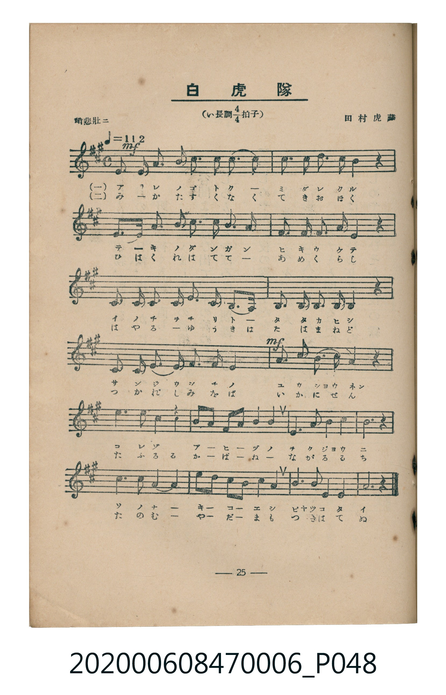
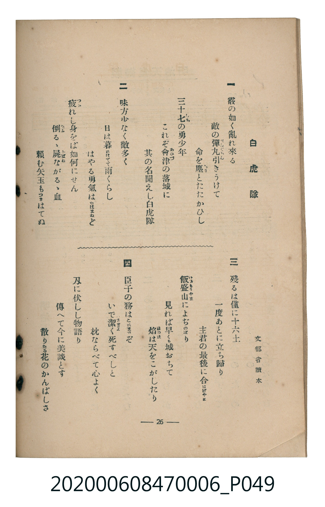

# 白虎隊

> Re:Shōka 使用 AI 協助辨識與重建樂譜，可能會有錯誤。歡迎[回報](https://github.com/TMDLang/reshoka/issues)。

- **鋼琴伴奏版**：<br><audio controls src="byakkotai.mp3"></audio>
- **NEUTRINO 歌聲合成版**：<br><audio controls src="byakkotai_neutrino.mp3"></audio>

- 詞：文部省讀本
- 曲：田村虎藏
- 臺灣教育會公認《新定兒童唱歌》尋常科第六學年用（2020.006.0847.0006）

## 說明

原書資訊與歌詞全文（對應 P048.jpg–P049.jpg，書頁 pp. 25–26，第二學期第 9 首）：
調性與拍號：い長調四分之四拍子（A 大調 4/4 拍），「稍悲壯ニ」（♩=112）


## 歌詞

```text
一、
霰の如く亂れ來る
敵の彈丸（だんぐわん）引きうけて
命を塵（ちり）とたたかひし
三十七（しち）の勇少年
これぞ會津（あいづ）の落城に
其の名聞えし白虎隊

二、
味方少なく敵多く
日は暮れはてて雨くらし
はやる勇氣はたゆまねど
疲（つか）れし身をば如何にせん
倒（たふ）るゝ屍（かばね）ながるゝ血
頼む矢玉もつきはてぬ

三、
殘るは僅に十六士
一度あとに立ち歸り
主君の最後に合はばやと
飯盛山（いひもりやま）によぢのぼり
見れば早くも城おちて
焔（ほのほ）は天をこがしたり

四、
臣子の務はこれまでぞ
いで潔（いさぎよ）く死すべしと
枕ならべて心よく
刃に伏しし物語り
傳へて今に美談とす
散りたる花のかんばしさ
```

## ABC

<div class="abc-score" data-abc-src="byakkotai.abc" aria-label="五線譜載入中"></div>

[下載 ABC 原始檔](byakkotai.abc)

## TMD 檔案連結

- [主旋律 TMD 檔案](byakkotai.tmd) [[在 TMD Studio 編輯](https://tmdlang.github.io/Tmd-TS/#tmd=s7IKdvYPcrWy4qpTUCpJTLdSSM7PyUlNLsnMz7MqzsjMK0nNjM_KTMmPL87Iz05Ugisry88pzU21Si9KTEmNN4s3MjAyiDcwMIs3sDAxBzIMzBBKi_NLi5JTrYqTM_Lzc-JLUitKkvLzsxHyBUX5Zal5iXlANQVFIBtTwIoQClLLMlNSQdLFyYl58WWpRZlpmakpSG5JLSoGuxdsUXxJUWJecXJRZgHIEwhV-UUlGflA9xZkVFplZBaX5BdlJifmxGcn5iF5qyQjFeir3MyczJLEokpkzZnpmXlWufl5SaXAkMCUSM3MysTiN6iTChLTU60CDEwsdIGEpRKXlpbC85l7X8zsezmrS0FLi0vRVsHQ0IjL3lbBkcvGRN_EDmTAi5Xz3u-Z9Wxa-8vmFc_nNL5Y1_Bszhqw0c9mbwLKPJ-y4dnciUBDXkzvBwu_aN_1vHHxs6kzXzRtejan-Wnrmhereh83dD2btuHpullPWyc9X7306ZSNz9b2PG7ofrqh--mOHc-XT3y-Zs3T1rVP1-54unPL8ykr3u_pAEWmHjAK9UCRCWQYmL3f06nExaWvpWBLLcCloKDwtG_-s9k7Xmxuf7Gi60VHO9BdQC8_bV0B9DLQFU839D5r71QAhZpeVkH6o4bJoLADMd_v6QHqe7mgUaGgQE_ByBQoZQR0Yg_QJ0929QB98mzOfCBbwVLh5bJpQKcDwwpk3YtV-581LAdZ1N37YuZ8oOjjxpaXU7cDxZ_Onv20o-3Jzm4gAyj7dO0EoAMcFZ4uWQ6UVABGiAJQFGwSMOh6nq_ofda06eni9Y-bux83AMU7Hs1caQuMQKAKLpBNT3Y0PG5oBLFeztnwuHHd02VNjxv7n-xqetzU82Rf2-OmbpDcs6lbQXJ7O57s2AE043HjgsdNkx83Tnjc1A9kAM16umfq48bex41tjxsnPm5cBg6yiXsfN016unArWMPCx01dQHWPG1c8bpwPRt2PGzc9bpwOcUTn097GJzuawUqnA1WDla572t3-dMNEYGSDFD1unAx00-PGecD08mzLUrBSoFtbHjcC2SDVLybsfTq_73HjarDtrdtABkzofdE473EjyFR4Kob4excweMD-fjpx87NpO4H2PG5cBfQ60KtPlwCDux_s7-lLHzeufzZrHdjm9UCfAdHL2UA_AP0NtBPsepBEUwswpIDOfbZhMVjd_MdNwKDY97hx7ePGlSBFz6cB8wHQGUuAHgc5F2Te9Be7VgOD6HHjBmCoP9kLDMHVjxtnAwMU7KyGSWANwJAChiBQQ_fjprlPN4KiEBx2wMhaC_Y30NE9ENkXCxvAEblgz-OmhufzFz3vA2oDBhHQTmDUQFy_BhrrnVDfP1s3A6S5cf3T5lag_cBoAOWwxeAwBKaNp7uAeoBGAH28-vlqoLqFz9buAEYlRHr30wmzgaH8bE7D031A_6x-OgHoNqA9G0Dh0bgC7JjF658DU-zGjWB3A0U3gZzU1AVWsQ_sAWAYAKUWAQ163Ah0OdjsF8uAHgIaueHZ9JXgwG4CR20XKCFBktfzlilgI3eD9e0Gm7T-6ZKV4AAFpk1Q-ILjARLfwNwC9fGL9sXATANOXTPBroUkK2BcLQcmLkiEAt22_NleiAVANjBm-oCOBNvR_2wt0Eqgzp1gC8CefDYPqGIVOEUARZc93d8M9hI4CT3taAZ68cmefrDy6c87V75YNQ_qy6dNmx837gDqeLIb6LPVz_f1vVjdDg7smZBctxgUUiBPdL_o2gj2KDBYgJ4DRj7QsKkgRZSXb1CgoKXPxeVUmZidnV-SmGkVkJmYl-9QY1BTDbJFwcbQTMsOzMJWtCqAyrMdDS8W9ihoGCk83dD_fH2DDrw81MSiAWgZyLAaherctFoF03gFXSAEUoZghpGCMZg2htM1cJYJlDYC07oKBlC6Bmygj2ENMP6awCLACAHiHgi7cR0QT4GyVwBxP0wfkL0fKr4ASX0_kN0NVQNxHtwOI4QekEqIKmA8AfFMhO7GVXA2SP0yKK8XiLug7N1I7kCzwxikZx1U3WS4W4ApFsiG6AGWfEi2rwbbMgPK2wpU1YvklunYbTEB6YHIARMWgg0OrSWI0GpqhNsO0jEZqqMHyN4HlVkOxPMwbMGfZHb1kJNkcKcWSJowBKoxg6gBUlCWIUwb9hQDiR1I_CBCYAFSyEDTBZANUr8JrhpY6UHZE5HMwZZiYHqAMQiNdUgIroeKL0PSj5yKG5HUA1M0rrgEp5gWqFkLgXgllN0EjkNYKoHogdgwH0k1LB3tANoCSZ_YUwvMBlB8w9hTgbgP6sIOpDSNlLqAOQNYOkLZ0-EuIj6t7OgkJ60YQ4wHUggWNCEAWUbQtBEPVAllAykMFvYkA_M8KKEshHp-EhK7C8mTyIENKiZggb0Jd3SCkww0aTS1IBVGwKYFVHcbUnKFZEyoHUAViIy5Fp4UsCeZ6Y-bWqFKQWUeNG-DvTUVygZaDy87IeUMNG2C0_IGhCOxxCoi5cAcBLKlE-YZWCkJTtmw9LEMuZQBl35Qb6KkLiJTDrDqpyzlIMobRKkCL0ygNRikJIKVQMZQPvaEAw1VcKkCK69BEQbLKaDcCCn5wQkHJbqBkdWOxF0Liy_syQdWgncj1WugvAet78DJFRJ7kCQKS9JA9dCSAtgghacJ_CUOMCk3wUosYNIHpgaI-D64WRDfdEDFF8F9CWz24S9z4GaBUhg0tQHNBNVyCD_BshFIPSx1gtIwzN_AbIfFDgL10xRwyjEhsX6Cmg5ONEAMqZ0QNLCsAZKgFAJOTyAGrDEDo-GVHAQiK0E1BRvEluZgMQiJH1CYIGprGETka0h8wlhL4SzkVAnLwRAZUJ4EpmZY6oSkT4SxiGoHFWJLtJAyDGYKKIqRyz4YC6QSLgpPxKDSDtNTkCIGpgLseRwmQspugu4EJ3xYAxBiCiRIYe5Ath1ShkMKSJgbYEUYLKkiV5UwmV6wSliSRbgNublCwJ3gYhdSCMBMAYUuqJKH8ZEbHAj3QYpqSDbD9NFmFBNBjSREEYFa50Gaw_jcib_obl1LTgaEZREQBLFhhTHCD6BsCepIgGRB2QimA6YSNXOB2PD8iFTyo5sLg9gy4FwkeUhGQk2XsBDrhatBhCikyIQUdAiVmx83AbuWi1HMBelBzUEw1bC4RYeEcyDYrU0NmGYipWdIQxkl5aCkbNQ0CPIjUr5ASYNriHMnOAfuxnQnXAxhPkrzHpFOgZUfho9Qi0lISQEPc0S4gPwOy5cE3AnOgcilCkQnwizU8gcRJrC0gSh0kd0J04PwE3IZiJxKII0NfO6s5eLStVOA9_wVgBxlLgA)]
- [鋼琴伴奏 TMD 檔案](byakkotai_piano.tmd) [[在 TMD Studio 編輯](https://tmdlang.github.io/Tmd-TS/#tmd=s7IKdvYPcrWy4qpTUCpJTLdSyC8qychPL0osyKi0ysgsLskvykxOzInPTsxLVIIrKs4vLUpOjS9ITE-1CjAwsdAFEpZKXFpaCs9n7n0xs-_lrK73ezpedu95PmHLkz1bni7tf97Z8X5Pp4KWFpeirYKhoRGXva2CI5eNib6JHcjUFyvnvd8z69m09pfNK57PaXyxruHZnDVg-57N3gSUeT5lw7O5E4Emv5jeDxZ-0b7reePiZ1Nnvmja9GxO89PWNS9W9T5u6Ho2bcPTdbOetk56vnrp0ykbn63tedzQ_XRD99MdO54vn_h8zZqnrWufrt3xdOeW51NWAN1oZGBkoGdgYKZnYGFiDmQYmAGdqcTF5VSZmJ2dX5KYaRWQmZiXH-ThUGNQU82lAAQ2hmZadmCWvpaCLTpQANrxZEfDi4U9ChqgoNHLKkjXxKJMSx9sRI1CdW5arYJpvIIuEAIpQzDDSMEYTBvD6Ro4ywRKG4FpXQUDKF0DNtDHsEbhcWMTWORxUycQ90DYjeuAeAqUvQKI-2H6gOz9UPEFSOr7gexuqBqI8-B2GCH0gFRCVD1unA_EMxG6G1fB2SD1y6C8XiDugrJ3I7kDzQ5jkJ51UHWT4W553LgeyIboedw4C8n21WBbZkB5W4GqepHcMh27LSYgPRC5x01AW2BscGgtQYRWUyPcdpCOyVAdPUD2PqjMciCeh2EL_oSyq4f4hII7jUBSgiFQjRlEDZCCsgxh2rCnE0icQGIF4e8FSOEBTQ1ANkj9Jrjqx41tUPZEJHOwpROYHmC8QeMaEm7roeLLkPQjp91GJPXAdIwrBsHppAVq1kIgXgllN4FjDpY2IHogNsxHUg1LPTuAtkBSJfY0ArMBFMsw9lQg7oO6sAMpJSOlKWB-eNy4E8qeDncR8SlkRyfxKcQYYiiQQrCg0Q9kGUFTRDxQJZQNpDBY2BMKzMug5LEQ6uVJSOwuJK8hBzGoSIAF8SbckQhOKNAE0dSCVPA8boIlszakRArJhFA7gCoQmXAtPAFgTyjTHze1QpWCyjdoPgZ7ayqUDbQeXk5CyhRoigSn4A0IR2KJS0R6gTkIZEsnzDOwEhGcnmGpYhlyiQIu6aDeRElTRKaXp7Nnk5NeEGULogSBFxzQOgpS6sBKG2MoH3tygYYluASBlcigaILlClDOg5Tt4OSCEsnAKGpH4q6FxRL2RAMro7uRai5QPoPWaOBECokzSMKEJWSgemip8LhxNjwl4C9dgAm4CVY6ARM8MA1AxPfBzYL4pgMqPgPuy8eNe_CXL3CzQOkKmsaAZoLqMYSfYJkHpB6WJkEpF-ZvYGbDYgeBGmgKCTUQ1ExwUgFiSP2DoIHlCpAEpQtwKgIxYI0UGA2vxiAQWQmqKdggtpQGizdIrIBCAlELwyAiD0NiEcaaBWchp0VYboXIgPIfMCZhaRKSKhHGIioWVIgtqULKK5gpoIhFLudgLJBKuCg86YJKNkxPQYoTmAqw53GYCCmnCboTnNxhDTuIKZAghbkD2XZIeQ0pDGFugBVXsASKXBnCZHrBKmEJFeE25AYJAXeCi1hI1oeZAgpdUDUO4yM3KRDugxTLkMyF6aPNKCaCmkGIggG1foM0c_G5E38x3bqWhGIayXwQG1bwIlwOyoygbgFIFpR5YDpgKlGzFIgNz4VIpTy6uTCILdvNRZKHZB_U1AgLp164GkQ4QopHSKGGULn5cVPz48bFKOaC9KDmG5hqWIyiQ8L5DuzWpgZMM5FSMaQBjJJeUNIzasoD-REpN6CkvDXEuROc73ZjuhMuhjAfpdmOSJ3Aig7DR6iFI6R8gIc5IlxAfoflRgLuBOc75LIEohNhFmqpgwgTWNpAFLXI7oTpQfgJueRDTiWQhgU-d9ZidN59kDvvJtC-O6xRE68QbRgLo4B5AMgwiQXminhgsod4GiKIrMgEKBttEo9HmVl8LkghSD7aFJdCsDFgA8FOMYMpBkrjthvYSoc5EKwYrgIsAlaC31a4SXBlKGYbYTMb6iJg0OraKcBDN9oHKIUqANSNKmCMLgB0O1BAmQsA)]

## 分析

```text
================================================================================
📊 TMD Song Profile: [ 白虎隊 ]
================================================================================
⏱  Duration:       0:34 (34.3s), 16 measures total
🎼 Key & Tempo:    首調基準 A, != 112.0 BPM, <4/4>
   - 分析範圍：      由實際發聲的音符與和弦推測調性；播放脈絡另行呈現
🎤 人聲音域:    A3 (MIDI 57) – E5 (MIDI 76) [跨度: 19 個半音 / 1.6 個八度, 難度: challenging]
   - 最低音:  A3 in [Byakkotai #1 @ m.5, 0:10]
   - 最高音: E5 in [Byakkotai #1 @ m.9, 0:17]
   - 適合: soprano, mezzo-soprano, contralto, tenor, baritone, bass
🏛  結構:      Byakkotai (34.3s)
⚡ 編曲密度:        Peak 1 軌道同時演奏
🗝  調性診斷：       E 調性不明確（純淨自然大調，未偵測到可信轉調）
   - 風格氣質:    純淨自然大調（陽光明朗、易唱易記，無明顯調外色彩）
   - 轉調歷程:    全曲維持單一推測調性（未偵測到可信轉調）
   - 核心骨幹音:  B, C#, E, A, F#
   - 調性數值:    E 調性不明確 [相關度: 0.73, 穩定度: Ambiguous, 自然音純度: 97.8%]
   - 候選調性 (K-S): E 大調 (0.73), A 大調 (0.72), C# 小調 (0.62)
   - 五度圈歷程:   +4
   - 各段落調性細節:
     • [Byakkotai #1]: E 調性不明確 (r: 0.73, 自然音純度: 97.8%, 調外音: D)

  [ 五度圈游移軌跡 ]
               C  
         F            G  
      Bb               D  
      Eb               A  
         Ab          [E ]*
            Db       B  
               F# 
     (* = active key center)

  [ 十二半音累積音高分佈 ]
     C  :                            0.0%
     C# : ██████████████████████    25.0%
     D  : ██                         2.2%
     D# :                            0.0%
     E  : ██████████████████        20.3%
     F  :                            0.0%
     F# : █████                      5.6%
     G  :                            0.0%
     G# :                            0.0%
     A  : ██████████████████        19.8%
     A# :                            0.0%
     B  : ████████████████████████  27.2%
--------------------------------------------------------------------------------
Assignment 軌道音域：
  - Piano         : A3 – E5 (19 個半音 / 1.6 個八度, 80 個音符)
================================================================================
```


## 原書掃描頁






