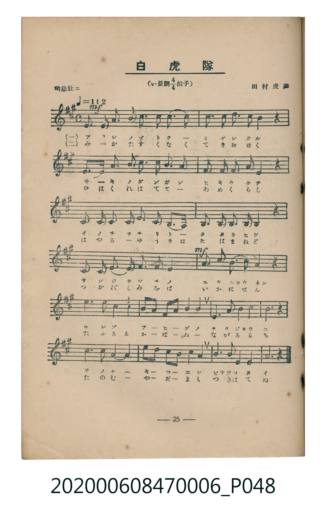
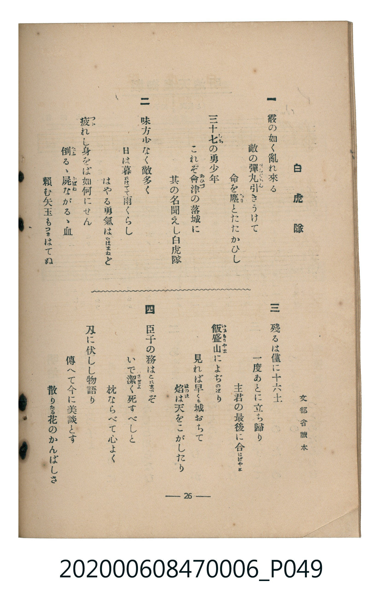

# 白虎隊

<audio controls src="byakkotai.mp3"></audio>

- 詞：文部省讀本
- 曲：田村虎藏
- 臺灣教育會公認《新定兒童唱歌》尋常科第六學年用（2020.006.0847.0006）

## 說明

原書資訊與歌詞全文（對應 P048.jpg–P049.jpg，書頁 pp. 25–26，第二學期第 9 首）：
調性與拍號：い長調四分之四拍子（A 大調 4/4 拍），「稍悲壯ニ」（♩=112）

## 歌詞

```text
一、
霰の如く亂れ來る
敵の彈丸（だんぐわん）引きうけて
命を塵（ちり）とたたかひし
三十七（しち）の勇少年
これぞ會津（あいづ）の落城に
其の名聞えし白虎隊

二、
味方少なく敵多く
日は暮れはてて雨くらし
はやる勇氣はたゆまねど
疲（つか）れし身をば如何にせん
倒（たふ）るゝ屍（かばね）ながるゝ血
頼む矢玉もつきはてぬ

三、
殘るは僅に十六士
一度あとに立ち歸り
主君の最後に合はばやと
飯盛山（いひもりやま）によぢのぼり
見れば早くも城おちて
焔（ほのほ）は天をこがしたり

四、
臣子の務はこれまでぞ
いで潔（いさぎよ）く死すべしと
枕ならべて心よく
刃に伏しし物語り
傳へて今に美談とす
散りたる花のかんばしさ
```

## 原書掃描頁





## 分析

```text
================================================================================
📊 TMD Song Profile: [ 白虎隊 ]
================================================================================
⏱  Duration:       0:25 (25.7s), 12 measures total
🎼 Key & Tempo:    首調基準 A, != 112.0 BPM, <4/4>
   - 分析範圍：      由實際發聲的音符與和弦推測調性；播放脈絡另行呈現
🎤 人聲音域:    A4 (MIDI 69) – E6 (MIDI 88) [跨度: 19 個半音 / 1.6 個八度, 難度: challenging]
   - 最低音:  A4 in [Byakkotai #1 @ m.5, 0:08]
   - 最高音: E6 in [Byakkotai #1 @ m.11, 0:21]
🏛  結構:      Byakkotai (25.7s)
⚡ 編曲密度:        Peak 1 軌道同時演奏
🗝  調性診斷：       A 大調（純淨自然大調，未偵測到可信轉調）
   - 風格氣質:    純淨自然大調（陽光明朗、易唱易記，無明顯調外色彩）
   - 轉調歷程:    全曲維持單一推測調性（未偵測到可信轉調）
   - 核心骨幹音:  E, A, C#, F#, B
   - 調性數值:    A 大調 [相關度: 0.80, 穩定度: Moderate, 自然音純度: 100.0%]
   - 候選調性 (K-S): A 大調 (0.80), E 大調 (0.73), F# 小調 (0.69)
   - 五度圈歷程:   +3
   - 各段落調性細節:
     • [Byakkotai #1]: A 大調 (r: 0.80, 自然音純度: 100.0%)

  [ 五度圈游移軌跡 ]
               C  
         F            G  
      Bb               D  
      Eb              [A ]*
         Ab           E  
            Db       B  
               F# 
     (* = active key center)

  [ 十二半音累積音高分佈 ]
     C  :                            0.0%
     C# : ██████████████████████    20.0%
     D  :                            0.0%
     D# :                            0.0%
     E  : ████████████████████████  21.8%
     F  :                            0.0%
     F# : █████████████████████     18.8%
     G  :                            0.0%
     G# :                            0.0%
     A  : ████████████████████████  21.8%
     A# :                            0.0%
     B  : ███████████████████       17.6%
--------------------------------------------------------------------------------
Assignment 軌道音域：
  - Piano         : A4 – E6 (19 個半音 / 1.6 個八度, 77 個音符)
================================================================================
```

## ABC

```abc
X:1
T:白虎隊
C:曲：田村虎藏
M:4/4
L:1/16
Q:1/4=112
K:A

V:V1 name="Piano" snm="Pia"

[V:V1]
!mf! e3 f e2 c2 f3 a f2 e2 | c4 f3 f e2 e2 z4 | a3 b a2 f2 e3 f e2 c2 | b2 c2 e3 c b4 z4 |
a3 b c2 e2 f3 e c2 a2 | b3 c b2 a2 b4 z4 | a3 b c2 c2 e3 f e2 c2 | !mf! f3 e f2 a2 b4 z4 |
c'3 b a2 z2 f3 a f2 e2 | c2 e2 a3 b c'6 z2 | e'3 c' b2 a2 f3 a f2 e2 | a3 a b3 b a6 z2 |
```

- [主旋律 TMD 檔案](byakkotai.tmd)
- [鋼琴伴奏 TMD 檔案](byakkotai_piano.tmd)
