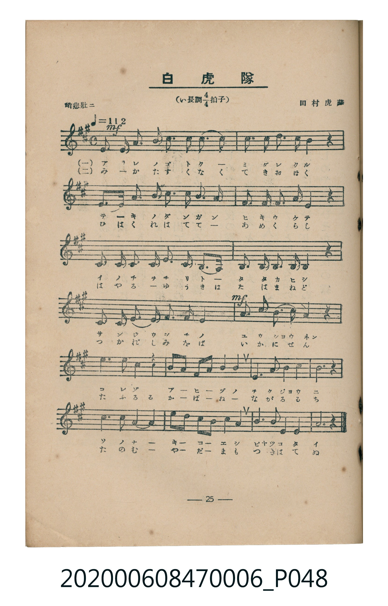
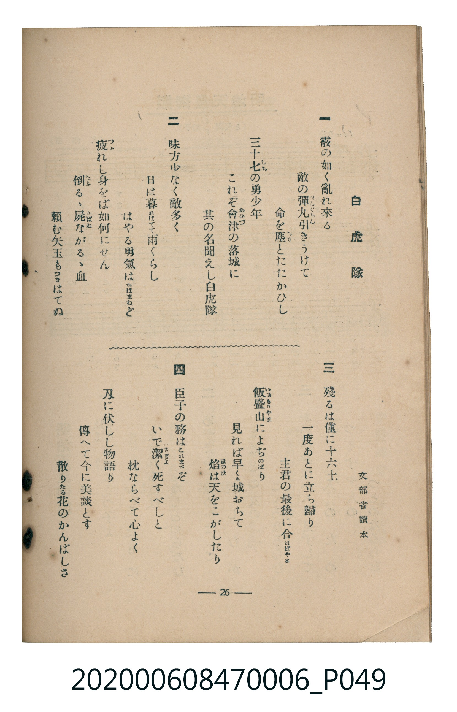

# 白虎隊

> Re:Shōka 使用 AI 協助辨識與重建樂譜，可能會有錯誤。歡迎回報。

<audio controls src="byakkotai.mp3"></audio>

- 詞：文部省讀本
- 曲：田村虎藏
- 臺灣教育會公認《新定兒童唱歌》尋常科第六學年用（2020.006.0847.0006）

## 說明

原書資訊與歌詞全文（對應 P048.jpg–P049.jpg，書頁 pp. 25–26，第二學期第 9 首）：
調性與拍號：い長調四分之四拍子（A 大調 4/4 拍），「稍悲壯ニ」（♩=112）


## 歌詞

```text
一、
霰の如く亂れ來る
敵の彈丸（だんぐわん）引きうけて
命を塵（ちり）とたたかひし
三十七（しち）の勇少年
これぞ會津（あいづ）の落城に
其の名聞えし白虎隊

二、
味方少なく敵多く
日は暮れはてて雨くらし
はやる勇氣はたゆまねど
疲（つか）れし身をば如何にせん
倒（たふ）るゝ屍（かばね）ながるゝ血
頼む矢玉もつきはてぬ

三、
殘るは僅に十六士
一度あとに立ち歸り
主君の最後に合はばやと
飯盛山（いひもりやま）によぢのぼり
見れば早くも城おちて
焔（ほのほ）は天をこがしたり

四、
臣子の務はこれまでぞ
いで潔（いさぎよ）く死すべしと
枕ならべて心よく
刃に伏しし物語り
傳へて今に美談とす
散りたる花のかんばしさ
```

## ABC

```abc
X:1
T:白虎隊
C:曲：田村虎藏
M:4/4
L:1/16
Q:1/4=112
K:A
V:V1 name="Piano" snm="Pia"
[V:V1]
!mf! e3 f e2 c2 f3 a f2 e2 | c4 f3 f e2 e2 z4 | a3 b a2 f2 e3 f e2 c2 | B2 c2 e3 c B4 z4 |
w: 1.~あ ら れ の ご と く _ | み だ れ く る | て _ き の だ ん ぐわ ん | ひ き う け て
w: 2.~み _ か た す く な く | て き お ほ く | ひ は く れ は て て _ | あ め く ら し
w: 3.~の こ る は わ づ か に | じ ふ ろ く し | い ち ど あ と に _ _ | た ち か へ り
w: 4.~し ん し の つ と め は | こ れ ま で ぞ | い で い さ ぎ よ く _ | し す べ し と
A3 B c2 e2 f3 e c2 A2 | B3 c B2 A2 B4 z4 | A3 B c2 c2 e3 f e2 c2 | !mf! f3 e f2 a2 b4 z4 |
w: 1.~い の ち を ち り と _ | た た か ひ し | さ ん じ う し ち の _ | ゆ う しよ う ねん
w: 2.~は や る _ ゆ う き は | た ゆ ま ね ど | つ か れ し み を ば _ | い か に せ ん
w: 3.~しゆ く ん の さ い ご に | あ は ば や と | い ひ も り や ま に _ | よ ぢ の ぼ り
w: 4.~ま く ら _ な ら べ て | こ こ ろ よ く | や い ば に ふ し し _ | も の が た り
c'3 b a2 z2 f3 a f2 e2 | c2 e2 a3 b c'6 z2 | e'3 c' b2 a2 f3 a f2 e2 | a3 a b3 b a6 z2 |
w: 1.~こ れ ぞ あ ひ _ づ | の ら く じよう に | そ の な _ き こ _ え | し びやつ こ た い
w: 2.~た ふ る か ば _ ね | な が る る ち | た の む _ や だ _ ま | も つ き は てぬ
w: 3.~み れ ば は や _ く | も し ろ おち て | ほ の ほ は て ん _ を | こ が し た り
w: 4.~つ た へ い ま _ に | び だ ん と す | ち り た る は な _ の | か ん ば し さ
```

## TMD 檔案連結

- [主旋律 TMD 檔案](byakkotai.tmd) [[在 TMD Studio 編輯](https://tmdlang.github.io/Tmd-TS/#tmd=s7IKdvYPcrWy4qpTUCpJTLdSSM7PyUlNLsnMz7MqzsjMK0nNjM_KTMmPL87Iz05Ugisry88pzU21Si9KTEmNN4s3MjAyiDcwMIs3sDAxBzIMzBBKi_NLi5JTrYqTM_Lzc-JLUitKkvLzsxHyBUX5Zal5iXlANQVFIBtTwIoQClLLMlNSQdKpKZkl-UWZiTlI7kgtKga7FWxJfElRYl5xclFmAcgDCFUlGalAx-Zm5mSWJBZVKnFpaSk8n7n3xcy-l7O6FLS0uBRtFQwNjbjsbRUcuWxM9E3sQDpfrJz3fs-sZ9PaXzaveD6n8cW6hmdz1oDNfDZ7E1Dm-ZQNz-ZOBBryYno_WPhF-67njYufTZ35omnTsznNT1vXvFjV-7ih69m0DU_XzXraOun56qVPp2x8trbncUP30w3dT3fseL584vM1a562rn26dsfTnVueT1nxfk8HKDD1gEGoBwpMIMPA7P2eTiUuLn0tBVtqAS4FBYWnffOfzd7xYnP7ixVdLzrage4Cevlp6wqgl4GueLqh91l7p0KAgYmFXlZB-qOGyUCmJYj5fk8PUN_LBY0KBQV6CkamQCkjoBN7gD55sqsH6JNnc-YD2QqWCi-XTQM6HRhWIOterNr_rGE5yKLu3hcz5wNFHze2vJy6HSj-dPbspx1tT3Z2AxlA2adrJwAd4KjwdMlyoKQCMEIUgKJgk4BB1_N8Re-zpk1PF69_3Nz9uAEo3vFo5kpbYAQCVXCBbHqyo-FxQyOI9XLOhseN654ua3rc2P9kV9Pjpp4n-9oeN3WD5J5N3QqS29vxZMcOoBmPGxc8bpr8uHHC46Z-IANo1tM9Ux839j5ubHvcOPFx4zJwkE3c-7hp0tOFW8EaFj5u6gKqe9y44nHjfDDqfty46XHjdIgjOp_2Nj7Z0QxWOh2oGqx03dPu9qcbJgIjG6ToceNkoJseN84DppdnW5aClQLd2vK4EcgGqX4xYe_T-X2PG1eDbW_dBjJgQu-LxnmPG0GmwlMxxN-7gMED9vfTiZufTdsJtOdx4yqg14FefboEGNz9YH9PX_q4cf2zWevANq8H-gyIXs4G-gHob6CdYNeDJJpagCEFdO6zDYvB6uY_bgIGxb7HjWsfN64EKXo-DZgPgM5YAvQ4yLkg86a_2LUaGESPGzcAQ_3JXmAIrn7cOBsYoGBnNUwCawCGFDAEgRq6HzfNfboRFIXgsANG1lqwv4GO7oHIvljYAI7IBXseNzU8n7_oeR9QGzCIgHYCowbi-jXQWO-E-v7ZuhkgzY3rnza3Au0HRgMohy0GhyEwbTzdBdQDNALo49XPVwPVLXy2dgcwKiHSu59OmA0M5WdzGp7uA_pn9dMJQLcB7dkACo_GFWDHLF7_HJhiN24EuxsougnkpKYusIp9YA8AwwAotQho0ONGoMvBZr9YBvQQ0MgNz6avBAd2Ezhqu0AJCZK8nrdMARu5G6xvN9ik9U-XrAQHKDBtgsIXHA-Q-AbmFqiPX7QvBmYacOqaCXYtJFkB42o5MHFBIhTotuXP9kIsALKBMdMHdCTYjv5na4FWAnXuBFsA9uSzeUAVq8ApAii67On-ZrCXwEnoaUcz0ItP9vSDlU9_3rnyxap5UF8-bdr8uHEHUMeT3UCfrX6-r-_F6nZwYM-E5LrFoJACeaL7RddGsEeBwQL0HDDygYZNBSmivHyDAgUtfS4up8rE7Oz8ksRMq4DMxLx8hxqDmmqQLQo2hmZadmAWtqJVAVSe7Wh4sbBHQQNWCmpiUQa0AmREjUJ1blqtgqmCLhCagWljMAvEN4wDM0CCNWBhiCKEUhA2gIrXgM3zMawBRloTWAQYC0DcA2I1rgOTUyDijSuAuB-mD8jeD2UDSzOozh6oCmB4A8l4VDuMUPWAVACjBkzOhIr1A_EqKAtixzK4-l4o3QXEu-Fq0OwwBukBuRokPxnqDmAiBbsJ4nZgcQe3fTXUlhlwW7ZCfdIL80njdExbTEB6QOIglUBbwGxYaC1BhFZTI9x2kI7JMFvAoQuS2QfEy8GseSi24E8nu3qITyfAxAAy0igOwoIlDORUU6NgBGVBZIzBfBDElkhQIwTmaVgCAAUGqFKDciD-3oSkvA2qeSKSUdjSCUgPJOxgKQqSIkFhCaKXIemHpV1YeEPjGZSOobGEPZ20QM1aCMQrwSywKcCYg4iDUgfCBkhKXQgmQakHRO8A2tKF3QZwGoHZsBzKBhY5YLIP6sIOuGshdkDSESg3AAtCqN7pcBcRn0J2dJKQQsAmGsETAKSkMAXzQXKQ5AFLFiARfMkD5uN1sLBqmgQPNxAPlHthvoGFKqQcgOVJSGrBEW_gtAFNA00t0PwN4cFSVhs8rcHyHdQOoApQjgPJrAWToDjHlTamIwwEFkrgpAxL66AoBNFA68FFI6IYgRag4ES7AepERILCnkRADoLZ0gnzDLgQhCVhUEKAJHZEIQIp3MDeBCYiRKInOokAq3PykgiinEAuQcDVESzlgGhwaQMsdXCnFGgwgosMUPkLKRvg5So4V0JKcrDHUeIXGDsQX0O0rIVEEK70AiuRu-GlCCSfQeoiUAqFRBcsTcLSMFA9OGqBbUqoS3GnF5ieTUB1kLIIVC5AEgBIHFTSw8oTkG9AzgeJL4Inqz1wXTiSCtwsUMIDJy-o66B1FrikgOUbkHpYcgTlRYi_wWUYFjsI1DdTiE8qxqj1DSjicbRKQCxE7QTVh0guyEkFmubBzQtYRYnIbbCqYinE25DgBOcleFXQCGyjA9uToKSDKNQh5iAnFFhhtBXWcIA2H2DFPSSRQIoPkHpIUwUctNCCCETDCjsMO8AJBZboQH4BmQfxC6JIg9gAbf5AkhIkuYJzO4gHasNDCwQsloALFViKB5WqO8AskGpEKoUVOrCCazOYB6rEYakc0tqDtMuQ7cBfqLSuJT6lmEJiHBjx4GIC3jxBSyrQJAKkoKUJLGnhSixzoe4HpXpIMQriwQIP5jtQ_kNqxTVuBvenliCpAIUdJLzwJxagPU0NMHvgEQhtEIFDGjkvgmyAuQVUTYB6lNgtAacWUEMX5hlIoxfclIVGPjyywJUscu0ASl0wrwE9As_y2BILctUMKSAQjWYQDa2LwPkKpB6W0kEFNyxHgIoeSIGObEctF5eunQK8S6QA5ChzAQA)]
- [鋼琴伴奏 TMD 檔案](byakkotai_piano.tmd) [[在 TMD Studio 編輯](https://tmdlang.github.io/Tmd-TS/#tmd=s7IKdvYPcrWy4tLSUng-c--LmX0vZ3W939PxsnvP8wlbnuzZ8nRp__POjvd7OhW0tLgUbRUMDY247G0VHLlsTPRN7LjqFJRerJz3fs-sZ9PaXzaveD6n8cW6hmdz1iiBZJ7N3gSUeT5lw7O5E4Emv5jeDxZ-0b7reePiZ1Nnvmja9GxO89PWNS9W9T5u6Ho2bcPTdbOetk56vnrp0ykbn63tedzQ_XRD99MdO54vn_h8zZqnrWufrt3xdOeW51NWAN1oZGBkoGdgYKZnYGFiDmQYmAGdqcTF5VSZmJ2dX5KYaRWQmZiXH-ThUGNQU82lAAQ2hmZadmCWvpaCLTpQANrxZEfDi4U9ChoBBiYWelkF6ZpYlGnpg42oUajOTatVMFXQBUIzMG0MZoH4hnFgBkiwBiwMUYRQCsIGUPEasHk-hjUKjxubwCKPmzqBuAfEalwHJqdAxBtXAHE_TB-QvR_Kfty4AKqzB6ricVM3kIxHtcMIVQ9IxePG-WByJlSsH4hXQVkQO5bB1fdC6S4g3g1Xg2aHMUgPyNUg-clQdzxuXA92E8TtjxuXwm1fDbVlBtyWrVCf9MJ80jgd0xYTkB6QOEgl0BYwGxZaSxCh1dQItx2kYzLMFnDogmT2AfFyMGseii3408muHuLTCTAxgIw0ioOwYAkDOdXUKBhBWRAZYzAfBLElEtQIgXkalgBAgTEBEtIgDsTfm5CUt0E1T0QyCls6AemBhB0sRUFSJCgsQfQyJP2wtAsLb2g8g9IxNJawp5MWqFkLgXglmAU2BRhzEHFQ6kDYAEmpC8EkKPWA6B1AW7qw2wBOIzAblkPZjxungsk-qAs74K6F2AFJR6Dc8LhxJ1TvdLiLiE8hOzpJSCFgE43gCQBSUpiC-SA5SPKAJQuQCL7kAfPxOlhYNU2ChxuIB8q9MN_AQhVSDsDyJCS14Ig3cNqApoGmFmj-hvBgKasNntZg-Q5qB1AFKMeBZNaCSVCc40ob0xEGAgslcFKGpXVQFIJooPXgohFRjEALUHCi3QB1IiJBYU8iIAfBbOmEeQZcCMKSMCghQBI7ohCBFG5gbwITESLRE51Ens6eTV4SQZQTyCUIuDqCpRwQDS5tgKUO7pQCDUZwkQEqfyFlA7xcBedKSEkO9jhK_AJjB-JriJa1kAjClV5gJXI3vBSB5DNIXQRKoZDogqVJWBoGqgdH7ePG2VCX4k4vMD2bgOogZRGoXIAkAJA4qKSHlScg34CcDxJfBE9We-C6cCQVuFmghAdOXlDXQesscEkByzcg9bDkCMqLEH-DyzAsdhCob6YQn1SMUesbUMTjaJWAWIjaCaoPkVyQkwo0zYObF7CKEpHbYFXFUoi3IcEJzkvwqqBxBjDEIUkHUahDzEFOKLDCaCus4QBtPsCKe0gigRQfIPWQpgo4aKEFEYiGFXYYdoATCizRgfwCMg_iF0SRBrEB2vyBJCVIcgXndhCvC5I3YLUfmiXgQgWW4kGl6g4wC6QakUphhQ6s4NoM5oEqcVgqh7T2IO0yZDvwFyqta4lPKaaQGAdGPLiYgDdP0JIKNIkAKWhpAktauBLLXKj7QakeUoyCeLDAg_kOlP-QWnGNm4FhDwo3hApQ2EHCC39iAdrT1ACzBx6B0AYROKSR8yLIBphbQNXEsseNa7BbAk4toIYuzDOQRi-4KQuNfHhkgStZ5NoBlLpgXgN6BJ7lsSUW5KoZUkAgGs0gGloXgfMVSD0spYMKbliOABU9kAId2Y5ajB6RD3KPyATaIYJWH4bxCtGGsQomEAoY80CGSSyIMoC6twYsCRGDqDGNh7BANEIVukl4VcHNAjsCaoEpPuMQGvGrMY2HKwKGhK6dAjwwon2AilAFjNAFjNEFgM4CCihzAQA)]

## 分析

```text
================================================================================
📊 TMD Song Profile: [ 白虎隊 ]
================================================================================
⏱  Duration:       0:25 (25.7s), 12 measures total
🎼 Key & Tempo:    首調基準 A, != 112.0 BPM, <4/4>
   - 分析範圍：      由實際發聲的音符與和弦推測調性；播放脈絡另行呈現
🎤 人聲音域:    A4 (MIDI 69) – E6 (MIDI 88) [跨度: 19 個半音 / 1.6 個八度, 難度: challenging]
   - 最低音:  A4 in [Byakkotai #1 @ m.5, 0:08]
   - 最高音: E6 in [Byakkotai #1 @ m.11, 0:21]
🏛  結構:      Byakkotai (25.7s)
⚡ 編曲密度:        Peak 1 軌道同時演奏
🗝  調性診斷：       A 大調（純淨自然大調，未偵測到可信轉調）
   - 風格氣質:    純淨自然大調（陽光明朗、易唱易記，無明顯調外色彩）
   - 轉調歷程:    全曲維持單一推測調性（未偵測到可信轉調）
   - 核心骨幹音:  E, A, C#, F#, B
   - 調性數值:    A 大調 [相關度: 0.80, 穩定度: Moderate, 自然音純度: 100.0%]
   - 候選調性 (K-S): A 大調 (0.80), E 大調 (0.73), F# 小調 (0.69)
   - 五度圈歷程:   +3
   - 各段落調性細節:
     • [Byakkotai #1]: A 大調 (r: 0.80, 自然音純度: 100.0%)

  [ 五度圈游移軌跡 ]
               C  
         F            G  
      Bb               D  
      Eb              [A ]*
         Ab           E  
            Db       B  
               F# 
     (* = active key center)

  [ 十二半音累積音高分佈 ]
     C  :                            0.0%
     C# : ██████████████████████    20.0%
     D  :                            0.0%
     D# :                            0.0%
     E  : ████████████████████████  21.8%
     F  :                            0.0%
     F# : █████████████████████     18.8%
     G  :                            0.0%
     G# :                            0.0%
     A  : ████████████████████████  21.8%
     A# :                            0.0%
     B  : ███████████████████       17.6%
--------------------------------------------------------------------------------
Assignment 軌道音域：
  - Piano         : A4 – E6 (19 個半音 / 1.6 個八度, 77 個音符)
================================================================================
```


## 原書掃描頁






