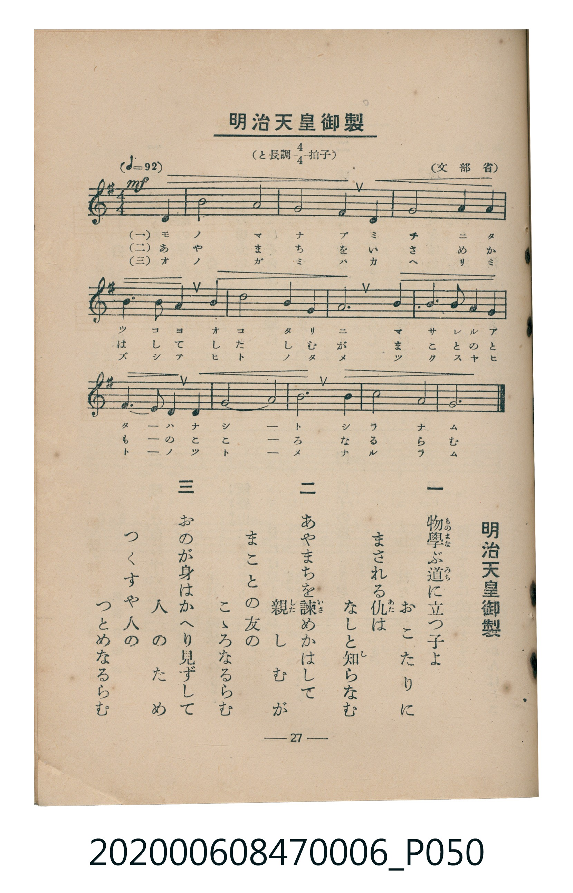

# 明治天皇御製

> Re:Shōka 使用 AI 協助辨識與重建樂譜，可能會有錯誤。歡迎回報。

<audio controls src="meiji_tenno_gyosei.mp3"></audio>

- 文部省
- 臺灣教育會公認《新定兒童唱歌》尋常科第六學年用（2020.006.0847.0006）

## 說明

原書資訊與歌詞全文（對應 P050.jpg，書頁 p. 27，第二學期第 10 首）：
調性與拍號：と長調四分之四拍子（G 大調 4/4 拍，弱起 1 拍），♩=92


## 歌詞

```text
一、
物學（ものまな）ぶ道（みち）に立つ子よ
おこたりにまされる仇（あた）は
なしと知（し）らなむ

二、
あやまちを諫（いさ）めかはして
親（した）しむがまことの友の
こゝろなるらむ

三、
おのが身はかへり見ずして
人のためつくすや人の
つとめなるらむ
```

## ABC

```abc
X:1
T:明治天皇御製
M:4/4
L:1/16
Q:1/4=92
K:G
V:V1 name="Piano" snm="Pia"
[V:V1]
!mf! z4 z4 z4 D4 | B8 A8 | G8 F4 D4 | G8 A4 A4 |
w: 1.~モ | ノ マ | ナ ブ ミ | チ ニ タ
w: 2.~あ | や ま | ち を い | さ め か
w: 3.~オ | ノ ガ | ミ ハ カ | ヘ リ ミ
B6 B2 A4 B4 | d8 B4 G4 | A12 B4 | B6 B2 A4 G4 |
w: 1.~ツ コ ヨ オ | コ タ リ | ニ マ | サ レ ル ア
w: 2.~は し て し | た し む | が ま | こ と の と
w: 3.~ズ シ テ ヒ | ト ノ タ | メ ツ | ク ス ヤ ヒ
F6 E2 D4 D4 | G8 A8 | B12 B4 | c8 A8 |
w: 1.~タ ー ハ ナ | シ ー | ト シ | ラ ナ
w: 2.~も ー の こ | こ ー | ろ な | る ら
w: 3.~ト ー ノ ツ | ト ー | メ ナ | ル ラ
G12 z4 |
w: 1.~ム
w: 2.~む
w: 3.~ム
```

## TMD 檔案連結

- [主旋律 TMD 檔案](meiji_tenno_gyosei.tmd) [[在 TMD Studio 編輯](https://tmdlang.github.io/Tmd-TS/#tmd=s7IKdvYPcrWy4qpTUCpJTLdSSM7PyUlNLsnMz7MqzsjMK0nNjM_KTMmPL87Iz05Ugisry88pzU21Si9KTEmNN4s3MjAyiDcwMIs3sDAxBzIMzBBKi_NLi5JTrYqTM_Lzc-JLUitKkvLzs9Hl4wsS01OtAgxMDRAyBUX5Zal5iXlA3QVFILekgLUjFKSWZaakgqSLkxPz4stSizLTMlNTkFyZWlQM9gnEipKixLzi5KLMApD3EKryi0oy8oE-KciotMrILC7JL8pMTsyJz07MQ_JwSUYq0L8Q6Up04czcAqDdiTnIZmamZ-ZZ5ebnJZUCgw5DoiQxsxzo5Py0tMxksEYtLYVnM_qebdr9dMnK57Pan-5b-GLxXgUtLS5FWwVLIy57WwV3LhsTfRM7kEnPprW_bF7xfE4j2NwX7bueNy5-NnXmi6ZNz-Y0P21d82JV7-OGrmfTNjxdN-tp66Tnq5c-nbLx2dqexw3dTzd0P92x4_nyic_XrHnauvbp2h1Pd255PmXF-z0doEjUA0adHigSgQwDs_d7OpW4uPS1FGypBbgUFBSe9s1_NnvHi83tL1Z0vehoB7rrxcp5T1tXAH0FdMXTDb3P2jsVQClBL6sg_f2eHqDilwsaFQr0FIzMgVygw5_s6gE6_Nmc-UC2gqGBwstl04BOfb9nFsj4F6v2P2tYDjK4u_fFzPlA0ceNK15O3Q4Ufzp79tOOtic7u4EMoOzTtROAFrorPF2yHCipAAxdBaAo0Iqneza-2LpdwRDCBRrc82jmSltgNIDMf7Kj4XFDI4j1vHMl0BlAIx43NT1uXPe4cd_jxlVA9Y8bt71snAwSb9z_uHEhWGT189XdjxuXAK183NQB0vy4setx4-THjfMfNwEZq8Gapz5u6nnc1P1kNyggHjcCDQU6H6h5PUTDqseN04F-eT5_KVh6OkiuCSi96nFTA8Rpu4BRDHYaSHNTC9jQhY-bJr1YvRqsBSgyFayr8XEj0DnrwQYuA4faMqDLQYbC7JwONPRxYw_YCKAzVwA9-LQfqGcdxPjJj5vmPm7qBVveDXIFzAk7OuFOAPoLGCg9L3YBfQe0Cqh5B9CzL5YBGcA4gdn8ZNcusDpgQABdteRxY__jxplAx0PEISYBRVeApZFsA0pQnh6hQEFLn4vLNzUzKzMkNS8v370yvzg10yogMzEv36HGoKYaZJmCjYWWHZiBLUMogJLljoYXC3sUNJCTj4K2grHC0w39z9c36MATtSYW_UAXgMyuUTBQ0IXj6ty0WgXTeCCrBmiMLhgaQekaoAUQljlIAVQVTAykCoRrwKb6GNYogORh-HHzIrDqx819UPWPm-fBzX3c3AUXnQYm50PFG-Hi3SCyaT_CBiM0GxqbIHqaWmB6GvchbGhcCBNtmgSWA6kCiU-Fi4PsAiYahA3GaDY0rUL3Q9MaJD-A3Axxaz9YbjVUfAZcHKQf6jdw2sUdsbt6wBFrQlpMQmLMGBwPIHaNginUbhAPFFM18NiEiaLqAquBx-DjZkhYPm7aDGSvQA4DoAgsDEBxAvEbSAco_GAQEscg1Vuh_DVADAqXx03g9ACPSWB-hahonA7Ey6AsSAzBwxUsAsyJUPEeZJvAcQ0SnQzlrwDidVAWcow-btoFdfd2oFvawK4CpQiQ2zvg7gbFMDS1AXmwtAORg6acJqiLm3YCxZYgzCEQszs6wTFrSlrMgnOcroJZPCTbYcl7kFQIy7OI2DXBUAPTBYKgPI8U32Afg3yyB5aKwTkTJLMd7v89cJMQIQYLUYjoSrhaWL4GiS5AUgt2PyL2m0B5F2ovNNZA8YiITzR7m3qR7W2EpUlY2gMW2EhqQekFi72gtAB1P8S_4DiHxS5SWkD2L2pKgIYNOEVDRGA-x-7fWi4uXTsF9GJfASimzAUA)]
- [鋼琴伴奏 TMD 檔案](meiji_tenno_gyosei_piano.tmd) [[在 TMD Studio 編輯](https://tmdlang.github.io/Tmd-TS/#tmd=s7IKdvYPcrWy4tLSUng2o-_Zpt1Pl6x8Pqv96b6FLxbvfb-n42X3nucTtjzZs-Xp0v7nnR3v93QqaGlxKdoqWBpx2dsquHPZmOib2HHVKSg9m9b-snnF8zmNSiDei_ZdzxsXP5s680XTpmdzmp-2rnmxqvdxQ9ezaRuerpv1tHXS89VLn07Z-Gxtz-OG7qcbup_u2PF8-cTna9Y8bV37dO2Opzu3PJ-yAmi_kYGRgZ6BgZmegYWJOZBhYAZ0ghIXl2deSVG-VUBmYl5-kIdDjUFNNZcCENhYaNmBGTUK1bkFtQqGCrpgaASlaxSMoSwQBLFrFEww1MB0gaABSISrFsVGH2QbTdBsjFeINoxVMI0H0qbxsSDTICJQCmgfkGGCQ4UBxC7f1MyszJDUvLx898r84tRMPB7V11KwRQcKwHB8sqPhxcIeBY0AA1MDvayCdE0syrT0oS4HeRKGq3PTaoGOQwkszKAxBymAqkIOZBCuAZvqY1ijAJKH4cfNi8CqHzf3QdU_bp4HN_dxcxdcdBqYnA8Vb4SLd4PIpv0IG4zQbGhsguhpaoHpadyHsKFxIUy0aRJYDqQKJD4VLg6y63EjyB6oDcZoNjStQvdD0xokP4DcDHFrP1huNVR8BlwcpB_qNy788berh_j4g8STMTj0IYnaFGojiAeKnxp4HCISPrIusBp4vD1uhoTg46bNQPYKZJ8DRWA-B8UExEcgHaBQg0FIzIJUb4Xy1wAxKDQeN4FTATz-Hjeuh6honA7Ey6AsSLzAQxMs8ripASreg2wTOIZBopOh_BVAvA7KQo7Hx027oO7eDnRLG9hVoHQAcnsH3N2geIWmMSAPlmIgctD00gR1cdNOoNgShDkE4nNHJ_HxCc5dugpm8ZAshiWfQVIceYUZPJbB_gS5fw8sxYJzIUhmO9zXe-AmIcIJFo4Q0ZVwtbA8DBJdgKQW7H5EnDeB8inUXmhcgWIPEYto9jb1ItvbCEuJsBT3uKkTSS0olWCxF5QCoO6H-Bcc07A4RUoByP5FjX9o2IDTMUQE5nPs_sVZkOOoPwzAEFQvwKsEzEoCnwjUHGRxcI2DXgPBdWAogQtAjUJVScAhpNRwunYK4ApVAchAD6RoH6BSrOJGOMSNweLKXAA)]

## 分析

```text
================================================================================
📊 TMD Song Profile: [ 明治天皇御製 ]
================================================================================
⏱  Duration:       0:33 (33.9s), 13 measures total
🎼 Key & Tempo:    首調基準 G, != 92.0 BPM, <4/4>
   - 分析範圍：      由實際發聲的音符與和弦推測調性；播放脈絡另行呈現
🎤 人聲音域:    D4 (MIDI 62) – D5 (MIDI 74) [跨度: 12 個半音 / 1.0 個八度, 難度: easy]
   - 最低音:  D4 in [MeijiTennoGyosei #1 @ m.1, 0:01]
   - 最高音: D5 in [MeijiTennoGyosei #1 @ m.6, 0:13]
   - 適合: soprano, mezzo-soprano, contralto, tenor, baritone, bass
🏛  結構:      MeijiTennoGyosei (33.9s)
⚡ 編曲密度:        Peak 1 軌道同時演奏
🗝  調性診斷：       G 大調（純淨自然大調，未偵測到可信轉調）
   - 風格氣質:    純淨自然大調（陽光明朗、易唱易記，無明顯調外色彩）
   - 轉調歷程:    全曲維持單一推測調性（未偵測到可信轉調）
   - 核心骨幹音:  A, B, G, D, F#
   - 調性數值:    G 大調 [相關度: 0.69, 穩定度: Moderate, 自然音純度: 100.0%]
   - 候選調性 (K-S): G 大調 (0.69), D 大調 (0.62), B 小調 (0.60)
   - 五度圈歷程:   +1
   - 各段落調性細節:
     • [MeijiTennoGyosei #1]: G 大調 (r: 0.69, 自然音純度: 100.0%)

  [ 五度圈游移軌跡 ]
               C  
         F           [G ]*
      Bb               D  
      Eb               A  
         Ab           E  
            Db       B  
               F# 
     (* = active key center)

  [ 十二半音累積音高分佈 ]
     C  : ████                       4.2%
     C# :                            0.0%
     D  : ███████████               12.5%
     D# :                            0.0%
     E  : █                          1.0%
     F  :                            0.0%
     F# : █████                      5.2%
     G  : ████████████████████      22.9%
     G# :                            0.0%
     A  : ████████████████████████  27.1%
     A# :                            0.0%
     B  : ████████████████████████  27.1%
--------------------------------------------------------------------------------
Assignment 軌道音域：
  - Piano         : D4 – D5 (12 個半音 / 1.0 個八度, 33 個音符)
================================================================================
```


## 原書掃描頁




