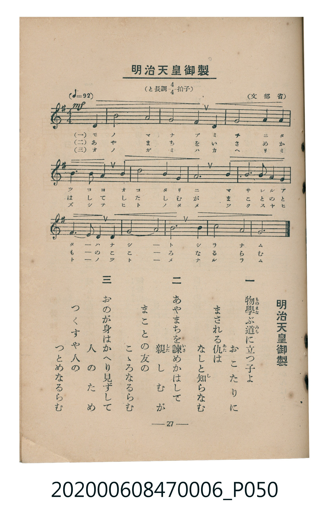

# 明治天皇御製

> Re:Shōka 使用 AI 協助辨識與重建樂譜，可能會有錯誤。歡迎[回報](https://github.com/TMDLang/reshoka/issues)。

- **鋼琴伴奏版**：<br><audio controls src="meiji_tenno_gyosei.mp3"></audio>
- **NEUTRINO 歌聲合成版**：<br><audio controls src="meiji_tenno_gyosei_neutrino.mp3"></audio>

- 文部省
- 臺灣教育會公認《新定兒童唱歌》尋常科第六學年用（2020.006.0847.0006）

## 說明

原書資訊與歌詞全文（對應 P050.jpg，書頁 p. 27，第二學期第 10 首）：
調性與拍號：と長調四分之四拍子（G 大調 4/4 拍，弱起 1 拍），♩=92


## 歌詞

```text
一、
物學（ものまな）ぶ道（みち）に立つ子よ
おこたりにまされる仇（あた）は
なしと知（し）らなむ

二、
あやまちを諫（いさ）めかはして
親（した）しむがまことの友の
こゝろなるらむ

三、
おのが身はかへり見ずして
人のためつくすや人の
つとめなるらむ
```

## ABC

<div class="abc-score" data-abc-src="meiji_tenno_gyosei.abc" aria-label="五線譜載入中"></div>

[下載 ABC 原始檔](meiji_tenno_gyosei.abc)

## TMD 檔案連結

- [主旋律 TMD 檔案](meiji_tenno_gyosei.tmd) [[在 TMD Studio 編輯](https://tmdlang.github.io/Tmd-TS/#tmd=s7IKdvYPcrWy4qpTUCpJTLdSSM7PyUlNLsnMz7MqzsjMK0nNjM_KTMmPL87Iz05Ugisry88pzU21Si9KTEmNN4s3MjAyiDcwMIs3sDAxBzIMzBBKi_NLi5JTrYqTM_Lzc-JLUitKkvLzs9Hl4wsS01OtAgxMDRAyBUX5Zal5iXlA3QVFILekgLUjFKSWZaakgqSLkxPz4stSizLTMlNTkFyZWlQM9gnEipKixLzi5KLMApD3EKryi0oy8oE-KciotMrILC7JL8pMTsyJz07MQ_JwSUYq0L8Q6Up04czcAqDdiTnIZmamZ-ZZ5ebnJZUCgw5DoiQxsxzo5Py0tMxksEYtLYVnM_qebdr9dMnK57Pan-5b-GLxXgUtLS5FWwVLIy57WwV3LhsTfRM7kEnPprW_bF7xfE4j2NwX7bueNy5-NnXmi6ZNz-Y0P21d82JV7-OGrmfTNjxdN-tp66Tnq5c-nbLx2dqexw3dTzd0P92x4_nyic_XrHnauvbp2h1Pd255PmXF-z0doEjUA0adHigSgQwDs_d7OpW4uPS1FGypBbgUFBSe9s1_NnvHi83tL1Z0vehoB7rrxcp5T1tXAH0FdMXTDb3P2jsVQClBL6sg_f2eHqDilwsaFQr0FIzMgVygw5_s6gE6_Nmc-UC2gqGBwstl04BOfb9nFsj4F6v2P2tYDjK4u_fFzPlA0ceNK15O3Q4Ufzp79tOOtic7u4EMoOzTtROAFrorPF2yHCipAAxdBaAo0Iqneza-2LpdwRDCBRrc82jmSltgNIDMf7Kj4XFDI4j1vHMl0BlAIx43NT1uXPe4cd_jxlVA9Y8bt71snAwSb9z_uHEhWGT189XdjxuXAK183NQB0vy4setx4-THjfMfNwEZq8Gapz5u6nnc1P1kNyggHjcCDQU6H6h5PUTDqseN04F-eT5_KVh6OkiuCSi96nFTA8Rpu4BRDHYaSHNTC9jQhY-bJr1YvRqsBSgyFayr8XEj0DnrwQYuA4faMqDLQYbC7JwONPRxYw_YCKAzVwA9-LQfqGcdxPjJj5vmPm7qBVveDXIFzAk7OuFOAPoLGCg9L3YBfQe0Cqh5B9CzL5YBGcA4gdn8ZNcusDpgQABdteRxY__jxplAx0PEISYBRVeApZFsA0pQnh6hQEFLn4vLNzUzKzMkNS8v370yvzg10yogMzEv36HGoKYaZJmCjYWWHZiBLUMogJLljoYXC3sUNJCTj4K2grHC0w39z9c36MATtSYW_UAXgMyuUTBQ0IXj6ty0WgXTeCCrBmiMLhgaQekaoAUQljlIAVQVTAykCoRrwKb6GNYogORh-HHzIrDqx819UPWPm-fBzX3c3AUXnQYm50PFG-Hi3SCyaT_CBiM0GxqbIHqaWmB6GvchbGhcCBNtmgSWA6kCiU-Fi4PsAiYahA3GaDY0rUL3Q9MaJD-A3Axxaz9YbjVUfAZcHKQf6jdw2sUdsbt6wBFrQlpMQmLMGBwPIHaNginUbhAPFFM18NiEiaLqAquBx-DjZkhYPm7aDGSvQA4DoAgsDEBxAvEbSAco_GAQEscg1Vuh_DVADAqXx03g9ACPSWB-hahonA7Ey6AsSAzBwxUsAsyJUPEeZJvAcQ0SnQzlrwDidVAWcow-btoFdfd2oFvawK4CpQiQ2zvg7gbFMDS1AXmwtAORg6acJqiLm3YCxZYgzCEQszs6wTFrSlrMgnOcroJZPCTbYcl7kFQIy7OI2DXBUAPTBYKgPI8U32Afg3yyB5aKwTkTJLMd7v89cJMQIQYLUYjoSrhaWL4GiS5AUgt2PyL2m0B5F2ovNNZA8YiITzR7m3qR7W2EpUlY2gMW2EhqQekFi72gtAB1P8S_4DiHxS5SWkD2L2pKgIYNOEVDRGA-x-7fWi4uXTsF9GJfASimzAUA)]
- [鋼琴伴奏 TMD 檔案](meiji_tenno_gyosei_piano.tmd) [[在 TMD Studio 編輯](https://tmdlang.github.io/Tmd-TS/#tmd=s7IKdvYPcrWy4qpTUCpJTLdSyC8qychPL0osyKi0ysgsLskvykxOzInPTsxLVIIrKs4vLUpOjS9ITE-1CjAwNVDi0tJSeDaj79mm3U-XrHw-q_3pvoUvFu99v6fjZfee5xO2PNmz5enS_uedHe_3dCpoaXEp2ipYGnHZ2yq4c9mY6JvYgQx-Nq39ZfOK53Mawda8aN_1vHHxs6kzXzRtejan-Wnrmhereh83dD2btuHpullPWyc9X7306ZSNz9b2PG7ofrqh--mOHc-XT3y-Zs3T1rVP1-54unPL8ykrgPYbGRgZ6BkYmOkZWJiYAxkGZkAnKHFxeeaVFOVbBWQm5uUHeTjUGNRUcykAgY2Flh2YUaNQnVtQq2CooAuGRlC6RsEYygJBELtGwQRDDUwXCBqARLhqUWz0QbbRBM3GeIVow1gF03ggbRofCzINIgKlgPYBGSY4VBhA7PJNzczKDEnNy8t3r8wvTs3E41F9LQVbdKAADMcnOxpeLOxR0ABFr15WQbomFmVa-lCXgzwJw9W5abVAx6EEFmbQmIMUQFUhBzII14BN9TGsUQDJw_Dj5kVg1Y-b-6DqHzfPg5v7uLkLLjoNTM6HijfCxbtBZNN-hA1GaDY0NkH0NLXA9DTuQ9jQuBAm2jQJLAdSBRKfChcH2fW4EWQP1AZjNBuaVqH7oWkNkh9Aboa4tR8stxoqPgMuDtIP9RsX_vjb1UN8_EHiyRgc-pBEbQq1EcQDxU8NPA4RCR9ZF1gNPN4eN0NC8HHTZiB7BbLPgSIwn4NiAuIjkA5QqMEgJGZBqrdC-WuAGBQaj5vAqQAef48b10NUNE4H4mVQFiRe4KEJFnnc1AAV70G2CRzDINHJUP4KIF4HZSHH4-OmXVB3bwe6pQ3sKlA6ALm9A-5uULxC0xiQB0sxEDloemmCurhpJ1BsCcIcAvG5o5P4-ATnLl0Fs3hIFsOSzyApjrzCDB7LYH-C3L8HlmLBuRAksx3u6z1wkxDhBAtHiOhKuFpYHgaJLkBSC3Y_Is6bQPkUai80rkCxh4hFNHubepHtbYSlRFiKe9zUiaQWlEqw2AtKAVD3Q_wLjmlYnCKlAGT_osY_NGzA6RgiAvM5dv_iLMhx1B8GYAiqF-BVAmYlgU8Eag6yOLjGQa-B4DowlMAFoEahqiTgEFJqOF07BXCFqgBkoAdStA9QKVZxIxzixmBxZS4A)]

## 分析

```text
================================================================================
📊 TMD Song Profile: [ 明治天皇御製 ]
================================================================================
⏱  Duration:       0:33 (33.9s), 13 measures total
🎼 Key & Tempo:    首調基準 G, != 92.0 BPM, <4/4>
   - 分析範圍：      由實際發聲的音符與和弦推測調性；播放脈絡另行呈現
🎤 人聲音域:    D4 (MIDI 62) – D5 (MIDI 74) [跨度: 12 個半音 / 1.0 個八度, 難度: easy]
   - 最低音:  D4 in [MeijiTennoGyosei #1 @ m.1, 0:01]
   - 最高音: D5 in [MeijiTennoGyosei #1 @ m.6, 0:13]
   - 適合: soprano, mezzo-soprano, contralto, tenor, baritone, bass
🏛  結構:      MeijiTennoGyosei (33.9s)
⚡ 編曲密度:        Peak 1 軌道同時演奏
🗝  調性診斷：       G 大調（純淨自然大調，未偵測到可信轉調）
   - 風格氣質:    純淨自然大調（陽光明朗、易唱易記，無明顯調外色彩）
   - 轉調歷程:    全曲維持單一推測調性（未偵測到可信轉調）
   - 核心骨幹音:  A, B, G, D, F#
   - 調性數值:    G 大調 [相關度: 0.69, 穩定度: Moderate, 自然音純度: 100.0%]
   - 候選調性 (K-S): G 大調 (0.69), D 大調 (0.62), B 小調 (0.60)
   - 五度圈歷程:   +1
   - 各段落調性細節:
     • [MeijiTennoGyosei #1]: G 大調 (r: 0.69, 自然音純度: 100.0%)

  [ 五度圈游移軌跡 ]
               C  
         F           [G ]*
      Bb               D  
      Eb               A  
         Ab           E  
            Db       B  
               F# 
     (* = active key center)

  [ 十二半音累積音高分佈 ]
     C  : ████                       4.2%
     C# :                            0.0%
     D  : ███████████               12.5%
     D# :                            0.0%
     E  : █                          1.0%
     F  :                            0.0%
     F# : █████                      5.2%
     G  : ████████████████████      22.9%
     G# :                            0.0%
     A  : ████████████████████████  27.1%
     A# :                            0.0%
     B  : ████████████████████████  27.1%
--------------------------------------------------------------------------------
Assignment 軌道音域：
  - Piano         : D4 – D5 (12 個半音 / 1.0 個八度, 33 個音符)
================================================================================
```


## 原書掃描頁




