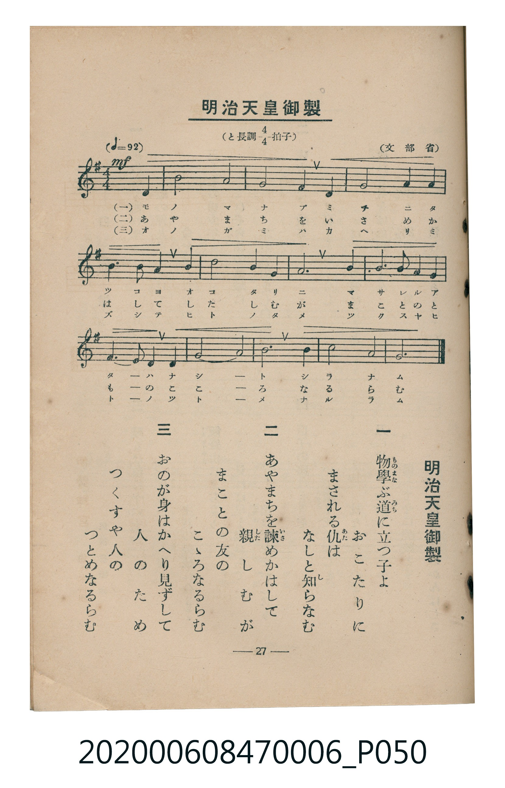

# 明治天皇御製

<audio controls src="meiji_tenno_gyosei.mp3"></audio>

- 文部省
- 臺灣教育會公認《新定兒童唱歌》尋常科第六學年用（2020.006.0847.0006）

- note

原書資訊與歌詞全文（對應 P050.jpg，書頁 p. 27，第二學期第 10 首）：
調性與拍號：と長調四分之四拍子（G 大調 4/4 拍），♩=92

## 歌詞

```text
一、
物學（ものまな）ぶ道（みち）に立つ子よ
おこたりにまされる仇（あた）は
なしと知らなむ

二、
あやまちを諫（いさ）めかはして
親（した）しむがまことの友の
こゝろなるらむ

三、
おのが身はかへり見ずして
人のためつくすや人の
つとめなるらむ
```

## 原書掃描頁



## 調性分析

```text
================================================================================
📊 TMD Song Profile: [ 明治天皇御製 ]
================================================================================
⏱  Duration:       0:31 (31.3s), 12 measures total
🎼 Key & Tempo:    首調基準 G, != 92.0 BPM, <4/4>
   - 分析範圍：      由實際發聲的音符與和弦推測調性；播放脈絡另行呈現
🎤 人聲音域:    D4 (MIDI 62) – D5 (MIDI 74) [跨度: 12 個半音 / 1.0 個八度, 難度: easy]
   - 最低音:  D4 in [MeijiTennoGyosei #1 @ m.1, 0:00]
   - 最高音: D5 in [MeijiTennoGyosei #1 @ m.6, 0:13]
   - 適合: soprano, mezzo-soprano, contralto, tenor, baritone, bass
🏛  結構:      MeijiTennoGyosei (31.3s)
⚡ 編曲密度:        Peak 1 軌道同時演奏
🗝  調性診斷：       G 大調（純淨自然大調，未偵測到可信轉調）
   - 風格氣質:    純淨自然大調（陽光明朗、易唱易記，無明顯調外色彩）
   - 轉調歷程:    全曲維持單一推測調性（未偵測到可信轉調）
   - 核心骨幹音:  G, A, D, B, E
   - 調性數值:    G 大調 [相關度: 0.81, 穩定度: Moderate, 自然音純度: 100.0%]
   - 候選調性 (K-S): G 大調 (0.81), D 大調 (0.77), E 小調 (0.60)
   - 五度圈歷程:   +1
   - 各段落調性細節:
     • [MeijiTennoGyosei #1]: G 大調 (r: 0.81, 自然音純度: 100.0%)

  [ 五度圈游移軌跡 ]
               C  
         F           [G ]*
      Bb               D  
      Eb               A  
         Ab           E  
            Db       B  
               F# 
     (* = active key center)

  [ 十二半音累積音高分佈 ]
     C  :                            0.0%
     C# :                            0.0%
     D  : █████████████████████     20.8%
     D# :                            0.0%
     E  : ██████████████            13.5%
     F  :                            0.0%
     F# : █                          1.0%
     G  : ████████████████████████  24.0%
     G# :                            0.0%
     A  : ██████████████████████    21.9%
     A# :                            0.0%
     B  : ███████████████████       18.7%
--------------------------------------------------------------------------------
Assignment 軌道音域：
  - Piano         : D4 – D5 (12 個半音 / 1.0 個八度, 33 個音符)
================================================================================
```

## ABC

```abc
X:1
T:明治天皇御製
C:TMD (Chen, Chih-Han / aguai)
M:4/4
L:1/16
Q:1/4=92
K:G

V:V1 name="Piano" snm="Pia"

[V:V1]
!mf! d8 b8 | a8 g4 e4 | d8 g8 | a8 b4 g4 |
a4 a4 b8 | d8 b4 g4 | e12 d4 | g6 a2 b4 g4 |
e6 f2 g4 d4 | b8 a8 | g4 e4 d8 | a8 g8 |
```

- [主旋律 TMD 檔案](meiji_tenno_gyosei.tmd)
- [鋼琴伴奏 TMD 檔案](meiji_tenno_gyosei_piano.tmd)
