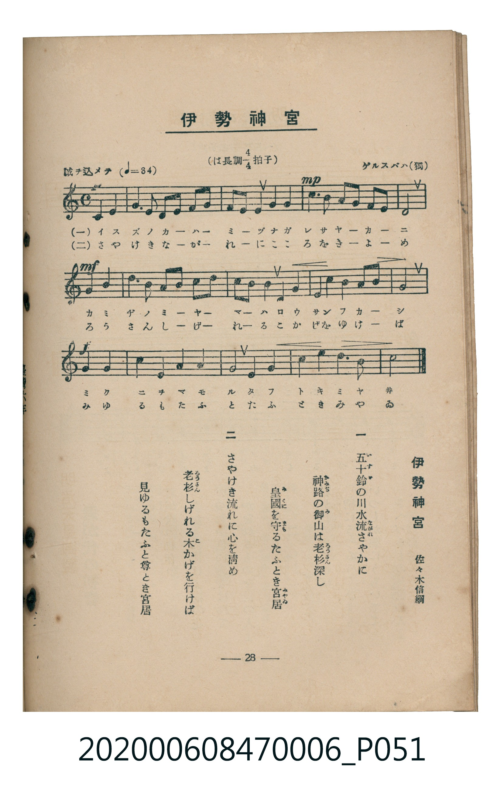

# 伊勢神宮

> Re:Shōka 使用 AI 協助辨識與重建樂譜，可能會有錯誤。歡迎回報。

<audio controls src="ise_jingu.mp3"></audio>

- 詞：佐々木の信綱
- 曲：ゲルスバハ（獨）
- 臺灣教育會公認《新定兒童唱歌》尋常科第六學年用（2020.006.0847.0006）

## 說明

原書資訊與歌詞全文（對應 P051.jpg，書頁 p. 28，第三學期第 1 首）：
調性與拍號：は長調四分之四拍子（C 大調 4/4 拍，弱起 2 拍），「誠ヲ込メテ」（♩=84）


## 歌詞

```text
一、
五十鈴（いすゞ）の川水流（なが）れさやに
神路（かみぢ）の御山（みやま）は老杉（ろうさん）深し
皇國（みくに）を守（まも）るたふとき宮居（みやゐ）

二、
さやけき流れに心を清め
老杉（ろうさん）しげれる木（こ）かげを行けば
見ゆるもたふと尊とき宮居
```

## ABC

```abc
X:1
T:伊勢神宮
C:曲：ゲルスバハ（獨）
M:4/4
L:1/16
Q:1/4=84
K:C
V:V1 name="Piano" snm="Pia"
[V:V1]
z8 E4 G4 | F6 D2 E2 F2 G2 A2 | G4 E4 A4 G2 G2 | !mp! c6 B2 A2 G2 F2 E2 |
w: 1.~い す | ず の か _ は _ | み づ な が れ | さ や _ か _ に
w: 2.~さ や | け き な _ が _ | れ に こ こ ろ | を き _ よ _ め
!mf! D8 G4 G4 | A6 A2 B2 c2 d2 B2 | G4 ^F4 G4 E2 E2 | A4 G4 ^F4 A4 |
w: 1.~_ か み | ぢ の み _ や _ | ま は ろ う さ | ん ふ か し
w: 2.~_ ろ う | さ ん し _ げ _ | れ る こ か げ | を ゆ け ば
!f! G8 c4 G4 | A4 E4 F4 D4 | E8 D4 G4 | c4 d4 e6 d2 |
w: 1.~_ み く | に を ま も | る た ふ | と き み や
w: 2.~_ み ゆ | る も た ふ | と た ふ | と き み や
c8 z8 |
w: 1.~ゐ
w: 2.~ゐ
```

## TMD 檔案連結

- [主旋律 TMD 檔案](ise_jingu.tmd) [[在 TMD Studio 編輯](https://tmdlang.github.io/Tmd-TS/#tmd=s7IKdvYPcrWy4qpTUCpJTLdSSM7PyUlNLsnMz7MqzsjMK0nNjM_KTMmPL87Iz05Ugisry88pzU21Si9KTEmNN4s3MjAyiDcwMIs3sDAxBzIMzBBKi_NLi5JTrYqTM_Lzc-JLUitKkvLzsxHyBUX5Zal5iXlANQVFIBtTwIoQClLLMlNSQdKpKZkl-UWZiTlI7kgtKga7FWxJfElRYl5xclFmAcgDCFUlGalAxxal5mSmYxEvyElMTlXi0tJSeLKn62n3oudL5z1dt05BS4tL0VbBwoTL3lbBmcvGRN_EDqTxxcp57_fMerJ3wuOG1mdzVjxuXPdk_8Ln2zaCTX02exNQ8nHTpsfNqx837XzcPOFxc__7PR3Pe1e839MJVvKifdfzxsXPps580bTp2Zzmp61rXqzqfdzQ9WzahqfrZj1tnfR89dKnUzY-W9vzuKH76Ybupzt2PF8-8fmaNU9b1z5du-Ppzi3PpwAN6wAFuR4woPVAQQ5kGJiBbeDS11KwpRbgUlBQeNo3_9nsHS82t79Y0fWiox3oLmAIPG1d8WxaO9AVTzf0PmvvVAgwMDXUyypIf7-nB6j45YJGhQI9BSMLIBfo8Cc7OoEOfzZnPpCtYKjwctk0oEuBwQQy_cWq_c8aloPM7e59MXM-KPAa17-cuh0o_nT27KcdbU92dgMZQNmnaycA7XNWeLpkOVBSARgdCkBRoA1P92x8sXW7ghGECzQYGHA9L1YteNy86cW-PY-bFz5ubnvcAJTqeDRzpa2FCVANF8jqJzsaHjc0glm7pjztbXzZsQWo5nFjy-PGmY-bgJHcCYzbp9vnPtuw5dnWRrDUqseNPSDxpp7HjVMfNwFVrgbpByaYF9vXg1V0P27c_7hxEVTzvoVPN24Ei-8Hq94HFl__oqHx2VygQzseN_U-bmwDmzUZKPVs-8bHjdPBJs5qfzqnG6qzsR9oD9jaSU_XdYAF9z1uagKLAO2b_7hx6-NGYELsBabapxtbEfY1AUMM6tddwEAB-xXm8IlA9UBvgb2y-un-ZqDhz3a0Pm4CK8LlQKDrHjdOAulp6gamfbBNEHGgO4Dik14sBBoHNHoD2JRl3Y-b2kBubGqCO_Pphi5kx4LUUZ5OoUBBS5-Ly7M41SszL73UKiAzMS_focagphpkiYKNhZYdmIEtgyiAk2kD0PkKGsjpSUFbwVjh6Yb-5-sbgEywkA48sWtiMQfoApAdNQoGCrpgaAzEpkBco2AC5hsBRUyAImZAEZA4SN4MrMYUKFKdW1CrYBgHVmkOFDcFqjVWqAGb6WNYoxAPNRWYSsHkTLDJjxtnQUXXAXE3mLUeKrMfzFsKJleByR4FYASC5aZCdDVBzILoWw2zzQjZNpBKiDqQvolQ0V4kM8EyQHMhZoDIyVASmIbAcpPgukBmdYDJRqBt-CNlVw84UogKcyOoe6tz02rBgQsJeFDwggLZHBSyRnFAGhL0JupQJcagMIbGAlQYxEEEO8RYRCCBAhUUEIuQgh0c0PAg2gePBJD3Qew2cDCCAgISMFuRzJuOsA0Y7HDb4DohZsKiCxikYB3ALIcc7E0QsyCmd4NlYcEOzIZgUVDEATMn2DYCeaGT-GAHBRo42IGhDk67iGAHpW5QugfFTA2YB8kDMDVg5cAoAaqEJHogGyoKgrBMhC0mIAm7Hxo24CQH8Ssk7JuaoGEDChWIjvnwcAfpWAHmQUIYZBYk9kA6JkB1wJI_lpiBxjY0ZiAhD7YRmy2U2l7LxaVrpwAr1xSAbGUuAA)]
- [鋼琴伴奏 TMD 檔案](ise_jingu_piano.tmd) [[在 TMD Studio 編輯](https://tmdlang.github.io/Tmd-TS/#tmd=s7IKdvYPcrWy4tLSUniyp-tp96LnS-c9Xbfu_Z6Ol917nk_Y8mTPlqdL-593drzf06mgpcWlaKtgYcJlb6vgzGVjom9ix1WnoPRi5bz3e2Y92TvhcUPrszkrHjeue7J_4fNtG5VAks9mbwJKPm7a9Lh59eOmnY-bJzxu7gca_7x3BdBIsJIX7bueNy5-NnXmi6ZNz-Y0P21d82JV7-OGrmfTNjxdN-tp66Tnq5c-nbLx2dqexw3dTzd0P92x4_nyic_XrHnauvbp2h1Pd255PgVoWIeRgZGBnoGBmZ6BhYk5kGFgBraBy7M41SszL73UKiAzMS8_yMOhxqCmmksBCGwstOzADH0tBVt0oAC04cmOhhcLexQ0AgxMDfWyCtI1sSjT0gcbUaNgoKALhsZAbArENQomYL4RUMQEKGIGFAGJg-TNwGpMgSLVuQW1CoZxYJXmQHFToFpjhRqwmT6GNQrxUFMfN7aAyZlgkx83zoKKrgPibjBrPVRmP5i3FEyuApM9Co-besByUyG6miBmQfSthtlmhGwbSCVEHUjfRKhoL5KZYBmguRAzQORkKPm4qRcsNwmuC2RWB5hsBNqGP8x39RAf5kZQ91bnptWCAxcS8KDgBQWyOShkjeKANCToTdShSoxBYQyNBagwiIMIdoixiEACBSooIBYhBTs4oOFBtA8eCSDvg9ht4GAEBQQkYLYimTcdYRsw2OG2wXVCzIRFFzBIwToeN4KCFB7sTRCzIKZ3g2Vhwf64CWQGJOIeN24A20YgqXcSH-ygQAMHOzDUwWkXEeyg1A1K96CYqQHzIHkApgasHBglQJWQRA9kQ0VBEJaJsMUEJGH3Q8MGnOQgfoWEfVMTNGxAoQLRMR8e7iAdK8A8SAiDzILEHkjHBKgOWPLHEjPQ2IbGDCTkwTZis4VS22vRSy0f5FLLBFpqgYocAwVDhWjDWFCcxCtEm8bCuRDaBCgI5oKLGRAPosQEKAaLS5C1kPwDkQbmKiDDKBbBB2qAcsFmgaSBDKgqVHNACQKqDGo3SJlpPMJJyKZCHAPlQSIf7HldOwWY_6N9gHpQ-EA7gXxlLgA)]

## 分析

```text
================================================================================
📊 TMD Song Profile: [ 伊勢神宮 ]
================================================================================
⏱  Duration:       0:37 (37.1s), 13 measures total
🎼 Key & Tempo:    首調基準 C, != 84.0 BPM, <4/4>
   - 分析範圍：      由實際發聲的音符與和弦推測調性；播放脈絡另行呈現
🎤 人聲音域:    D4 (MIDI 62) – E5 (MIDI 76) [跨度: 14 個半音 / 1.2 個八度, 難度: moderate]
   - 最低音:  D4 in [IseJingu #1 @ m.2, 0:03]
   - 最高音: E5 in [IseJingu #1 @ m.12, 0:32]
   - 適合: soprano, mezzo-soprano, contralto, tenor, baritone, bass
🏛  結構:      IseJingu (37.1s)
⚡ 編曲密度:        Peak 1 軌道同時演奏
🗝  調性診斷：       G 大調（流行色彩大調，未偵測到可信轉調）
   - 風格氣質:    流行大調（略帶和弦色彩音與裝飾副屬和弦）
   - 轉調歷程:    全曲維持單一推測調性（未偵測到可信轉調）
   - 核心骨幹音:  G, E, A, D, C
   - 調性數值:    G 大調 [相關度: 0.81, 穩定度: Moderate, 自然音純度: 92.7%]
   - 候選調性 (K-S): G 大調 (0.81), C 大調 (0.78), E 小調 (0.71)
   - 五度圈歷程:   +1
   - 各段落調性細節:
     • [IseJingu #1]: G 大調 (r: 0.81, 自然音純度: 92.7%, 調外音: F)

  [ 五度圈游移軌跡 ]
               C  
         F           [G ]*
      Bb               D  
      Eb               A  
         Ab           E  
            Db       B  
               F# 
     (* = active key center)

  [ 十二半音累積音高分佈 ]
     C  : ███████████               12.5%
     C# :                            0.0%
     D  : ████████████              13.5%
     D# :                            0.0%
     E  : ████████████████          17.7%
     F  : ██████                     7.3%
     F# : ████                       4.2%
     G  : ████████████████████████  27.1%
     G# :                            0.0%
     A  : █████████████             14.6%
     A# :                            0.0%
     B  : ███                        3.1%
--------------------------------------------------------------------------------
Assignment 軌道音域：
  - Piano         : D4 – E5 (14 個半音 / 1.2 個八度, 52 個音符)
================================================================================
```


## 原書掃描頁




