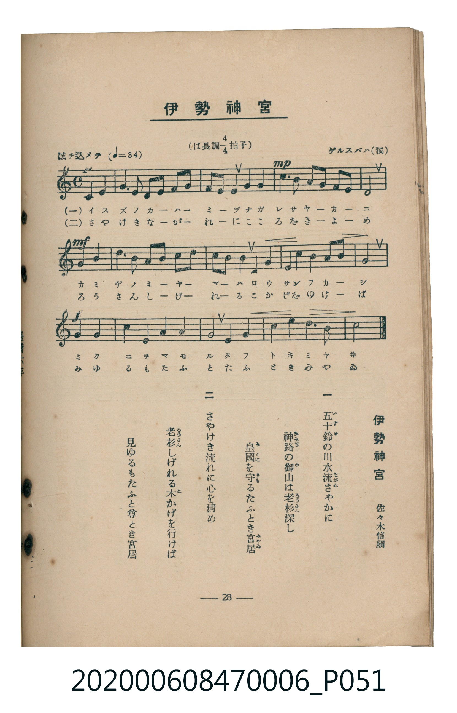

# 伊勢神宮

> Re:Shōka 使用 AI 協助辨識與重建樂譜，可能會有錯誤。歡迎[回報](https://github.com/TMDLang/reshoka/issues)。

- **鋼琴伴奏版**：<br><audio controls src="ise_jingu.mp3"></audio>
- **NEUTRINO 歌聲合成版**：<br><audio controls src="ise_jingu_neutrino.mp3"></audio>

- 詞：佐々木の信綱
- 曲：ゲルスバハ（獨）
- 臺灣教育會公認《新定兒童唱歌》尋常科第六學年用（2020.006.0847.0006）

## 說明

原書資訊與歌詞全文（對應 P051.jpg，書頁 p. 28，第三學期第 1 首）：
調性與拍號：は長調四分之四拍子（C 大調 4/4 拍，弱起 2 拍），「誠ヲ込メテ」（♩=84）


## 歌詞

```text
一、
五十鈴（いすゞ）の川水流（なが）れさやに
神路（かみぢ）の御山（みやま）は老杉（ろうさん）深し
皇國（みくに）を守（まも）るたふとき宮居（みやゐ）

二、
さやけき流れに心を清め
老杉（ろうさん）しげれる木（こ）かげを行けば
見ゆるもたふと尊とき宮居
```

## ABC

<div class="abc-score" data-abc-src="ise_jingu.abc" aria-label="五線譜載入中"></div>

[下載 ABC 原始檔](ise_jingu.abc)

## TMD 檔案連結

- [主旋律 TMD 檔案](ise_jingu.tmd) [[在 TMD Studio 編輯](https://tmdlang.github.io/Tmd-TS/#tmd=s7IKdvYPcrWy4qpTUCpJTLdSSM7PyUlNLsnMz7MqzsjMK0nNjM_KTMmPL87Iz05Ugisry88pzU21Si9KTEmNN4s3MjAyiDcwMIs3sDAxBzIMzBBKi_NLi5JTrYqTM_Lzc-JLUitKkvLzsxHyBUX5Zal5iXlANQVFIBtTwIoQClLLMlNSQdLFyYl58WWpRZlpmakpSG5JLSoGuxdsUXxJUWJecXJRZgHIEwhV-UUlGflA9xZkVFplZBaX5BdlJifmxGcn5iF5qyQjFeirotSczHQUzRDxgpzE5FRkE4Gq8qxyUzOzMrH4CypdnlpcklqUF5-bmpOfUokeLPEFiempVgEGpoZKXFpaCk_2dD3tXvR86byn69YpaGlxKdoqWJhw2dsqOHPZmOib2IF0v1g57_2eWU_2Tnjc0PpszorHjeue7F_4fNtGsNHPZm8CSj5u2vS4efXjpp2Pmyc8bu5_v6fjee-K93s6wUpetO963rj42dSZL5o2PZvT_LR1zYtVvY8bup5N2_B03aynrZOer176dMrGZ2t7Hjd0P93Q_XTHjufLJz5fs-Zp69qna3c83bnl-RSgYR2gONcDxrQeKM6BDAMzsA1c-loKttQCXAoKCk_75j-bvePF5vYXK7pedLQD3QUMgaetK55Nawe64umG3mftnQqgENTLKkh_v6cHqPjlgkaFAj0FIwsgF-jwJzs6gQ5_Nmc-kK1gqPBy2TSgS4HBBDL9xar9zxqWg8zt7n0xcz4o8BrXv5y6HSj-dPbspx1tT3Z2AxlA2adrJwDtc1Z4umQ5UFIBGB0KQFGgDU_3bHyxdbuCEYQLNBgYcD0vVi143Lzpxb49j5sXPm5ue9wAlOp4NHOlrYUJUA0XyOonOxoeNzSCWbumPO1tfNmxBajmcWPL48aZj5uAkdwJjNun2-c-27Dl2dZGsNSqx409IPGmnseNUx83AVWuBukHJpgX29eDVXQ_btz_uHERVPO-hU83bgSL7wer3gcWX_-iofHZXKBDOx439T5ubAObNRko9Wz7xseN08Emzmp_OqcbqrOxH2gP2NpJT9d1gAX3PW5qAosA7Zv_uHHr40ZgQuwFptqnG1sR9jUBQwzq113AQAH7FebwiUD1QG-BvbL66f5moOHPdrQ-bgIrwuVAoOseN04C6WnqBqZ9sE0QcaA7gOKTXiwEGgc0egPYlGXdj5vaQG5saoI78-mGLmTHgtRRnk6hQEFLn4vLszjVKzMvvdQqIDMxL9-hxqCmGmSJgo2Flh2YgS2DKICTaQPQ-QoayOlJQVvBWOHphv7n6xuATLCQDjyxa2IxB-gCkB01CgYKumBoCMTGQFyjYArmGwNNMVYwAfJqgKQxWA4kA8I1CtW5BbUKhnFgleYKZkBRkJoasJk-hjUK8VBTgakUTM4E63rcOAsqug6Iu8Gs9VCZ_WDeUjC5Ckz2QGSaQDSIPxXIhpgG0gm1ywjZrqkgEqwGZOJEqGgvVhOBqQlMToaTIJleiJ6mSWB9IFYH2C78EbKrBxwhRIW3EdS11blpteDANAdbbYQIS3NQwAL5NSDaHCwP0gQJeFA0gMMdJAxSiwhziI8gfoaELShMQeKLkEIdHM7wMNoHjwOI34GZCCoDyklgga1wA0EQEezALAizDl0rVHQykD0dLDMJOeCbII6DmA6OSpAKUJiDJEGGwOKOcMjv6CQ-5CHpGhjy0ICHBCg4MEGhagbFCIWwJA9TBCLg8QQVBEFYFkKOCpC_IYEOSdj9UH-CEx3Eq5DAb2qChg0shIElEDzcQTpWgHmQEAaZBYk-kI4JUB2wDIAUN40bUO0HByvMFoid2Oyh1P5aLi5dOwVYyaYAZCtzAQA)]
- [鋼琴伴奏 TMD 檔案](ise_jingu_piano.tmd) [[在 TMD Studio 編輯](https://tmdlang.github.io/Tmd-TS/#tmd=s7IKdvYPcrWy4qpTUCpJTLdSyC8qychPL0osyKi0ysgsLskvykxOzInPTsxLVIIrKs4vLUpOjS9ITE-1CjAwNVTi0tJSeLKn62n3oudL5z1dt-79no6X3XueT9jyZM-Wp0v7n3d2vN_TqaClxaVoq2BhwmVvq-DMZWOib2IHMvLFynnv98x6snfC44bWZ3NWPG5c92T_wufbNoLtezZ7E1DycdOmx82rHzftfNw84XFzP9D4570rgEaClbxo3_W8cfGzqTNfNG16Nqf5aeuaF6t6Hzd0PZu24em6WU9bJz1fvfTplI3P1vY8buh-uqH76Y4dz5dPfL5mzdPWtU_X7ni6c8vzKUDDOowMjAz0DAzM9AwsTMyBDAMzsA1cnsWpXpl56aVWAZmJeflBHg41uoY11VwKQGBjoWUHZuhrKdiiAwWgFU92NLxY2KOgAQolvayCdE0syrT0wUbUKBgo6IKhIRAbA3GNgimYb6xgBMQmQF4NkDQGy4FkQLhGoTq3oFbBMA6s0lzBDCgKUlMDNtPHsEYhHmrq48YWMDkTrOtx4yyo6Dog7gaz1kNl9oN5IPnHjavAZA9EpglEg_hTgWyIaSCdULuMkO2aCiLBakAmToSK9mI18XHjajA5GU6CZHohepomgfWBWB1gu_CH964e4sPbCOra6ty0WnBgmoOtNkKEpTkoYIH8GhBtDpYHaYIEPCgawOEOEgapRYQ5xEcQP0PCFhSmIPEZSKEODmd4GO2DxwHE748b26AyUx83QYJmK9xAEEQE--OmRph16FqhopOB7OlgmUnIAd8EcRzEdHBUglSAwhwkCTIEFneEQ35HJ_EhD0nXwJCHBjwkQMGBCQpVMyhGKIQleZgiEAGPJ6ggCMKyEHJUgPwNCXRIwu6H-hOc6CBehQR-UxM0bGAh_LhxPjzcQTpWgHmQEAaZBYk-kAwoEkEQlgGQ4qZxA6r94GCF2QKxE5s9lNpfi15w-aAUXCbQggtU6hgAS5xow1hQOIJp03goF8oAUaYgPqSoAXNMoGpgEQqyGJKPYIqhDCM0PlweYhdI2gjdHKAxqC4C2WaC4EKcgOxcKBeSAMCe17VTgPk_2geoCoUPtBHIV-YCAA)]

## 分析

```text
================================================================================
📊 TMD Song Profile: [ 伊勢神宮 ]
================================================================================
⏱  Duration:       0:37 (37.1s), 13 measures total
🎼 Key & Tempo:    首調基準 C, != 84.0 BPM, <4/4>
   - 分析範圍：      由實際發聲的音符與和弦推測調性；播放脈絡另行呈現
🎤 人聲音域:    C4 (MIDI 60) – E5 (MIDI 76) [跨度: 16 個半音 / 1.3 個八度, 難度: moderate]
   - 最低音:  C4 in [IseJingu #1 @ m.1, 0:01]
   - 最高音: E5 in [IseJingu #1 @ m.12, 0:32]
   - 適合: soprano, mezzo-soprano, contralto, tenor, baritone, bass
🏛  結構:      IseJingu (37.1s)
⚡ 編曲密度:        Peak 1 軌道同時演奏
🗝  調性診斷：       G 大調（純淨自然大調，未偵測到可信轉調）
   - 風格氣質:    純淨自然大調（陽光明朗、易唱易記，無明顯調外色彩）
   - 轉調歷程:    全曲維持單一推測調性（未偵測到可信轉調）
   - 核心骨幹音:  G, C, E, D, B
   - 調性數值:    G 大調 [相關度: 0.92, 穩定度: High, 自然音純度: 96.9%]
   - 候選調性 (K-S): G 大調 (0.92), C 大調 (0.80), E 小調 (0.79)
   - 五度圈歷程:   +1
   - 各段落調性細節:
     • [IseJingu #1]: G 大調 (r: 0.92, 自然音純度: 96.9%, 調外音: F)

  [ 五度圈游移軌跡 ]
               C  
         F           [G ]*
      Bb               D  
      Eb               A  
         Ab           E  
            Db       B  
               F# 
     (* = active key center)

  [ 十二半音累積音高分佈 ]
     C  : ███████████████           17.7%
     C# :                            0.0%
     D  : ████████████              14.6%
     D# :                            0.0%
     E  : ██████████████            16.7%
     F  : ███                        3.1%
     F# :                            0.0%
     G  : ████████████████████████  28.1%
     G# :                            0.0%
     A  : ██████                     7.3%
     A# :                            0.0%
     B  : ███████████               12.5%
--------------------------------------------------------------------------------
Assignment 軌道音域：
  - Piano         : C4 – E5 (16 個半音 / 1.3 個八度, 53 個音符)
================================================================================
```


## 原書掃描頁




