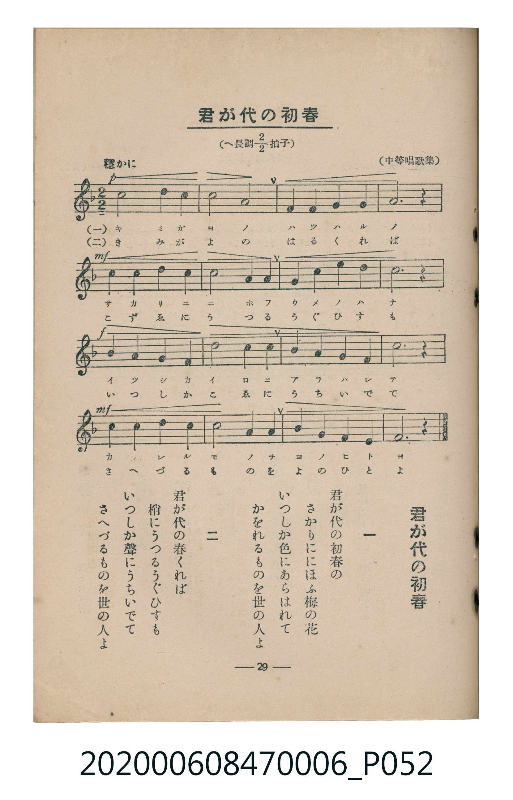

# 君が代の初春

> Re:Shōka 使用 AI 協助辨識與重建樂譜，可能會有錯誤。歡迎回報。

- **鋼琴伴奏版**：<br><audio controls src="kimigayo_no_hatsuharu.mp3"></audio>

- 中等唱歌集
- 臺灣教育會公認《新定兒童唱歌》尋常科第六學年用（2020.006.0847.0006）

## 說明

原書資訊與歌詞全文（對應 P052.jpg，書頁 p. 29，第三學期第 2 首）：
調性與拍號：へ長調二分之二拍子（F 大調 2/2 拍），「穩かに」


## 歌詞

```text
一、
君が代の初春の
さかりににほふ梅の花
いつしか色にあらはれて
かをれるものを世の人よ

二、
君が代の春くれば
梢にうつるうぐひすも
いつしか聲にうちいでて
さへづるものを世の人よ
```

## ABC

```abc
X:1
T:君が代の初春
M:2/2
L:1/16
Q:1/2=36
K:F
V:V1 name="Piano" snm="Pia"
[V:V1]
!p! c8 d4 c4 | c8 A8 | F4 F4 G4 G4 | A12 z4 |
w: 1.~き み が | よ の | は つ は る | の
w: 2.~き み が | よ の | は る く れ | ば
!mf! c4 c4 d4 c4 | c8 A4 A4 | G4 c4 e4 d4 | c12 z4 |
w: 1.~さ か り に | に ほ ふ | う め の は | な
w: 2.~こ ず ゑ に | う つ る | う ぐ ひ す | も
!f! B4 A4 G4 F4 | d8 c4 c4 | B4 A4 G4 F4 | c12 z4 |
w: 1.~い つ し か | い ろ に | あ ら は れ | て
w: 2.~い つ し か | こ ゑ に | う ち い で | て
!mf! c4 c4 d4 c4 | c8 A4 A4 | B4 G4 F4 E4 | F12 z4 |
w: 1.~か を れ る | も の を | よ の ひ と | よ
w: 2.~さ へ づ る | も の を | よ の ひ と | よ
```

## TMD 檔案連結

- [主旋律 TMD 檔案](kimigayo_no_hatsuharu.tmd) [[在 TMD Studio 編輯](https://tmdlang.github.io/Tmd-TS/#tmd=s7IKdvYPcrWy4qpTUCpJTLdSSM7PyUlNLsnMz7MqzsjMK0nNjM_KTMmPL87Iz05Ugisry88pzU21Si9KTEmNN4s3MjAyiDcwMIs3sDAxBzIMzBBKi_NLi5JTrYqTM_Lzc-JLUitKkvLzs9Hl4wsS01OtAgxMjRAyBUX5Zal5iXlA3QVFILekgLUjFKSWZaakgqSLkxPz4stSizLTMlNTkFyZWlQM9gnEipKixLzi5KLMApD3EKryi0oy8oE-KciotMrILC7JL8pMTsyJz07MQ_JwSUYq0L-ZuQVASxJz0MWTU4tSc_PzUGSAxqRn5lnlpmZmZSJ5W0tL4emE2Y8be57sXvy4cd3TjrnPZixV0NLiUrRVMDfisrdVcOOyMdI3sgMZ9GTH2udrO59O2fhsbc_L2W1gw1-073reuPjZ1JkvmjY9m9P8tHXNi1W9jxu6nk3b8HTdrKetk56vXgrR8bih--mG7qc7djxfPvH5mjVPW9c-Xbvj6c4tz6eseL-nAxRnesCY0gPFGZBhYPZ-T6cSF5e-loIttQCXgoLC0775z2bveLG5_cWKrhcd7UB3vVg572nrimfT2oGueLqh91l7pwIo4vWyCtLf7-kBKn65oFGhQE_ByBLIBTr8yY5OoMOfzZkPZCsYKbxcNg3o0vd7ZoFMf7Fq_7OG5SBzu3tfzJwPFH3cuOPl1O1A8Se7ep52tD3Z2Q1kAGWfrp0AtM9N4emS5UBJBWAQKwBFwSYBQ6rn-cqVjxu7HzeuftzQywUy-cmOhscNjWAfYMQXkAGSeNw4FaSnqQukDYR2P27c-mxRK1D6RddGiIqWx41LHjdOB6p70bkJrKjpcVPn48b1j5t6HjcugygCmjEJxG8CMpqAuoHcJzumARlPdu163NQBcc8uoDMx3AN2TD_YrA0guWeLFoEtaQNZCzQOxJjwuBFo80yg0RhOAklAVC8Eiy-HOwnosx2PG5fidBJQEeXpAwoUtPS5uLwzczPTEyvz_fI9EkuKSzMSi0qtAjIT8_IdagxqqkH2KdiYaNmBGdjSqAI4pTS8WNijoGGi8HRD__P1DTrwhKWJRQPQVpBhNQrVBbUKpgq6CmZAsgbMMgbiGgVDIDQCwhowX1fBQKEGrMPHsAYYQr1AkceN-4G4B6gCGCZg_jqwTmD8AvESCN3UDRYByegqxMPMMCLKDKBeYPwCabB84wa4GfjDYVcPWeGQmwYKCFOUgDAGsoyAbHOgKEQMPSCmglIw0IldQHo12Jmrwd7YDcRbwfw2oGwj2GMgT4FEVmEJjMlAPAuociLcnDawOcBghAYh0JzGCUC8CYhnggOsicgA2dFJVoAAw8MEGAJGwIRQA_S_Ljh0apDEsIVHCzTqp4PDBSIC9EdTL9xfTUBeJzSCIRG7DEt4YJozGWwOcvgAMy5U5XI0c_CGx9PZs6maQEzAwWEOtBdIYYYIKHVMAvsVGpPgeAOnB6A4JOFDUgcoZlfAswJ6iIBS2g4gXkqWObVcXLp2CljKGQWgsDIXAA)]
- [鋼琴伴奏 TMD 檔案](kimigayo_no_hatsuharu_piano.tmd) [[在 TMD Studio 編輯](https://tmdlang.github.io/Tmd-TS/#tmd=s7IKdvYPcrWy4tLSUng6Yfbjxp4nuxc_blz3tGPusxlL3-_peNm95_mELU_2bHm6tP95Z8f7PZ0KWlpcirYK5kZc9rYKblw2RvpGdlx1CkpPdqx9vrbz6ZSNz9b2vJzdpgQSe9G-63nj4mdTZ75o2vRsTvPT1jUvVvU-buh6Nm3D03WznrZOer56KUTH44bupxu6n-7Y8Xz5xOdr1jxtXft07Y6nO7c8n7IC6AojAyMDPQMDMz0DCxNzIMPADOgQJS4u78zczPTEyny_fI_EkuLSjMSiUquAzMS8_CAPhxqDmmouBSCwMdGyAzP0tRRs0YEC0LInOxpeLOxR0AgwMDXSyypI18SiTEsfbESNQnVBrYKpgq6CGZCsAbOMgbhGwRAIjYCwBszXVTBQqAHr8DGsUXjc2AsUedy4H4h7gCoeN3WA-evAOh83rgfiJRC6qRssApLRVYiHmWFElBlAvY8b-4E0WL5xA9wM_L7f1UOC73PTQN43RfG-MZBlBGSbA0UhYujenwrEQMc1dQHp1WDHrQY7fjcQbwXz24CyjWDvgLwCElmFJQgmA_EsoMqJcHPawOYAAw8acEBzGicA8SYgngkOpiYig2FHJwnBAAwFE6C_jYCRXgP0tS44TGqQxLCFQgs0mqeDQwMiAnR9Uy_cN01AXic0MiGRuAxLKGCaMxlsDnKoPG5cCFW5HM0cvKHwdPZsKiQGE3AgmANtA1KY4QBKCZPAPoTGGjiOwHEPFIckbUhKAMXiCnhiRw8HUKraAcRLyTKnFk_x4YOt-IDkfcN4hWjDWAUTCAX0IIQBpYB-jweyTOJjFUxBDFMgA1kNLCCggUfIMLgZYIZZfC6GIJKBoMgASQF1IisHGW6CbiaaGlxGEuNGsIeNQObg9DEwqHXtFLCEdrQPUBEuKSOwlDIXAA)]

## 分析

```text
================================================================================
📊 TMD Song Profile: [ 君が代の初春 ]
================================================================================
⏱  Duration:       0:53 (53.3s), 16 measures total
🎼 Key & Tempo:    首調基準 F, != 72.0 BPM, <2/2>
   - 分析範圍：      由實際發聲的音符與和弦推測調性；播放脈絡另行呈現
🎤 人聲音域:    E4 (MIDI 64) – E5 (MIDI 76) [跨度: 12 個半音 / 1.0 個八度, 難度: easy]
   - 最低音:  E4 in [KimigayoNoHatsuharu #1 @ m.15, 0:49]
   - 最高音: E5 in [KimigayoNoHatsuharu #1 @ m.7, 0:21]
   - 適合: soprano, mezzo-soprano, contralto, tenor, baritone, bass
🏛  結構:      KimigayoNoHatsuharu (53.3s)
⚡ 編曲密度:        Peak 1 軌道同時演奏
🗝  調性診斷：       C 大調（純淨自然大調，未偵測到可信轉調）
   - 風格氣質:    純淨自然大調（陽光明朗、易唱易記，無明顯調外色彩）
   - 轉調歷程:    全曲維持單一推測調性（未偵測到可信轉調）
   - 核心骨幹音:  C, A, F, D, G
   - 調性數值:    C 大調 [相關度: 0.82, 穩定度: Moderate, 自然音純度: 95.0%]
   - 候選調性 (K-S): C 大調 (0.82), F 大調 (0.74), A 小調 (0.71)
   - 五度圈歷程:   +0
   - 各段落調性細節:
     • [KimigayoNoHatsuharu #1]: C 大調 (r: 0.82, 自然音純度: 95.0%, 調外音: A#)

  [ 五度圈游移軌跡 ]
              [C ]*
         F            G  
      Bb               D  
      Eb               A  
         Ab           E  
            Db       B  
               F# 
     (* = active key center)

  [ 十二半音累積音高分佈 ]
     C  : ████████████████████████  40.0%
     C# :                            0.0%
     D  : ██████                    10.0%
     D# :                            0.0%
     E  : ██                         3.3%
     F  : ████████                  13.3%
     F# :                            0.0%
     G  : ██████                    10.0%
     G# :                            0.0%
     A  : ███████████               18.3%
     A# : ███                        5.0%
     B  :                            0.0%
--------------------------------------------------------------------------------
Assignment 軌道音域：
  - Piano         : E4 – E5 (12 個半音 / 1.0 個八度, 46 個音符)
================================================================================
```


## 原書掃描頁




