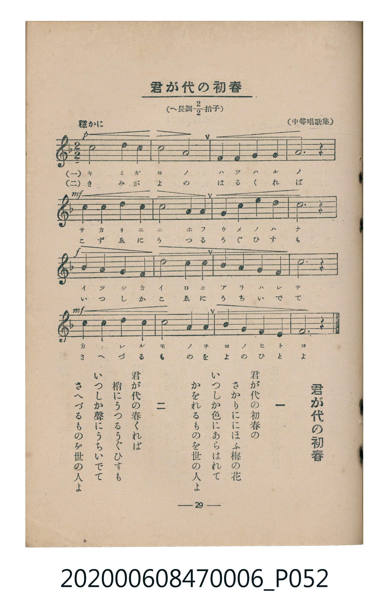

# 君が代の初春

<audio controls src="kimigayo_no_hatsuharu.mp3"></audio>

- 中等唱歌集
- 臺灣教育會公認《新定兒童唱歌》尋常科第六學年用（2020.006.0847.0006）

- note

原書資訊與歌詞全文（對應 P052.jpg，書頁 p. 29，第三學期第 2 首）：
調性與拍號：へ長調二分之二拍子（F 大調 2/2 拍），「穩かに」

## 歌詞

```text
一、
君が代の初春の
さかりににほふ梅の花
いつしか色にあらはれて
かをれるものを世の人よ

二、
君が代の春くれば
梢にうつるうぐひすも
いつしか聲にうちいでて
さへづるものを世の人よ
```

## 原書掃描頁



## 調性分析

```text
================================================================================
📊 TMD Song Profile: [ 君が代の初春 ]
================================================================================
⏱  Duration:       0:53 (53.3s), 16 measures total
🎼 Key & Tempo:    首調基準 F, != 72.0 BPM, <2/2>
   - 分析範圍：      由實際發聲的音符與和弦推測調性；播放脈絡另行呈現
🎤 人聲音域:    C4 (MIDI 60) – D5 (MIDI 74) [跨度: 14 個半音 / 1.2 個八度, 難度: moderate]
   - 最低音:  C4 in [KimigayoNoHatsuharu #1 @ m.1, 0:00]
   - 最高音: D5 in [KimigayoNoHatsuharu #1 @ m.9, 0:26]
   - 適合: soprano, mezzo-soprano, contralto, tenor, baritone, bass
🏛  結構:      KimigayoNoHatsuharu (53.3s)
⚡ 編曲密度:        Peak 1 軌道同時演奏
🗝  調性診斷：       C 大調（純淨自然大調，未偵測到可信轉調）
   - 風格氣質:    純淨自然大調（陽光明朗、易唱易記，無明顯調外色彩）
   - 轉調歷程:    全曲維持單一推測調性（未偵測到可信轉調）
   - 核心骨幹音:  C, G, A, D, F
   - 調性數值:    C 大調 [相關度: 0.85, 穩定度: High, 自然音純度: 100.0%]
   - 候選調性 (K-S): C 大調 (0.85), F 大調 (0.70), A 小調 (0.67)
   - 五度圈歷程:   +0
   - 各段落調性細節:
     • [KimigayoNoHatsuharu #1]: C 大調 (r: 0.85, 自然音純度: 100.0%)

  [ 五度圈游移軌跡 ]
              [C ]*
         F            G  
      Bb               D  
      Eb               A  
         Ab           E  
            Db       B  
               F# 
     (* = active key center)

  [ 十二半音累積音高分佈 ]
     C  : ████████████████████████  33.3%
     C# :                            0.0%
     D  : ██████████                13.3%
     D# :                            0.0%
     E  :                            0.0%
     F  : ██████████                13.3%
     F# :                            0.0%
     G  : ██████████████            20.0%
     G# :                            0.0%
     A  : ██████████████            20.0%
     A# :                            0.0%
     B  :                            0.0%
--------------------------------------------------------------------------------
Assignment 軌道音域：
  - Piano         : C4 – D5 (14 個半音 / 1.2 個八度, 46 個音符)
================================================================================
```

## ABC

```abc
X:1
T:君が代の初春
C:TMD (Chen, Chih-Han / aguai)
M:2/2
L:1/16
Q:1/2=36
K:F

V:V1 name="Piano" snm="Pia"

[V:V1]
!p! c8 d4 c4 | a8 g8 | f4 g4 a4 c4 | g12 z4 |
!mf! c4 c4 d4 c4 | a8 g4 g4 | f4 a4 c4 a4 | c12 z4 |
!f! d4 d4 c4 a4 | c8 a4 f4 | g4 a4 g4 f4 | c12 z4 |
!mf! d4 c4 d4 c4 | a8 g4 f4 | g4 d4 c4 d4 | f12 z4 |
```

- [主旋律 TMD 檔案](kimigayo_no_hatsuharu.tmd)
- [鋼琴伴奏 TMD 檔案](kimigayo_no_hatsuharu_piano.tmd)
