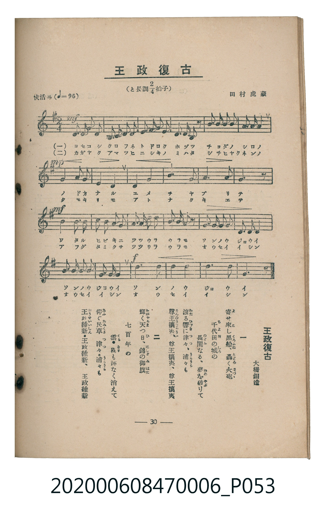

# 王政復古

<audio controls src="osei_fukko.mp3"></audio>

- 詞：大橋銅造
- 曲：田村虎藏
- 臺灣教育會公認《新定兒童唱歌》尋常科第六學年用（2020.006.0847.0006）

## 說明

原書資訊與歌詞全文（對應 P053.jpg，書頁 p. 30，第三學期第 3 首）：
調性與拍號：と長調四分之二拍子（G 大調 2/4 拍），「快活ニ」（♩=96）

## 歌詞

```text
一、
寄（よ）せ來（こ）し黒船（くろふね）、轟（とどろ）く火砲（ほづゝ）、
千代田（ちよだ）の城（しろ）の
長閑（のどか）なる、夢（ゆめ）を破（やぶ）りて
渡（わた）る響（ひびき）に津々（つゝ）、浦々（うらうら）も
尊王攘夷（そんのうじやうい）、尊王攘夷、尊王攘夷

二、
輝（かがや）く天（あま）つ日（ひ）、錦（にしき）の御旗（みはた）
七百年の
雲（くも）・霧（きり）も跡なく消えて
仰（あふ）ぐ民草（たみくさ）津々（つゝ）・浦々（うらうら）も
王政維新（わうせいいしん）・王政維新、王政維新
```

## ABC

```abc
X:1
T:王政復古
C:曲：田村虎藏
M:2/4
L:1/16
Q:1/4=96
K:G
V:V1 name="Piano" snm="Pia"
[V:V1]
!mf! D2 D2 E2 E2 | D2 E2 G2 A2 | B2 B2 A2 D2 | B2 A2 A2 z2 |
B2 B2 A2 A2 | G2 A2 B4 | !mp! A3 A G2 E2 | D4 G4 |
F4 A4 | e4 d4 | ^c4 e4 | d4 z4 |
!mf! B3 B A2 G2 | F2 G2 A2 F2 | G2 G2 A2 A2 | B2 c2 d4 |
e2 e2 d2 B2 | G2 A2 B2 G2 | A2 A2 G2 E2 | D2 G2 B4 |
!f! e4 d4 | B4 G4 | A4 d4 | G4 z4 |
```

## TMD 檔案連結

- [主旋律 TMD 檔案](osei_fukko.tmd) [[在 TMD Studio 編輯](https://tmdlang.github.io/Tmd-TS/#tmd=s7IKdvYPcrWy4tLSUnje1_1syv6n-1Y-7V-ioKXFpWirYGnGZW-r4M5lY6RvYsdVp6D0YuW893tmPV2y_NnK7pddrS8bFiiBhJ_N3gQUfj5lw7O5E1_M7HsxvR8s_KJ91_PGxc-mznzRtOnZnOanrWterOp93ND1bNqGp-tmPW2d9Hz10qdTNj5b2_O4ofvphu6nO3Y8Xz7x-Zo1T1vXPl274-nOLc-nrHi_p8PIwMhAz8DATM_AwsQcyDAwe7-nU4mLS19LwZZagEtBQeFp3_xns3e82Nz-YkXXi452oLuA_n3auuLZtHagK55u6H3W3qkQYGBqrJdVkP5-Tw9Q8csFjQoFegrGBkAu0OFPdnQCHf5sznwgW8FY4eWyaUCXAoMGZPqLVfufNSwHmdvd-2LmfKDo48YVL6duB4o_nT37aUfbk53dT3b1AGWfrp0AtM9dARjOQEkFYOArAEXBJgFDqufp_tXPtux-3Nz9uAEo2PFo5kpbS1CIcIFsebKj4XFDI9g361uAso-bOoBSjxtnP9nXBuI2TgZzp7_cPelFx06wSP_jpt7HjVsfN64FSTU0vtgLdBxQfMXjxpVAKbD6_ueNq58vAMYyUHz348alj5vmQhSDbeptfrJ7MTD6wdILgVY-blwA1rbu6fw-sOB0mEHrQBqAvn45bSJYYh3IksZusNyqx01APzU-XbII7PC2x02NIPGmSc8XbAGLtDxu3AYW6XrcuAxk0LMdC8ES_Y8bgW4GSnS_nL8fbO6mx42bHzdC7AQG19LHDa1g8SVwlz_bugwmCLQJqAxEgg1pAntqQxc4R8x4umQ7WNHcx02Twe5te9w4A-wWIAMYxCCzkBWjcSGxsgsYceCwerEHaD3QtO7HjT1AQyCB-3TJSrBg0-PGfWCRJc-mL4V4A2L-y55lYO5qUEhCfbXu6b6Fz6ZPB4vvf9y4HhIEkDTQ_HzmPmD2gQU3KHtCIroJpLV598s5y8EivcCghHj5xfaFoAho7H-2DSgORODwfbIbEqdAh20FWzrh2YaJL3qBwQQUnA-2Fxj0U4FSWIK4eTeBIIaUOM-3rQUWCLBoBIbpbGCwghEw0YBTa_NuZJXA4EDmggyiPPtDgYKWPheXf3Fqpltpdna-VUBmYl6-Q41BjUI1yBoFG0MzLTswC1vRowAuABpeLOxR0DADpp_-5-sbdODlhSYWDUDbQIYBjc9Nq1UwjVfQhRBmcKIGScAQiI3AYsZAEoRBPLA8RAjEBWEDDEUQbTADQKIgWANOm7j9squHPL8U1IKtAVkGshLZIyAIEgNbr2AOE4IoBwmZQVmmcBETdSgTJgU0CsoCeZQYj-zoJDtSIGFlDHYhyOFQR8OCEsyBhCxMCBFFJij-ADkfhEEiIFnU-ACbjd8bwFqCHG_A3IQeFSA-PCUoVAP9ihn2MHlElMFiCqEGJoeIjFouLl07BXg2UgBylLkA)]
- [鋼琴伴奏 TMD 檔案](osei_fukko_piano.tmd) [[在 TMD Studio 編輯](https://tmdlang.github.io/Tmd-TS/#tmd=s7IKdvYPcrWy4tLSUnje1_1syv6n-1Y-7V_yfk_Hy-49zydsebJny9Ol_c87O97v6VTQ0uJStFWwNOOyt1Vw57Ix0jex46pTUHqxct77PbOeLln-bGX3y67Wlw0LlEDCz2ZvAgo_n7Lh2dyJL2b2vZjeDxZ-0b7reePiZ1Nnvmja9GxO89PWNS9W9T5u6Ho2bcPTdbOetk56vnrp0ykbn63tedzQ_XRD99MdO54vn_h8zZqnrWufrt3xdOeW51NWAN1nZGBkoGdgYKZnYGFiDmQYmAGdqMTF5V-cmulWmp2dbxWQmZiXH-ThUGNQo1DNpQAENoZmWnZglr6Wgi06UABa8mRHw4uFPQoaAQamxnpZBemaWJRp6YONABqam1arYBqvoAshzOBEDZKAIRAbgcWMgSQIg3hgeYgQiAvCBhiKINpgBoBEQbCGC78PdvWQ4oOCWrDhICtAFiE7HwRBYmBLFcxhQhDlICEzKMsULmKiDmXCpIBGQVkg7xHj_B2dJEYAJFyMwe4CORfqVFiwgTmQUIQJIaLDBMX1IEeDMEgEJIsa9mCz8Tv-6ezZxDse5hL0YAfx4XGtUA30IWY4w-QR0QOLFYQamBwi4GsxcocPSu4wgWYOaMAaxitEm8bHgowCsgxhDIiQaXw80GRkEZgi5KQFUoVuBpKYEUwMxDBCMhbdGegasTjNBNmNSO7A5gRQoGKoR1MJcgUwwHTtFOBhpoDOUeYCAA)]

## 分析

```text
================================================================================
📊 TMD Song Profile: [ 王政復古 ]
================================================================================
⏱  Duration:       0:30 (30.0s), 24 measures total
🎼 Key & Tempo:    首調基準 G, != 96.0 BPM, <2/4>
   - 分析範圍：      由實際發聲的音符與和弦推測調性；播放脈絡另行呈現
🎤 人聲音域:    D4 (MIDI 62) – E5 (MIDI 76) [跨度: 14 個半音 / 1.2 個八度, 難度: moderate]
   - 最低音:  D4 in [OseiFukko #1 @ m.1, 0:00]
   - 最高音: E5 in [OseiFukko #1 @ m.10, 0:11]
   - 適合: soprano, mezzo-soprano, contralto, tenor, baritone, bass
🏛  結構:      OseiFukko (30.0s)
⚡ 編曲密度:        Peak 1 軌道同時演奏
🗝  調性診斷：       D 大調（純淨自然大調，未偵測到可信轉調）
   - 風格氣質:    純淨自然大調（陽光明朗、易唱易記，無明顯調外色彩）
   - 轉調歷程:    全曲維持單一推測調性（未偵測到可信轉調）
   - 核心骨幹音:  A, D, G, B, E
   - 調性數值:    D 大調 [相關度: 0.82, 穩定度: Moderate, 自然音純度: 98.9%]
   - 候選調性 (K-S): D 大調 (0.82), G 大調 (0.76), B 小調 (0.63)
   - 五度圈歷程:   +2
   - 各段落調性細節:
     • [OseiFukko #1]: D 大調 (r: 0.82, 自然音純度: 98.9%, 調外音: C)

  [ 五度圈游移軌跡 ]
               C  
         F            G  
      Bb              [D ]*
      Eb               A  
         Ab           E  
            Db       B  
               F# 
     (* = active key center)

  [ 十二半音累積音高分佈 ]
     C  : █                          1.1%
     C# : ██                         2.2%
     D  : ██████████████████████    19.8%
     D# :                            0.0%
     E  : ████████████████          14.3%
     F  :                            0.0%
     F# : █████                      4.4%
     G  : ████████████████████      18.7%
     G# :                            0.0%
     A  : ████████████████████████  22.0%
     A# :                            0.0%
     B  : ███████████████████       17.6%
--------------------------------------------------------------------------------
Assignment 軌道音域：
  - Piano         : D4 – E5 (14 個半音 / 1.2 個八度, 72 個音符)
================================================================================
```


## 原書掃描頁




