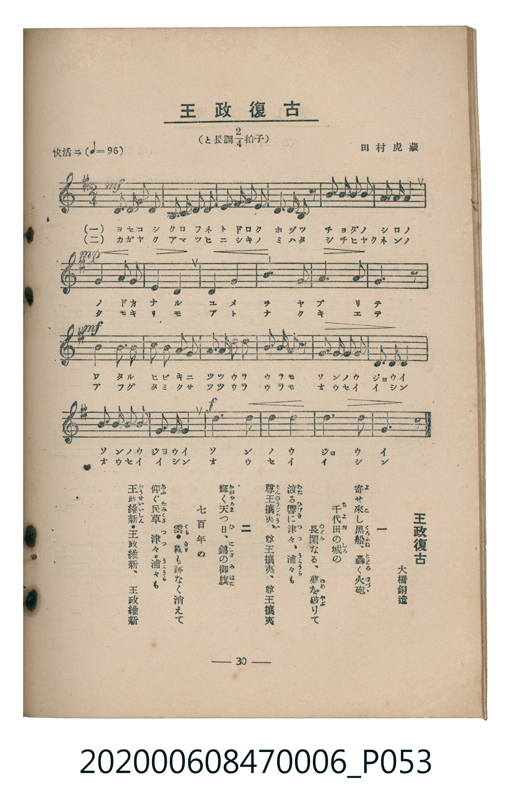

# 王政復古

> Re:Shōka 使用 AI 協助辨識與重建樂譜，可能會有錯誤。歡迎回報。

- **鋼琴伴奏版**：<br><audio controls src="osei_fukko.mp3"></audio>
- **NEUTRINO 歌聲合成版**：<br><audio controls src="osei_fukko_neutrino.mp3"></audio>

- 詞：大橋銅造
- 曲：田村虎藏
- 臺灣教育會公認《新定兒童唱歌》尋常科第六學年用（2020.006.0847.0006）

## 說明

原書資訊與歌詞全文（對應 P053.jpg，書頁 p. 30，第三學期第 3 首）：
調性與拍號：と長調四分之二拍子（G 大調 2/4 拍），「快活ニ」（♩=96）


## 歌詞

```text
一、
寄（よ）せ來（こ）し黒船（くろふね）、轟（とどろ）く火砲（ほづゝ）、
千代田（ちよだ）の城（しろ）の
長閑（のどか）なる、夢（ゆめ）を破（やぶ）りて
渡（わた）る響（ひびき）に津々（つゝ）、浦々（うらうら）も
尊王攘夷（そんのうじやうい）、尊王攘夷、尊王攘夷

二、
輝（かがや）く天（あま）つ日（ひ）、錦（にしき）の御旗（みはた）
七百年の
雲（くも）・霧（きり）も跡なく消えて
仰（あふ）ぐ民草（たみくさ）津々（つゝ）・浦々（うらうら）も
王政維新（わうせいいしん）・王政維新、王政維新
```

## ABC

<div class="abc-score" data-abc-src="osei_fukko.abc" aria-label="五線譜載入中"></div>

[下載 ABC 原始檔](osei_fukko.abc)

## TMD 檔案連結

- [主旋律 TMD 檔案](osei_fukko.tmd) [[在 TMD Studio 編輯](https://tmdlang.github.io/Tmd-TS/#tmd=s7IKdvYPcrWy4qpTUCpJTLdSSM7PyUlNLsnMz7MqzsjMK0nNjM_KTMmPL87Iz05Ugisry88pzU21Si9KTEmNN4s3MjAyiDcwMIs3sDAxBzIMzBBKi_NLi5JTrYqTM_Lzc-JLUitKkvLzsxHyBUX5Zal5iXlANQVFIBtTwIoQClLLMlNSQdLFyYl58WWpRZlpmakpSG5JLSoGuxdsUXxJUWJecXJRZgHIEwhV-UUlGflA9xZkVFplZBaX5BdlJifmxGcn5iF5qyQjFegriHQlunBmbgHQ7sQcZDMz0zPzrHJTM7MysfgMKl2SmAkMPVAIlifG5yZm5uUk5gGdr6Wl8Lyv-9mU_U_3rXzav0RBS4tL0VbB0ozL3lbBncvGSN_EDmTSi5Xz3u-Z9XTJ8mcru192tb5sWAC24NnsTUDh51M2PJs78cXMvhfT-8HCL9p3PW9c_GzqzBdNm57NaX7auubFqt7HDV3Ppm14um7W09ZJz1cvfTpl47O1PY8bup9u6H66Y8fz5ROfr1nztHXt07U7nu7c8nzKivd7OkARqgeMRj1QhAIZBmbv93QqcXHpaynYUgtwKSgoPO2b_2z2jheb21-s6HrR0Q50F9C_T1tXPJvWDnTF0w29z9o7FQIMTI31sgrS3-_pASp-uaBRoUBPwdgAyAU6_MmOTqDDn82ZD2QrGCu8XDYN6FJg0IBMf7Fq_7OG5SBzu3tfzJwPFH3cuOLl1O1A8aezZz_taHuys_vJrh6g7NO1E4D2uSsAwxkoqQAMfAWgKNgkYEj1PN2_-tmW3Y-bux83AAU7Hs1caWsJChEukC1PdjQ8bmgE-2Z9C1D2cVMHUOpx4-wn-9pA3MbJYO70l7snvejYCRbpf9zU-7hx6-PGtSCphsYXe4GOA4qveNy4EigFVt__vHH18wXAWAaK737cuPRx01yIYrBNvc1Pdi8GRj9YeiHQyseNC8Da1j2d3wcWnA4zaB1IA9DXL6dNBEusA1nS2A2WW_W4CeinxqdLFoEd3va4qREk3jTp-YItYJGWx43bwCJdjxuXgQx6tmMhWKL_cSPQzUCJ7pfz94PN3fS4cfPjRoidwOBa-rihFSy-BO7yZ1uXwQSBNgGVgUiwIU1gT23oAueIGU-XbAcrmvu4aTLYvW2PG2eA3QJkAIMYZBayYjQuJFZ2ASMOHFYv9gCtB5rW_bixB2gIJHCfLlkJFmx63LgPLLLk2fSlEG9AzH_ZswzMXQ0KSaiv1j3dt_DZ9Olg8f2PG9dDggCSBpqfz9wHzD6w4AZlT0hEN4G0Nu9-OWc5WKQXGJQQL7_YvhAUAY39z7YBxYEIHL5PdkPiFOiwrWBLJzzbMPFFLzCYgILzwfYCg34qUApLEDfvJhDEkBLn-ba1wAIBFo3AMJ0NDFYwAiYacGpt3o2sEhgcyFyQQZRnfyhQ0NLn4vIvTs10K83OzrcKyEzMy3eoMaipBtmiYGNopmUHZmEreRTA-b_hxcIeBQ0zYPLpf76-QQdeXGhi0QC0DGRYjUJ1blqtgmm8gi4QAilDCKULlDGGCJrEQwTMIKLmEFFDBSMgCebUIGkH6zGAaAeLGYNpEK4B69AFkhAaKAJ2go9hjQIw24JFgBEAxJPBrOlgPcBIhsg09QLZW8Eya6EyK6B6VoJlQSyQWpDMbqjMUiBeAmRBnAksH6BmdQDZC8Aq1kFlQLbBbAGJIbnPCCTfDTWxB6imBcWuJqjMPqhdwIwDlVkNlZkOxBD3wWzbD5VZD8TzkdwHdQXQnaBSpKkZxSKQt0FOnIziRPxpYlcPeWmioBacEiDxBYptkBPAKQAa0VDrEUyYcljEI0RhEY8wrgauGgTByQWRFOB-A0UsiAQFPUh8FUy8CRIZYNGmNrhoI5LoJCTzIREGMmEbimgXVHQZkig4IpCiHZL4QKpB0QyJRpD5IL0Icait0KQAUgdJmqjuhsjAYhNkEkIUlPyxu4VAnu8kO8_DogmWT2sUTKA8RIzDcqwpkARhRK4GyUDyOSQqDcE0RBeiOEAkFKSsDg9TcNKHxCfI76BsA6w54eEMyUAgGVC2AvGXADEovoElOVQGEvsgPiQmYBlpLlQcllcgKkEywOoTlK0gQsCiHtWB4EhHRCOovAHRE8BaQc6F5F1INAJrH3IdCA0EiBtmg1mwRApxEbjUADof5jq8yQDYhiMnGWCW0MhxCUm-1aDaAcoDRypYFCYCoxEiCDX4sjjp0QPXBI0acNCglhawkgDFGGRJROhCIFpmJzVOkJIyqh0gvRARZOcj2wyv3eCmIdxTy8Wla6cAbwgoADnKXAA)]
- [鋼琴伴奏 TMD 檔案](osei_fukko_piano.tmd) [[在 TMD Studio 編輯](https://tmdlang.github.io/Tmd-TS/#tmd=s7IKdvYPcrWy4tLSUnje1_1syv6n-1Y-7V_yfk_Hy-49zydsebJny9Ol_c87O97v6VTQ0uJStFWwNOOyt1Vw57Ix0jex46pTUHqxct77PbOeLln-bGX3y67Wlw0LlEDCz2ZvAgo_n7Lh2dyJL2b2vZjeDxZ-0b7reePiZ1Nnvmja9GxO89PWNS9W9T5u6Ho2bcPTdbOetk56vnrp0ykbn63tedzQ_XRD99MdO54vn_h8zZqnrWufrt3xdOeW51NWAN1nZGBkoGdgYKZnYGFiDmQYmAGdqMTF5V-cmulWmp2dbxWQmZiXH-ThUGNQU82lAAQ2hmZadmCWvpaCLTpQANrxZEfDi4U9ChoBBqbGelkF6ZpYlGnpg42oUajOTatVMI1X0AVCIGUIoXSBMsYQQZN4iIAZRNQcImqoYAQkwZwaJO1gPQYQ7WAxYzANwjVgHbpAEkIDRcBO8DGsUXjc1AEWedw4G4gng1nTwXoeN_ZDZJp6geytYJm1UJkVUD0rwbIgFkgtSGY3VGYpEC8BsiDOfNy4EGpWB5C9AKxiHVQGZBvMFpAYkvuMQPLdUBN7gGpaUOxqgsrsg9r1uHETVGY1VGY6EEPcB7NtP1RmPRDPR3If1BVAdwJNedzUjGIRyNsgJ05GcSL-lLCrh5SUUFALjn9ILIHiGGQxON6h0Qu1FMGEKYdFN0IUFt0I42rgqkEQnEgQCQDuI1B0gkhQgIPEV8HEmyBRABZtaoOLNiKJTkIyHxJNIBO2oYh2QUWXIYmCgx8psiFJDqQaFLmQyAOZD9KLEIfaCk0AIHWQBInqbogMLA5BJiFEQYkeu1sI5O9OEvM3LHJgebJGwQTKQ8QzLHeaAkkQRuRgkAwkT0Mi0BBMQ3Qhsj4ieSBla3hIgpM5JBZBPgZlkceNm-GhC8ksIBlQFgLxlwAxKJYfN3VCZSBxDuJDwh-WaeZCxWH5AqISJDMDkoUgQo8bQQkCyYHgqEZEHqhsAdETwFpBzoXkU0jkPW6cSq4DoYEAccNsMAuWNCEuApcQQOfDXIc38p_Onk185GOWwcgxCEmq1aDyH8oDRyVYFCYCoxEiCDX4sjPpkQLXBI0QcICglgywXI9iDLIkIkwhEC1jkxoTSAkY1Q6QXogIsvORbYbXX3DTEO6pxajffZDrdxNo9Q7Nu4bxCtGGsaDghjFM44Es03iomAF2KZRCHSZtApJGKCRgLFZXAJsD2JQjsbA7BNMb4ISHMAQ7E-oSYJDp2inAQy3aB2gCqoARWECZCwA)]

## 分析

```text
================================================================================
📊 TMD Song Profile: [ 王政復古 ]
================================================================================
⏱  Duration:       0:30 (30.0s), 24 measures total
🎼 Key & Tempo:    首調基準 G, != 96.0 BPM, <2/4>
   - 分析範圍：      由實際發聲的音符與和弦推測調性；播放脈絡另行呈現
🎤 人聲音域:    B3 (MIDI 59) – D5 (MIDI 74) [跨度: 15 個半音 / 1.2 個八度, 難度: moderate]
   - 最低音:  B3 in [OseiFukko #1 @ m.2, 0:01]
   - 最高音: D5 in [OseiFukko #1 @ m.15, 0:18]
   - 適合: soprano, mezzo-soprano, contralto, tenor, baritone, bass
🏛  結構:      OseiFukko (30.0s)
⚡ 編曲密度:        Peak 1 軌道同時演奏
🗝  調性診斷：       G 大調（純淨自然大調，未偵測到可信轉調）
   - 風格氣質:    純淨自然大調（陽光明朗、易唱易記，無明顯調外色彩）
   - 轉調歷程:    全曲維持單一推測調性（未偵測到可信轉調）
   - 核心骨幹音:  D, G, B, A, E
   - 調性數值:    G 大調 [相關度: 0.86, 穩定度: Moderate, 自然音純度: 100.0%]
   - 候選調性 (K-S): G 大調 (0.86), D 大調 (0.80), B 小調 (0.73)
   - 五度圈歷程:   +1
   - 各段落調性細節:
     • [OseiFukko #1]: G 大調 (r: 0.86, 自然音純度: 100.0%)

  [ 五度圈游移軌跡 ]
               C  
         F           [G ]*
      Bb               D  
      Eb               A  
         Ab           E  
            Db       B  
               F# 
     (* = active key center)

  [ 十二半音累積音高分佈 ]
     C  : █                          1.6%
     C# :                            0.0%
     D  : ████████████████████████  30.4%
     D# :                            0.0%
     E  : ███                        3.3%
     F  :                            0.0%
     F# : ██                         2.7%
     G  : ███████████████████       24.5%
     G# :                            0.0%
     A  : ████████████              15.2%
     A# :                            0.0%
     B  : ██████████████████        22.3%
--------------------------------------------------------------------------------
Assignment 軌道音域：
  - Piano         : B3 – D5 (15 個半音 / 1.2 個八度, 69 個音符)
================================================================================
```


## 原書掃描頁




