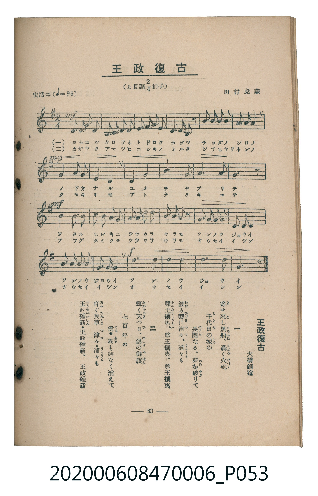

# 王政復古

> Re:Shōka 使用 AI 協助辨識與重建樂譜，可能會有錯誤。歡迎回報。

- **鋼琴伴奏版**：<br><audio controls src="osei_fukko.mp3"></audio>
- **NEUTRINO 歌聲合成版**：<br><audio controls src="osei_fukko_neutrino.mp3"></audio>

- 詞：大橋銅造
- 曲：田村虎藏
- 臺灣教育會公認《新定兒童唱歌》尋常科第六學年用（2020.006.0847.0006）

## 說明

原書資訊與歌詞全文（對應 P053.jpg，書頁 p. 30，第三學期第 3 首）：
調性與拍號：と長調四分之二拍子（G 大調 2/4 拍），「快活ニ」（♩=96）


## 歌詞

```text
一、
寄（よ）せ來（こ）し黒船（くろふね）、轟（とどろ）く火砲（ほづゝ）、
千代田（ちよだ）の城（しろ）の
長閑（のどか）なる、夢（ゆめ）を破（やぶ）りて
渡（わた）る響（ひびき）に津々（つゝ）、浦々（うらうら）も
尊王攘夷（そんのうじやうい）、尊王攘夷、尊王攘夷

二、
輝（かがや）く天（あま）つ日（ひ）、錦（にしき）の御旗（みはた）
七百年の
雲（くも）・霧（きり）も跡なく消えて
仰（あふ）ぐ民草（たみくさ）津々（つゝ）・浦々（うらうら）も
王政維新（わうせいいしん）・王政維新、王政維新
```

## ABC

<div class="abc-score" data-abc-src="osei_fukko.abc" aria-label="五線譜載入中"></div>

[下載 ABC 原始檔](osei_fukko.abc)

## TMD 檔案連結

- [主旋律 TMD 檔案](osei_fukko.tmd) [[在 TMD Studio 編輯](https://tmdlang.github.io/Tmd-TS/#tmd=s7IKdvYPcrWy4qpTUCpJTLdSSM7PyUlNLsnMz7MqzsjMK0nNjM_KTMmPL87Iz05Ugisry88pzU21Si9KTEmNN4s3MjAyiDcwMIs3sDAxBzIMzBBKi_NLi5JTrYqTM_Lzc-JLUitKkvLzsxHyBUX5Zal5iXlANQVFIBtTwIoQClLLMlNSQdLFyYl58WWpRZlpmakpSG5JLSoGuxdsUXxJUWJecXJRZgHIEwhV-UUlGflA9xZkVFplZBaX5BdlJifmxGcn5iF5qyQjFegriHQlunBmbgHQ7sQcZDMz0zPzrHJTM7MysfgMKl2SmAkMPVAIlifG5yZm5uUk5iE5H-rsgsT0VKsAA1NjJS4tLYXnfd3Ppux_um_l0_4lClpaXIq2CpZmXPa2Cu5cNkb6JnYg3S9Wznu_Z9bTJcufrex-2dX6smEB2NBnszcBhZ9P2fBs7sQXM_teTO8HC79o3_W8cfGzqTNfNG16Nqf5aeuaF6t6Hzd0PZu24em6WU9bJz1fvfTplI3P1vY8buh-uqH76Y4dz5dPfL5mzdPWtU_X7ni6c8vzKSve7-kARbUeMIL1QFENZBiYvd_TqcTFpa-lYEstwKWgoPC0b_6z2TtebG5_saLrRUc70F1A_z5tXfFsWjvQFU839D5r71QAhZdeVkH6-z09QMUvFzQqFOgpGBsAuUCHP9nRCXT4sznzgWwFY4WXy6YBXQoMGpDpL1btf9awHGRud--LmfOBoo8bV7ycuh0o_nT27KcdbU92dj_Z1QOUfbp2AtA-dwVgOAMlFYCBrwAUBZsEDKmep_tXP9uy-3Fz9-MGoGDHo5krbS1BIcIFsuXJjobHDY1g36xvAco-buoASj1unP1kXxuI2zgZzJ3-cvekFx07wSL9j5t6Hzdufdy4FiTV0PhiL9BxQPEVjxtXAqXA6vufN65-vgAYy0Dx3Y8blz5umgtRDLapt_nJ7sXA6AdLLwRa-bhxAVjbuqfz-8CC02EGrQNpAPr65bSJYIl1IEsau8Fyqx43Af3U-HTJIrDD2x43NYLEmyY9X7AFLNLyuHEbWKTrceMykEHPdiwES_Q_bgS6GSjR_XL-frC5mx43bn7cCLETGFxLHze0gsWXwF3-bOsymCDQJqAyEAk2pAnsqQ1d4Bwx4-mS7WBFcx83TQa7t-1x4wywW4AMYBCDzEJWjMaFxMouYMSBw-rFHqD1QNO6Hzf2AA2BBO7TJSvBgk2PG_eBRZY8m74U4g2I-S97loG5q0EhCfXVuqf7Fj6bPh0svv9x43pIEEDSQPPzmfuA2QcW3KDsCYnoJpDW5t0v5ywHi_QCgxLi5RfbF4IioLH_2TagOBCBw_fJbkicAh22FWzphGcbJr7oBQYTUHA-2F5g0E8FSmEJ4ubdBIIYUuI837YWWCDAohEYprOBwQpGwEQDTq3Nu5FVAoMDmQsyiPLsDwUKWvpcXP7FqZlupdnZ-VYBmYl5-Q41BjXVIFsUbAzNtOzALGwljwI4_ze8WNijoGEGTD79z9c36MCLC00sGoCWgQyrUajOTatVMI1X0AVCIGUIoXSBMsYQQZN4iIAZRNQcImqoYAQkwZwaJO1gPQYQ7WAxYzANwjVgHbpAEkIDRcBO8DGsUQBmW7AIMAKAeDKYNR2sBxjJEJmmXiB7K1hmLVRmBVTPSrAsiAVSC5LZDZVZCsRLgCyIM4HlA9SsDiB7AVjFOqgMyDaYLSAxJPcZgeS7oSb2ANW0oNjVBJXZB7ULmHGgMquhMtOBGOI-mG37oTLrgXg-kvugrgC6E1SKNDWjWATyNsiJk1GciD9N7OohL00U1IJTAiS-QLENcgI4BUAjGmo9gglTDot4hCgs4hHG1cBVgyA4uSCSAtxvoIgFkaCgB4mvgok3QSIDLNrUBhdtRBKdhGQ-JMJAJmxDEe2Cii5DEgVHBFK0QxIfSDUomiHRCDIfpBchDrUVmhRA6iBJE9XdEBlYbIJMQoiCkj92txDI851k53lYNMHyaY2CCZSHiHFYjjUFkiCMyNUgGUg-h0SlIZiG6EIUB4iEgpTV4WEKTvqQ-AT5HZRtgDUnPJwhGQgkA8pWIP4SIAbFN7Akh8pAYh_Eh8QELCPNhYrD8gpEJUgGWH2CshVECFjUozoQHOmIaASVNyB6AlgryLmQvAuJRmDtQ64DoYEAccNsMAuWSCEuApcaQOfDXIc3GQDbcOQkA8wSGjkuIcm3GlQ7QHngSAWLwkRgNEIEoQZfFic9euCaoFEDDhrU0gJWEqAYgyyJCF0IRMvspMYJUlJGtQOkFyKC7Hxkm-G1G9w0hHtqubh07RTgDQEFIEeZCwA)]
- [鋼琴伴奏 TMD 檔案](osei_fukko_piano.tmd) [[在 TMD Studio 編輯](https://tmdlang.github.io/Tmd-TS/#tmd=s7IKdvYPcrWy4qpTUCpJTLdSyC8qychPL0osyKi0ysgsLskvykxOzInPTsxLVIIrKs4vLUpOjS9ITE-1CjAwNVbi0tJSeN7X_WzK_qf7Vj7tX_J-T8fL7j3PJ2x5smfL06X9zzs73u_pVNDS4lK0VbA047K3VXDnsjHSN7EDGfli5bz3e2Y9XbL82crul12tLxsWgG16NnsTUPj5lA3P5k58MbPvxfR-sPCL9l3PGxc_mzrzRdOmZ3Oan7auebGq93FD17NpG56um_W0ddLz1UufTtn4bG3P44bupxu6n-7Y8Xz5xOdr1jxtXft07Y6nO7c8n7IC6D4jAyMDPQMDMz0DCxNzIMPADOhEJS4u_-LUTLfS7Ox8q4DMxLz8IA-HGoOaai4FILAxNNOyA7P0tRRs0YEC0I4nOxpeLOxR0AAFil5WQbomFmVa-mAjahSqc9NqFUzjFXSBEEgZQihdoIwxRNAkHiJgBhE1h4gaKhgBSTCnBkk7WI8BRDtYzBhMg3ANWIcukITQQBGwE3wMaxQeN3WARR43zgbiyWDWdLCex439EJmmXiB7K1hmLVRmBVTPSrAsiAVSC5LZDZVZCsRLgCyIMx83LoSa1QFkLwCrWAeVAdkGswUkhuQ-I5B8N9TEHqCaFhS7mqAy-6B2PW7cBJVZDZWZDsQQ98Fs2w-VWQ_E85HcB3UF0J1AUx43NaNYBPI2yImTUZyIPyXs6iElJRTUguMfEkugOAZZDI53aPRCLUUwYcph0Y0QhUU3wrgauGoQBCcSRAKA-wgUnSASFOAg8VUw8SZIFIBFm9rgoo1IopOQzIdEE8iEbSiiXVDRZUii4OBHimxIkgOpBkUuJPJA5oP0IsShtkITAEgdJEGiuhsiA4tDkEkIUVCix-4WAvm7k8T8DYscWJ6sUTCB8hDxDMudpkAShBE5GCQDydOQCDQE0xBdiKyPSB5I2RoekuBkDolFkI9BWeRx42Z46EIyC0gGlIVA_CVADIrlx02dUBlInIP4kPCHZZq5UHFYvoCoBMnMgGQhiNDjRlCCQHIgOKoRkQcqW0D0BLBWkHMh-RQSeY8bp5LrQGggQNwwG8yCJU2Ii8AlBND5MNfhjfyns2cTH_mYZTByDEKSajWo_IfywFEJFoWJwGiECEINvuxMeqTANUEjBBwgqCUDLNejGIMsiQhTCETL2KTGBFICRrUDpBcigux8ZJvh9RfcNIR7ajHqdx_k-t0EWr1D865hvEK0YSwouGEM03ggyzQeKmaAXQqlUIdJm4CkEQoJGIvVFcDmADblSCzsDsH0BjjhIQzBzoS6BBhkunYK8FCL9gGagCpgBBZQ5gIA)]

## 分析

```text
================================================================================
📊 TMD Song Profile: [ 王政復古 ]
================================================================================
⏱  Duration:       0:30 (30.0s), 24 measures total
🎼 Key & Tempo:    首調基準 G, != 96.0 BPM, <2/4>
   - 分析範圍：      由實際發聲的音符與和弦推測調性；播放脈絡另行呈現
🎤 人聲音域:    B3 (MIDI 59) – D5 (MIDI 74) [跨度: 15 個半音 / 1.2 個八度, 難度: moderate]
   - 最低音:  B3 in [OseiFukko #1 @ m.2, 0:01]
   - 最高音: D5 in [OseiFukko #1 @ m.15, 0:18]
   - 適合: soprano, mezzo-soprano, contralto, tenor, baritone, bass
🏛  結構:      OseiFukko (30.0s)
⚡ 編曲密度:        Peak 1 軌道同時演奏
🗝  調性診斷：       G 大調（純淨自然大調，未偵測到可信轉調）
   - 風格氣質:    純淨自然大調（陽光明朗、易唱易記，無明顯調外色彩）
   - 轉調歷程:    全曲維持單一推測調性（未偵測到可信轉調）
   - 核心骨幹音:  D, G, B, A, E
   - 調性數值:    G 大調 [相關度: 0.86, 穩定度: Moderate, 自然音純度: 100.0%]
   - 候選調性 (K-S): G 大調 (0.86), D 大調 (0.80), B 小調 (0.73)
   - 五度圈歷程:   +1
   - 各段落調性細節:
     • [OseiFukko #1]: G 大調 (r: 0.86, 自然音純度: 100.0%)

  [ 五度圈游移軌跡 ]
               C  
         F           [G ]*
      Bb               D  
      Eb               A  
         Ab           E  
            Db       B  
               F# 
     (* = active key center)

  [ 十二半音累積音高分佈 ]
     C  : █                          1.6%
     C# :                            0.0%
     D  : ████████████████████████  30.4%
     D# :                            0.0%
     E  : ███                        3.3%
     F  :                            0.0%
     F# : ██                         2.7%
     G  : ███████████████████       24.5%
     G# :                            0.0%
     A  : ████████████              15.2%
     A# :                            0.0%
     B  : ██████████████████        22.3%
--------------------------------------------------------------------------------
Assignment 軌道音域：
  - Piano         : B3 – D5 (15 個半音 / 1.2 個八度, 69 個音符)
================================================================================
```


## 原書掃描頁




