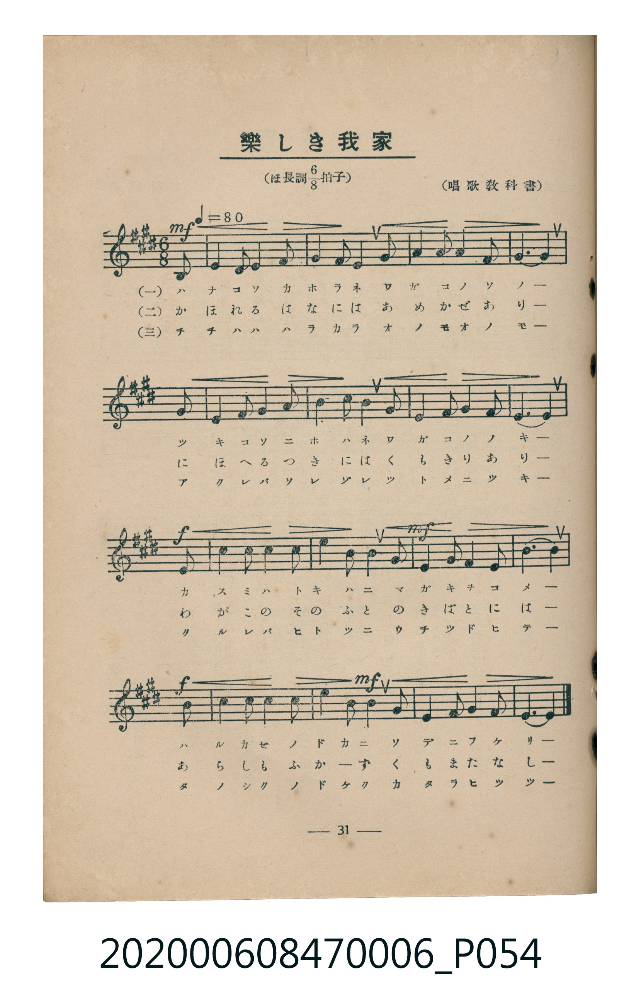
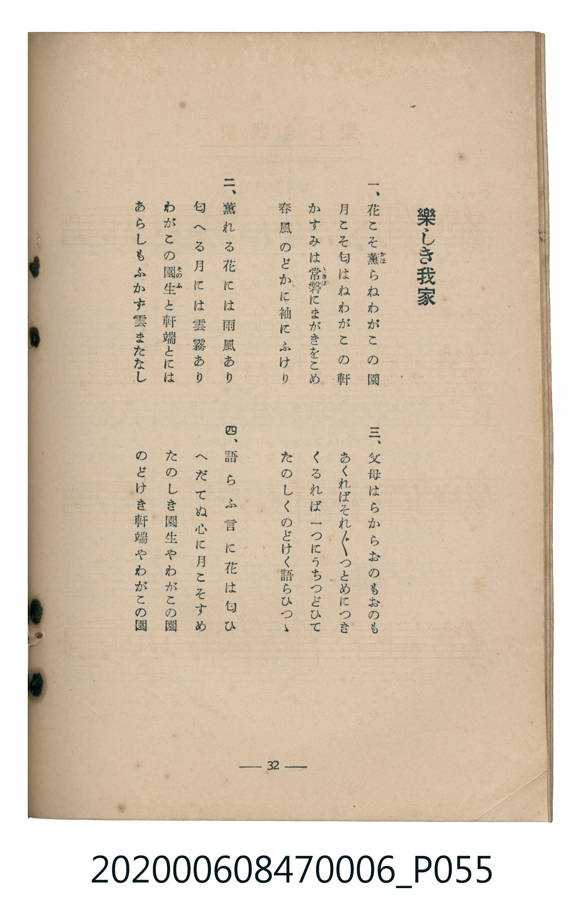

# 樂しき我家

<audio controls src="tanoshiki_wagaya.mp3"></audio>

- 唱歌教科書
- 臺灣教育會公認《新定兒童唱歌》尋常科第六學年用（2020.006.0847.0006）

## 說明

原書資訊與歌詞全文（對應 P054.jpg–P055.jpg，書頁 pp. 31–32，第三學期第 4 首）：
調性與拍號：ほ長調八分之六拍子（E 大調 6/8 拍，弱起 1 拍），♩.=80

## 歌詞

```text
一、
花こそ薫（かほ）らねわがこの園
月こそ匂はねわがこの軒
かすみは常磐（ときは）にまがきをこめ
春風のどかに袖にふけり

二、
薫れる花には雨風あり
匂へる月には雲霧あり
わがこの園生（そのふ）と軒端とには
あらしもふかず雲またなし

三、
父母はらからおのもおのも
あくればそれ〲つとめにつき
くるれば一つにうちつどひて
たのしくのどけく語らひつゝ

四、
語らふ言に花は匂ひ
へだてぬ心に月こそすめ
たのしき園生やわがこの園
のどけき軒端やわがこの園
```

## ABC

```abc
X:1
T:樂しき我家
C:TMD (Chen, Chih-Han / aguai)
M:6/8
L:1/16
Q:3/8=53
K:E
V:V1 name="Piano" snm="Pia"
[V:V1]
!mf! z2 z2 z2 z2 z2 G2 | G2 G2 G2 A4 G2 | F6 E4 E2 | A4 A2 G4 A2 |
B6 G4 G2 | G2 G2 G2 A4 G2 | F6 E4 E2 | F4 F2 G4 F2 |
!f! E10 B2 | c2 c2 c2 B4 G2 | !mf! F6 E4 E2 | A4 A2 G4 A2 |
!f! B10 B2 | c2 c2 c2 B4 G2 | !mf! F6 E4 E2 | F4 F2 G4 F2 |
E10 z2 |
```

## TMD 檔案連結

- [主旋律 TMD 檔案](tanoshiki_wagaya.tmd)
- [鋼琴伴奏 TMD 檔案](tanoshiki_wagaya_piano.tmd)

## 分析

```text
================================================================================
📊 TMD Song Profile: [ 樂しき我家 ]
================================================================================
⏱  Duration:       0:38 (38.2s), 17 measures total
🎼 Key & Tempo:    首調基準 E, != 80.0 BPM, <6/8>
   - 分析範圍：      由實際發聲的音符與和弦推測調性；播放脈絡另行呈現
🎤 人聲音域:    E4 (MIDI 64) – C#5 (MIDI 73) [跨度: 9 個半音 / 0.8 個八度, 難度: easy]
   - 最低音:  E4 in [TanoshikiWagaya #1 @ m.3, 0:05]
   - 最高音: C#5 in [TanoshikiWagaya #1 @ m.10, 0:20]
   - 適合: soprano, mezzo-soprano, contralto, tenor, baritone, bass
🏛  結構:      TanoshikiWagaya (38.2s)
⚡ 編曲密度:        Peak 1 軌道同時演奏
🗝  調性診斷：       E 大調（純淨自然大調，未偵測到可信轉調）
   - 風格氣質:    純淨自然大調（陽光明朗、易唱易記，無明顯調外色彩）
   - 轉調歷程:    全曲維持單一推測調性（未偵測到可信轉調）
   - 核心骨幹音:  E, G#, F#, B, A
   - 調性數值:    E 大調 [相關度: 0.84, 穩定度: High, 自然音純度: 100.0%]
   - 候選調性 (K-S): E 大調 (0.84), B 大調 (0.57), C# 小調 (0.56)
   - 五度圈歷程:   +4
   - 各段落調性細節:
     • [TanoshikiWagaya #1]: E 大調 (r: 0.84, 自然音純度: 100.0%)

  [ 五度圈游移軌跡 ]
               C  
         F            G  
      Bb               D  
      Eb               A  
         Ab          [E ]*
            Db       B  
               F# 
     (* = active key center)

  [ 十二半音累積音高分佈 ]
     C  :                            0.0%
     C# : ███████                    6.2%
     D  :                            0.0%
     D# :                            0.0%
     E  : ████████████████████████  22.9%
     F  :                            0.0%
     F# : ██████████████████████    20.8%
     G  :                            0.0%
     G# : ████████████████████████  22.9%
     A  : █████████████             12.5%
     A# :                            0.0%
     B  : ███████████████           14.6%
--------------------------------------------------------------------------------
Assignment 軌道音域：
  - Piano         : E4 – C#5 (9 個半音 / 0.8 個八度, 57 個音符)
================================================================================
```


## 原書掃描頁






