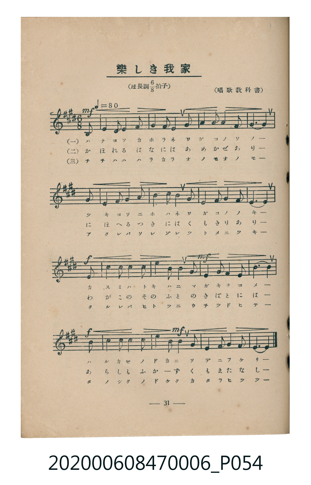
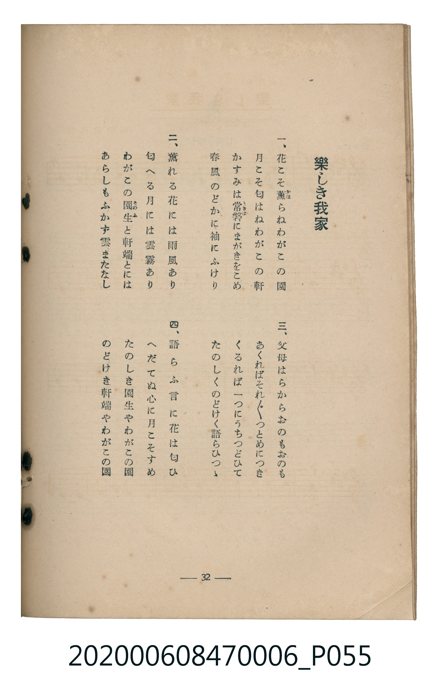

# 樂しき我家

> Re:Shōka 使用 AI 協助辨識與重建樂譜，可能會有錯誤。歡迎回報。

<audio controls src="tanoshiki_wagaya.mp3"></audio>

- 唱歌教科書
- 臺灣教育會公認《新定兒童唱歌》尋常科第六學年用（2020.006.0847.0006）

## 說明

原書資訊與歌詞全文（對應 P054.jpg–P055.jpg，書頁 pp. 31–32，第三學期第 4 首）：
調性與拍號：ほ長調八分之六拍子（E 大調 6/8 拍，弱起 1 拍），♩=80
註：P055 歌詞頁第四節末句印作「のどけき軒端やわがこの園」（《公學校唱歌》作「我がこの軒」）。


## 跨冊／重複收錄參照

> 同曲＋同詞異曲＋同名異曲（《公學校唱歌》六年級、《新定兒童唱歌》六年級與《共益商社唱歌教科書》卷四為同曲；《唱歌帖》P027 同採「花こそ薫らね…」歌詞而譜曲不同；《唱歌帖》P102 則採 *Home! Sweet Home!* 旋律）

- **[同曲]** 《公學校唱歌》第六學年用（昭和15年／1940，國臺圖 523.37 4322-4）：[**〈樂しき我が家〉**](../../../kogakko_shoka/grade_6/15_tanoshiki_wagaya/index.md)（`E` / `6/8` — [原始 TMD](../../../kogakko_shoka/grade_6/15_tanoshiki_wagaya/tanoshiki_wagaya.tmd)）
- **[同曲]** 《共益商社唱歌教科書》卷四・教師用（明治33年／1900）：[**〈樂しき我家〉**](../../../kyoeki_shoka/kan_4_854865/12_tanoshiki_wagaya/index.md)（`E` / `6/8` — [原始 TMD](../../../kyoeki_shoka/kan_4_854865/12_tanoshiki_wagaya/tanoshiki_wagaya.tmd)）
- **[同名異曲]** 《新編小公學校唱歌教材集》高等一、二學年（大正12年／1923，國臺圖 0725-41）：[**〈樂しき我家〉**](../../../shoka_kyozai_shu_1923/koto_1_2/23_tanoshiki_wagaya/index.md)（`E` / `6/8` — [原始 TMD](../../../shoka_kyozai_shu_1923/koto_1_2/23_tanoshiki_wagaya/tanoshiki_wagaya.tmd)）
- **[同名異曲]** 楊金土手抄《唱歌帖》第 2 冊・II（2020.006.0843）：[**〈樂しき我家〉**](../../../shokacho/vol_02/p102_tanoshiki_wagaya/index.md)（`B,` / `4/4` — [原始 TMD](../../../shokacho/vol_02/p102_tanoshiki_wagaya/tanoshiki_wagaya.tmd)）
- **[同詞異曲]** 楊金土手抄《唱歌帖》第 8 冊・VIII（2020.006.0843）：[**〈樂シキ我家（快樂的我家）〉**](../../../shokacho/vol_08/p027_tanoshiki_waga_ie/index.md)（`B,` / `4/4` — [原始 TMD](../../../shokacho/vol_08/p027_tanoshiki_waga_ie/tanoshiki_waga_ie.tmd)）
- 總表：[跨冊重複與同名歌曲總索引](../../../duplicate_songs.md)

## 歌詞

```text
一、
花こそ薫（かほ）らねわがこの園
月こそ匂はねわがこの軒
かすみは常磐（ときは）にまがきをこめ
春風のどかに袖にふけり

二、
薫れる花には雨風あり
匂へる月には雲霧あり
わがこの園生（そのふ）と軒端とには
あらしもふかず雲またなし

三、
父母はらからおのもおのも
あくればそれ〴〵つとめにつき
くるれば一つにうちつどひて
たのしくのどけく語らひつゝ

四、
語らふ言に花は匂ひ
へだてぬ心に月こそすめ
たのしき園生やわがこの園
のどけき軒端やわがこの園
```

## ABC

```abc
X:1
T:樂しき我家
M:6/8
L:1/16
Q:3/8=53
K:E
V:V1 name="Piano" snm="Pia"
[V:V1]
!mf! z2 z2 z2 z2 z2 B,2 | E4 D2 E4 F2 | G4 F2 E4 G2 | A4 A2 A4 F2 |
w: 1.~ハ | ナ コ ソ カ | ホ ラ ネ ワ | ガ コ ノ ソ
w: 2.~か | ほ れ る は | な に は あ | め か ぜ あ
w: 3.~チ | チ ハ ハ ハ | ラ カ ラ オ | ノ モ オ ノ
w: 4.~か | た ら ふ こ | と ば に は | な は に ほ
G6 G4 G2 | E4 F2 G4 A2 | B4 c2 B4 G2 | E4 F2 G4 F2 |
w: 1.~ノ ー ツ | キ コ ソ ニ | ホ ハ ネ ワ | ガ コ ノ ノ
w: 2.~り ー に | ほ へ る つ | き に は く | も き り あ
w: 3.~モ ー ア | ク レ バ ソ | レ ゾ レ ツ | ト メ ニ ツ
w: 4.~ひ ー へ | だ て ぬ こ | こ ろ に つ | き こ そ す
!f! E6 E4 E2 | c4 c2 c4 c2 | !mf! e4 B2 B4 G2 | E4 G2 F4 E2 |
w: 1.~キ ー カ | ス ミ ハ ト | キ ハ ニ マ | ガ キ ヲ コ
w: 2.~り ー わ | が こ の そ | の ふ と の | き ば と に
w: 3.~キ ー ク | ル レ バ ヒ | ト ツ ニ ウ | チ ツ ド ヒ
w: 4.~め ー た | の し き そ | の ふ や わ | が こ の そ
!f! B6 B4 B2 | c4 c2 c4 c2 | !mf! e4 B2 B4 G2 | E4 F2 G4 F2 |
w: 1.~メ ー ハ | ル カ ゼ ノ | ド カ ニ ソ | デ ニ フ ケ
w: 2.~は ー あ | ら し も ふ | か ー ず く | も ま た な
w: 3.~テ ー タ | ノ シ ク ノ | ド ケ ク カ | タ ラ ヒ ツ
w: 4.~の ー の | ど け き の | き ば や わ | が こ の そ
E6 E4 z2 |
w: 1.~リ ー
w: 2.~し ー
w: 3.~ツ ー
w: 4.~の ー
```

## TMD 檔案連結

- [主旋律 TMD 檔案](tanoshiki_wagaya.tmd) [[在 TMD Studio 編輯](https://tmdlang.github.io/Tmd-TS/#tmd=s7IKdvYPcrWy4qpTUCpJTLdSSM7PyUlNLsnMz7MqzsjMK0nNjM_KTMmPL87Iz05Ugisry88pzU21Si9KTEmNN4s3MjAyiDcwMIs3sDAxBzIMzBBKi_NLi5JTrYqTM_Lzc-JLUitKkvLzs9Hl4wsS01OtAgxMTRAyBUX5Zal5iXlA3QVFILekgLUjFKSWZaakgqSLkxPz4stSizLTMlNTkFyZWlQM9gnEipKixLzi5KLMApD3EKryi0oy8oE-KciotMrILC7JL8pMTsyJz07MQ_JwSUYq0L9pibmZOZXoohn5ualKXFpaCs9WND1unP64sfdZx8Sn67YpaGlxKdoqWBhw2dsquHLZmOlb2IG0Pp2y8dnanmdTZz5fPvHZ7B1g416073reuBgo9qJp07M5zU9b17xY1fu4oevZtA1P18162jrp-eqlEH2PG7qfbuh-umMHUPfzNWuetq59unbH051bnk9Z8X5PBygm9IDhrweKCSDDwOz9nk4lLi59LQVbagEuBQWFp33zgU5_sbn9xYquFx3tQHe9WDnvaeuKZ9Paga54uqH3WXunAig69bIK0h81TAYyTUHM93t6gPpeLmhUKCjQUzA2BEoZGwEFgT55sqMT6JNnc-YD2QomCi-XTQM6_f2eWSDrXqza_6xhOcii7t4XM-cDRR837n45dTtQ_Gnr6qcdbU92dgNDAij7dO0EoANcFZ4uWQ6UVACGuQJQFGjD0z0bX2zdrmAI4QIN7nk0c6UtMHJAxq_YDTQS5EYFiE-ADgSF7ezZz9c3PJuz-mn_0qe9G57snfO4oedx47rHjSsfN04ExvOL3cB4Wf-4qeVxU__jRqDUZKDs0zmTHjcAregARh8wHkF-WrAQHncQQ4AJBK4eaAhYfefjhiYukGue7Gh43NAIdlfXRrCauS-mrQYZ2NgN9DZIZVPn48a1aJaCNDybA1QE0vC0B5gU16MpAtoEUgQ2Zubjxv1AFaB0tBgUYo8bVwA9BBQBGd-4-nHjPrC23sdNk0Cam8DueTZj6ctFQHWQEACasvrFomlg1VtBAdLUBXH_LqBHIe6ftvpxU8_jpm6wR4DK1r-cvQJsQhNIMSgdgdy5A6gC7HKIik0v5yxHqEDz5fMpwNgHKp0LdsVWsGtXQOMB5AWQERBPAg0Ayk1_3AS0Aeg8oGtnAc0Ge2z-48ZVQCloaAMDHuza5x3bnq0HBQFYYzeY7AJZAzIByoAZ3dgP8ljjBpBDgIyGLY8bgHYsATmhqRHsCiC7F6IaqBRoGEg1KGZBEkDptseNC8FsYEACHbUMohToMKCvgEUI0M_wZNb_YtU8sGOA6pY8bpoLdjYwbcICGSq79cUKoOmrwUG9HhyumyCG7njcuABow-PGNU_3NwNVwBMJKBVAIhbJ5l5IIGMmaog6wokfpI7yQgYKFLT0ubhCEvPygbVRdmZ4YnpiZaJVQCZQwKHGoKYaZJeCjYWWHZiBrZBTAJcsDS8W9ihoQIsAbQVjhacb-oFZG8iEFDYQ7tPOXgVgCdDdqwMvujSxmAh0Esi2GgUDOKzOTatVMI0Hihkq6CqYx4MpIyDXGEyDeMZAngmQNgGTMDmQOFgObKSPYY1CPBw-bu4Hqnrc3AVU8bhpMxDvBbNWg0Vng9jNK4G4F8xaDxJtWgNT29wHZu0FqwWxQWr2gMkWmG1GKLY1doPUNu4G6-sB4m4QqxFsbuMqMHs1mA9iNYFtawSzu4F4DpIoyL1w24B6oLYZo_qtEewysAlAf4IwhAUSXQn1J4y1Cu6Lx82LwHwQqw8sugjZtqZFMNtMsPltPlhNJ5C1Fey2yWDRFWD2BrBb0X28Hi66Gyy6CcVvO4C24U95u3rAKQ85lQHrE2ASw0yFFmSmQkhSAyUjEyDPFEibgUlQgkPIgRIciKcLJquBydUQKdE9blqLmsiawQEGTWSg6MGTyCARATYBERHwaAcmMmiiAgYXLFEtAQcm2EykRAWO_KYmMLsXmpCwJqomoEp4onrcBNbdvAaIJyAleogr98FYoGQPJDvA7IVgH8JF0dwO9CU8EQHLTrArlgEx2BxoopkMVgl0JTR5IPtoMhDPBbNmwrMJItHMJ5hodnTCEw0sUeBKNIZGZKYaM3A6gZDAlBEHZJiCkw24KIOlHWNgugGlGEi6AimBpB1TlLSzE-y7-fBM3AEPU0jagYT0PKS0sxbIB2UlUCoCxcpC5BACFQJIaacHHqbrwKy54JCGsLfCs-86pPAHZWWIKLioBKcuRPgD0xMi7TSDYw-RdponIaWSFpjbm5YhFVYg0U4ktW0oaWc_StqBuHI63GVobm9qgaVmvP5EuB3oS_xpB9gsgKcdeNqAJx5YEUTVNIKtfDFATh-QMAYV502Q-IUU3OAwBBfykDCG5Np2sApgldI8FSy6ESwKKoxhoQCsZRGpA1iYQ0MYWm5sBYcaJMXtAbJmgUWRSxZgiQCpCIBFPEjtdGxmg9MGpArdDi9hkN29ESYKqY6B8Q5SAaqOJ0FTCUgtKH4xzAanDHDF1jgRnjLQ0i-JKQNkdi0Xl66dAlpbSQEopMwFAA)]
- [鋼琴伴奏 TMD 檔案](tanoshiki_wagaya_piano.tmd) [[在 TMD Studio 編輯](https://tmdlang.github.io/Tmd-TS/#tmd=s7IKdvYPcrWy4tLSUni2oulx4_THjb3POiY-Xbft_Z6Ol917nk_Y8mTPlqdL-593drzf06mgpcWlaKtgYcBlb6vgymVjpm9hx1WnoPR0ysZna3ueTZ35fPnEZ7N3KIHEXrTvet64GCj2omnTsznNT1vXvFjV-7ih69m0DU_XzXraOun56qUQfY8bup9u6H66YwdQ9_M1a562rn26dsfTnVueT1kBdIWRgZGBnoGBmZ6BhYk5kGFgBnSIEheXZ15JUb5VQGZiXn6Qh0ONQU01lwIQ2Fho2YEZNQrVuWm1CmYKukAMIWsUDOOADFMg1FUwBnGBtBGQBSIhPF0waaBQw1WLYoUPHitM4uMVok3iYyEEKg9oKpBrCOQBMZAJNhvCMAUqBGFdhWhTXCpBrggBWl-ckZmdGZ6YnliZiMfL-loKtuhAARiiT3Y0vFjYo6ARYGBqopdVkK6JRZmWPtRLBnAI9pxpPDRkzOOhwVUDDTAQDxSIJkDaBEzC5EDiYDmwkT6GNQrxcPi4uR-o6nFzF1DF46bNQLwXzFoNFp0NYjevBOJeMGs9SLRpDUxtcx-YtResFsQGqdkDJltgthmh2NbYDVLbuBusrweIu0GsRrC5javA7NVgPojVBLatEczuBuI5SKIg98JtA-qB2maM6rdGsMvAJgD9CcIQFkh0JdSfMNYquC8eNy8C80GsPrDoImTbmhbBbDPB5rf5YDWdQNZWsNsmg0VXgNkbwG5F9_F6uOhusOgmFL_tANqGPznt6iE-OSGymAmQB8p4ZgSzXzUw3RkipZ7HTWtRU0sz2OfQ1AIKZzypBRKiYBMQIQqPP2BqgaYOoL9hqWMJOFTAZiKlDnAsNjWB2b3QFIE1dTQBVcJTx-MmsO7mNUA8ASn1Qly5D8YCpV8g2QFmLwT7EC6K5nagL-Gp4XHjArArlgEx2Bxo7E8GqwS6EhrPyD6aDMRzwayZ8PSOiP35BGN_RyfxsY-z9AWXLbA0YAyMf1DMQ9IHSAkkDZiipIGdYFfOh-eqDnjYQNIAJMTmIaWBtUA-KG2DUgModBci-xSUK5HSQA88bNaBWXPBIQZhb4Xnp3VI4QjKWxBRcNkFTiWIcASmC0QaaAbHAiINNE9Ciu0WmNubliGVHiDRTiS1bShpYD9KGoC4cjrcZWhub2qBpUq8_kS4HehL_Gng6ezZ1E4DuKphePxDwhBUfjZB4g9SUoLDCFyqQsIQkrvawSqAZXjzVLDoRrAoqPSD-RJYrSFiH1h6QkMQmr-3gkMFkqL2AFmzwKLIJQAw50JKXmCZClI7HZvZ4LiH1Fnb4SUBsrs3wkQh9R8wXkEqQPXfJGgqAKkFxR-G2eCYB9ckjRPhMY-WPkmMeZDZuBocOBpAaK0FeOPGGNhagDVykNo7YAaogQNsNqC0k4yAHKNcIAdEYG8KQesTFKNAhgBLDXArCsSGsIBSxLaxQMUMwnDSWnKoPgYJI1kPYoLtBBMQCepZRmzbUddOAdyIVQAy0KI12geoFpuwEXZhY-zCJmBhZS4A)]

## 分析

```text
================================================================================
📊 TMD Song Profile: [ 樂しき我家 ]
================================================================================
⏱  Duration:       0:38 (38.2s), 17 measures total
🎼 Key & Tempo:    首調基準 E, != 80.0 BPM, <6/8>
   - 分析範圍：      由實際發聲的音符與和弦推測調性；播放脈絡另行呈現
🎤 人聲音域:    B3 (MIDI 59) – E5 (MIDI 76) [跨度: 17 個半音 / 1.4 個八度, 難度: challenging]
   - 最低音:  B3 in [TanoshikiWagaya #1 @ m.1, 0:01]
   - 最高音: E5 in [TanoshikiWagaya #1 @ m.11, 0:22]
   - 適合: soprano, mezzo-soprano, contralto, tenor, baritone, bass
🏛  結構:      TanoshikiWagaya (38.2s)
⚡ 編曲密度:        Peak 1 軌道同時演奏
🗝  調性診斷：       E 大調（純淨自然大調，未偵測到可信轉調）
   - 風格氣質:    純淨自然大調（陽光明朗、易唱易記，無明顯調外色彩）
   - 轉調歷程:    全曲維持單一推測調性（未偵測到可信轉調）
   - 核心骨幹音:  E, G#, B, C#, F#
   - 調性數值:    E 大調 [相關度: 0.95, 穩定度: High, 自然音純度: 100.0%]
   - 候選調性 (K-S): E 大調 (0.95), C# 小調 (0.74), G# 小調 (0.57)
   - 五度圈歷程:   +4
   - 各段落調性細節:
     • [TanoshikiWagaya #1]: E 大調 (r: 0.95, 自然音純度: 100.0%)

  [ 五度圈游移軌跡 ]
               C  
         F            G  
      Bb               D  
      Eb               A  
         Ab          [E ]*
            Db       B  
               F# 
     (* = active key center)

  [ 十二半音累積音高分佈 ]
     C  :                            0.0%
     C# : ██████████                13.5%
     D  :                            0.0%
     D# : █                          1.0%
     E  : ████████████████████████  31.2%
     F  :                            0.0%
     F# : ████████                  10.4%
     G  :                            0.0%
     G# : ███████████████           19.8%
     A  : █████                      6.2%
     A# :                            0.0%
     B  : ██████████████            17.7%
--------------------------------------------------------------------------------
Assignment 軌道音域：
  - Piano         : B3 – E5 (17 個半音 / 1.4 個八度, 60 個音符)
================================================================================
```


## 原書掃描頁






