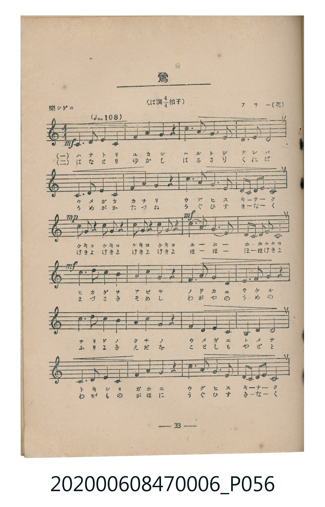
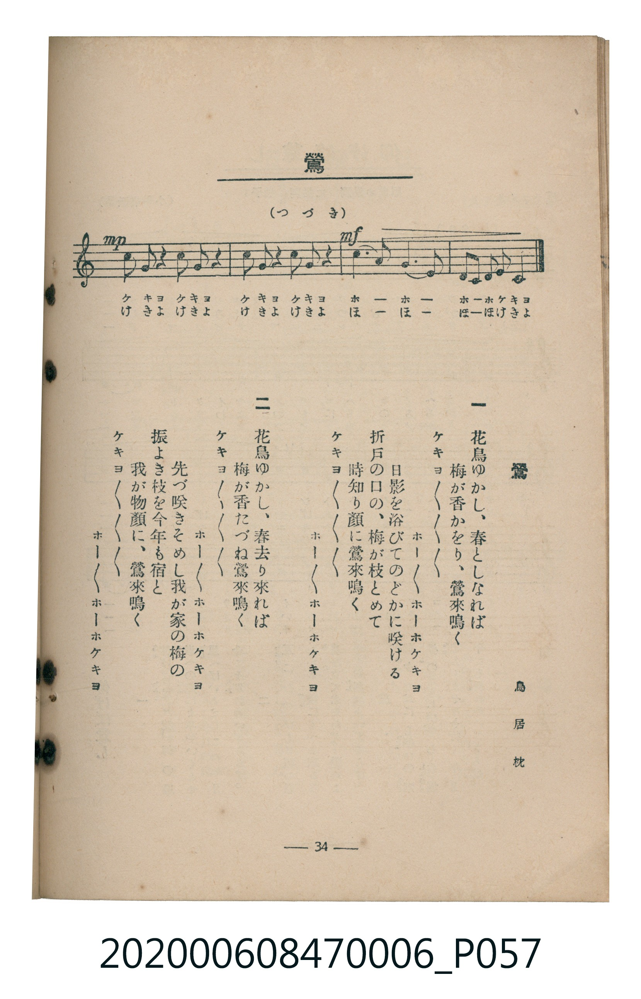

# 鶯

<audio controls src="uguisu.mp3"></audio>

- 詞：鳥居忱
- 曲：フラー（英）
- 臺灣教育會公認《新定兒童唱歌》尋常科第六學年用（2020.006.0847.0006）

## 說明

原書資訊與歌詞全文（對應 P056.jpg–P057.jpg，書頁 pp. 33–34，第三學期第 5 首）：
調性與拍號：は調四分之四拍子（C 大調 4/4 拍），「樂シゲニ」（♩=108）

## 歌詞

```text
一、
花鳥ゆかし、春としなれば
梅が香かをり、鶯來鳴く
ケキョ〳〵〳〵〳〵　ホー〳〵ホーホケキョ
日影を浴びてのどかに咲ける
折戸の口の、梅が枝とめて
時知り顔に鶯來鳴く
ケキョ〳〵〳〵〳〵　ホー〳〵ホーホケキョ

二、
花鳥ゆかし、春去り來れば
梅が香たづね鶯來鳴く
ケキョ〳〵〳〵〳〵　ホー〳〵ホーホケキョ
先づ咲きそめし我が家の梅の
振よき枝を今年も宿と
我が物顔に、鶯來鳴く
ケキョ〳〵〳〵〳〵　ホー〳〵ホーホケキョ
```

## 原書掃描頁





## 分析

```text
================================================================================
📊 TMD Song Profile: [ 鶯 ]
================================================================================
⏱  Duration:       1:02 (62.2s), 28 measures total
🎼 Key & Tempo:    首調基準 C, != 108.0 BPM, <4/4>
   - 分析範圍：      由實際發聲的音符與和弦推測調性；播放脈絡另行呈現
🎤 人聲音域:    C4 (MIDI 60) – C5 (MIDI 72) [跨度: 12 個半音 / 1.0 個八度, 難度: easy]
   - 最低音:  C4 in [Uguisu #1 @ m.1, 0:00]
   - 最高音: C5 in [Uguisu #1 @ m.11, 0:22]
   - 適合: soprano, mezzo-soprano, contralto, tenor, baritone, bass
🏛  結構:      Uguisu (62.2s)
⚡ 編曲密度:        Peak 1 軌道同時演奏
🗝  調性診斷：       C 大調（純淨自然大調，未偵測到可信轉調）
   - 風格氣質:    純淨自然大調（陽光明朗、易唱易記，無明顯調外色彩）
   - 轉調歷程:    全曲維持單一推測調性（未偵測到可信轉調）
   - 核心骨幹音:  G, C, D, F, A
   - 調性數值:    C 大調 [相關度: 0.93, 穩定度: High, 自然音純度: 100.0%]
   - 候選調性 (K-S): C 大調 (0.93), G 大調 (0.77), A 小調 (0.58)
   - 五度圈歷程:   +0
   - 各段落調性細節:
     • [Uguisu #1]: C 大調 (r: 0.93, 自然音純度: 100.0%)

  [ 五度圈游移軌跡 ]
              [C ]*
         F            G  
      Bb               D  
      Eb               A  
         Ab           E  
            Db       B  
               F# 
     (* = active key center)

  [ 十二半音累積音高分佈 ]
     C  : ███████████████████████   22.4%
     C# :                            0.0%
     D  : █████████████████         16.6%
     D# :                            0.0%
     E  : ███████████               10.7%
     F  : ████████████              11.7%
     F# :                            0.0%
     G  : ████████████████████████  23.4%
     G# :                            0.0%
     A  : ████████████              11.2%
     A# :                            0.0%
     B  : ████                       3.9%
--------------------------------------------------------------------------------
Assignment 軌道音域：
  - Piano         : C4 – C5 (12 個半音 / 1.0 個八度, 112 個音符)
================================================================================
```

## ABC

```abc
X:1
T:鶯
C:曲：フラー（英）
M:4/4
L:1/16
Q:1/4=108
K:C

V:V1 name="Piano" snm="Pia"

[V:V1]
!mf! c6 c2 d4 d4 | e4 f4 d4 z4 | g6 g2 f6 f2 | e4 f4 g8 |
c6 c2 d4 d4 | e4 f4 d4 z4 | g6 g2 f6 f2 | e4 d4 c8 |
!mp! g2 a2 g2 z2 g2 a2 g2 z2 | g2 a2 g2 z2 g2 a2 g2 z2 | !mf! c6 g2 e6 c2 | d4 d2 e2 d2 c6 |
!mf! c6 c2 b4 b4 | a4 a4 g4 z4 | a6 a2 g4 g4 | f4 d4 g6 z2 |
c6 c2 b4 b4 | a4 a4 g4 z4 | a6 g2 f4 e4 | d4 g4 c8 |
c6 c2 d4 d4 | e4 f4 d4 z4 | g6 g2 f6 f2 | e4 d4 c8 |
!mp! g2 a2 g2 z2 g2 a2 g2 z2 | g2 a2 g2 z2 g2 a2 g2 z2 | !mf! c6 g2 e6 c2 | d4 d2 e2 d2 c6 |
```

- [主旋律 TMD 檔案](uguisu.tmd)
- [鋼琴伴奏 TMD 檔案](uguisu_piano.tmd)
