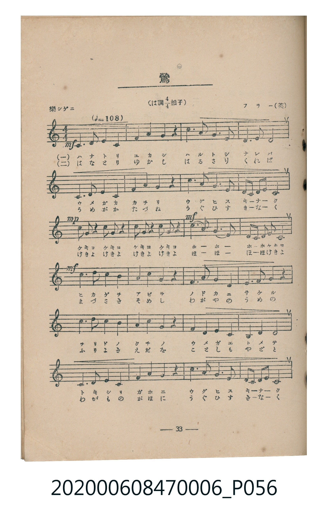
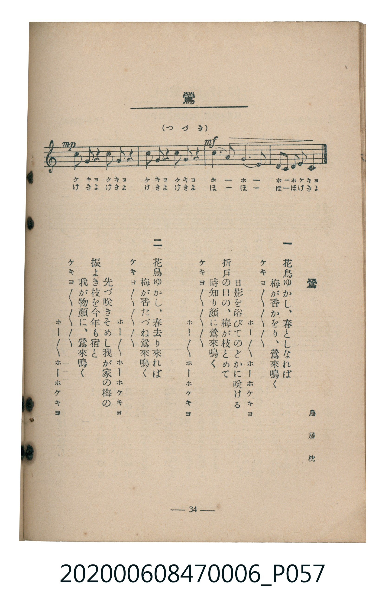

# 鶯

> Re:Shōka 使用 AI 協助辨識與重建樂譜，可能會有錯誤。歡迎回報。

- **鋼琴伴奏版**：<br><audio controls src="uguisu.mp3"></audio>

- 詞：鳥居忱
- 曲：フラー（英）
- 臺灣教育會公認《新定兒童唱歌》尋常科第六學年用（2020.006.0847.0006）

## 說明

原書資訊與歌詞全文（對應 P056.jpg–P057.jpg，書頁 pp. 33–34，第三學期第 5 首）：
調性與拍號：は調四分之四拍子（C 大調 4/4 拍），「樂シゲニ」（♩=108）


## 歌詞

```text
一、
花鳥ゆかし、春としなれば
梅が香かをり、鶯來鳴く
ケキョ〳〵〳〵〳〵　ホー〳〵ホーホケキョ
日影を浴びてのどかに咲ける
折戸の口の、梅が枝とめて
時知り顔に鶯來鳴く
ケキョ〳〵〳〵〳〵　ホー〳〵ホーホケキョ

二、
花鳥ゆかし、春去り來れば
梅が香たづね鶯來鳴く
ケキョ〳〵〳〵〳〵　ホー〳〵ホーホケキョ
先づ咲きそめし我が家の梅の
振よき枝を今年も宿と
我が物顔に、鶯來鳴く
ケキョ〳〵〳〵〳〵　ホー〳〵ホーホケキョ
```

## ABC

```abc
X:1
T:鶯
C:曲：フラー（英）
M:4/4
L:1/16
Q:1/4=108
K:C
V:V1 name="Piano" snm="Pia"
[V:V1]
!mf! C6 D2 E4 C4 | F4 A4 G4 z4 | c6 A2 G6 E2 | D6 E2 D8 |
w: 1.~は な と り | ゆ か し | は る と し | な れ ば
w: 2.~は な と り | ゆ か し | は る さ り | く れ ば
C6 D2 E4 C4 | F4 A4 G4 z4 | c6 A2 G6 E2 | D2 C2 D2 E2 C8 |
w: 1.~う め が か | か を り | う ぐ ひ す | き _ な _ く
w: 2.~う め が か | た づ ね | う ぐ ひ す | き _ な _ く
!mp! c2 G2 z4 c2 G2 z4 | c2 G2 z4 c2 G2 z4 | !mf! c6 A2 G6 E2 | D2 C2 D2 E2 C8 |
w: 1.~け きょ け きょ | け きょ け きょ | ほ _ ほ _ | ほ _ ほ け きょ
w: 2.~け きょ け きょ | け きょ け きょ | ほ _ ほ _ | ほ _ ほ け きょ
!mf! c6 d2 c4 B4 | A4 c4 G4 z4 | F6 A2 G4 D4 | E6 F2 G4 z4 |
w: 1.~ひ か げ を | あ び て | の ど か に | さ け る
w: 2.~ま づ さ き | そ め し | わ が や の | う め の
c6 d2 c4 B4 | A4 c4 G4 z4 | F4 D4 E4 C4 | B,4 D4 D8 |
w: 1.~を り ど の | く ち の | う め が え | と め て
w: 2.~ふ り よ き | え だ を | こ と し も | や ど と
C6 D2 E4 C4 | F4 A4 G4 z4 | c6 A2 G6 E2 | D2 C2 D2 E2 C8 |
w: 1.~と き し り | が ほ に | う ぐ ひ す | き _ な _ く
w: 2.~わ が も の | が ほ に | う ぐ ひ す | き _ な _ く
!mp! c2 G2 z4 c2 G2 z4 | c2 G2 z4 c2 G2 z4 | !mf! c6 A2 G6 E2 | D2 C2 D2 E2 C8 |
w: 1.~け きょ け きょ | け きょ け きょ | ほ _ ほ _ | ほ _ ほ け きょ
w: 2.~け きょ け きょ | け きょ け きょ | ほ _ ほ _ | ほ _ ほ け きょ
```

## TMD 檔案連結

- [主旋律 TMD 檔案](uguisu.tmd) [[在 TMD Studio 編輯](https://tmdlang.github.io/Tmd-TS/#tmd=s7IKdvYPcrWy4qpTUCpJTLdSSM7PyUlNLsnMz7MqzsjMK0nNjM_KTMmPL87Iz05Ugisry88pzU21Si9KTEmNN4s3MjAyiDcwMIs3sDAxBzIMzBBKi_NLi5JTrYqTM_Lzc-JLUitKkvLzsxHyBUX5Zal5iXlANQVFIBtTwIoQClLLMlNSQdLFyYl58WWpRZlpmakpSG5JLSoGuxdsUXxJUWJecXJRZgHIEwhV-UUlGflA9xZkVFplZBaX5BdlJifmxGcn5iF5qyQjFeirxLzM3MQcZK2Z6Zl5VrmpmVmZSB7Q0lJ4uW29gpYWl6KtgqGBBZe9rYIzl42JvokdSOuLlfPe75n1cvPSpxtbn-7fCDbu2exNQLHHzVMfN6983Lzn_Z6OF90b3-_pBEu-aN_1vHHxs6kzXzRtejan-Wnrmhereh83dD2btuHpullPWyc9X7306ZSNz9b2PG7ofrqh--mOHc-XT3y-Zs3T1rVP1-54unPL8ykrgEaCIkMPGAV6oMgAMgzMwDZw6Wsp2FILcCkoKDztm_9s9o4Xm9tfrOh60dEOdBfQy09bVzyb1g50xdMNvc_aOxUCDEzN9LIK0h81TAYyzUHM93t6gPpeLmhUKCjQUzA2BkoZmwAFgT55sqMT6JNnc-YD2QqmCi-XTQM6HRhiIOterNr_rGE5yKLu3hcz54PCsXE9UPDp7NlPO9qe7OwGMoBST9dOANrurPB0yXKgpAIwNhSAomBjgOHW82xF0-Om7Y-bNj1u7n7cABTveDRzpS0w9oAquEDWPNnR8LihEWxh10Zg7D1uanvc2P24cTpQ9NmMpY8bV4DYjaseN_U8btwAUvdsUevjxp6Xy2aC1DVNetzUBVQKTBlP9rW93LzlcWM_SNHjpo2Pm9Y-bl7-uGHz44atqGTD4-bZwOQA5ULYQBKmBWzJ9KVP9wL5k55tBRq5-XHjsseN6x43rgS7bfXTSZseN0583NQNVto141nHDqD00_7FIEVAd4Nd-GzeXJDrmxqBmsHqZjY9nw_0X9fLhVOAZlDVxeCQ3AUMcNwh-bRvN9BuoJVYQ3L-40ZgWK-ldjA-be0AGgwOrt7HjXPBgTH9WcdEoLVP120DhhbYCevAjulZ_7gJqLoXFG5Nk57s7gLmsMdNTU_X7QcGI1gFWN_zzpWQAKRBrFOeUaFAQUufiys0vTSzuNQqIDMxL9-hxqCmGmSFgo2Flh2Yga18UABnyoYXC3sUNEwUnm7of76-QQeeqTWxaABaBDKsRqE6N61WwVBBFwiNFIyBJIhdo2ACJM2A2BSIDcAihnFgRWZgIV2g0hqgBggLQgMVgc30MaxRAOZ5sAgwBwLxChCrqQtsDDB5gcW7weR0IBkPEYfpaOqG6oDIg2RWQWV6gOwNqHYZUW7XVCi7CyzTj9Uu_CG_q4eckCc70A3BmiDaUQMd5F2Q4xuB7B6410Ey4CBomgQPHFhAQHU0TgDiTVD2TLBMLzRIQSQkUFADHbdd88G8pWByLQV2EUjuneQl9wJgco8DhicogOEMcEhjiEHyBmlRMBHkncdN7WBfo3GJkd8NNRPBgomCSCQNmDFCd6vxRhCwnie_PIKEuVEchGUOdgooZ4C5iOwByjCwqAEVQjXgzKQLFIerQYoaWJoDZXpITgCRIJkmsPhmMLkMSMJCZB1Ux0pYDmpcDZWBFhqgMAEWIlAdSHGxDyq_FKoWksZBMnPBNjeCxZCKpCZowQPMS4-bWsAskO3oOQ0kBrGLQJE0hawiiYRwB4U3ougyBzkKJISlLgAHM6TgAQUlstdAnn7cuBAuhlxUwAIJUrh0QGUg5TtEBhRV6JlgK8KuJpAeRMBDeAvAsiAXweyaDBYHmwuOEGDjARolkGiAuBhSIxFO9a1rB0ldAKtCe-HeglaK0ACF5GtQeqa4LkBJu5C8BItgatlFoC5oxgx0cCdmtC6gl9W1XFy6dgqQtqsCkKXMBQA)]
- [鋼琴伴奏 TMD 檔案](uguisu_piano.tmd) [[在 TMD Studio 編輯](https://tmdlang.github.io/Tmd-TS/#tmd=s7IKdvYPcrWy4tLSUni5bf37PR0vu_c8n7DlyZ4tT5f2P-_seL-nU0FLi0vRVsHQwILL3lbBmcvGRN_EjqtOQenFynnv98x6uXnp042tT_dvVAKJPZu9CSj2uHnq4-aVj5v3AA180b0RaAhY8kX7rueNi59NnfmiadOzOc1PW9e8WNX7uKHr2bQNT9fNeto66fnqpU-nbHy2tudxQ_fTDd1Pd-x4vnzi8zVrnraufbp2x9OdW55PWQE00sjAyEDPwMBMz8DCxBzIMDAD28AVml6aWVxqFZCZmJcf5OFQY1BTzaUABDYWWnZghr6Wgi06UACa_2RHw4uFPQoaAQamZnpZBemaWJRp6YONqFGozk2rVTBU0AVCIwVjIAli1yiYAEkzIDYFYgOwiGEcWJEZWEgXqLQGqAHCgtBARWAzfQxrFB43rgeLPG5cBcQrQKymLrAxj5vawOLdYHI6kIyHiMN0NHVDdUDkQTKroDI9QPYGVLuMKLdrKpTdBZbpx2oX_vDe1UN8eJMd1IZgTRDtqEEN8iTIyY1Adg_cwyAZsMebJsGDBOZ9qI7GCUC8CcqeCZbphQYkiIQEBWpQ47ZrPpi3FEyupcAuAkm7k5SkXQBM2nHAUAQFK5wBDl8MMUg-IC3gJ4I88bipHexXNC4x8ruhZiJYMFEQiaQBMx7objXeaHk6ezapJQ4kpI3iICxzsANAuQDMRWQFUOaARQiomKkBZxxdoDhcDVKEwNIXKFtDUj2IBMk0gcU3g8llQBIWDuugOlbCckvjaqgMtFgAhQSwmIDqQIqBfVD5pVC1kPQMkpkLtrkRLIZU6DRBixZgvnnc1AJmgWxHz1UgMYhdBAqdKSQUOiSENiiUEYWTOcgpICEsZTw4cCFFCygAkT0E8urjxoVwMeTCABY0kOKjAyoDKbchMqAIQk_wWxF2NYH0IIIbwlsAlgW5CGbXZLA42FxwNDxuAiUCkLshgQ9xMaSmIZzCW9cOaBkPqxB74Z6BVnHQYITkXFDapbiMR0mnkHwDi1Zq2UWgjG-GBbX5aBlPT6trURudPsiNThNooxPeYow2jIWSwOQdrxBtAuIaIHMgcqZArmksiIL5DpRBSNQNzkUoUY5iAioP7EBizEH2B1ASu0ugOmGWALlASXR_YOo2AnKMBnUoAGNb104BEuHRPkB5JB7Q5UCeMhcA)]

## 分析

```text
================================================================================
📊 TMD Song Profile: [ 鶯 ]
================================================================================
⏱  Duration:       1:02 (62.2s), 28 measures total
🎼 Key & Tempo:    首調基準 C, != 108.0 BPM, <4/4>
   - 分析範圍：      由實際發聲的音符與和弦推測調性；播放脈絡另行呈現
🎤 人聲音域:    B3 (MIDI 59) – D5 (MIDI 74) [跨度: 15 個半音 / 1.2 個八度, 難度: moderate]
   - 最低音:  B3 in [Uguisu #1 @ m.20, 0:42]
   - 最高音: D5 in [Uguisu #1 @ m.13, 0:27]
   - 適合: soprano, mezzo-soprano, contralto, tenor, baritone, bass
🏛  結構:      Uguisu (62.2s)
⚡ 編曲密度:        Peak 1 軌道同時演奏
🗝  調性診斷：       C 大調（純淨自然大調，未偵測到可信轉調）
   - 風格氣質:    純淨自然大調（陽光明朗、易唱易記，無明顯調外色彩）
   - 轉調歷程:    全曲維持單一推測調性（未偵測到可信轉調）
   - 核心骨幹音:  C, G, D, E, A
   - 調性數值:    C 大調 [相關度: 0.93, 穩定度: High, 自然音純度: 100.0%]
   - 候選調性 (K-S): C 大調 (0.93), C 小調 (0.62), G 大調 (0.61)
   - 五度圈歷程:   +0
   - 各段落調性細節:
     • [Uguisu #1]: C 大調 (r: 0.93, 自然音純度: 100.0%)

  [ 五度圈游移軌跡 ]
              [C ]*
         F            G  
      Bb               D  
      Eb               A  
         Ab           E  
            Db       B  
               F# 
     (* = active key center)

  [ 十二半音累積音高分佈 ]
     C  : ████████████████████████  37.8%
     C# :                            0.0%
     D  : ██████████                15.3%
     D# :                            0.0%
     E  : ███████                   10.7%
     F  : ████                       6.1%
     F# :                            0.0%
     G  : ████████████              18.9%
     G# :                            0.0%
     A  : █████                      8.2%
     A# :                            0.0%
     B  : ██                         3.1%
--------------------------------------------------------------------------------
Assignment 軌道音域：
  - Piano         : B3 – D5 (15 個半音 / 1.2 個八度, 108 個音符)
================================================================================
```


## 原書掃描頁






