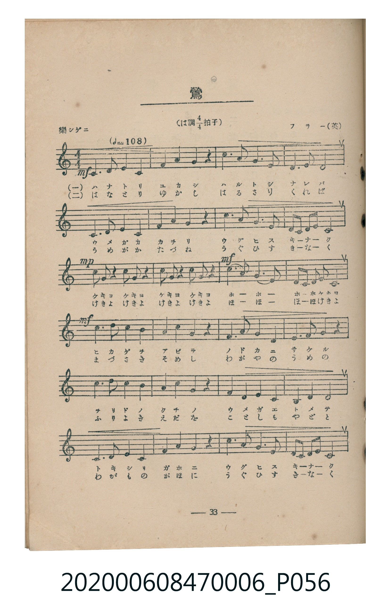
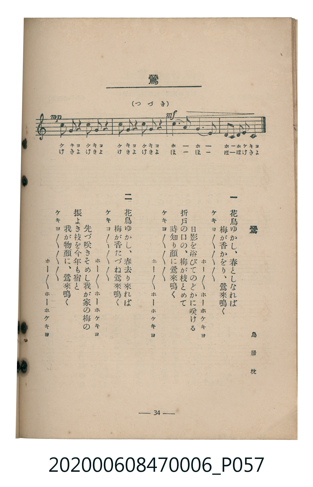

# 鶯

> Re:Shōka 使用 AI 協助辨識與重建樂譜，可能會有錯誤。歡迎回報。

- **鋼琴伴奏版**：<br><audio controls src="uguisu.mp3"></audio>
- **NEUTRINO 歌聲合成版**：<br><audio controls src="uguisu_neutrino.mp3"></audio>

- 詞：鳥居忱
- 曲：フラー（英）
- 臺灣教育會公認《新定兒童唱歌》尋常科第六學年用（2020.006.0847.0006）

## 說明

原書資訊與歌詞全文（對應 P056.jpg–P057.jpg，書頁 pp. 33–34，第三學期第 5 首）：
調性與拍號：は調四分之四拍子（C 大調 4/4 拍），「樂シゲニ」（♩=108）


## 歌詞

```text
一、
花鳥ゆかし、春としなれば
梅が香かをり、鶯來鳴く
ケキョ〳〵〳〵〳〵　ホー〳〵ホーホケキョ
日影を浴びてのどかに咲ける
折戸の口の、梅が枝とめて
時知り顔に鶯來鳴く
ケキョ〳〵〳〵〳〵　ホー〳〵ホーホケキョ

二、
花鳥ゆかし、春去り來れば
梅が香たづね鶯來鳴く
ケキョ〳〵〳〵〳〵　ホー〳〵ホーホケキョ
先づ咲きそめし我が家の梅の
振よき枝を今年も宿と
我が物顔に、鶯來鳴く
ケキョ〳〵〳〵〳〵　ホー〳〵ホーホケキョ
```

## ABC

<div class="abc-score" data-abc-src="uguisu.abc" aria-label="五線譜載入中"></div>

[下載 ABC 原始檔](uguisu.abc)

## TMD 檔案連結

- [主旋律 TMD 檔案](uguisu.tmd) [[在 TMD Studio 編輯](https://tmdlang.github.io/Tmd-TS/#tmd=s7IKdvYPcrWy4qpTUCpJTLdSSM7PyUlNLsnMz7MqzsjMK0nNjM_KTMmPL87Iz05Ugisry88pzU21Si9KTEmNN4s3MjAyiDcwMIs3sDAxBzIMzBBKi_NLi5JTrYqTM_Lzc-JLUitKkvLzsxHyBUX5Zal5iXlANQVFIBtTwIoQClLLMlNSQdLFyYl58WWpRZlpmakpSG5JLSoGuxdsUXxJUWJecXJRZgHIEwhV-UUlGflA9xZkVFplZBaX5BdlJifmxGcn5iF5qyQjFeirxLzM3MQcZK2Z6Zl5VrmpmVmZWDwAtbcgMT3VKsDA1EwXSJgrcWlpKbzctl5BS4tL0VbB0MCCy95WwZnLxkTfxA6k9cXKee_3zHq5eenTja1P928EG_ds9iag2OPmqY-bVz5u3vN-T8eL7o3v93SCJV-073reuPjZ1JkvmjY9m9P8tHXNi1W9jxu6nk3b8HTdrKetk56vXvp0ysZna3seN3Q_3dD9dMeO58snPl-z5mnr2qdrdzzdueX5lBVAI0FxpQeMIT1QXAEZBmZgG7j0tRRsqQW4FBQUnvbNfzZ7x4vN7S9WdL3oaAe6C-jlp60rnk1rB7ri6YbeZ-2dCqDw0ssqSH_UMBkUaiDm-z09QH0vFzQqFBToKRgbA6WMTYCCQJ882dEJ9MmzOfOBbAVThZfLpgGdDgwxkHUvVu1_1rAcZFF374uZ80Hh2LgeKPh09uynHW1PdnYDGUCpp2snAG13Vni6ZDlQUgEYGwpAUbAxwHDrebai6XHT9sdNmx43dz9uAIp3PJq50hYYe0AVXCBrnuxoeNzQCLawayMw9h43tT1u7H7cOB0o-mzG0seNK0DsxlWPm3oeN24AqXu2qPVxY8_LZTNB6pomPW7qAioFpown-9pebt7yuLEfpOhx08bHTWsfNy9_3LD5ccNWVLLhcfNsYHKAciFsIAnTArZk-tKne4H8Sc-2Ao3c_Lhx2ePGdY8bV4LdtvrppE2PGyc-buoGK-2a8axjB1D6af9ikCKgu8EufDZvLsj1TY1AzWB1M5uezwf6r-vlwilAM6jqYnBI7gIGOO6QfNq3G2g30EqsITn_cSMwrNdSOxiftnYADQYHV-_jxrngwJj-rGMi0Nqn67YBQwvshHVgx_Ssf9wEVN0LCremSU92dwFz2OOmpqfr9gODEawCrO9550pIANIg1inPqFCgoKXPxRWaXppZXGoVkJmYl-9QY1BTDbJCwcZCyw7MwFY-KIAzZcOLhT0KGiYKTzf0P1_foAPP1JpYNAAtAhlWo1Cdm1arYKigC4RGCsZAEsSuUTABkmZAbArEBmARwziwIjOwkC5QaQ1QA4QFoYGKwGb6GNYoAPM8WASYA4F4BYjV1AU2Bpi8wOLdYHI6kIyHiMN0NHVDdUDkQTKroDI9QPYGVLuMKLdrKpTdBZbpx2oX_pDf1UNOyJMd6IZgTRDtqIEO8i7I8Y1Adg_c6yAZcBA0TYIHDiwgoDoaJwDxJih7JlimFxqkIBISKKiBjtuu-WDeUjC5lgK7CCT3TvKSewEwuccBwxMUwHAGOKQxxCB5g7QomAjyzuOmdrCv0bjEyO-GmolgwURBJJIGzBihu9V4IwhYz5NfHkHC3CgOwjIHOwWUM8BcRPYAZRhY1IAKoRpwZtIFisPVIEUNLM2BMj0kJ4BIkEwTWHwzmFwGJGEhsg6qYyUsBzWuhspACw1QmAALEagOpLjYB5VfClULSeMgmblgmxvBYkhFUhO04AHmpcdNLWAWyHb0nAYSg9hFoEiaQlaRREK4g8IbUXSZgxwFEsJSF4CDGVLwgIIS2WsgTz9uXAgXQy4qYIEEKVw6oDKQ8h0iA4oq9EywFWFXE0gPIuAhvAVgWZCLYHZNBouDzQVHCLDxAI0SSDRAXAypkQin-ta1g6QugFWhvXBvQStFaIBC8jUoPVNcF6CkXUhegkUwtewiUBc0YwY6uBMzWhfQy-paLi5dOwVI21UByFLmAgA)]
- [鋼琴伴奏 TMD 檔案](uguisu_piano.tmd) [[在 TMD Studio 編輯](https://tmdlang.github.io/Tmd-TS/#tmd=s7IKdvYPcrWy4qpTUCpJTLdSyC8qychPL0osyKi0ysgsLskvykxOzInPTsxLVIIrKs4vLUpOjS9ITE-1CjAwNdMFEuZKXFpaCi-3rX-_p-Nl957nE7Y82bPl6dL-550d7_d0KmhpcSnaKhgaWHDZ2yo4c9mY6JvYgcx7sXLe-z2zXm5e-nRj69P9G8F2PJu9CSj2uHnq4-aVj5v3AA180b0RaAhY8kX7rueNi59NnfmiadOzOc1PW9e8WNX7uKHr2bQNT9fNeto66fnqpU-nbHy2tudxQ_fTDd1Pd-x4vnzi8zVrnraufbp2x9OdW55PWQE00sjAyEDPwMBMz8DCxBzIMDAD28AVml6aWVxqFZCZmJcf5OFQY1BTzaUABDYWWnZghr6Wgi06UACa_2RHw4uFPQoaoADRyypI18SiTEsfbESNQnVuWq2CoYIuEBopGANJELtGwQRImgGxKRAbgEUM48CKzMBCukClNUANEBaEBioCm-ljWKPwuHE9WORx4yogXgFiNXWBjXnc1AYW7waT04FkPEQcpqOpG6oDIg-SWQWV6QGyN6DaZUS5XVOh7C6wTD9Wu_CH964e4sOb7KA2BGuCaEcNapAnQU5uBLJ74B4GyYA93jQJHiQw70N1NE4A4k1Q9kywTC80IEEkJChQgxq3XfPBvKVgci0FdhFI2p2kJO0CYNKOA4YiKFjhDHD4YohB8gFpAT8R5InHTe1gv6JxiZHfDTUTwYKJgkgkDZjxQHer8UbL09mzSS1xICFtFAdhmYMdAMoFYC4iK4AyByxCQMVMDTjj6ALF4WqQIgSWvkDZGpLqQSRIpgksvhlMLgOSsHBYB9WxEpZbGldDZaDFAigkgMUEVAdSDOyDyi-FqoWkZ5DMXLDNjWAxpEKnCVq0APPN46YWMAtkO3quAolB7CJQ6EwhodAhIbRBoYwonMxBTgEJYSnjwYELKVpAAYjsIZBXHzcuhIshFwawoIEUHx1QGUi5DZEBRRB6gt-KsKsJpAcR3BDeArAsyEUwuyaDxcHmgqPhcRMoEYDcDQl8iIshNQ3hFN66dkDLeFiF2Av3DLSKgwYjJOeC0i7FZTxKOoXkG1i0UssuAmV8MyyozUfLeHpaXYva6PRBbnSaQBud8BZjtGEslAQm73iFaBMQ1wCZA5EzBXJNY0EUzHegDEKibnAuQolyFBNQeWAHEmMOsj-AkthdAtUJswTIBUqi-wNTtxGQYzSoQwEY27p2CpAIj_YByiPxgC4H8pS5AA)]

## 分析

```text
================================================================================
📊 TMD Song Profile: [ 鶯 ]
================================================================================
⏱  Duration:       1:02 (62.2s), 28 measures total
🎼 Key & Tempo:    首調基準 C, != 108.0 BPM, <4/4>
   - 分析範圍：      由實際發聲的音符與和弦推測調性；播放脈絡另行呈現
🎤 人聲音域:    B3 (MIDI 59) – D5 (MIDI 74) [跨度: 15 個半音 / 1.2 個八度, 難度: moderate]
   - 最低音:  B3 in [Uguisu #1 @ m.20, 0:42]
   - 最高音: D5 in [Uguisu #1 @ m.13, 0:27]
   - 適合: soprano, mezzo-soprano, contralto, tenor, baritone, bass
🏛  結構:      Uguisu (62.2s)
⚡ 編曲密度:        Peak 1 軌道同時演奏
🗝  調性診斷：       C 大調（純淨自然大調，未偵測到可信轉調）
   - 風格氣質:    純淨自然大調（陽光明朗、易唱易記，無明顯調外色彩）
   - 轉調歷程:    全曲維持單一推測調性（未偵測到可信轉調）
   - 核心骨幹音:  C, G, D, E, A
   - 調性數值:    C 大調 [相關度: 0.93, 穩定度: High, 自然音純度: 100.0%]
   - 候選調性 (K-S): C 大調 (0.93), C 小調 (0.62), G 大調 (0.61)
   - 五度圈歷程:   +0
   - 各段落調性細節:
     • [Uguisu #1]: C 大調 (r: 0.93, 自然音純度: 100.0%)

  [ 五度圈游移軌跡 ]
              [C ]*
         F            G  
      Bb               D  
      Eb               A  
         Ab           E  
            Db       B  
               F# 
     (* = active key center)

  [ 十二半音累積音高分佈 ]
     C  : ████████████████████████  37.8%
     C# :                            0.0%
     D  : ██████████                15.3%
     D# :                            0.0%
     E  : ███████                   10.7%
     F  : ████                       6.1%
     F# :                            0.0%
     G  : ████████████              18.9%
     G# :                            0.0%
     A  : █████                      8.2%
     A# :                            0.0%
     B  : ██                         3.1%
--------------------------------------------------------------------------------
Assignment 軌道音域：
  - Piano         : B3 – D5 (15 個半音 / 1.2 個八度, 108 個音符)
================================================================================
```


## 原書掃描頁






