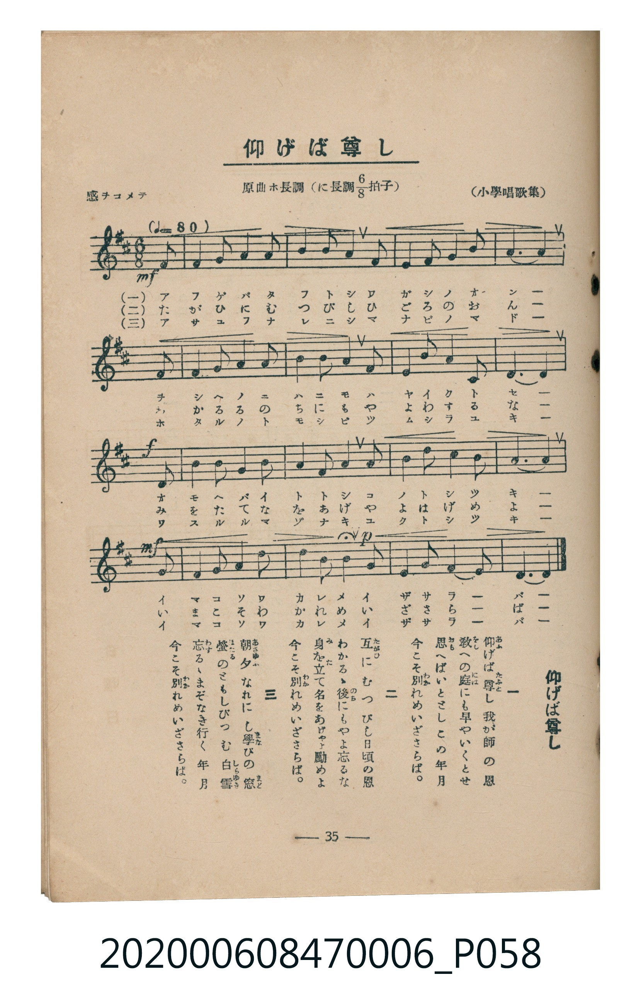

# 仰げば尊し

> Re:Shōka 使用 AI 協助辨識與重建樂譜，可能會有錯誤。歡迎回報。

- **鋼琴伴奏版**：<br><audio controls src="aogeba_totoshi.mp3"></audio>
- **NEUTRINO 歌聲合成版**：<br><audio controls src="aogeba_totoshi_neutrino.mp3"></audio>

- 小學唱歌集
- 臺灣教育會公認《新定兒童唱歌》尋常科第六學年用（2020.006.0847.0006）

## 說明

原書資訊與歌詞全文（對應 P058.jpg，書頁 p. 35，第三學期第 6 首）：
調性與拍號：原曲ホ長調，に長調八分之六拍子（D 大調 6/8 拍），「感ヲコメテ」（♩.=80）


## 歌詞

```text
一、
仰（あふ）げば尊（たふと）し　我が師の恩
教（をし）への庭（には）にも　早やいくとせ
思（おも）へばいと疾（と）し　この年月
今こそ別（わか）れめ　いざさらば。

二、
互（たがひ）にむつびし　日頃の恩
わかるゝ後（のち）にも　やよ忘るな
身（み）を立（た）て名（な）をあげ　やよ勵めよ
今こそ別（わか）れめ　いざさらば。

三、
朝夕（あさゆふ）なれにし　學（まな）びの窓（まど）
螢（ほたる）のともしび　つむ白雪（しらゆき）
忘（わす）るゝまぞなき　行く年月
今こそ別（わか）れめ　いざさらば。
```

## ABC

<div class="abc-score" data-abc-src="aogeba_totoshi.abc" aria-label="五線譜載入中"></div>

[下載 ABC 原始檔](aogeba_totoshi.abc)

## TMD 檔案連結

- [主旋律 TMD 檔案](aogeba_totoshi.tmd) [[在 TMD Studio 編輯](https://tmdlang.github.io/Tmd-TS/#tmd=s7IKdvYPcrWy4qpTUCpJTLdSSM7PyUlNLsnMz7MqzsjMK0nNjM_KTMmPL87Iz05Ugisry88pzU21Si9KTEmNN4s3MjAyiDcwMIs3sDAxBzIMzBBKi_NLi5JTrYqTM_Lzc-JLUitKkvLzsxHyBUX5Zal5iXlANQVFIBtTwIoQClLLMlNSQdLFyYl58WWpRZlpmakpSG5JLSoGuxdsUXxJUWJecXJRZgHIEwhV-UUlGflA9xZkVFplZBaX5BdlJifmxGcn5iF5qyQjFegrqFNzMtNS0aVSc_PRjc1Mz8yzys3PSyoFhhGGRHlqcUlqUV58bmpOfkoleqjEFySmp1oFGJhaKHFpaSk82b3hceOkx40bnm7oetw4XUFLi0vRVsHCgMveVsGFy8ZM38IOZMDTDf1P1-54OmXjs7U9L2e3gQ190b7reePiZ1Nnvmja9GxO89PWNS9W9T5u6Ho2bcPTdbOetk56vnopRMfjhu6nG7qf7tjxfPnE52vWPG1dCzJs55bnU1a839MBikk9YPzpgWISyDAwe7-nU4mLS19LwZZagEtBQeFp3_xns3e82Nz-YkXXi452oLterJz3tHXFs2ntQFc83dD7rL1TARQwelkF6e_39AAVv1zQqFCgp2BsCuQCHf5kRyfQ4c_mzAeyFcwUXi6bBnTp-z2zQKa_WLX_WcNykLndvS9mzgeKgu3b9Lh59sup24GyQCMeN66GsJ-2rn7a0fZkZzcwKIDqn66dAHSBi8LTJcuBkgrAQFcAioLNBoZdz7OW-Y-bNz1u2vy4eeHj5rbHDUCpjkczV-rZWhgAFXGBrH-yo-FxQyOYtXsDUPpxY9Pjxq1AWXjsggXnAwUfNwJDHSg-_XFDw7OOiY8be57uWP24cd2zxpUg_cAIBSltAmqbDla3Ayj3dNdasH6guvVgwdWPm5pA-qevfNzU8rgRiPqB5j5unA02omEuWHUXUBHMCGAyAypa8XzaPrAUwgmPGyeDLNi55dmcDoj7gQkRKDT3acdSsEOABneDVDf1PG5qBGsAGjTtcePUx01AIzY8bmiChMAuYFhBQmDXJJhngUG-CeZeoMYljxs3Qz0-fenLBc0IX0OsedwERHOf7usB61_3uHEhsmdBPm3qeLp_BkhZ4ypwrO9aDVYKjF2gA4EpHuhSkM1gbcueTgDFFFApRBYcJ5MQBnVvBXmoiTJf7-iE-vrZnLlPl0yFRT1QWRssAawCGQKKOpDHgQkYrGYf1FmgAFn3fNVkmOBKUIoC-WzeIrDQblA4NoGdAgqQFaCgABoE1AZy0xJgsD6fufflbKBZQMXTQY4DWQxKvOA8t38GzDfAVAWUA4Uv2J55IHc1AsuLhhcLga7rpywBALVRXkhAgYKWPheXY356alJiSH5JPrBOsgrITMzLd6gxqKkG2aRgY6FlB2ZgK6IUwAUFyFcKGk_3bHyxdbuCtoKJArAEfb6-QQdewGhi0Qm0GGRqjYIBHFbnptUqGAKFDBV0FYwUjIGkMZBnAqRNwDyQnHk8mGEEJE2BXJAwSBlYEmyij2GNQjwcAhMIUBUwdQBVABMkEG8As-Yjia4A4ukgVlM_WLQHLDodiNeBWV0g0abJYJtAEJi8YXYZodoFMRWifxMQrwarbgCLLgGLbobZBZQHiU4Bq-jFYxfQTRC7jLH5aypYTRvcL6vA-iEuWA23ax9Y7Sq4CyB2QURXIuxq3A20C39k7-oBRzaJcYwaoabguANFqxFUDsIDRi2EC4pMXYVqSGqARyrMMzvgHlgN9sB6mGebmsCs9eAgaAGzW4C4HxrJILWzkTwLDGp4JAJzHTggu8EYJLsOrH4hqtlAU0Fmd0AjBpjRobpgwQszez9SpIGSBdRsqLvBboG6FpTMNoNZS8CiDTDRpk5o1IJM6EVLEARyZCc5kQSJFlAkgTIWJHogeQ8iZxinYA6kzKBckDJgJIHyLDBSEbEE9RcoliBZDRxmQD-jZLXGyWBRWHjARMFhgOxbkG5ELAEzHiTzAiscMAuS3CGiTUAMZiHHEjA1wEQb4aIYZoNjCRaXsBQAyR7zoPZAXAWLD1iawu9uvLH0dPZscmIJVPAZQ7ILqDQERwM4IgrA8QCWh5SWsMwFyU0GKDlpHzQOgDUPLE3B80APOKwQMTcNzJ4KTZG6YDFQzEIgMM8i5SIamAuOG-qaW8vFpWungFLtKQAFlLkA)]
- [鋼琴伴奏 TMD 檔案](aogeba_totoshi_piano.tmd) [[在 TMD Studio 編輯](https://tmdlang.github.io/Tmd-TS/#tmd=s7IKdvYPcrWy4qpTUCpJTLdSyC8qychPL0osyKi0ysgsLskvykxOzInPTsxLVIIrKs4vLUpOjS9ITE-1CjAwtVDi0tJSeLJ7w-PGSY8bNzzd0PW4cfr7PR0vu_c8n7DlyZ4tT5f2P-_seL-nU0FLi0vRVsHCgMveVsGFy8ZM38IOZOrTDf1P1-54OmXjs7U9L2e3gW160b7reePiZ1Nnvmja9GxO89PWNS9W9T5u6Ho2bcPTdbOetk56vnopRMfjhu6nG7qf7tjxfPnE52vWPG1dCzJs55bnU1YAXWFkYGSgZ2BgpmdgYWIOZBiYAR2ixMXlmJ-empQYkl-SX5yRaRWQmZiXH-ThUKNrWFPNpQAENhZadmCGvpaCLTpQANrzZEfDi4U9ChqgENDLKkjXxKJMSx9sRI2CARxW56bVKhgChQwVdBWMFIyBpDGQZwKkTcA8kJx5PJhhBCRNgVyQMEgZWBJsoo9hjUI8HD5ubAKqety4FagCGAlAvAHMmo8kugKIp4NYTf1g0R6w6HQgXgdmdYFEmyaDbQLBx02TYHYZodoFMRWifxMQrwarbgCLLgGLbobZBZQHiU4Bq-jFYxfQTRC7jLH5aypYTRvcL6vA-iEuWA23ax9Y7Sq4CyB2QURXIuxq3A20C3_M7uohPmZRo9EUHGOgyDSCykF4wAiFcEFRqKtQDUkD8KiEeWEH3Nmrwc5eD_NiUxOYtR7s8RYwuwWI-6FRC1I7G8mLwACGR93jxm5w8HWDMUh2HVj9QlSzgaaCzO6ARsfjxplQXbBAhZm9HymqQIkBajbU3WC3QF0LSlybwawlYNEGmGhTJzRCQSb0oiUDApmuk_iogUQGKGpAmQgSKZB8BpEzjFMwB1JmUC5IGTBqQPkTGJWIuIH6BhQ3kGwFDimgT1GyVeNksCgsFGCiYJ8j-xGkGxE3wEwGyaiPG5eBWZCkDRFtAmIwCzlugGkAJtoIF8UwGxw3sBiExTskK8yD2gNxFSwWYCkJv7vxxs3T2bOJjxtQ0WYMyRqg8g4c-ODgLwCHPlgeUh7CMhIk5xig5Jp90JB_3DgXln7g6b0HHEKI-JoGZk-Fpj5dsBgoPiEQmD-RcgwNzAXHCHXNrcVai_lgrcWQqyBgGCoYxitEG8aCMRITmEuAHBMgB4hRxE3jgTzTeCAXRKDy0E1DxBJue5A4SFaiiFNuCZLJuCwxAjKNgEwgxuZJZFtICwJQQgYFNOkBB4xWXTsFlJiN9gEqwBQEOhpT0BgsqMwFAA)]

## 分析

```text
================================================================================
📊 TMD Song Profile: [ 仰げば尊し ]
================================================================================
⏱  Duration:       0:38 (38.2s), 17 measures total
🎼 Key & Tempo:    首調基準 D, != 80.0 BPM, <6/8>
   - 分析範圍：      由實際發聲的音符與和弦推測調性；播放脈絡另行呈現
🎤 人聲音域:    C#4 (MIDI 61) – D5 (MIDI 74) [跨度: 13 個半音 / 1.1 個八度, 難度: moderate]
   - 最低音:  C#4 in [AogebaTotoshi #1 @ m.4, 0:06]
   - 最高音: D5 in [AogebaTotoshi #1 @ m.12, 0:25]
   - 適合: soprano, mezzo-soprano, contralto, tenor, baritone, bass
🏛  結構:      AogebaTotoshi (38.2s)
⚡ 編曲密度:        Peak 1 軌道同時演奏
🗝  調性診斷：       D 大調（純淨自然大調，未偵測到可信轉調）
   - 風格氣質:    純淨自然大調（陽光明朗、易唱易記，無明顯調外色彩）
   - 轉調歷程:    全曲維持單一推測調性（未偵測到可信轉調）
   - 核心骨幹音:  D, F#, A, G, E
   - 調性數值:    D 大調 [相關度: 0.90, 穩定度: High, 自然音純度: 100.0%]
   - 候選調性 (K-S): D 大調 (0.90), F# 小調 (0.66), A 大調 (0.61)
   - 五度圈歷程:   +2
   - 各段落調性細節:
     • [AogebaTotoshi #1]: D 大調 (r: 0.90, 自然音純度: 100.0%)

  [ 五度圈游移軌跡 ]
               C  
         F            G  
      Bb              [D ]*
      Eb               A  
         Ab           E  
            Db       B  
               F# 
     (* = active key center)

  [ 十二半音累積音高分佈 ]
     C  :                            0.0%
     C# : █████████                  8.3%
     D  : ████████████████████████  22.9%
     D# :                            0.0%
     E  : ████████████              11.5%
     F  :                            0.0%
     F# : ██████████████████████    20.8%
     G  : ████████████████          15.6%
     G# :                            0.0%
     A  : █████████████████████     19.8%
     A# :                            0.0%
     B  : █                          1.0%
--------------------------------------------------------------------------------
Assignment 軌道音域：
  - Piano         : C#4 – D5 (13 個半音 / 1.1 個八度, 60 個音符)
================================================================================
```


## 原書掃描頁




