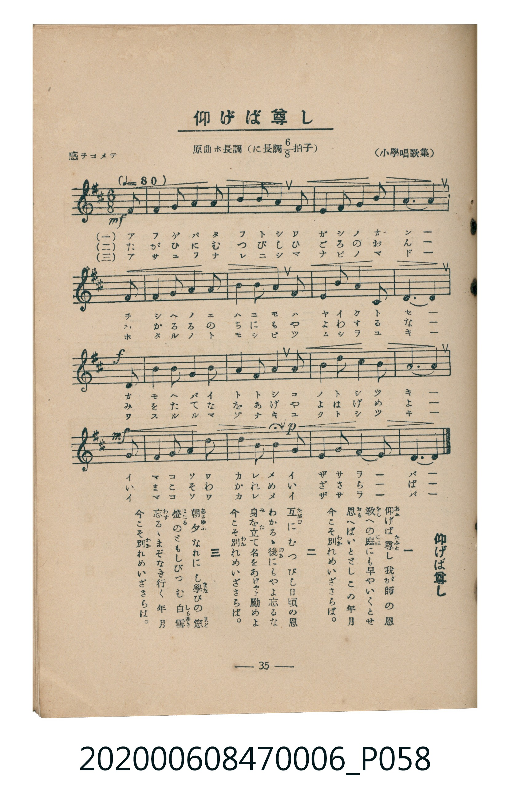

# 仰げば尊し

> Re:Shōka 使用 AI 協助辨識與重建樂譜，可能會有錯誤。歡迎回報。

- **鋼琴伴奏版**：<br><audio controls src="aogeba_totoshi.mp3"></audio>
- **NEUTRINO 歌聲合成版**：<br><audio controls src="aogeba_totoshi_neutrino.mp3"></audio>

- 小學唱歌集
- 臺灣教育會公認《新定兒童唱歌》尋常科第六學年用（2020.006.0847.0006）

## 說明

原書資訊與歌詞全文（對應 P058.jpg，書頁 p. 35，第三學期第 6 首）：
調性與拍號：原曲ホ長調，に長調八分之六拍子（D 大調 6/8 拍），「感ヲコメテ」（♩.=80）


## 歌詞

```text
一、
仰（あふ）げば尊（たふと）し　我が師の恩
教（をし）への庭（には）にも　早やいくとせ
思（おも）へばいと疾（と）し　この年月
今こそ別（わか）れめ　いざさらば。

二、
互（たがひ）にむつびし　日頃の恩
わかるゝ後（のち）にも　やよ忘るな
身（み）を立（た）て名（な）をあげ　やよ勵めよ
今こそ別（わか）れめ　いざさらば。

三、
朝夕（あさゆふ）なれにし　學（まな）びの窓（まど）
螢（ほたる）のともしび　つむ白雪（しらゆき）
忘（わす）るゝまぞなき　行く年月
今こそ別（わか）れめ　いざさらば。
```

## ABC

<div class="abc-score" data-abc-src="aogeba_totoshi.abc" aria-label="五線譜載入中"></div>

[下載 ABC 原始檔](aogeba_totoshi.abc)

## TMD 檔案連結

- [主旋律 TMD 檔案](aogeba_totoshi.tmd) [[在 TMD Studio 編輯](https://tmdlang.github.io/Tmd-TS/#tmd=s7IKdvYPcrWy4qpTUCpJTLdSSM7PyUlNLsnMz7MqzsjMK0nNjM_KTMmPL87Iz05Ugisry88pzU21Si9KTEmNN4s3MjAyiDcwMIs3sDAxBzIMzBBKi_NLi5JTrYqTM_Lzc-JLUitKkvLzsxHyBUX5Zal5iXlANQVFIBtTwIoQClLLMlNSQdLFyYl58WWpRZlpmakpSG5JLSoGuxdsUXxJUWJecXJRZgHIEwhV-UUlGflA9xZkVFplZBaX5BdlJifmxGcn5iF5qyQjFegrqFNzMtNS0aVSc_PRjc1Mz8yzys3PSyoFhhGGRHlqcUlqUV58bmpOfkqlEpeWlsKT3RseN0563Ljh6Yaux43TFbS0uBRtFSwMuOxtFVy4bMz0LexApjzd0P907Y6nUzY-W9vzcnYb2OQX7bueNy5-NnXmi6ZNz-Y0P21d82JV7-OGrmfTNjxdN-tp66Tnq5dCdDxu6H66ofvpjh3Pl098vmbN09a1IMN2bnk-ZcX7PR2g-NIDxpIeKL6ADAOz93s6lbi49LUUbKkFuBQUFJ72zX82e8eLze0vVnS96GgHuuvFynlPW1c8m9YOdMXTDb3P2jsVAgxMLfSyCtLf7-kBKn65oFGhQE_B2BTIBTr8yY5OoMOfzZkPZCuYKbxcNg3o0vd7ZoFMf7Fq_7OG5SBzu3tfzJwPFAXbt-lx8-yXU7cDZYFGPG5cDWE_bV39tKPtyc5uYFAA1T9dOwHoAheFp0uWAyUVgIGuABQFmw0Mu55nLfMfN2963LT5cfPCx81tjxuAUh2PZq7Us7UwACriAln_ZEfD44ZGMGv3BqD048amx41bgbLw2AULzgcKPm4EhjpQfPrjhoZnHRMfN_Y83bH6ceO6Z40rQfqBEQpS2gTUNh2sbgdQ7umutWD9QHXrwYKrHzc1gfRPX_m4qeVxIxD1A8193DgbbETDXLDqLqAimBHAZAZUtOL5tH1gKYQTHjdOBlmwc8uzOR0Q9wMTIlBo7tOOpWCHAA3uBqlu6nnc1AjWADRo2uPGqY-bgEZseNzQBAmBXcCwgoTArkkwzwKDfBPMvUCNSx43boZ6fPrSlwuaEb6GWPO4CYjmPt3XA9a_7nHjQmTPgnza1PF0_wyQssZV4FjftRqsFBi7QAcCUzzQpSCbwdqWPZ0AiimgUogsOE4mIQzq3gryUBNlvt7RCfX1szlzny6ZCot6oLI2WAJYBTIEFHUgjwMTMFjNPqizQAGy7vmqyTDBlaAUBfLZvEVgod2gcGwCOwUUICtAQQE0CKgN5KYlwGB9PnPvy9lAs4CKp4McB7IYlHjBeW7_DJhvgKkKKAcKX7A980DuagSWFw0vFgJd109ZAgBqo7yQgAIFLX0uLsf89NSkxJD8knxgzWMVkJmYl-9QY1BTDbJJwcZCyw7MwFZEKYALCpCvFDSe7tn4Yut2BW0FEwVgCfp8fYMOvIDRxKITaDHI1BoFAziszk2rVTAEChkq6CoYKRgDSWMgzwRIm4B5IDnzeDDDCEiaArkgYZAysCTYRB_DGoV4OAQmEKAqYOoAqgAmSCDeAGbNRxJdAcTTQaymfrBoD1h0OhCvA7O6QKJNk8E2gSAwecPsMkK1C2IqRP8mIF4NVt0AFl0CFt0MswsoDxKdAlbRi8cuoJsgdhlj89dUsJo2uF9WgfVDXLAabtc-sNpVcBdA7IKIrkTY1bgbaBf-yN7VA45sEuMYNUJNwXEHilYjqByEB4xaCBcUmboK1ZDUAI9UmGd2wD2wGuyB9TDPNjWBWevBQdACZrcAcT80kkFqZyN5FhjU8EgE5jpwQHaDMUh2HVj9QlSzgaaCzO6ARgwwo0N1wYIXZvZ-pEgDJQuo2VB3g90CdS0omW0Gs5aARRtgok2d0KgFmdCLliAI5MhOciIJEi2gSAJlLEj0QPIeRM4wTsEcSJlBuSBlwEgC5VlgpCJiCeovUCxBsho4zIB-RslqjZPBorDwgImCwwDZtyDdiFgCZjxI5gVWOGAWJLlDRJuAGMxCjiVgaoCJNsJFMcwGxxIsLmEpAJI95kHtgbgKFh-wNIXf3Xhj6ens2eTEEqjgM4ZkF1BpCI4GcEQUgOMBLA8pLWGZC5KbDFBy0j5oHABrHliagueBHnBYIWJuGpg9FZoidcFioJiFQGCeRcpFNDAXHDfUNbeWi0vXTgGl2lMACihzAQA)]
- [鋼琴伴奏 TMD 檔案](aogeba_totoshi_piano.tmd) [[在 TMD Studio 編輯](https://tmdlang.github.io/Tmd-TS/#tmd=s7IKdvYPcrWy4tLSUniye8PjxkmPGzc83dD1uHH6-z0dL7v3PJ-w5cmeLU-X9j_v7Hi_p1NBS4tL0VbBwoDL3lbBhcvGTN_CjqtOQenphv6na3c8nbLx2dqel7PblEBiL9p3PW9c_GzqzBdNm57NaX7auubFqt7HDV3Ppm14um7W09ZJz1cvheh43ND9dEP30x07ni-f-HzNmqeta0GG7dzyfMoKoCuMDIwM9AwMzPQMLEzMgQwDM6BDlLi4HPPTU5MSQ_JL8oszMq0CMhPz8oM8HGp0DWuquRSAwMZCyw7M0NdSsEUHCkB7nuxoeLGwR0EjwMDUQi-rIF0TizItfbARNQoGcFidm1arYAgUMlTQVTBSMAaSxkCeCZA2AfNAcubxYIYRkDQFckHCIGVgSbCJPoY1CvFw-LixCajqceNWoApgJADxBjBrPpLoCiCeDmI19YNFe8Ci04F4HZjVBRJtmgy2CQQfN02C2WWEahfEVIj-TUC8Gqy6ASy6BCy6GWYXUB4kOgWsohePXUA3QewyxuavqWA1bXC_rALrh7hgNdyufWC1q-AugNgFEV2JsKtxN9Au_DG7q4f4mEWNRlNwjIEi0wgqB-EBIxTCBUWhrkI1JA3AoxLmhR1wZ68GO3s9zItNTWDWerDHW8DsFiDuh0YtSO1sJC8CAxgedY8bu8HB1w3GINl1YPULUc0GmgoyuwMaHY8bZ0J1wQIVZvZ-pKgCJQao2VB3g90CdS0ocW0Gs5aARRtgok2d0AgFmdCLlgwIZLpO4qMGEhmgqAFlIkikQPIZRM4wTsEcSJlBuSBlwKgB5U9gVCLiBuobUNxAshU4pIA-RclWjZPBorBQgImCfY7sR5BuRNwAMxkkoz5uXAZmQZI2RLQJiMEs5LgBpgGYaCNcFMNscNzAYhAW75CsMA9qD8RVsFiApST87sYbN09nzyY-bkBFmzEka4DKO3Dgg4O_ABz6YHlIeQjLSJCcY4CSa_ZBQ_5x41xY-oGn9x5wCCHiaxqYPRWa-nTBYqD4hEBg_kTKMTQwFxwj1DW3Fmst5oO1FkOugoBhqGAYrxBtGAvGSExgLgFyTIAcIEYRN40H8kzjgVwQgcpDNw0RS7jtQeIgWYkiTrklSCbjssQIyDQCMoEYmyeRbSEtCEAJGRTQpAccMFp17RRQYjbaB6gAUxDoaExBY7CgMhcA)]

## 分析

```text
================================================================================
📊 TMD Song Profile: [ 仰げば尊し ]
================================================================================
⏱  Duration:       0:38 (38.2s), 17 measures total
🎼 Key & Tempo:    首調基準 D, != 80.0 BPM, <6/8>
   - 分析範圍：      由實際發聲的音符與和弦推測調性；播放脈絡另行呈現
🎤 人聲音域:    C#4 (MIDI 61) – D5 (MIDI 74) [跨度: 13 個半音 / 1.1 個八度, 難度: moderate]
   - 最低音:  C#4 in [AogebaTotoshi #1 @ m.4, 0:06]
   - 最高音: D5 in [AogebaTotoshi #1 @ m.12, 0:25]
   - 適合: soprano, mezzo-soprano, contralto, tenor, baritone, bass
🏛  結構:      AogebaTotoshi (38.2s)
⚡ 編曲密度:        Peak 1 軌道同時演奏
🗝  調性診斷：       D 大調（純淨自然大調，未偵測到可信轉調）
   - 風格氣質:    純淨自然大調（陽光明朗、易唱易記，無明顯調外色彩）
   - 轉調歷程:    全曲維持單一推測調性（未偵測到可信轉調）
   - 核心骨幹音:  D, F#, A, G, E
   - 調性數值:    D 大調 [相關度: 0.90, 穩定度: High, 自然音純度: 100.0%]
   - 候選調性 (K-S): D 大調 (0.90), F# 小調 (0.66), A 大調 (0.61)
   - 五度圈歷程:   +2
   - 各段落調性細節:
     • [AogebaTotoshi #1]: D 大調 (r: 0.90, 自然音純度: 100.0%)

  [ 五度圈游移軌跡 ]
               C  
         F            G  
      Bb              [D ]*
      Eb               A  
         Ab           E  
            Db       B  
               F# 
     (* = active key center)

  [ 十二半音累積音高分佈 ]
     C  :                            0.0%
     C# : █████████                  8.3%
     D  : ████████████████████████  22.9%
     D# :                            0.0%
     E  : ████████████              11.5%
     F  :                            0.0%
     F# : ██████████████████████    20.8%
     G  : ████████████████          15.6%
     G# :                            0.0%
     A  : █████████████████████     19.8%
     A# :                            0.0%
     B  : █                          1.0%
--------------------------------------------------------------------------------
Assignment 軌道音域：
  - Piano         : C#4 – D5 (13 個半音 / 1.1 個八度, 60 個音符)
================================================================================
```


## 原書掃描頁




