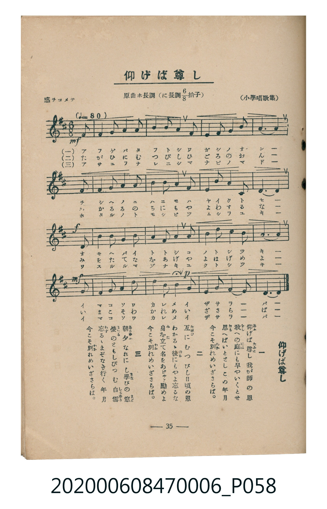

# 仰げば尊し

<audio controls src="aogeba_totoshi.mp3"></audio>

- 小學唱歌集
- 臺灣教育會公認《新定兒童唱歌》尋常科第六學年用（2020.006.0847.0006）

## 說明

原書資訊與歌詞全文（對應 P058.jpg，書頁 p. 35，第三學期第 6 首）：
調性與拍號：原曲ホ長調，に長調八分之六拍子（D 大調 6/8 拍），「感ヲコメテ」（♩.=80）

## 歌詞

```text
一、
仰（あふ）げば尊（たふと）し　我が師の恩
教（をし）への庭（には）にも　早やいくとせ
思（おも）へばいと疾（と）し　この年月
今こそ別（わか）れめ　いざさらば。

二、
互（たがひ）にむつびし　日頃の恩
わかるゝ後（のち）にも　やよ忘るな
身（み）を立（た）て名（な）をあげ　やよ勵めよ
今こそ別（わか）れめ　いざさらば。

三、
朝夕（あさゆふ）なれにし　學（まな）びの窓（まど）
螢（ほたる）のともしび　つむ白雪（しらゆき）
忘（わす）るゝまぞなき　行く年月
今こそ別（わか）れめ　いざさらば。
```

## ABC

```abc
X:1
T:仰げば尊し
M:6/8
L:1/16
Q:3/8=53
K:D
V:V1 name="Piano" snm="Pia"
[V:V1]
!mf! F4 F2 F4 G2 | A4 B2 A6 | B4 A2 G4 E2 | F6 E6 |
F4 F2 F4 G2 | A4 A2 B4 c2 | d4 c2 d4 B2 | A12 |
!f! B4 A2 G4 B2 | A4 F2 D6 | E4 E2 B4 E2 | F12 |
!mf! D4 E2 F4 G2 | !p! A4 B2 A4 D2 | F4 G2 F4 E2 | D12 |
```

## TMD 檔案連結

- [主旋律 TMD 檔案](aogeba_totoshi.tmd) [[在 TMD Studio 編輯](https://tmdlang.github.io/Tmd-TS/#tmd=s7IKdvYPcrWy4tLSUniye8PjxkmPGzc83dD1uHG6gpYWl6KtgoUBl72tgguXjZm-hR1XnYLS0w39T9fueDpl47O1PS9ntymBxF6073reuPjZ1JkvmjY9m9P8tHXNi1W9jxu6nk3b8HTdrKetk56vXgrR8bih--mG7qc7djxfPvH5mjVPW9eCDNu55fmUFe_3dBgZGBnoGRiY6RlYmJgDGQZm7_d0KnFx6Wsp2FILcCkoKDztm_9s9o4Xm9tfrOh60dEOdNeLlfOetq54Nq0d6IqnG3qftXcqBBiYWuhlFaS_39MDVPxyQaNCgZ6CsSmQC3T4kx2dQIc_mzMfyFYwU3i5bBrQpe_3zAKZ_mLV_mcNy0Hmdve-mDkfKAq2b9Pj5tkvp24HygKNeNy4GsJ-2rr6aUfbk53dwKAAqn-6dgLQBS4KT5csB0oqAANdASgKNhsYdj3PWuY_bt70uGnz4-aFj5vbHjcApToezVypZ2thAFTEBbL-yY6Gxw2NYNbuDUDpx41Njxu3AmXhsQsWnA8UfNwIDHWg-PTHDQ3POiY-bux5umP148Z1zxpXgvQDIxSktAmobTpY3Q6g3NNda8H6gerWgwVXP25qAumfvvJxU8vjRiDqB5r7uHE22IiGuWDVXUBFMCOAyQyoaMXzafvAUggnPG6cDLJg55Znczog7gcmRKDQ3KcdS8EOARrcDVLd1PO4qRGsAWjQtMeNUx83AY3Y8LihCRICu4BhBQmBXZNgngUG-SaYe4Ealzxu3Az1-PSlLxc0I3wNseZxExDNfbqvB6x_3ePGhcieBfm0qePp_hkgZY2rwLG-azVYKTB2gQ4EpnigS0E2g7UtezoBFFNApRBZcJxMQhjUvRXkoSbKfL2jE-rrZ3PmPl0yFRb1QGVtsASwCmQIKOpAHgcmYLCafVBngQJk3fNVk2GCK0EpCuSzeYvAQrtB4dgEdgooQFaAggJoEFAbyE1LgMH6fObel7OBZgEVTwc5DmQxKPGC89z-GTDfAFMVUA4UvmB75oHc1QgsLxpeLAS6rp-yBADURnkhAQUKWvpcXI756alJiSH5JfnFGZlWAZmJefkONQY1CtUgqxRsLLTswAxsZZQCuKQAeUtBw0QBWHI-X9-gAy9YNLFoAFoIMgxoem5arYKxgi4Qg0gToJApkDYDk7pAnhmQNAWK6yoYAXkgNSAWWA6cHHA7aFcPOQ7CdIsp2A3mQJ5hHJgBpsygsjBIyDU7OskKHmDoIEIAZqexgiE0dEAhYQRWgQgdotzzdPZssqMLZLkRPIiqC2qRoswQ6gwTMAlyFMSpMEfVcnHp2imgpDUFoIAyFwA)]
- [鋼琴伴奏 TMD 檔案](aogeba_totoshi_piano.tmd) [[在 TMD Studio 編輯](https://tmdlang.github.io/Tmd-TS/#tmd=s7IKdvYPcrWy4tLSUniye8PjxkmPGzc83dD1uHH6-z0dL7v3PJ-w5cmeLU-X9j_v7Hi_p1NBS4tL0VbBwoDL3lbBhcvGTN_CjqtOQenphv6na3c8nbLx2dqel7PblEBiL9p3PW9c_GzqzBdNm57NaX7auubFqt7HDV3Ppm14um7W09ZJz1cvheh43ND9dEP30x07ni-f-HzNmqeta0GG7dzyfMoKoCuMDIwM9AwMzPQMLEzMgQwDM6BDlLi4HPPTU5MSQ_JL8oszMq0CMhPz8oM8HGoMahSquRSAwMZCyw7M0NdSsEUHCkB7nuxoeLGwR0EjwMDUQi-rIF0TizItfbARQDNz02oVjBV0gRhEmgCFTIG0GZjUBfLMgKQpUFxXwQjIA6kBscByXPidsauHeGdgusAUbLM5kGcYB2aAKTOoLAwScsOOThKCAhgSCN_CbDJWMISGBMjXRmAViJAgyhVPZ88mMUJAVhrBg6O6oBYpUgyhlpuASZBTIA6EOaUWaxLywZqEYNbFK0QbxoIxEhNoMA5xEyDHBMgBYiMg0wjIBGIU9abxQLZpPJADImqgthFhEZLZwAgAGQIyA80iVNNBPIjfERGJZAyKibhcgGQ8KTbhCz1QtCHZjSKHaSxSYKGZCI9WXTsFlJhVwCagzAUA)]

## 分析

```text
================================================================================
📊 TMD Song Profile: [ 仰げば尊し ]
================================================================================
⏱  Duration:       0:36 (36.0s), 16 measures total
🎼 Key & Tempo:    首調基準 D, != 80.0 BPM, <6/8>
   - 分析範圍：      由實際發聲的音符與和弦推測調性；播放脈絡另行呈現
🎤 人聲音域:    D4 (MIDI 62) – D5 (MIDI 74) [跨度: 12 個半音 / 1.0 個八度, 難度: easy]
   - 最低音:  D4 in [AogebaTotoshi #1 @ m.10, 0:21]
   - 最高音: D5 in [AogebaTotoshi #1 @ m.7, 0:13]
   - 適合: soprano, mezzo-soprano, contralto, tenor, baritone, bass
🏛  結構:      AogebaTotoshi (36.0s)
⚡ 編曲密度:        Peak 1 軌道同時演奏
🗝  調性診斷：       D 大調（純淨自然大調，未偵測到可信轉調）
   - 風格氣質:    純淨自然大調（陽光明朗、易唱易記，無明顯調外色彩）
   - 轉調歷程:    全曲維持單一推測調性（未偵測到可信轉調）
   - 核心骨幹音:  F#, A, D, B, E
   - 調性數值:    D 大調 [相關度: 0.83, 穩定度: Moderate, 自然音純度: 100.0%]
   - 候選調性 (K-S): D 大調 (0.83), F# 小調 (0.78), A 大調 (0.64)
   - 五度圈歷程:   +2
   - 各段落調性細節:
     • [AogebaTotoshi #1]: D 大調 (r: 0.83, 自然音純度: 100.0%)

  [ 五度圈游移軌跡 ]
               C  
         F            G  
      Bb              [D ]*
      Eb               A  
         Ab           E  
            Db       B  
               F# 
     (* = active key center)

  [ 十二半音累積音高分佈 ]
     C  :                            0.0%
     C# : ██                         2.1%
     D  : ███████████████           16.7%
     D# :                            0.0%
     E  : █████████                 10.4%
     F  :                            0.0%
     F# : ████████████████████████  27.1%
     G  : ███████                    8.3%
     G# :                            0.0%
     A  : ████████████████████      22.9%
     A# :                            0.0%
     B  : ███████████               12.5%
--------------------------------------------------------------------------------
Assignment 軌道音域：
  - Piano         : D4 – D5 (12 個半音 / 1.0 個八度, 51 個音符)
================================================================================
```


## 原書掃描頁




